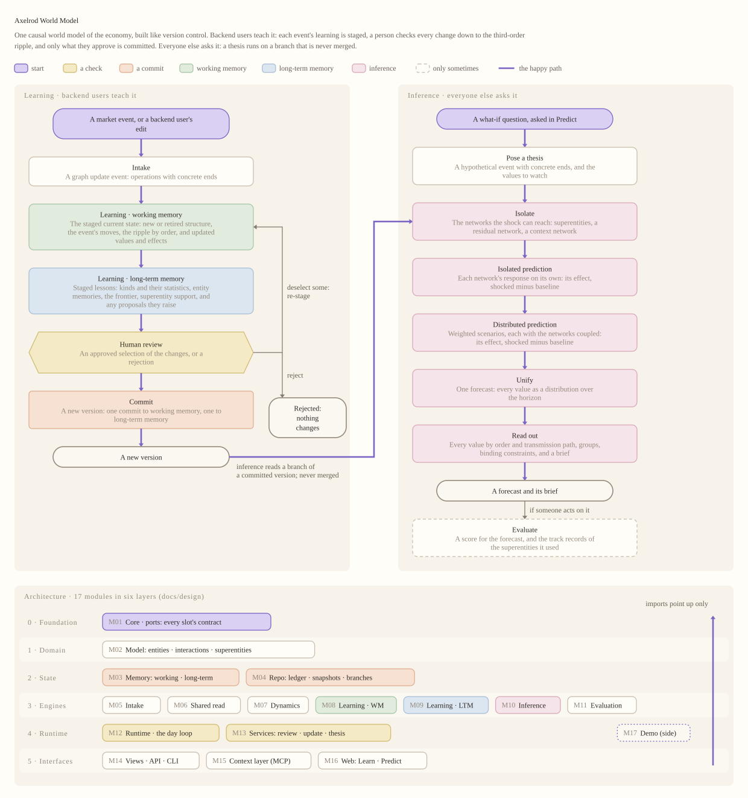

# karthik-init-world-model

The **Axelrod World Model**, v0. It is one causal world model of the economy, built like version control:

- **Backend users** teach it (the Learn view). Each event's learning runs on a staged copy, first working memory and then long-term memory. A person checks everything it would commit, down to the second- and third-order ripple. They keep what makes sense, and only that is committed.
- **Everyone else** only asks it (the Predict view). A thesis runs on a branch of a committed version that is never merged.



The repository has two parts:

- **`axelrod_wm`**, a Python package. It holds a causal graph of actors in an environment of actors:
  - **entities**: companies, agencies, and the economic ideas they act in;
  - **subentities**: each entity's values;
  - **interactions**: causal relations with uncertain effects and timing;
  - **superentities**: schemas such as sectors, rivalries, and shocks.
- **A browser demo** in `web/`, in two sizes. The **small demo** builds a world model from a blank canvas, one feature at a time. The **production demo** shows the same features in the oil-shock world, after three years of synthetic history. Its **How it works** pane (in the top bar) explains the model:
  - **Learning:** the five stages of learning, each with its own flowchart, ending in a person's review and the commit;
  - **Inference:** the six stages that answer a what-if question, each with its own flowchart; inference never writes;
  - **Literature:** the literature review;
  - **Implementation:** the ML stack and every component's inputs and outputs.

**All news, data, and numbers are synthetic.** Real company and agency names make the graph concrete. No headline reports a real event, and nothing in it is a claim about any company. The Fed chair is a role, not a person.

## Requirements

- [uv](https://docs.astral.sh/uv/) (`curl -LsSf https://astral.sh/uv/install.sh | sh`). uv installs Python 3.12, as pinned in `.python-version`.
- A browser for the demo. d3 v7 is vendored in `web/vendor/`.

## The two demos

```bash
uv sync
uv run axelrod small_demo              # a blank canvas at http://127.0.0.1:8765
uv run axelrod small_demo 9            # open at example 9: examples 1–8 are played first, and 9 waits for review
uv run axelrod prod_demo ripple        # the same examples in the busier oil-shock world (an id works as well as a number)
uv run axelrod small_demo --list       # the examples, and how many "more like this" events each has
uv run axelrod small_demo --headless   # every example's review, printed in the terminal
```

**Examples** in the top bar lists 24 examples. Most show one feature of the framework through one or more sample articles; two show a backend user adding what they know with no article at all. Each title names the idea it tests (for example, "Analogy: a new shock recalls an old one"):

| Memory | Examples |
|---|---|
| Working memory | 1 create an entity · 2 links inside an entity · 4 a shock and its ripple, by order · 7 an observation teaches an effect · 14 evidence weakens a link · 23 delete a link |
| Your own knowledge (no article) | 5 add an entity, its value, and an interaction from experience · 9 connect your idea to the rest, at half confidence (example 10's ripple then runs through it) |
| Intake | 3 a fuzzy mention, refined to one value · 12 an ambiguous mention stays fuzzy |
| Long-term memory | 8 a new member inherits its kind's priors · 10 an actor's decision goes into its entity memory · 11 a later shock recalls an earlier one · 13 later evidence settles a fuzzy end · 15 a recurring group is proposed as a superentity · 16 a correlation gains strength · 17 a co-movement is proposed as a link · 18 a crowded kind splits · 19 collapse · 20 nest two superentities in one · 21 expand · 22 delete a superentity the model provided |
| Review | 6 many new items: keep only some |
| Inference | 24 a what-if question |

How the examples run:
- **They form one chain.** Running example *n* plays examples 1 to *n* − 1 first. Running an earlier example rewinds to it and replays the decisions you made on the earlier ones.
- **More like this.** Under an example, **More like this** adds further articles of the same kind to the current state.
- **The review.** Every example stops at **Review**. It is grouped by stage, each in its stage's color:
  - **Intake:** the article, with the phrases that asked for each change marked;
  - **Working memory:** every change, one checkbox each; what recall brought back; the ripple, by order and path, where each value's ripple can be deselected or given the probability it arrives; what the fold learns;
  - **Long-term memory:** what it learns, and any proposals it raises;
  - **Your review:** approve all, some, or none. Nothing in either memory changes until you do.
- **The canvas.** Staged items have a dashed outline, retired ones a red outline, and moved values are tinted by order. Approve all of it, some of it, or none.
- **Your own knowledge.** ☰ → **Add from your own knowledge** opens a form for an entity, its values (a typical level and spread set the prior), interactions (sign, size, timing), why you believe it, and your confidence. It is staged and reviewed like an article, with no article needed; your reason is kept as the evidence on what it adds. The manual examples open it prefilled.
- **Your confidence.** A slider sets your confidence in the article (100% takes it as stated), and any change can have its own. It goes into the data the approval writes: an interaction's existence and evidence, a report's weight, a move's expected size, and a record on each new entity and value.
- **Fuzzy ends stay fuzzy.** A mention binds only when the article names its target. Otherwise it is hedged across its candidates, with a share for one not in the graph yet, and drawn as soft interactions as strong as they are probable. Later articles move the odds, and a resolution comes back for review once one candidate passes the bound.

- **Open nodes.** Every node carries an empty dashed node: what the graph does not explain yet. For a value, it is the share of its recent movement no interaction explains. For a kind in long-term memory, it is the chance that the next item is a kind not seen yet. Larger rings are blind spots.
- **Checks (C).** This pane shows what the model is testing now: fuzzy ends, co-movements, and candidate superentities, each with its progress toward its bound. It also says when each kind of check runs, how it works, and exactly what it updates. The timeline's middle lane marks each day's checks: filled if they passed, hollow if one failed.
- **Find (/).** It filters by meaning over entities, values, interactions, and superentities. It takes words ("airline", "rates") and filters ("moved", "open>0.8", "learned", "kind:company"). It can widen to neighbors one and two hops out.
- **Levels ([ ]).** The path above the canvas names each level of superentities within superentities; example 20 nests two of them.
- **Auto, Color, the lens.** With Auto on, detail follows zoom. Color (K) colors pills by change, blind spots, or category, and holds the key. The hover card draws what the cursor is on.

A one-minute video of the learning process is at [docs/media/axelrod-learning-60s.mp4](docs/media/axelrod-learning-60s.mp4). It is wordless, with music and text on screen. `scripts/video/` records it again from the small demo: music, footage, and the edit.

The production demo needs the oil world's history the first time, which takes about two minutes. After that it starts in seconds.

## The full demo

```bash
uv run axelrod demo --port 8765            # the oil-shock scenario: 53 real actors and ideas, 18 scripted steps
```

The first start replays three years of synthetic history (about two and a half minutes) and caches it in `var/oil_shock_demo/`. Later starts take a few seconds. The cache rebuilds itself when the data, config, or engine code changes.

| Do this | To |
|---|---|
| **Learn / Predict**, top left | switch views. Predict hides everything that learns, and Ask becomes the main action. |
| Hover, click, double-click, right-click | see what something is, inspect it, open an entity or superentity, and see every option |
| **Update** or `U`; **Step ▸** or `→`; **Play** or `Space` | read news and data up to a date, or follow the scripted demo. A run pauses when something needs review. |
| **Review** (shown when something waits) | the staged review of each waiting change; approve all, some, or none |
| **How it works** or `H` | learning and inference, each stage with its flowchart; the literature; the implementation |
| **☰** | everything else: News, Briefs, Ask, Long-term memory, the Console, Admin, shortcuts |
| **Console** or `I` (Learn) | the commit log: every commit (process, memory, who vetted it), one commit, a diff, or an old version |
| Right-click, Learn view | **Group into a superentity**, **Dissolve it**, or **Retire** an entity or interaction. Each is staged and waits for review. |
| **Ask** or `Q`; **Briefs** or `B` | pose a thesis and forecast values, actors, sectors, superentities, or categories; read the brief |
| **Memory** or `M` | long-term memory: object generalizations, interaction generalizations, entity memories, the correlation frontier, prior states |
| `?` | every shortcut |

## The model from the command line

```bash
uv run axelrod flows --svg docs/flowchart.svg              # learning's and inference's stages and their flowcharts, as text; learning's overview as a picture
uv run axelrod contracts                                   # every component's inputs, outputs, and writes
uv run axelrod init oil_shock_demo                         # build the init snapshot and start a session in var/axelrod
uv run axelrod update --until 2026-02-02 --auto-approve    # fold news and data through Feb 2 into that session
uv run axelrod log --limit 20                              # the session's commits, newest first
uv run axelrod show <version>                              # one commit
uv run axelrod diff <from> [<to>]                          # what changed between two versions
uv run axelrod run-scenario oil_shock_demo --headless --auto-approve   # all 18 steps and the 17-item checklist
```

## Documentation

The demo is the documentation: **How it works** for the stages of learning and of inference and their flowcharts, the literature review, and the implementation. In `docs/`:

- [architecture.md](docs/architecture.md): a map from the code to its processes, and the invariants;
- [flowchart.svg](docs/flowchart.svg): the flowchart as a picture;
- [plan.md](docs/plan.md): the original specification, which the code's § references point to.

## Layout

```text
src/axelrod_wm/   model/ memory/ events/ repo/ intake/ shared/ dynamics/ learning/ inference/ engine/
                  control/ flows/ evaluation/ sim/ api/ trace.py cli.py
web/              index.html literature.md implementation.html css/ js/{graph,panels,animator,charts}/ vendor/
data/             worlds/{economy,small_demo}/ taxonomy/ scenarios/{oil_shock_demo,small_demo,prod_demo}/
docs/             architecture.md flowchart.svg plan.md
configs/          default.yaml demo.yaml small_demo.yaml
tests/            unit/ integration/ scenario/ ui/
var/              runtime data: init caches, sessions, snapshots, ledger, traces (gitignored)
```

## Tests

```bash
uv run pytest                              # unit, scenario, and API tests
uv run pytest --runslow                    # also the full checklist run, every slot alternative, and the browser smoke test
uv run ruff check src tests
uv run --with playwright pytest tests/ui --runslow   # the smoke test alone (run `playwright install chromium` once)
```

## Configuration

- `configs/default.yaml` picks one component per slot. To swap one in, copy the file, edit `components:`, and pass `--config`.
- `configs/demo.yaml` and `configs/small_demo.yaml` hold each scenario's overrides. Both demos review every change (`review_all`).
- `data/worlds/<world>/` holds a world's construction files. `data/taxonomy/objects.yaml` gives each kind of firm its default values and links.
- `data/scenarios/<scenario>/` holds a script, seeds, a layout, market events and their reviewed translations, and the synthetic world's truth. The small demo is a blank canvas (`canvas: blank`). The production demo builds on `oil_shock_demo` (`base:`). Their examples, articles, and "more like this" events are in `src/axelrod_wm/sim/examples/`.
- Choices where the plan was silent carry `# DECISION:` comments. `grep -rn DECISION src configs data web` lists them.

## Railway deployment

See [.railway/README.md](.railway/README.md) for the dev infrastructure, deployment,
persistent storage, and validation workflow.
