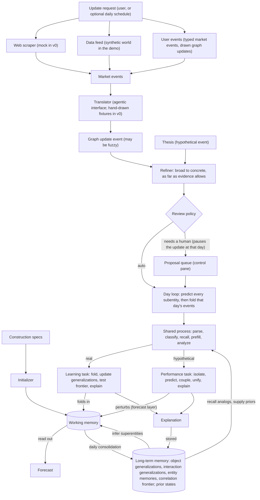

# Axelrod World Model: Implementation Plan (v0, revision 2)

> **Historical.** This is the specification the repository was first built from; the code's § references point here. The code has moved on since, for example to two demos with examples, a staged review at the end of learning, and a hosted deployment with auth (which §1.3 lists as non-goals). Where they differ, the code and the other pages in `docs/` are current: start at [../README.md](../README.md); the design of record is [../design/README.md](../design/README.md).

**For:** a coding agent (Claude Code) that will build the repository from scratch, and Manav and Karthik reviewing it.
**Sources:** the "World Model" architecture page (Figures 1–6 and its definitions), the Oct 4, 2026 Manav/Karthik notes, the Axelrod vision, and the design answers recorded in §2.
**Deliverables:** a Python package, `axelrod_wm`, whose algorithms plug in behind interfaces, and a locally hosted browser demo. The demo shows market events turning into graph update events and landing in the graph, with a human approving changes.
**Revision 2:** the engine runs on a daily grid (D13); the main loop is an update the user requests, fed by a mock web scraper and the user's own events (D14); long-term memory now has Figure 1's four parts (D15); D5 and D12 are confirmed.

---

## 0. Instructions for the coding agent

Build the repository in the milestone order of §16. Run each milestone's tests before moving on. Do not start the front end (M9) until the headless scenario run (M7) passes.

Rules:

1. **Python 3.11+, managed with `uv`.** Runtime dependencies: `numpy`, `scipy`, `pydantic>=2`, `networkx`, `pyyaml`, `fastapi`, `uvicorn[standard]`, `typer`. Dev dependencies: `pytest`, `ruff`, `httpx`. Do not add others without a `# DECISION:` comment saying why.
2. **Records are pydantic v2 models, and strategies are ABCs.** Every process step in §8 is an abstract class with one default implementation registered by name (§8.1). The engine only calls the abstract classes.
3. **Keep the names in this plan.** Class names, registry names, config keys, enum values, and JSON field names are a contract between the engine, the API, the front end, and the fixtures. Adding things is fine; renaming is not.
4. **One writer.** Every change to working or long-term memory goes through `GraphMutator` (§7.7). It records a `ChangeSet` in the ledger and bumps the state version. Nothing else mutates memory.
5. **Explicit randomness.** All sampling uses the `numpy.random.Generator` in `ProcessContext`. Never call `np.random.*` module functions. The same seed, state version, and config must give identical outputs.
6. **Trace what the UI shows.** Each stage emits trace events through `ctx.tracer` (§10). The front end never computes model results. It renders API views and replays traces.
7. **No build step for the front end.** Use plain HTML, CSS, and ES modules, with d3 v7 vendored in `web/vendor/`.
8. **When this plan is silent,** pick the simplest option that keeps the interfaces intact and leave a `# DECISION:` comment.

These commands must work at the end:

```bash
uv sync
uv run pytest
uv run axelrod run-scenario oil_shock_demo --headless --auto-approve   # prints the checklist in §15.3
uv run axelrod init oil_shock_demo                                      # builds the state in var/axelrod
uv run axelrod update --until 2026-02-02 --auto-approve                 # one update run (§7.8)
uv run axelrod demo                                                     # serves http://127.0.0.1:8000
```

---

## 1. Scope

### 1.1 Vision

> Build a financial world model that grounds financial agents' decisions today by maintaining an evidence-backed, continuously evolving causal state layer of markets, companies, macro variables, policies, events, and transmission paths. The model should monitor new information, update causal relationships with measurable but imperfect estimates of probability, impact magnitude, lag, delay, duration, confidence, and supporting evidence, then expose that state for scenario simulation and decision review. Over time, every recommendation should be traceable to the point-in-time world model state that produced it, turning decisions and outcomes into a learning loop for better future reasoning.

### 1.2 Goals for v0

| ID | Goal | Where |
|---|---|---|
| G1 | Implement every element of the main architecture diagram (Figure 1) in code, with each process step behind an interface and a working default. | §4.2, §8 |
| G2 | Run the performance task in three steps: isolate the networks relevant to a hypothesized event, predict within each network and across networks using prior events, and unify those predictions into one forecast. | §8.9 |
| G3 | Run the main loop on request: the user asks for an update, a web scraper (mocked) collects new market events, the user can add their own, and everything is translated, refined from broad to concrete as far as evidence allows, reviewed by a human where needed, and folded in day by day. | §7 |
| G4 | Ship a local browser demo: a canvas with gravity and semantic zoom, a control pane for updates and human review, a scenario simulator, and an animator that replays the engine's trace. | §11, §13 |
| G5 | Make results traceable. Every forecast and recommendation records the state version that produced it, and any version can be restored. | §8.15, §9 |
| G6 | Keep everything on a daily grid: the state of every subentity, observed or not, is propagated each day an update covers. | §8.6 |

### 1.3 Non-goals for v0

- Real web scraping and live data feeds. The scraper is a mock over a fixture corpus, and the demo's data comes from a synthetic world. Real sources plug in behind the same interfaces later.
- A working LLM translator. v0 ships the interface and a stub.
- Databases, auth, multiple users, and deployment.
- Strong algorithms. Defaults are simple and explainable so better ones can replace them.

---

## 2. Design decisions

D1–D4 come from the Oct 4 Q&A, and D13–D14 from the follow-up. D5 and D12 were proposed in this plan and confirmed in the follow-up. The others are choices made in this plan, and each is easy to change.

| ID | Decision | Consequence in code |
|---|---|---|
| D1 | **A network is a bound superentity.** It is a recalled superentity's interactions, bound to the concrete entities the event touches. Single-network prediction runs inside one network, and distributed prediction runs over the edges between networks. | `Network` wraps a `SuperentityInstance` (§8.9). A residual network covers direct effects that no superentity covers. |
| D2 | **Add channels and mix rivals.** Networks that act through different paths add their effects. Networks that disagree about structure become weighted alternative scenarios. | `ChannelsAndRivalsUnifier` (§8.9.4) |
| D3 | **Refine as far as evidence allows.** An update moves down the generalization taxonomies to the most specific level that clears the recall threshold. Anything finer stays fuzzy until later events support it. | `TaxonomyRefiner` and `PendingRefinement` (§7.5) |
| D4 | **A hypothesis's informational value is its value of information.** It measures how much the forecasts agents care about would move if the hypothesis held, times how unsure the model is. The value decays on a half-life, and updates that touch the hypothesis's entities re-score it. | `ForecastSensitivityVOI` (§8.11) |
| D5 | **The performance task updates the state into a forecast by writing a forecast layer, and never edits learned posteriors** (confirmed). Writing the layer is Figure 1's "perturbs" arrow, and building the `Forecast` from the layer is its "read out" arrow. A what-if never carries into learned state, even if it later happens. | `WorkingMemory.forecast_layer` (§6.12), §8.9.5 |
| D6 | **Propagation works in standardized deviations in link space.** Each subentity has a link function (identity, log, or logit, set by its distribution family) and a `scale`. Effects are measured in target standard units per source standard unit. | §6.3, §8.5 |
| D7 | **The default dynamics are one dynamic linear model, used both ways.** Each subentity is a local level plus the kernel-weighted responses of its in-channels to changes in their sources. Learning filters this model (Kalman). Forecasting simulates it forward from the current state (Monte Carlo), so past events keep unfolding in every forecast. Nonlinear models can plug in behind `Propagator` and `Folder`. | §8.5, §8.6 |
| D8 | **The model is event-sourced.** The ledger stores every input and every resulting `ChangeSet`, and snapshots are taken at the end of every update and every 30 simulated days. The version number bumps only when learned state changes, so posing forecasts never bumps it. A forecast's explanation waits in the forecast layer and moves into long-term memory at the next consolidation. Forecasts record the version they used. | §9 |
| D9 | **Superentities are bound during prefill and counted at consolidation.** Prefill binds patterns to the event's entities, forming new instances and dissolving stale ones. The support that admits or dissolves a pattern is counted at the daily consolidation, at most once per evidence spacing, so one shock that lasts for weeks counts as one piece of evidence rather than one per day. | §8.8 |
| D10 | **Fuzzy ops never propagate.** An op that stays abstract updates generalization statistics and waits as a pending refinement. Only concrete interactions carry effects. | §7.5 |
| D11 | **The demo seeds S1–S7 from Figure 1, plus a rival pair (S8, S9) and two history patterns (HP1, HP2), as patterns with `origin=seed`.** Unsupervised discovery shows up live, as a new superentity that forms during the demo, and in tests. | §14.4 |
| D12 | **Structural change needs human review by default** (confirmed). Data observations apply automatically. New entities, subentities, interactions, promotions, admissions, dissolutions, and changes derived from news wait for a human. | §7.6 |
| D13 | **Everything runs on a daily grid.** The state, propagation, consolidation, and every time parameter use days. Each day an update covers, every subentity's state is propagated forward, whether or not it was observed that day, so effects reach subentities no source reports. Forecasts are daily paths. | §6.4, §8.5, §8.6 |
| D14 | **The main loop is an update the user requests.** An update run collects new market events from the sources (a mock web scraper in v0, plus the synthetic data feed in the demo) and any events the user adds, then translates, refines, reviews, and folds them in, day by day up to the requested date. The same run can also be triggered by an optional daily schedule. News waiting for review pauses the run at its day, so events are always folded in time order. | §7.8 |
| D15 | **Long-term memory has Figure 1's four parts:** object generalizations (which include the superentity patterns), interaction generalizations, entity memories, and the correlation frontier, plus the prior states named in the box's title (daily episodes and stored explanations). | §6.13 |

---

## 3. Terms and their classes

The architecture page's definitions still apply. This table maps each term to code.

| Term | Meaning, briefly | Class (module) |
|---|---|---|
| Entity | An actor or factor that is itself a small graph of subentities | `Entity` (`core/entity.py`) |
| Subentity | An attribute of an entity with a distributional prior and posterior | `Subentity` (`core/entity.py`) |
| Interaction (edge) | A binary causal relation between two subentities, uni- or bidirectional | `Interaction` (`core/interaction.py`) |
| Learned causal edge | An interaction promoted from the correlation frontier | `Interaction(edge_type=LEARNED_CAUSAL)` |
| Parameter | A third input brought into a binary edge | `ParameterBinding` |
| Time state | An annotation that preserves an object's past values | `TimeState` (`core/temporal.py`) |
| Superentity | A reusable configuration of entities, interactions, and other superentities | `SuperentityPattern` in LTM and `SuperentityInstance` in WM (`core/superentity.py`) |
| Interaction between superentities | An abstraction over the edges that run between their members | `SuperInteraction` |
| Object | An entity or a superentity | Both classify in the object taxonomy |
| Category tag | One of the eight categories, with no causal meaning | `CategoryTag` (`core/categories.py`) |
| Construction | The designer's specification of entities, subentities, interactions, priors, and the attribute vocabulary | `ConstructionSpec`, `Initializer` |
| Update (run) | One pass of the main loop, requested by the user or a schedule: collect, translate, refine, review, fold in day by day, propagate, consolidate | `UpdateRequest`, `UpdateRun`, `UpdateCycle` (`control/updates.py`) |
| Web scraper | A source that collects new market events from the web; mocked in v0 | `WebScraper`, `MockWebScraper` (`ingest/scrapers.py`) |
| User event | A market event the user types in, or a graph update event the user draws, supplied with an update | `UpdateRequest.user_market_events`, `.user_graph_update_events` |
| Daily propagation | Advancing every subentity's state by one day before that day's events are folded in | `DailyPropagator` (`engine/daily.py`) |
| Market event | A raw real-world input (news, data, a filing) before translation | `MarketEvent` (`events/market.py`) |
| Event | A time-stamped occurrence, real or hypothetical | `GraphUpdateEvent` (`events/graph_update.py`) |
| Graph update op | One change an event proposes: add, observe, change, reweight, and so on | `GraphOp` union |
| Thesis | A question that poses a hypothetical event | `Thesis` (`events/thesis.py`) |
| Event parsing | Mapping an event onto graph objects and creating missing ones | `EventParser` |
| Classification | Sorting an object or interaction down its taxonomy | `Classifier` |
| Update | Revising an item and every generalization on its path | `GeneralizationUpdater` |
| Object or interaction generalization | A probabilistic summary of a set of objects or interactions, nested in a taxonomy | `Generalization`, `Taxonomy` (`core/taxonomy.py`); held in `ObjectGeneralizations` and `InteractionGeneralizations` (`memory/long_term.py`) |
| Recognition threshold | The support a candidate must exceed to be admitted or promoted | `config.thresholds.recognition` |
| Recall threshold | The support a generalization must exceed before it supplies priors or analogs | `config.thresholds.recall` |
| Correlation frontier | The store of co-movements that have no interaction | `CorrelationFrontier`, `CoMovement` (`memory/frontier.py`) |
| Working memory | The current state of the graph | `WorkingMemory` (`memory/working.py`) |
| Long-term memory | Figure 1's four parts (object generalizations, interaction generalizations, entity memories, correlation frontier) plus prior states | `LongTermMemory` (`memory/long_term.py`, §6.13) |
| Entity memory | An entity's own record of its past states and decisions | `EntityMemory` (`memory/entity_memory.py`) |
| Consolidation | The daily distillation of working memory into long-term memory | `Consolidator` |
| Prior states | Summarized past days (episodes) and the explanations stored with them | `PriorStates` (`memory/long_term.py`) |
| Episode | A stored stretch of past events and the states they produced; in v0, one consolidated day | `Episode` (`memory/long_term.py`) |
| Analog | A past non-routine episode that shares generalizations with the present, with the response that followed it | `ScoredEpisode` |
| Shared process | parse → classify → recall → prefill → analyze | `SharedProcess` (`engine/shared.py`) |
| Learning task | Folds a real event into the state | `LearningTask` |
| Performance task | Perturbs the state with a hypothetical event and writes a forecast | `PerformanceTask` |
| Network | A bound superentity used for prediction (D1) | `Network` |
| Propagation | The spread of a perturbation along interactions | `Propagator` |
| Forecast | A distribution over future states | `Forecast` |
| Explanation | The edges, paths, analogs, and scenarios responsible for a result | `Explanation` |
| Hypothesis | A claim that an interaction is present or absent, or that an entity will make a decision | `Hypothesis` (`core/hypothesis.py`) |
| Proposal | A change waiting for review | `Proposal` (`control/review.py`) |
| State version | The integer id of a learned state, which can be restored | `StateVersion` (`memory/snapshots.py`) |

---

## 4. Architecture

### 4.1 Flow



Layers, from the bottom up:

1. **Core model** (`core/`): records only, with no inference.
2. **Memory** (`memory/`): working memory, long-term memory (Figure 1's four parts plus prior states), and snapshots.
3. **Events and ingestion** (`events/`, `ingest/`): market events, sources and scrapers, graph update events, translators, the refiner, and the ledger.
4. **Control** (`control/`): update runs, proposals, review, the mutator, the controller façade, and decisions.
5. **Engine** (`engine/`): pluggable stages, the shared process, daily propagation, the learning and performance tasks, consolidation, and initialization.
6. **Evaluation and simulation** (`evaluation/`, `sim/`).
7. **API and web** (`api/`, `web/`).

### 4.2 Main diagram (Figure 1) mapped to code

Every element of the main diagram appears here.

| Figure 1 element | Code | See |
|---|---|---|
| Input · Events: "Real or hypothetical, one shared process" | `GraphUpdateEvent.kind` is `real` or `hypothetical`, and both go through `SharedProcess.run()`. Real events arrive through update runs. | §7.2, §7.8, §8.4 |
| Real · for learning: "Observed (e.g., a central bank raises its policy rate)" | A real `GraphUpdateEvent` produced during an update run, from scraped, data-feed, or user-provided market events | Demo ME-01 (§14.6) |
| Hypothetical · for performance: "Posed (e.g., what if oil prices doubled next quarter?)" | A `Thesis` that wraps a hypothetical `GraphUpdateEvent` | Demo T-01 (§14.8) |
| Input · Construction: "Specifications: entities, subentities, interactions, and priors, set by the designer" | `ConstructionSpec` YAML loaded by `Initializer.construct()` | §8.13, §14.1 |
| Arrow "constructs the graph" | `Initializer.construct()` writes through `GraphMutator` with `origin=construction` | §8.13 |
| Shared process: parse | `EventParser.parse()` | §8.4.1 |
| Shared process: classify | `Classifier.classify()` for each new or touched object and interaction | §8.4.2 |
| Shared process: recall relevant superentities and analogs | `Recaller.recall()` with an `AttentionPolicy` | §8.4.3 |
| Shared process: prefill a model with their trends | `SuperentityInducer.bind()`, then `Prefiller.prefill()` | §8.4.4, §8.8 |
| Shared process: analyze the event with that model | `Analyzer.analyze()` using a `Propagator` | §8.4.5, §8.5 |
| If real · Learning task: "Fold the event into the state, so the state tracks what happened," and the arrow "folds in" | `LearningTask.run()` → `Folder.fold()`, inside the update run's day loop, after that day's `DailyPropagator.predict()` | §7.8, §8.6 |
| If hypothetical · Performance task: "Use the analysis to update the state into a forecast of future states," and the arrow "perturbs" | `PerformanceTask.run()`: the analysis seeds network isolation, and `update_state()` writes the forecast into the forecast layer (D5) | §8.9 |
| Working memory · The causal graph | `WorkingMemory`, which holds a `CausalGraph` and the daily state of every subentity | §6.11, §6.12 |
| "Category tags are assigned at construction" | `Entity.category_tags`, set by construction, or by the reviewer for an event-parsed entity | §6.6 |
| "superentities are inferred" | `SuperentityInstance` objects in WM, bound from `SuperentityPattern` objects in LTM | §8.8 |
| The 29 entity pills with category codes | `data/worlds/economy/entities.yaml` | §14.2 |
| Dashed pills (Market concentration, Geography): entity in no superentity | Entities with no instance membership; the view sets `nodes[].loose = true` | §12.2 |
| Seven tinted hulls, S1–S7 | Patterns and instances in `superentity_seeds.yaml` | §14.4 |
| The 20 labeled causal arrows | `data/worlds/economy/interactions.yaml`; each arrow is realized by at least one subentity-level edge | §14.3 |
| Dashed "frontier" line between Inflation and Confidence | A `CoMovement` on the `CorrelationFrontier`, which the demo promotes | §8.7, §14.6 |
| Arrow "daily consolidation" | `Consolidator.run(day)`, once for every day an update run covers | §8.12 |
| Arrow "recall analogs" | `Recaller`, reading `ltm.prior_states` | §8.4.3 |
| Arrow "infer superentities (abduction)" | `SuperentityInducer`, which binds patterns from `ltm.object_generalizations` during prefill and counts support at consolidation | §8.8 |
| Arrow "read out" | `PerformanceTask.read_out()`, which builds the `Forecast` from the forecast layer | §8.9.5 |
| Long-term memory · Prior states and generalizations | `LongTermMemory`: the four parts below plus `prior_states` (episodes and stored explanations). Exact past states are snapshots (§9). | §6.13 |
| "Generalizations are updated by evidence" | `GeneralizationUpdater.update()` runs after every classification in a real event | §8.6 |
| Object generalizations card: "A taxonomy over entities and superentities. Classifies new objects and supplies priors." | `ltm.object_generalizations`: the object taxonomy plus the superentity patterns it classifies. The `Classifier` sorts new entities and admitted patterns; prior inheritance gives entities their subentity priors and patterns their relation priors and starting track record. | §6.9, §6.13, §8.4.2 |
| Interaction generalizations card: "A taxonomy over causal edges. Classifies new edges and supplies priors." | `ltm.interaction_generalizations`: the interaction taxonomy; new edges inherit effect, existence, and delay, lag, and duration | §6.9, §6.13, §8.4.2 |
| Entity memories card: "Each entity's own long-term memory, which affects how it is used later." | `ltm.entity_memories`: one `EntityMemory` per entity; it sets each subentity's learned level noise and the entity's decision probabilities | §6.6, §8.12 |
| Correlation frontier card: "Co-movements not yet admitted as causal; promoted once verified." | `ltm.correlation_frontier` | §8.7 |
| Output · Forecast: "A distribution over future states, not a single path" | `Forecast`: a mixture of scenarios, with quantiles for each day | §8.9 |
| Output · Explanation: "The edges and analogs responsible for the forecast" | `Explanation` | §8.10 |
| Arrow "stored" (explanation to long-term memory) | Added to `ltm.prior_states.explanations`: in the learning task's change set, or at the next consolidation for forecasts | §8.10, §8.12 |
| Key: entity, entity in no superentity, inferred superentity, causal edge, co-movement on the frontier | The UI legend, driven by the view fields `loose`, `hulls[].status`, `links[].edge_type`, and `frontier` | §12.2, §13 |
| Category tag codes (SD, MF, SC, DI, DF, EN, EX, SH) | The `CategoryTag` enum | §6.2 |

### 4.3 Other figures mapped to code

| Figure | Element | Code |
|---|---|---|
| 2 | Subentity distributions: Gaussian, beta for a rate between 0 and 1, log-normal or gamma for a positive quantity | `Gaussian`, `Beta`, `LogNormal`, `Gamma` (§6.3) |
| 2 | Interaction record: label, direction, origin, weight p(w, t), time states, parameter | `Interaction` fields, `significance()`, `time_states`, `ParameterBinding` (§6.7) |
| 2 | Example: real rate → household saving rate, "raises saving," with parameter "household debt level" | Interaction `e13` (§14.3) |
| 3 | Observe co-movement → hold on the frontier (counted, but excluded from propagation) → verify each new episode → promote with low weight, or decay | `ResidualCoMovementFrontier` (§8.7); on the daily grid, verification counts at most once per evidence spacing, so overlapping windows are not counted twice |
| 4 | Interactions between superentities, and "share members" | `SuperInteraction(kind=causal or shares_members)` (§6.8, §14.4) |
| 5 | Object and interaction taxonomies, the classification path, prior inheritance, the update along the path, and nodes with two or more children | `Taxonomy`, `TaxonomyDescentClassifier`, `PathStatsUpdater`; seeds in §14.5 |
| 5 | A "bank run" generalization over the superentities from two crises | Object generalization `gen:obj:bank_run` over the history patterns `HP1` and `HP2` (§14.4) |
| 6 | Initialize: construct entities → set priors → specify causal edges → populate long-term memory | `Initializer` (§8.13); history is replayed as one long update run |
| 6 | Learning lane: ingest → shared process → fold → update generalizations → test the frontier → explain and store | `LearningTask` (§8.6), run by update runs (§7.8) |
| 6 | Memory column: working memory (current state) and long-term memory (object generalizations, interaction generalizations, entity memories, stored explanations, correlation frontier) | `WorkingMemory` (§6.12) and `LongTermMemory` (§6.13), where stored explanations are part of prior states |
| 6 | Performance lane: pose → shared process → update the state into a forecast → explain and store | `PerformanceTask` (§8.9) |
| 6 | Evaluate: freeze at a past date → pose what later happened → compare with the outcome → score (omission, commission, calibration) | `Backtester` (§8.14) |

### 4.4 Oct 4 notes mapped to code

| Note | Code |
|---|---|
| Goal 1: isolate the relevant groups of interactions (networks) for a hypothesized event | `NetworkIsolator` (§8.9.1) |
| Goal 2: isolated and distributed prediction on those networks, with respect to prior events | `NetworkPredictor`, `NetworkCoupler`, and analog prefill (§8.9.2–3, §8.4.4) |
| Goal 3: unify the predictions into a final prediction | `ForecastUnifier` (§8.9.4) |
| Entities can be companies, important people, external factors, and agencies | `EntityKind` (§6.6); the demo has two agencies, a company, and a person (§14.2) |
| Subentities hold values, and each entity is its own graph | `Subentity`, `Entity.internal_interaction_ids` |
| Entities sit at a level that is natural for people and matches the language of events | Naming guidance (§14.1); `aliases` for entity resolution |
| Bayesian priors and posteriors | `Subentity.prior` and `Subentity.posterior`; `PosteriorUpdater` (§6.3) |
| Interactions are directional, binary, and labeled, and are displayed subentity to subentity | `Interaction`; the UI's subentity zoom level |
| The weight of causal significance is a distribution over time | `Interaction.significance()` and `time_states` |
| Probability, impact magnitude, lag, delay, duration, confidence, and supporting evidence | `existence`, `forward.effect`, `KernelSpec(delay, lag, duration)`, `confidence()`, `evidence`. All are learned: effect and existence by the fold (§8.6), delay, lag, and duration by the kernel updater (§8.6), and evidence is appended whenever an event moves the edge |
| More abstract relationships can be drawn | Interaction generalizations, `SuperInteraction`, and entity-level links |
| Graph update events are mostly additions: posterior additions, reweighting, new interactions, new entities | The `GraphOp` union (§7.2) |
| Time-state annotations in a context-graph setting | `TimeState`, `AnnotateInteraction` |
| Superentities at different granularities, like TRELLIS chunks | `SuperentityPattern.sub_pattern_ids`, with no size limit |
| Working and long-term memory, daily extraction, and per-entity memory | `WorkingMemory`, `LongTermMemory` with Figure 1's four parts (D15), `Consolidator` (daily), `EntityMemory` |
| Hypotheses about the presence or absence of interactions, or proposed decisions of entities or subentities, with a value that decays and changes with updates | `Hypothesis`, `ForecastSensitivityVOI` (§8.11) |
| Market events become graph update events through an agentic interface, mocked first | `MarketEventTranslator`, `HandDrawnTranslator` (§7.4) |
| Graph update events move from broad connections to concrete ones | `TaxonomyRefiner` (§7.5) |
| Abstractions over groups of interactions scaffold how interactions are proposed | An `add_interaction` op can name an interaction generalization or a pattern relation, and the refiner uses it to constrain and rank candidates (§7.2, §7.5). The translator context includes taxonomies and patterns, and `PatternBinder` proposes missing relations (§7.4, §8.8) |
| Canvas and control pane, zoom, gravity, simulator, animator, and a human in the loop | §11, §13 |
| Follow-up: propagate everything daily, or when the user requests an update | D13, D14; the day loop in §7.8 and daily propagation in §8.6 |
| Follow-up: the user requests an update, a web scraper (mocked for now) runs, the user may add events, and all of it is folded in | `UpdateCycle`, `MockWebScraper`, `UpdateRequest.user_*` (§7.8); "Update" in the control pane (§13.6) |

---
## 5. Repository layout

```text
axelrod-world-model/
├── pyproject.toml
├── README.md
├── configs/
│   ├── default.yaml                 # §8.2
│   └── demo.yaml                    # demo overrides (sample count, review mode)
├── data/
│   ├── construction/                # §14.1–14.3
│   │   ├── entities.yaml
│   │   ├── interactions.yaml
│   │   ├── series_map.yaml          # data series → subentity (§7.4)
│   │   └── templates.yaml           # rules for the template translator (§7.4)
│   ├── taxonomy/                    # §14.5
│   │   ├── attributes.yaml
│   │   ├── objects.yaml
│   │   └── interactions.yaml
│   └── scenarios/oil_shock_demo/    # §14.4, §14.6–14.10
│       ├── scenario.yaml
│       ├── market_events.jsonl      # the mock scraper's corpus, plus scripted data and user events
│       ├── user_events.yaml         # graph update events the user draws during the demo
│       ├── translations/            # hand-drawn graph update events, one file per market event
│       ├── theses.yaml
│       ├── decisions.yaml
│       ├── superentity_seeds.yaml
│       ├── figure1_layout.yaml      # positions and hull shapes from Figure 1 (§13.3)
│       ├── truth.yaml
│       └── history_regimes.yaml
├── src/axelrod_wm/
│   ├── __init__.py
│   ├── core/          ids.py categories.py distributions.py temporal.py evidence.py entity.py
│   │                  interaction.py superentity.py taxonomy.py hypothesis.py graph.py
│   ├── memory/        working.py long_term.py entity_memory.py frontier.py snapshots.py
│   ├── events/        market.py graph_update.py thesis.py ledger.py
│   ├── ingest/        sources.py scrapers.py translators.py resolver.py refiner.py pipeline.py
│   ├── control/       review.py mutator.py controller.py updates.py decisions.py
│   ├── engine/        registry.py config.py context.py interfaces.py engine.py shared.py
│   │                  parse.py classify.py recall.py prefill.py abduction.py analyze.py
│   │                  kernels.py propagation.py daily.py learning.py kernel_update.py frontier_test.py
│   │                  explain.py voi.py consolidate.py initialize.py
│   │                  performance/  isolate.py predict.py couple.py unify.py task.py
│   ├── evaluation/    backtest.py metrics.py
│   ├── sim/           world.py scenario.py runner.py
│   ├── trace.py
│   ├── api/           app.py routes.py ws.py views.py
│   └── cli.py
├── web/               index.html  css/  js/  vendor/      # §13
├── tests/             unit/  integration/  scenario/
└── var/               # runtime data, gitignored
```

---

## 6. Domain model (`axelrod_wm/core`)

All records are pydantic v2 models with `model_config = ConfigDict(extra="forbid")`. The skeletons below fix field names and method signatures; fill in the bodies. Imports are left out of the skeletons.

### 6.1 IDs

- Entity ids are snake_case slugs (`inflation`). Subentity ids are `<entity_id>.<slug>` (`inflation.headline_cpi`).
- Generalization ids are `gen:obj:<slug>` and `gen:int:<slug>`.
- Construction interactions keep their spec ids (`e01`…). Seeded patterns keep theirs (`S1`…).
- Ids created at runtime are `<prefix>-<6-digit counter>`, from an `IdFactory` whose counters live in working memory and are saved in every `ChangeSet`. Do not use uuids, because ids must be identical when a run is repeated.
- Prefixes: `int` interaction, `pat` pattern, `inst` instance, `sup` super-interaction, `GUE` graph update event, `PR` proposal, `H` hypothesis, `EP` episode, `CM` co-movement, `EX` explanation, `EV` evidence, `CS` change set, `PEND` pending refinement, `UPD` update run. Scraped market events take `ME-<first 10 hex of SHA-256 of the URL>`, and typed user events take `ME-U-<6-digit counter>` from `IdFactory`; fixture events keep their ids.
- Performance runs must not touch `IdFactory`, because they do not change learned state. Their ids are scoped to the thesis: `FC-<thesis id>-<n>` for the n-th time that thesis is posed (the counter lives in the forecast layer), and `NW-<thesis id>-<k>`, `SC-<thesis id>-<k>`, and `inst-<thesis id>-<k>` within one run.
- Ops inside one event refer to objects they create with a temporary id of the form `new:<final id>`, such as `new:rbi` or `new:interest_rates.india_policy_rate`. The parser assigns the final id, adding a suffix if the id is taken.

```python
# core/ids.py
class IdFactory(BaseModel):
    counters: dict[str, int] = {}

    def next(self, prefix: str) -> str:
        n = self.counters.get(prefix, 0) + 1
        self.counters[prefix] = n
        return f"{prefix}-{n:06d}"
```

### 6.2 Category tags

```python
# core/categories.py
class CategoryTag(StrEnum):
    """One of the eight main categories. A label for people with no causal meaning.
    It is not a generalization and plays no part in forming superentities."""
    SD = "SD"  # spending and demand
    MF = "MF"  # money and finance
    SC = "SC"  # supply and capacity
    DI = "DI"  # distribution
    DF = "DF"  # deep foundations
    EN = "EN"  # environment
    EX = "EX"  # expectations
    SH = "SH"  # shocks
```

### 6.3 Distributions, links, and posterior updates

Each family has a link function that maps a native value to the space where effects add up (D6):

| Family | Use | Link | Parameters |
|---|---|---|---|
| `gaussian` | levels and rates that can be negative | identity | `mu`, `sigma` |
| `beta` | shares and rates between 0 and 1 | logit | `alpha`, `beta` |
| `lognormal` | positive, right-skewed quantities such as prices | log | `mu`, `sigma` of log x |
| `gamma` | positive durations, losses, and volatilities | log | `k` (shape), `theta` (scale) |

A subentity's **standardized deviation** is `z = (link(x) − anchor) / scale`, where `anchor` and `scale` are in link space. The anchor is fixed at creation (the prior's link-space mean). Propagation, learning, and the frontier all work in `z`. The API converts back to native units for display.

```python
# core/distributions.py
class Link(StrEnum):
    IDENTITY = "identity"
    LOG = "log"
    LOGIT = "logit"


class DistSummary(BaseModel):
    mean: float
    sd: float
    q05: float
    q10: float
    q25: float
    q50: float
    q75: float
    q90: float
    q95: float


class DistributionBase(BaseModel, ABC):
    family: str

    @property
    @abstractmethod
    def link(self) -> Link: ...

    @abstractmethod
    def mean(self) -> float: ...

    @abstractmethod
    def var(self) -> float: ...

    @abstractmethod
    def sample(self, n: int, rng: np.random.Generator) -> np.ndarray: ...

    @abstractmethod
    def logpdf(self, x: np.ndarray) -> np.ndarray: ...

    @abstractmethod
    def quantile(self, q: np.ndarray) -> np.ndarray: ...

    @abstractmethod
    def link_moments(self) -> tuple[float, float]:
        """Mean and variance of link(x)."""

    @classmethod
    @abstractmethod
    def from_link_moments(cls, mean: float, var: float) -> "DistributionBase":
        """Refit this family from link-space moments by moment matching."""

    def summary(self) -> DistSummary: ...


class Gaussian(DistributionBase):
    family: Literal["gaussian"] = "gaussian"
    mu: float
    sigma: float


class Beta(DistributionBase):
    family: Literal["beta"] = "beta"
    alpha: float
    beta: float


class LogNormal(DistributionBase):
    family: Literal["lognormal"] = "lognormal"
    mu: float
    sigma: float


class Gamma(DistributionBase):
    family: Literal["gamma"] = "gamma"
    k: float
    theta: float


Distribution = Annotated[Union[Gaussian, Beta, LogNormal, Gamma], Field(discriminator="family")]


def to_link(x: np.ndarray, link: Link) -> np.ndarray: ...


def from_link(eta: np.ndarray, link: Link) -> np.ndarray: ...


class Observation(BaseModel):
    value: float            # native units
    noise_sd: float         # standardized units (multiples of the subentity's scale)
    observed_at: datetime


class PosteriorUpdater(ABC):
    @abstractmethod
    def update(self, current: Distribution, obs: Observation, scale: float,
               process_noise_sd: float = 0.0) -> Distribution: ...

    @abstractmethod
    def shift(self, current: Distribution, delta_link: float, extra_var_link: float = 0.0) -> Distribution:
        """Move a distribution by a known change in link space (a real change_value op)."""
```

**Observation noise.** A subentity's `obs_noise` defaults by attribute kind: 0.05 for kinds under `rate` and `price`, 0.25 for kinds under `sentiment_index`, and 0.15 otherwise. Decision variables default to 0.02. A spec can override any of these.

**Default `link_kalman` updater.** Take the link-space moments `(m, v)`. Add process noise: `v += (process_noise_sd * scale)**2`. Let `r = (obs.noise_sd * scale)**2`, `eta = to_link(obs.value)`, and `K = v / (v + r)`. Then `m' = m + K * (eta - m)` and `v' = (1 - K) * v`. Refit with `from_link_moments(m', v')`. For beta and gamma, match native-space moments with the delta method; tests allow a 2% tolerance.

### 6.4 Time, kernels, and time states

```python
# core/temporal.py
class Bitemporal(BaseModel):
    valid_at: datetime       # when it was true in the world
    recorded_at: datetime    # when the model learned it


class TimeState(BaseModel):
    """An annotation that keeps a past value of an object (context-graph style)."""
    at: Bitemporal
    values: dict[str, float]
    source_event_id: str | None = None
    note: str | None = None


class KernelSpec(BaseModel):
    """Step response of one channel, in days. It is zero before `delay`, rises linearly over
    `lag`, then fades over `duration`. duration=None means the effect is permanent."""
    delay: Distribution
    lag: Distribution
    duration: Optional[Distribution] = None
    shape: str = "ramp_decay"


def step_response(d: int, l: int, D: float | None, n_days: int) -> np.ndarray:
    """Reference definition, used by tests. Returns g[tau] for tau = 0..n_days, with integer
    days d >= 1 and l >= 1 (sampled values are rounded and floored at 1):
        g = 0                                   for tau < d
        g = (tau - d + 1) / l                   for d <= tau <= d + l - 1   (peak 1 at tau = d + l - 1)
        g = lam ** (tau - (d + l - 1))          for tau >= d + l, lam = exp(-3 / D), when D is given
        g = 1                                   for tau >= d + l, when D is None (lam = 1)
    """


# engine/kernels.py
class KernelRecursion(BaseModel):
    """O(1)-per-day evaluation of a channel's regressor phi(t) = sum_{tau>=1} g(tau) * dz_src(t - tau).
    Summing by parts, phi(t) = sum_tau h(tau) * z_src(t - tau) with h = g(tau) - g(tau - 1), which is
    a boxcar of height 1/l on [d, d + l - 1] followed by a geometric tail -(1 - lam) * lam**(tau - d - l).
    So phi(t) = S(t) / l + T(t), where
        S(t+1) = S(t) + z(t + 1 - d) - z(t + 1 - d - l)          (running sum over the boxcar)
        T(t+1) = lam * T(t) - (1 - lam) * z(t + 1 - d - l)        (the tail; 0 for a permanent effect)
    and z is the source's daily deviation (0 before the history starts)."""
    d: int
    l: int
    lam: float
    S: float = 0.0
    T: float = 0.0

    def phi(self) -> float: ...                                   # S / l + T

    def advance(self, z_history: "DeviationSeries", t: int) -> None: ...   # move from day t to t + 1

    @classmethod
    def warm_start(cls, d: int, l: int, lam: float, z_history: "DeviationSeries", t: int) -> "KernelRecursion":
        """Build S and T for day t directly from the history (used after a kernel changes)."""
```

The kernel answers the notes' "lag, delay, duration": **delay** is the dead time before any effect (at least one day), **lag** is the time from onset to peak, and **duration** is how long the effect takes to fade after its peak (about 95% gone after one duration). Specs and fixtures may use the shorthand `{"delay_days": 7, "lag_days": 30, "duration_days": null}`. A `model_validator(mode="before")` on `KernelSpec` turns each mean into a gamma distribution with a coefficient of variation of 0.3. The kernel updater learns these values later (§8.6).

**Why the linear ramp.** On a daily grid a direct convolution costs O(window) per day, and some edges have windows of years. With a linear ramp and an exponential tail, every channel needs only two running sums, so daily propagation, the fold's regressors, and Monte Carlo forecasts all cost O(1) per channel per day (§8.5). A test checks that `KernelRecursion` matches the direct convolution with `step_response` to 1e-9.

### 6.5 Provenance and evidence

```python
# core/evidence.py
class Origin(StrEnum):
    CONSTRUCTION = "construction"
    EVENT_PARSING = "event_parsing"
    FRONTIER_PROMOTION = "frontier_promotion"
    INFERENCE = "inference"
    HUMAN = "human"
    SEED = "seed"


class SourceType(StrEnum):
    NEWS = "news"
    DATA = "data"
    FILING = "filing"
    ANALYST = "analyst"
    HUMAN = "human"
    MODEL = "model"
    HISTORY = "history"


class Evidence(BaseModel):
    id: str
    source_type: SourceType
    source_ref: str | None = None     # URL, dataset id, or document id
    excerpt: str | None = None
    observed_at: datetime
    strength: float = 0.5             # 0..1, how far this item should move beliefs
    market_event_id: str | None = None
```

### 6.6 Entities, subentities, and entity memory

```python
# core/entity.py
class EntityKind(StrEnum):
    COMPANY = "company"
    PERSON = "person"
    AGENCY = "agency"
    MARKET = "market"
    MACRO_FACTOR = "macro_factor"
    EXTERNAL_FACTOR = "external_factor"
    OTHER = "other"


class Subentity(BaseModel):
    id: str                          # "<entity_id>.<slug>"
    entity_id: str
    name: str
    attribute_kind: str              # key into AttributeVocabulary (§6.9)
    unit: str
    aliases: list[str] = []          # words events use for it, e.g. "chip capex"
    features: dict[str, str] = {}    # e.g. {"product": "semiconductors"}
    scale: float                     # one standardized unit, in link space
    obs_noise: float | None = None   # standardized units; None uses the default by attribute kind (§6.3)
    prior: Distribution
    posterior: Distribution
    anchor: float                    # link-space reference that deviations are measured from
    level_mean: float = 0.0          # local level of the daily state-space model (§8.6), standardized
    level_var: float = 1.0
    level_noise: float | None = None # per-day level noise learned from entity memory; None uses the config
    observed: bool = True            # False if no source ever reports it; it then moves only by propagation
    origin: Origin
    history: list[TimeState] = []    # one per week and one per non-routine event; the newest 260 are kept


class Entity(BaseModel):
    id: str
    name: str
    kind: EntityKind
    aliases: list[str] = []
    category_tags: set[CategoryTag]
    features: dict[str, str] = {}               # e.g. {"region": "US", "function": "monetary_policy"}
    subentity_ids: list[str] = []
    internal_interaction_ids: list[str] = []    # relations among its own subentities
    generalization_id: str | None = None        # set by classification
    origin: Origin
    created_at: datetime


# memory/entity_memory.py  (one of the four parts of long-term memory, §6.13)
class DecisionObservation(BaseModel):
    subentity_id: str                 # the decision variable, e.g. federal_reserve.policy_stance
    at: datetime
    change: float                     # native units; 0 for a hold
    context: dict[str, float]         # standardized deviations of related subentities at the time


class DecisionProfile(BaseModel):
    """Counts of how the entity has acted, by context bucket (e.g. "inflation.headline_cpi>+0.75"):
    bucket -> [raised, cut, held]."""
    by_context: dict[str, list[int]] = {}

    def p_action(self, bucket: str, action: str) -> float: ...   # Laplace-smoothed


class EntityMemoryEntry(BaseModel):
    at: datetime
    subentity_summaries: dict[str, DistSummary]
    event_ids: list[str] = []


class EntityMemory(BaseModel):
    """The entity's own long-term memory. It affects how the entity is used later in two ways.
    Entries are written weekly (entity_memory.entry_every_days). At consolidation, the realized
    volatility of each subentity over the last 52 entries sets that subentity's level_noise, which the
    daily predict step and the propagator use (§8.12). The decision profiles supply probabilities for
    ENTITY_DECISION hypotheses."""
    entity_id: str
    entries: list[EntityMemoryEntry] = []
    decisions: list[DecisionObservation] = []
    profiles: dict[str, DecisionProfile] = {}   # decision subentity id -> profile
```

Entities created by event parsing get category tags from the translator's proposal, and the reviewer can change them. Tags are never used in inference.

### 6.7 Interactions

```python
# core/interaction.py
class Direction(StrEnum):
    UNIDIRECTIONAL = "unidirectional"
    BIDIRECTIONAL = "bidirectional"


class EdgeType(StrEnum):
    CAUSAL = "causal"
    LEARNED_CAUSAL = "learned_causal"     # promoted from the correlation frontier


class EdgeDynamics(BaseModel):
    effect: Distribution      # impact magnitude: target standard units per source standard unit
    kernel: KernelSpec        # delay, lag, duration


class ParameterForm(StrEnum):
    MULTIPLICATIVE = "multiplicative"     # beta_eff = beta * (1 + gamma * z_mod)
    THRESHOLD = "threshold"               # beta_eff = beta if z_mod > threshold else 0
    ADDITIVE = "additive"                 # adds gamma * z_mod to the target


class ParameterBinding(BaseModel):
    """Brings a third input into a binary edge."""
    name: str                             # e.g. "household debt level"
    moderator_id: str                     # subentity id
    form: ParameterForm = ParameterForm.MULTIPLICATIVE
    coefficient: Distribution             # gamma
    threshold: float | None = None        # standardized units, for THRESHOLD


class Interaction(BaseModel):
    id: str
    source_id: str                        # subentity id
    target_id: str                        # subentity id
    label: str                            # how A affects B, e.g. "raises saving"
    direction: Direction = Direction.UNIDIRECTIONAL
    edge_type: EdgeType = EdgeType.CAUSAL
    origin: Origin
    existence: Beta                       # probability that the relation holds
    forward: EdgeDynamics                 # source -> target
    reverse: Optional[EdgeDynamics] = None   # target -> source; only when BIDIRECTIONAL
    parameters: list[ParameterBinding] = []
    evidence: list[Evidence] = []
    time_states: list[TimeState] = []
    generalization_id: str | None = None
    internal: bool = False                # source and target belong to the same entity
    tags: list[str] = []                  # e.g. ["demo_addition"]
    created_at: datetime
    retired_at: datetime | None = None

    def channels(self) -> list[tuple[str, str, EdgeDynamics]]:
        """One (source, target, dynamics) triple, or two for a bidirectional edge."""

    def polarity(self) -> int:
        """Sign of the forward effect's mean."""

    def significance(self) -> DistSummary:
        """Weight of causal significance now: w = existence * |effect|.
        The weight's history over time is kept in time_states["significance"]."""

    def confidence(self) -> float:
        """P(the edge exists) * P(its sign is right) = E[existence] * Phi(|mu| / sigma)."""
```

How the notes' attributes map to fields:

| Notes attribute | Field |
|---|---|
| label | `label` |
| direction | `direction`, plus `reverse` for bidirectional edges |
| probability | `existence` (a beta distribution) |
| impact magnitude | `forward.effect` |
| delay, lag, duration | `forward.kernel` |
| weight of causal significance (a distribution over time) | `significance()`, and its history in `time_states` |
| confidence | `confidence()` |
| supporting evidence | `evidence` |
| time-state annotations | `time_states` |
| a third input | `parameters` |

**Evidence and time states.** Whenever an op adds, reweights, or annotates an interaction, and whenever the fold moves its effect mean by more than 0.1 standard deviations, append an `Evidence` record. It carries the market event id, the headline as the excerpt, the source type, and a strength equal to the size of the move (capped at 1). Keep the 50 most recent records. An interaction's `time_states` get one entry per non-routine event that moves it and one per week otherwise, with `source_event_id` set where there is one; keep the newest 260. Both lists grow through the mutator's `append` and `truncate` on the record's field (§7.7), so a change set records only the new entry.

### 6.8 Superentities

```python
# core/superentity.py
class SuperentityStatus(StrEnum):
    CANDIDATE = "candidate"
    ADMITTED = "admitted"
    DISSOLVED = "dissolved"


class RoleSpec(BaseModel):
    name: str                         # e.g. "price_level"
    generalization_id: str            # object generalization the role's filler must fall under
    attribute_kinds: list[str] = []


class PatternRelation(BaseModel):
    source_role: str
    source_attr: str                  # attribute kind
    target_role: str
    target_attr: str
    interaction_generalization_id: str | None = None
    polarity: int                     # +1 or -1
    label: str
    present: bool = True              # a pattern may assert that a relation is ABSENT


class TrackRecord(BaseModel):
    """How often a pattern's predictions held up (§8.14, §8.15), as beta pseudo-counts."""
    hits: float = 0.0
    misses: float = 0.0

    def mean(self) -> float: ...      # (hits + 1) / (hits + misses + 2)


class SuperentityPattern(BaseModel):
    """The reusable configuration (a TRELLIS chunk). Lives in long-term memory, under
    object generalizations (§6.13)."""
    id: str
    name: str
    roles: list[RoleSpec]
    relations: list[PatternRelation]
    sub_pattern_ids: list[str] = []   # composition: superentities made of superentities
    support: float = 0.0              # decayed count of independent supporting evidence (§8.8)
    status: SuperentityStatus = SuperentityStatus.CANDIDATE
    rival_ids: set[str] = set()       # patterns that explain the same moves with different structure
    episode_ids: list[str] = []
    track_record: TrackRecord = TrackRecord()
    generalization_id: str | None = None   # superentities are objects, so they classify too
    origin: Origin = Origin.INFERENCE
    palette: str | None = None             # hull color key for the UI
    history: list[TimeState] = []          # support over time, one entry per week; the newest 260 are kept
    created_at: datetime
    last_seen: datetime | None = None
    last_counted_day: int | None = None    # day index, for evidence spacing (§8.8)


class SuperentityInstance(BaseModel):
    """A pattern bound to concrete entities. Lives in working memory.
    The performance task calls a bound instance a network (D1)."""
    id: str
    pattern_id: str
    bindings: dict[str, str]          # role name -> entity id
    interaction_ids: list[str]        # concrete edges that realize the pattern's relations
    absent_interaction_ids: list[str] = []   # edges the pattern says are absent
    child_instance_ids: list[str] = []
    activation: float = 0.0           # share of its channels with activity records in the last abduction.window_days
    transient: bool = False           # bound only for one hypothetical; never persisted


class SuperLinkKind(StrEnum):
    CAUSAL = "causal"
    SHARES_MEMBERS = "shares_members"


class SuperInteraction(BaseModel):
    """An interaction between two instances: an abstraction over the edges from
    members of one to members of the other (Figure 4)."""
    id: str
    source_instance_id: str
    target_instance_id: str
    kind: SuperLinkKind
    label: str
    underlying_interaction_ids: list[str] = []
    shared_entity_ids: list[str] = []
    significance: float = 0.0
```

**Boundary edges.** An interaction is a boundary edge from instance A to instance B when its source entity is in A but not in B, and its target entity is in B but not in A. `SuperInteractionBuilder` recomputes super-interactions after every change to instance bindings. It creates one `CAUSAL` super-interaction per ordered pair of instances that has boundary edges, and one `SHARES_MEMBERS` super-interaction per pair that shares entities. The label is the label of the most significant underlying edge, unless the seed file sets one.

### 6.9 Taxonomies and generalizations

There are two learned taxonomies, as in Figure 1: one over objects (entities and superentity patterns) and one over interactions. A third, small hierarchy, the **attribute vocabulary**, is designer-provided and not learned, so it is part of the construction spec rather than long-term memory (§6.13). It lets an interaction generalization say "policy rate → bank funding cost" without naming entities.

```python
# core/taxonomy.py
class TaxonomyKind(StrEnum):
    OBJECT = "object"
    INTERACTION = "interaction"


class Signature(BaseModel):
    """Features a member must match. All values are strings.
    required: the key must be present, and the item's value must be one of the listed values.
    any_of:   the key must be present, and at least one of the item's values must be listed.
    The attribute keys ("attribute_kinds", "source_attr", "target_attr") match through
    AttributeVocabulary.is_a, so a listed kind also matches its descendants."""
    required: dict[str, list[str]] = {}
    any_of: dict[str, list[str]] = {}

    def is_empty(self) -> bool: ...

    def match(self, features: dict[str, list[str]], vocab: "AttributeVocabulary") -> float:
        """Fraction of keys (required plus any_of) that hold. An empty signature scores 0."""


class RunningStats(BaseModel):
    n: float = 0.0
    mean: float = 0.0
    m2: float = 0.0        # Welford

    def push(self, x: float, w: float = 1.0) -> None: ...

    def var(self) -> float: ...


class GeneralizationStats(BaseModel):
    support: float = 0.0                        # observations classified through this node
    attribute_level: dict[str, RunningStats] = {}    # entity nodes: link-space level per attribute kind
    attribute_scale: dict[str, RunningStats] = {}    # entity nodes: scale per attribute kind
    relation_effects: dict[str, RunningStats] = {}   # configuration nodes: effect means of member patterns'
                                                     # realized relations, keyed "<source_attr>><target_attr>:<polarity>"
    track_hits: float = 0.0                     # configuration nodes: pooled track record of member patterns
    track_misses: float = 0.0
    effect: RunningStats = RunningStats()       # interaction nodes: effect means seen
    existence_alpha: float = 1.0                # interaction nodes: beta pseudo-counts
    existence_beta: float = 1.0
    delay_days: RunningStats = RunningStats()
    lag_days: RunningStats = RunningStats()
    duration_days: RunningStats = RunningStats()


class Generalization(BaseModel):
    id: str
    kind: TaxonomyKind
    name: str
    parent_id: str | None
    child_ids: list[str] = []
    signature: Signature
    stats: GeneralizationStats = GeneralizationStats()
    instance_ids: list[str] = []      # objects or interactions attached directly to this node
    origin: Origin = Origin.CONSTRUCTION

    def prior_for_attribute(self, attribute_kind: str, family: str) -> tuple[Distribution, float]:
        """(prior, scale) for a new subentity of this kind, from attribute_level and attribute_scale."""

    def prior_dynamics(self) -> tuple[EdgeDynamics, Beta]:
        """(dynamics, existence) for a new interaction classified here."""

    def prior_for_pattern(self) -> tuple[dict[str, Distribution], TrackRecord]:
        """For a new superentity classified under this configuration node: an effect prior for each
        relation key (from relation_effects), and a starting track record (the pooled hit rate,
        scaled to two pseudo-observations)."""


class Taxonomy(BaseModel):
    kind: TaxonomyKind
    root_id: str
    nodes: dict[str, Generalization]

    def children(self, gen_id: str) -> list[Generalization]: ...

    def path_to_root(self, gen_id: str) -> list[str]: ...

    def deepest_supported(self, path: list[str], recall_threshold: float) -> str:
        """Deepest node on `path` whose support exceeds the recall threshold (the root if none)."""

    def instances_under(self, gen_id: str) -> list[str]: ...


class AttributeKind(BaseModel):
    name: str
    parent: str | None
    family: str                       # default distribution family


class AttributeVocabulary(BaseModel):
    """Designer-provided; part of ConstructionSpec, not of long-term memory."""
    kinds: dict[str, AttributeKind]

    def is_a(self, kind: str, ancestor: str) -> bool: ...

    def distance(self, a: str, b: str) -> int: ...
```

**Features.** `features_of(item)` returns a dict of string lists:

- Entity: `kind`; each key in `features` (such as `region` and `function`); `attribute_kinds` (its subentities' kinds); and `object_type: ["entity"]`.
- Pattern: `object_type: ["superentity"]`, `role_generalizations`, and `relation_generalizations`.
- Interaction: `source_attr`, `target_attr`, `polarity` (`"1"` or `"-1"`), `label_family`, `source_gen` and `target_gen` (the endpoints' entity generalizations), and `source_features` and `target_features` as `"key=value"` strings.

**Derived signatures.** A node given without a signature gets one derived from all instances under it. For objects, `required.kind` lists the kinds its instances have, and `any_of.attribute_kinds` lists the exact attribute kinds of their subentities. For interactions, `required.polarity` is set only when all instances share one polarity, and `any_of.source_attr` and `any_of.target_attr` list their exact attribute kinds. A node with no signature and no instances has an empty signature, scores 0, and is never chosen during descent. Ties go to the higher support, then to the lower id. The root is always on the path and is never scored.

**Growth.** Taxonomies grow. When at least `recognition + 1` instances under one node share a feature value that none of its other children have, `SplitOnSharedFeatureGrower` creates a child generalization for them. Every new generalization starts with the summed stats of the instances it takes over. COBWEB-style category utility can plug in later behind `TaxonomyGrower`.

### 6.10 Hypotheses

```python
# core/hypothesis.py
class HypothesisKind(StrEnum):
    INTERACTION_PRESENT = "interaction_present"
    INTERACTION_ABSENT = "interaction_absent"
    ENTITY_DECISION = "entity_decision"


class HypothesisStatus(StrEnum):
    OPEN = "open"
    SUPPORTED = "supported"
    REFUTED = "refuted"
    EXPIRED = "expired"


class Hypothesis(BaseModel):
    id: str
    kind: HypothesisKind
    statement: str
    # INTERACTION_*: an existing interaction, or a proposed source/target pair
    interaction_id: str | None = None
    source_id: str | None = None
    target_id: str | None = None
    # ENTITY_DECISION: the decision variable, the decision, and its window
    decision_subentity_id: str | None = None
    decision_change: float | None = None      # native units; 0 means "holds"
    decision_window_days: int | None = None
    probability: float                        # current p that the hypothesis holds
    informational_value: float = 0.0          # VOI at scored_at (§8.11)
    scored_at: datetime
    half_life_days: float = 14.0
    status: HypothesisStatus = HypothesisStatus.OPEN
    origin: Origin
    subject_entity_ids: list[str] = []        # filled by a validator when empty (see below)

    def current_value(self, now: datetime) -> float:
        """informational_value * 0.5 ** ((now - scored_at).days / half_life_days)"""
```

A validator fills `subject_entity_ids` when they are empty. It uses the entities of the interaction's endpoints, of `source_id` and `target_id`, or of the decision subentity. Every hypothesis can then be re-scored when an update touches its entities (D4).

Where hypotheses come from:

- Every `CoMovement` on the frontier owns an `INTERACTION_PRESENT` hypothesis. Its probability rises with support, and it resolves when the co-movement is promoted or decays.
- An interaction whose existence mean is between 0.15 and 0.85 can be given a hypothesis by the scorer or by a person.
- `ENTITY_DECISION` hypotheses are created by people, or by the scorer from an entity's `DecisionProfile` when an actor's decision variable is in a watched path. Their probability comes from the profile.

### 6.11 The causal graph

```python
# core/graph.py
class EntityLink(BaseModel):
    """Entity-to-entity aggregation of subentity edges, for display."""
    source_entity_id: str
    target_entity_id: str
    label: str                        # from entity_link_labels (§14.3), else the most significant edge's label
    interaction_ids: list[str]
    significance: float


class CausalGraph(BaseModel):
    """Store and indexes for entities, subentities, interactions, superentity instances,
    and super-interactions. A pure data structure with no inference."""
    entities: dict[str, Entity] = {}
    subentities: dict[str, Subentity] = {}
    interactions: dict[str, Interaction] = {}
    instances: dict[str, SuperentityInstance] = {}
    super_interactions: dict[str, SuperInteraction] = {}

    def in_channels(self, subentity_id: str) -> list[tuple[str, str, EdgeDynamics]]: ...

    def out_channels(self, subentity_id: str) -> list[tuple[str, str, EdgeDynamics]]: ...

    def interaction_between(self, a: str, b: str) -> list[str]:
        """Interaction ids that connect subentities a and b in either direction."""

    def neighborhood(self, seeds: list[str], hops: int, min_significance: float) -> set[str]: ...

    def members(self, instance_id: str) -> set[str]:
        """Entity ids of an instance, including those of its child instances."""

    def instances_of_entity(self, entity_id: str) -> list[str]: ...

    def entity_links(self) -> list[EntityLink]: ...

    def to_networkx(self) -> "nx.MultiDiGraph": ...

    def content_hash(self) -> str: ...
```

Retired interactions stay in the store with `retired_at` set and are skipped by every query.

### 6.12 Working memory

```python
# memory/working.py
class DeviationPoint(BaseModel):
    z: float                          # filtered if observed that day, predicted otherwise
    var: float                        # variance of z (standardized units squared)
    level: float                      # the local level a_j at the end of the day
    innovation: float | None = None   # standardized; None when not observed that day
    observed: bool = False


class DeviationHistory(BaseModel):
    """The daily state of every subentity (D13). Every processed day has a point for every
    subentity, observed or predicted. Keyed "<subentity id>|<day>" so that a change set records only
    the points it adds; days older than history.keep_days are pruned at consolidation."""
    origin_date: date                 # day 0
    points: dict[str, DeviationPoint] = {}

    def day_of(self, t: datetime) -> int: ...

    def series(self, subentity_id: str) -> "DeviationSeries": ...

    def window_change(self, subentity_id: str, day: int, width_days: int) -> float:
        """z(day) - z(day - width_days)."""

    def window_innovation(self, subentity_id: str, day: int, width_days: int) -> float:
        """Sum of the innovations observed in (day - width_days, day], divided by the square root
        of their count; 0 if there are none."""


class DeviationSeries:
    """Read-only view of one subentity's z by day; returns 0.0 before the history starts."""
    def __getitem__(self, day: int) -> float: ...


class ChannelState(BaseModel):
    """A channel's regressor at its mean kernel, kept current day by day (§6.4). Every interaction
    has one per direction from the moment it is created: construction, an add_interaction op, a
    promotion, or a refinement builds it with KernelRecursion.warm_start() at the current day."""
    channel_id: str                   # interaction id, or "<interaction id>:rev" for a reverse channel
    recursion: KernelRecursion


class PendingRefinement(BaseModel):
    """A graph update op that could not yet be made concrete (§7.5)."""
    id: str
    op: GraphOp                         # as specific as it got
    end: str                            # "source", "target", or "subject"
    reached: Specificity
    node_id: str                        # generalization or entity id reached
    candidates: dict[str, float]        # candidate id -> score
    evidence: list[Evidence]
    source_event_id: str
    created_at: datetime
    expires_at: datetime


class ForecastStateView(BaseModel):
    """What the forecast layer holds for one thesis: the state updated into a forecast."""
    thesis_id: str
    forecast: "Forecast"                     # the full record (§8.9); read_out() returns it
    explanation: "Explanation"               # moves into long-term memory at the next consolidation


class ForecastLayer(BaseModel):
    """Forecasts written by the performance task, keyed by thesis id (D5). It never touches
    posteriors, it is not part of the state hash, and writing it never bumps the version.
    Unpinned entries are cleared at consolidation, after their explanations are stored."""
    by_thesis: dict[str, ForecastStateView] = {}
    pinned: set[str] = set()
    pose_counts: dict[str, int] = {}         # thesis id -> times posed, for FC-<thesis>-<n> ids


class WorkingMemory(BaseModel):
    clock: datetime                   # the end of the last processed day
    last_processed_day: int           # day index of the clock
    graph: CausalGraph
    deviations: DeviationHistory
    channels: dict[str, ChannelState] = {}       # channel id -> regressor state
    channel_phi: dict[str, float] = {}           # "<channel id>|<day>" -> phi; pruned with the activity log
    hypotheses: dict[str, Hypothesis] = {}
    pending_refinements: dict[str, PendingRefinement] = {}
    forecast_layer: ForecastLayer = ForecastLayer()
    activity_log: dict[str, "ActivityRecord"] = {}   # "<day>|<channel id>" -> record; rolling window (§8.8)
    fold_accumulators: dict[str, tuple[float, float]] = {}   # interaction id -> (sum phi*y, sum phi^2) today
    episode_buffer: list["EpisodeEntry"] = []    # applied real events today
    source_cursors: dict[str, datetime] = {}     # source name -> end of the last window already collected
    late_queue: dict[str, int] = {}              # proposal id -> day it was due; folded first on the next processed day
    ids: IdFactory = IdFactory()


class ActivityRecord(BaseModel):
    day: int
    channel_id: str
    contribution_change: float        # change in mu * m * phi over the last abduction.window_days
    target_move: float                # the target's window change over the same days (observed or predicted)


class EpisodeEntry(BaseModel):
    """What consolidation needs from each applied real event (§8.12)."""
    event_id: str
    at: datetime
    event_type: str | None
    tags: list[str]
    signature: set[str]               # from signature_of(), including tag: and etype: keys
    routine: bool                     # True for event_type "data_release" with no move of 1 standard unit or more
    touched_entity_ids: list[str]
    explanation_id: str | None
```

Working memory holds the **current state**: the graph, and the daily state of every subentity. Its `clock` only moves forward through update runs (§7.8), one day at a time.

### 6.13 Long-term memory (D15)

Long-term memory has the structure of Figure 1's box: its four cards, plus the prior states named in the box's title.

| Figure 1 | Field | What it holds |
|---|---|---|
| Object generalizations: "A taxonomy over entities and superentities. Classifies new objects and supplies priors." | `object_generalizations` | The object taxonomy, and the superentity patterns it classifies. Superentities are objects, so their definitions, support, and track records live here. |
| Interaction generalizations: "A taxonomy over causal edges. Classifies new edges and supplies priors." | `interaction_generalizations` | The interaction taxonomy |
| Entity memories: "Each entity's own long-term memory, which affects how it is used later." | `entity_memories` | One `EntityMemory` per entity (§6.6) |
| Correlation frontier: "Co-movements not yet admitted as causal; promoted once verified." | `correlation_frontier` | `CoMovement` entries and blocked pairs (§8.7) |
| Box title: "Prior states" | `prior_states` | Daily episodes, and the explanations stored with them (Figure 1's "stored" arrow; Figure 6 lists them as "Stored explanations") |

Two things are deliberately left out of long-term memory:

- The **attribute vocabulary** is designer-provided and never learned, so it belongs to the construction spec (`ConstructionSpec.attributes`), and the engine passes it to whatever needs it.
- **Exact prior states** are snapshots in the `SnapshotStore` (§9). Long-term memory keeps the summarized versions (episodes) that recall uses, and a snapshot never contains other snapshots.

```python
# memory/long_term.py
class Episode(BaseModel):
    """One consolidated day with applied events (§8.12)."""
    id: str
    day: date
    trigger_event_ids: list[str]
    routine: bool                               # True if every event that day was a routine data release
    event_types: list[str] = []
    tags: list[str] = []                        # e.g. ["energy-shock-like"]
    signature: set[str]                         # generalization ids involved (objects and interactions)
    key_signature: set[str]                     # the same, from non-routine events only (all events if none)
    deltas: dict[str, tuple[float, float]]      # subentity -> (z at start of day, z at end of day)
    edge_effects: dict[str, tuple[float, float]]       # interaction id -> (implied effect, weight) that day
    response_effects: dict[str, tuple[float, float]] = {}   # non-routine only: pooled over the following
                                                            # episodes.analog_span_days (filled in by consolidation)
    response_deltas: dict[str, float] = {}      # non-routine only: change in z over the same span
    active_interaction_ids: list[str]
    active_pattern_ids: list[str]
    explanation_ids: list[str] = []


class ObjectGeneralizations(BaseModel):
    taxonomy: Taxonomy                                   # kind OBJECT; instances are entities and patterns
    patterns: dict[str, SuperentityPattern] = {}        # superentity definitions (§6.8)

    def admitted(self) -> list[SuperentityPattern]: ...

    def candidates(self) -> list[SuperentityPattern]: ...


class InteractionGeneralizations(BaseModel):
    taxonomy: Taxonomy                                   # kind INTERACTION


class PriorStates(BaseModel):
    episodes: dict[str, Episode] = {}
    explanations: dict[str, "Explanation"] = {}

    def by_generalization(self, gen_id: str) -> list[str]: ...

    def analog_candidates(self) -> list[Episode]: ...   # non-routine episodes

    def by_index_key(self, key: str) -> list[str]: ...   # explanation ids


class LongTermMemory(BaseModel):
    object_generalizations: ObjectGeneralizations
    interaction_generalizations: InteractionGeneralizations
    entity_memories: dict[str, EntityMemory] = {}
    correlation_frontier: "CorrelationFrontier"        # §8.7
    prior_states: PriorStates = PriorStates()
```

How each part is used:

| Part | Written by | Read by |
|---|---|---|
| Object generalizations | Classification and the path update (§8.4.2, §8.6); abduction adds, admits, and dissolves patterns (§8.8) | Prior inheritance for new entities, subentities, and patterns; recall; binding; the refiner; scenario weights (track records) |
| Interaction generalizations | Classification and the path update; the refiner's soft support (§7.5) | Prior inheritance for new interactions; the refiner's relation step; recall signatures; missing-relation proposals |
| Entity memories | Consolidation (§8.12) | The fold and the propagator (learned level noise); decision probabilities for `ENTITY_DECISION` hypotheses (§8.11) |
| Correlation frontier | The frontier tester (§8.7) | Promotion proposals; `INTERACTION_PRESENT` hypotheses; the canvas's dashed lines |
| Prior states | Consolidation (episodes, stored explanations) | Recall of analogs and the prefill's analog evidence (§8.4.3, §8.4.4); explanations scaffold later recall |

---
## 7. Events, ingestion, and review

### 7.1 Market events

A market event is raw input from the world, before translation.

```python
# events/market.py
class MarketEventKind(StrEnum):
    NEWS = "news"
    DATA = "data"
    FILING = "filing"
    ANALYST = "analyst"


class MarketEventChannel(StrEnum):
    SCRAPER = "scraper"               # found by a web scraper
    DATA_FEED = "data_feed"           # released by a data source
    USER = "user"                     # typed in by the user with an update request


class MarketEvent(BaseModel):
    id: str
    kind: MarketEventKind
    channel: MarketEventChannel
    source: str                       # feed, site, or publisher name; "user" for user events
    headline: str
    body: str = ""
    published_at: datetime            # when the information became available; decides the day it is folded in
    occurred_at: datetime             # when it happened in the world
    data: dict[str, float] = {}       # DATA events: series id -> value
    mentions: list[str] = []
    tags: list[str] = []              # e.g. ["energy-shock-like"]; copied into episodes
    event_type: str | None = None     # optional hint, e.g. "financial_stress" for history regimes
    url: str | None = None
    update_id: str | None = None      # the update run that collected it
    synthetic: bool = False           # True for demo events; the UI shows a "Synthetic" badge
```

### 7.2 Graph update events and ops

A graph update event is a list of ops. Following the notes, most ops are additions: a distributional addition to a posterior, a reweighted interaction, a new interaction, or a new entity with its subentities.

```python
# events/graph_update.py
class EventKind(StrEnum):
    REAL = "real"
    HYPOTHETICAL = "hypothetical"


class Specificity(IntEnum):
    GENERALIZATION = 0     # only a taxonomy node is known
    ENTITY = 1             # the entity is known, but not the subentity
    SUBENTITY = 2          # concrete


class ConcreteTarget(BaseModel):
    kind: Literal["concrete"] = "concrete"
    subentity_id: str                     # an existing id or a "new:" temp id


class AbstractTarget(BaseModel):
    kind: Literal["abstract"] = "abstract"
    generalization_id: str | None = None  # object taxonomy node; None means the root
    entity_id: str | None = None          # set when the entity is known but the subentity is not
    candidate_entity_ids: list[str] = []  # explicit candidates, e.g. the members of a hull in the Draw tool
    attribute_kind: str | None = None
    constraints: dict[str, str] = {}      # e.g. {"product": "semiconductors", "region": "IN"}
    mention: str | None = None            # text span from the market event


TargetSpec = Annotated[Union[ConcreteTarget, AbstractTarget], Field(discriminator="kind")]


class ChangeMode(StrEnum):
    ABSOLUTE = "absolute"          # native units
    RELATIVE = "relative"          # fraction, e.g. 0.18 for +18%
    STANDARDIZED = "standardized"  # standard units of the subentity


class Persistence(StrEnum):
    STEP = "step"      # the change persists
    PULSE = "pulse"    # the change lasts one day


class AddEntity(BaseModel):
    op: Literal["add_entity"] = "add_entity"
    temp_id: str                          # "new:<final id>"
    name: str
    kind: EntityKind
    category_tags: set[CategoryTag] = set()
    features: dict[str, str] = {}
    aliases: list[str] = []


class AddSubentity(BaseModel):
    op: Literal["add_subentity"] = "add_subentity"
    entity: str                           # entity id or temp id
    temp_id: str                          # "new:<entity_id>.<slug>"
    name: str
    attribute_kind: str
    unit: str
    features: dict[str, str] = {}
    aliases: list[str] = []
    family: str | None = None             # None: from the attribute vocabulary
    prior: Optional[Distribution] = None  # None: inherited (§8.4.2)
    scale: float | None = None            # None: inherited (§8.4.2)


class ObserveValue(BaseModel):
    op: Literal["observe_value"] = "observe_value"
    target: TargetSpec
    value: float                          # native units
    noise_sd: float | None = None         # standardized units; None uses the subentity's obs_noise
    observed_at: datetime


class ChangeValue(BaseModel):
    op: Literal["change_value"] = "change_value"
    target: TargetSpec
    delta: float
    delta_sd: float = 0.0                 # uncertainty about the change, same units as delta
    mode: ChangeMode
    persistence: Persistence = Persistence.STEP
    intervention: bool = False            # hypothetical only: do(); cut the target's in-channels while set
    window_days: int | None = None        # for interventions: how long the value is held
    at: datetime


class PatternRelationRef(BaseModel):
    pattern_id: str
    relation_index: int


class AddInteraction(BaseModel):
    op: Literal["add_interaction"] = "add_interaction"
    source: TargetSpec
    target: TargetSpec
    label: str
    polarity: int
    direction: Direction = Direction.UNIDIRECTIONAL
    edge_type: EdgeType = EdgeType.CAUSAL
    interaction_generalization_id: str | None = None   # the broad connection this op asserts, if known
    pattern_relation: Optional[PatternRelationRef] = None  # the pattern relation it would realize, if known
    dynamics: Optional[EdgeDynamics] = None   # None: inherited from the interaction generalization
    reverse: Optional[EdgeDynamics] = None    # for BIDIRECTIONAL
    existence: Optional[Beta] = None
    parameters: list[ParameterBinding] = []


class ReweightInteraction(BaseModel):
    op: Literal["reweight_interaction"] = "reweight_interaction"
    interaction_id: str
    supports: bool                        # True: evidence for the relation; False: against it
    strength: float = 0.5


class AnnotateInteraction(BaseModel):
    op: Literal["annotate_interaction"] = "annotate_interaction"
    interaction_id: str
    note: str
    valid_from: datetime
    valid_to: datetime | None = None


class ProposeHypothesis(BaseModel):
    op: Literal["propose_hypothesis"] = "propose_hypothesis"
    hypothesis: Hypothesis


class ProposeSuperentity(BaseModel):
    op: Literal["propose_superentity"] = "propose_superentity"
    pattern: SuperentityPattern
    bindings: dict[str, str] = {}


class DissolveSuperentity(BaseModel):
    op: Literal["dissolve_superentity"] = "dissolve_superentity"
    pattern_id: str
    reason: str


GraphOp = Annotated[
    Union[AddEntity, AddSubentity, ObserveValue, ChangeValue, AddInteraction, ReweightInteraction,
          AnnotateInteraction, ProposeHypothesis, ProposeSuperentity, DissolveSuperentity],
    Field(discriminator="op"),
]


class GraphUpdateEvent(BaseModel):
    id: str
    kind: EventKind
    event_type: str | None = None          # e.g. "policy_decision", "supply_shock", "regulatory_action"
    occurred_at: datetime
    recorded_at: datetime
    ops: list[GraphOp]
    evidence: list[Evidence] = []
    market_event_id: str | None = None
    produced_by: str                       # translator name, "human", or "engine"
    confidence: float = 1.0
    tags: list[str] = []                   # e.g. ["bank-run-like"]; copied into episodes
    mentions: list[str] = []               # text spans the refiner can match, e.g. ["chip capex"]

    def specificity(self) -> Specificity:
        """The lowest specificity over all target ends of all ops."""
```

All timestamps (`recorded_at`, `created_at`, `decided_at`, and so on) use the simulation clock, `ctx.now`, never wall time. Determinism (§9) and point-in-time restores depend on it. Trace events may carry wall time in a separate field.

Fixtures may leave out `id`, `recorded_at`, and `produced_by`; the loader fills them. They may also use the kernel shorthand from §6.4.

A thesis wraps a hypothetical event:

```python
# events/thesis.py
class ThesisMode(StrEnum):
    OPEN_ENDED = "open_ended"
    SCAFFOLDED = "scaffolded"         # the person also specifies changes (extra ops, interventions)


class Thesis(BaseModel):
    id: str
    question: str                     # e.g. "What if oil prices doubled next quarter?"
    mode: ThesisMode
    event: GraphUpdateEvent           # kind must be HYPOTHETICAL
    horizon_days: int = 182
    targets: list[str] = []           # subentities to report; empty means everything that moves
    posed_by: str
    posed_at: datetime
    pinned: bool = False              # pinned forecasts survive consolidation
```

What each op does:

| Op | In a real event (learning) | In a hypothetical event (performance) |
|---|---|---|
| `add_entity`, `add_subentity` | Created after review with `origin=event_parsing`, classified, and given inherited priors | Created in a transient overlay for that run only |
| `observe_value` | Kalman update of the subentity; records its deviation and innovation; drives edge learning | Not allowed (validation error) |
| `change_value` | Treated as an observation of the new level | Becomes a `ShockInput` for propagation; `intervention=True` is a do() that holds the value for `window_days` |
| `add_interaction` | After review, a new `Interaction` with `origin=event_parsing` or `human`, classified, with inherited priors | Overlay only (a scaffolded thesis) |
| `reweight_interaction` | Soft evidence on `existence`: alpha or beta += `strength` | Overlay only |
| `annotate_interaction` | Appends a `TimeState` note to the interaction | Ignored |
| `propose_hypothesis` | Adds the hypothesis to the board | Adds the hypothesis, marked as coming from a thesis |
| `propose_superentity`, `dissolve_superentity` | Produced only by the engine (§8.8), and only applied through review | Not allowed |

Validation rules: temp ids must be defined before an op uses them; `propose_superentity` and `dissolve_superentity` never come from translators; hypothetical events may not contain `observe_value`.

### 7.3 Fuzzy targets

An op's end is **fuzzy** when it is an `AbstractTarget`. Its specificity is:

- `GENERALIZATION` when only `generalization_id` or `attribute_kind` is known;
- `ENTITY` when `entity_id` is set (or resolved) but the subentity is not;
- `SUBENTITY` when it is a `ConcreteTarget`.

An op is concrete when all its ends are concrete. An event's specificity is the lowest over its ops. Only concrete ops change the learned graph or propagate (D10).

### 7.4 Translators: the agentic interface

```python
# ingest/translators.py
class TranslationContext:
    """Read-only view of the model for translators. An LLM translator gets the same content as text."""
    def __init__(self, wm: WorkingMemory, ltm: LongTermMemory, vocab: AttributeVocabulary,
                 now: datetime) -> None: ...

    def search_entities(self, text: str, limit: int = 5) -> list[tuple[str, float]]: ...

    def subentities_of(self, entity_id: str) -> list[Subentity]: ...

    def attribute_vocabulary(self) -> AttributeVocabulary: ...

    def taxonomy_outline(self, kind: TaxonomyKind, depth: int = 2) -> list[tuple[str, str, int]]:
        """(generalization id, name, depth) rows."""

    def admitted_patterns(self) -> list[SuperentityPattern]: ...

    def recent_events(self, n: int = 20) -> list[GraphUpdateEvent]: ...


class TranslationResult(BaseModel):
    market_event_id: str
    events: list[GraphUpdateEvent]
    rationale: str = ""
    spans: list[tuple[int, int, int]] = []    # (start, end, op index) in headline + body, for highlighting


class MarketEventTranslator(ABC):
    @abstractmethod
    def translate(self, event: MarketEvent, ctx: TranslationContext) -> TranslationResult: ...
```

Translators to ship. `config.translators` gives, for each market event kind, a list tried in order until one returns at least one event; if none does, the market event is marked "no translation" and the user can draw the update by hand (§13.5).

| Name | What it does |
|---|---|
| `hand_drawn` (first for news, filings, analyst notes) | Loads `translations/<market_event_id>.json`, which holds a `TranslationResult`. If the file is missing, it returns no events and emits `translate.missing`. This is the mock-up for the first interaction. |
| `data_feed` (default for data) | Maps each key in `MarketEvent.data` to a concrete `observe_value` op, except for decision variables: a released decision that differs from the current posterior mean becomes a `change_value` (mode absolute, the difference), so a policy move is a shock with an analysis and a non-routine episode, while a hold stays an `observe_value`. A key is either a subentity id (the synthetic world uses these) or a series id listed in `series_map.yaml` (series id → subentity id). Keys for subentities that do not exist yet are skipped, with one `translate.missing` trace event per key. The event gets the market event's `event_type` (history regimes set one) or else `"data_release"`, plus the market event's tags and mentions, `produced_by="data_feed"`, and confidence 1.0. |
| `template` | Regex rules from `data/worlds/economy/templates.yaml`, each with an op template and slots. It handles typed theses in the UI ("what if oil doubles") and user-typed events with no fixture ("oil up 10%", "Fed cuts 25 bp"). |
| `llm` (stub) | Builds a prompt with the market event, the JSON schema of `TranslationResult` (from pydantic), the attribute vocabulary, the top two levels of both taxonomies, the admitted patterns with their relations, and entity names and aliases. It tells the model to use abstract targets when unsure. It calls a provider-agnostic `LLMClient` protocol (`complete(prompt: str, schema: dict) -> str`). It is not a default, and it raises a clear error if selected without a configured client. |

The translator receives taxonomies and patterns on purpose. Abstractions over groups of interactions scaffold proposals: a translator that cannot name the exact edge should set `interaction_generalization_id` (the broad connection, such as "Technology diffusion") or `pattern_relation` on the `add_interaction` op, and let the refiner make it concrete.

### 7.5 Refiner: from broad to concrete (D3)

```python
# ingest/refiner.py
class RefinementStep(BaseModel):
    op_index: int
    end: str                               # "source", "target", or "subject"
    from_level: Specificity
    to_level: Specificity
    node_id: str                           # generalization, entity, or subentity id reached
    candidates: list[tuple[str, float]]    # (id, score) considered at this level
    created: bool = False                  # True if the refiner added an AddSubentity op
    reason: str


class RefinementResult(BaseModel):
    event: GraphUpdateEvent                # concrete ops only, plus any AddSubentity ops added
    steps: list[RefinementStep]
    pending: list[PendingRefinement]       # ops that stayed fuzzy
    soft_support: dict[str, float] = {}    # interaction generalization id -> support to add


class Refiner(ABC):
    """Pure: refine() and retry_pending() never write to memory. Their results travel inside
    a Proposal and are applied when the proposal is approved (§7.6)."""

    @abstractmethod
    def refine(self, event: GraphUpdateEvent, wm: WorkingMemory, ltm: LongTermMemory,
               ctx: ProcessContext) -> RefinementResult: ...

    @abstractmethod
    def retry_pending(self, applied: GraphUpdateEvent, wm: WorkingMemory, ltm: LongTermMemory,
                      ctx: ProcessContext) -> list[GraphUpdateEvent]:
        """Called after each applied real event. Returns refined events ready for review."""


class EntityResolver(ABC):
    @abstractmethod
    def resolve(self, mention: str | None, constraints: dict[str, str],
                candidate_ids: list[str], graph: CausalGraph) -> list[tuple[str, float]]: ...
```

**Default `taxonomy` refiner.** Process the ops in order. Refinement descends both taxonomies: the interaction taxonomy for the relation an op asserts, and the object taxonomy for each of its ends.

0. **Refine the relation (add_interaction only).** If the op names `interaction_generalization_id`, start at that node, because the translator asserted it whatever its support. Otherwise start at the interaction root. Descend while some child's signature is satisfied by the features already known (the ends' attribute kinds, the generalizations reached so far, polarity, and label family) and that child's support exceeds the recall threshold. Unknown keys are ignored here, and they count neither for nor against. Emit a `refine.step` with `end="relation"` for each move. The node where descent stops is the op's **relation node**:
   - its signature's `source_attr` and `target_attr` fill any end that has no `attribute_kind`;
   - the deepest node on its path whose support exceeds the recall threshold (itself or an ancestor) supplies the new edge's priors if the op has no `dynamics`;
   - it receives the soft support in step 4.

   If the op names `pattern_relation`, candidates that can fill that relation's roles (entities under the role generalizations) get +0.2 in step 2, and so do entities already bound in an instance of that pattern.
1. **Find the entity.** If `t.entity_id` is set, the entity is known. If `t.candidate_entity_ids` is set, those entities are the candidates for step 2. Otherwise start at `t.generalization_id` (the root if missing) and walk down the object taxonomy. Score each child generalization as `0.6 × signature_fit + 0.4 × mention_similarity`. Here `signature_fit` is the fraction of the target's requirements that instances under the child can meet: an attribute kind that is-a `t.attribute_kind`, and features that match `t.constraints`. `mention_similarity` is the best similarity between `t.mention` and the names and aliases of the child and its instances. Move to the best child if its score is at least `refinement.min_generalization_score` **and its support exceeds the recall threshold**. Emit a `refine.step` for each move.
2. **Bind the entity.** At the deepest node reached, rank the entity instances under it with `EntityResolver.resolve()`, filtered to entities that can satisfy the attribute kind. Bind the top entity if its score is at least `bind_score` and beats the runner-up by at least `bind_margin`. Otherwise stop: this end stays at `GENERALIZATION`.
3. **Bind the subentity.** Within the bound entity, the candidates are subentities whose attribute kind is-a `t.attribute_kind` and whose features match `t.constraints`. If there is one candidate, or one whose mention similarity beats the runner-up by at least `bind_margin`, bind it (`SUBENTITY`). If there is none and `t.attribute_kind` is set, add an `AddSubentity` op and bind to its temp id (`SUBENTITY`, `created=True`). The new subentity's id is `<entity_id>.<slug of the mention>`, such as `cross_border_trade.chip_exports`. It takes its family from the vocabulary, its features from the constraints, and its prior and scale by the inheritance order in §8.4.2. Otherwise stop at `ENTITY`. Subentities created earlier in the same event count as candidates for later ops.
4. **Settle the op.** If all ends are concrete, keep the op. If not, record it as a `PendingRefinement` with the least specific end, the node reached, and the scored candidates. For an `add_interaction` op, also record soft support for the relation node: `soft_support[node] += evidence strength`. That is how a broad connection is learned before it becomes concrete. Nothing is written yet; both travel inside the proposal (§7.6).
5. **Retry pending refinements.** After each applied real event, the refiner rescores every pending item. A candidate's new score is the larger of its old score and the resolver's score for the new event's mentions, plus `evidence_bonus` when the new event touched the candidate with a change whose sign agrees with the pending op. For an `add_interaction`, agreement means the target candidate moved the way the relation predicts, given the source's recent move. When a candidate passes the bind rule, the op is refined: if the pending end has no attribute kind, it binds to the subentity the new event touched in that entity. The refined op goes to review as a `Proposal(kind=REFINEMENT)`. Pending items expire after `refinement.pending_ttl_days`.

**Default `alias_fuzzy` resolver.** The score is the best `difflib.SequenceMatcher` ratio between the mention and the names and aliases of the entity and its subentities, plus 0.3 × the Jaccard overlap of their word sets, plus 0.2 × the fraction of constraints matched by the entity's or its subentities' features (0 when there are no constraints), capped at 1.0.

### 7.6 Review and the control plane (D12)

```python
# control/review.py
class ProposalKind(StrEnum):
    GRAPH_UPDATE = "graph_update"                     # from a market event or a person
    REFINEMENT = "refinement"                         # a pending refinement became concrete
    FRONTIER_PROMOTION = "frontier_promotion"
    SUPERENTITY_ADMISSION = "superentity_admission"
    SUPERENTITY_DISSOLUTION = "superentity_dissolution"
    MISSING_RELATION = "missing_relation"             # suggested by a bound pattern (§8.8)


class ProposalStatus(StrEnum):
    PENDING = "pending"
    APPROVED = "approved"
    REJECTED = "rejected"
    DEFERRED = "deferred"
    AUTO_APPLIED = "auto_applied"


class Proposal(BaseModel):
    id: str
    kind: ProposalKind
    event: GraphUpdateEvent
    market_event_id: str | None = None
    refinement_steps: list[RefinementStep] = []
    review_reasons: list[str] = []
    status: ProposalStatus = ProposalStatus.PENDING
    created_at: datetime
    decided_at: datetime | None = None
    decided_by: str | None = None
    note: str | None = None
    edited_from: GraphUpdateEvent | None = None
    pending: list[PendingRefinement] = []     # fuzzy ops from refinement, stored on approval
    soft_support: dict[str, float] = {}       # interaction generalization support, added on approval
    retires_pending_id: str | None = None     # for REFINEMENT: the pending item this proposal resolves


class ReviewRequirement(BaseModel):
    needs_review: bool
    reasons: list[str]


class ReviewPolicy(ABC):
    @abstractmethod
    def assess(self, proposal: Proposal, wm: WorkingMemory) -> ReviewRequirement: ...
```

**Default policy (`default`).** A proposal needs review if any rule fires:

| Rule | Reason shown to the reviewer |
|---|---|
| Contains `add_entity`, `add_subentity`, or `add_interaction` | "structural change" |
| Kind is `FRONTIER_PROMOTION`, `SUPERENTITY_ADMISSION`, `SUPERENTITY_DISSOLUTION`, `MISSING_RELATION`, or `REFINEMENT` | "model structure" |
| `produced_by` is a news, filing, or analyst translator | "translated from text" |
| `reweight_interaction` with strength above 0.7, or on an interaction with `origin=construction` | "large reweighting" |
| `confidence` below `review.min_auto_confidence` | "low confidence" |

Everything else applies automatically as `AUTO_APPLIED`. A person's own proposals (`produced_by="human"`) apply automatically when `review.auto_approve_human` is true. The `auto_approve_all` policy approves everything; initialization and headless runs use it.

**World events and model edits.** A proposal is one of two things, and they are applied differently:

- A **world event** is a `GRAPH_UPDATE` that contains `observe_value` or `change_value` ops, or that came from a market event. It must be folded in on its day, in time order, so it is applied by the update run's day loop (§7.8), never out of order.
- A **model edit** is everything else: `REFINEMENT`, `FRONTIER_PROMOTION`, `MISSING_RELATION`, `SUPERENTITY_ADMISSION`, `SUPERENTITY_DISSOLUTION`, and a user's drawn `GRAPH_UPDATE` that only adds or reweights structure. It changes the model rather than reporting the world, so it applies as soon as it is approved.

**What approval does.** Within the approval's transaction, it stores the proposal's `pending` items and adds its `soft_support`, and for a `REFINEMENT` it removes the pending item it resolves. Then:

- A world event becomes ready for its day. If its update run is paused at that day, the run resumes once every world event of that day is approved, rejected, or deferred (§7.8).
- A model edit goes to `StructuralApplier.apply(event)`. It parses, classifies, updates generalizations, and writes through the mutator, but does not fold.
- Rejecting a world event drops it. Rejecting a frontier promotion sets the co-movement to `DECAYED`, refutes its hypothesis, and blocks the pair for `frontier.reject_cooldown_days`.
- Deferring a world event lets its update run continue without it. If it is approved later, its proposal id goes into `wm.late_queue`, and the next processed day folds it in first, with a note `late_from=<its day>` in the ledger and the trace. It is never folded into a day that has already been consolidated.

Every decision is a `REVIEW_DECISION` ledger entry with who decided, when, the note, and the diff of any edit. That ledger is the audit log.

**Controller façade.** The API, the CLI, and the scenario runner call only this class.

```python
# control/controller.py
class WorldModelController:
    def request_update(self, request: "UpdateRequest") -> "UpdateRun": ...      # the main loop (§7.8)
    def continue_update(self, update_id: str) -> "UpdateRun": ...
    def cancel_update(self, update_id: str) -> "UpdateRun": ...
    def get_update(self, update_id: str) -> "UpdateRun": ...
    def submit_graph_update(self, event: GraphUpdateEvent, by: str) -> Proposal: ...   # a drawn model edit
    def approve(self, proposal_id: str, by: str, note: str | None = None) -> "ChangeSet | None": ...
    def reject(self, proposal_id: str, by: str, note: str) -> None: ...
    def edit(self, proposal_id: str, event: GraphUpdateEvent, by: str) -> Proposal: ...
    def defer(self, proposal_id: str, by: str) -> None: ...
    def pose_thesis(self, thesis: Thesis) -> "Forecast": ...
    def pose_hypothesis(self, hypothesis_id: str, base_thesis_id: str | None = None) -> "Forecast": ...
    def evaluate(self, request: "EvaluationRequest") -> "EvaluationReport": ...
    def record_decision(self, decision: "DecisionRecord") -> "DecisionRecord": ...
    def resolve_decision(self, decision_id: str) -> "Outcome": ...
    def trace_decision(self, decision_id: str) -> "DecisionTrace": ...
    def state_view(self, version: int | None = None) -> "GraphView": ...
    def set_review_policy(self, name: str) -> None: ...
```

### 7.7 The mutator and change sets

```python
# control/mutator.py
class Change(BaseModel):
    action: Literal["add", "update", "remove", "put", "append", "truncate", "clear"]
    collection: str          # dotted path, see the list below
    id: str                  # key in a keyed collection; "_" for a singleton or a top-level list
    field: str | None = None # for append/truncate on a list field of a keyed record,
                             # e.g. collection "wm.graph.interactions", id "e08", field "time_states"
    before: dict | None = None
    after: dict | None = None   # "put": {"value": ...}; "append": the appended item only;
                                # "truncate": {"keep_last": n}


class ChangeSet(BaseModel):
    id: str
    cause: str               # event id, proposal id, "construction", "predict:<date>", "consolidation:<date>", ...
    version_before: int
    version_after: int
    changes: list[Change]
    id_counters_after: dict[str, int]
    recorded_at: datetime


class MutationTxn:
    """Collects changes. On exit, commits one ChangeSet to the ledger and bumps the version;
    on an exception, rolls back."""
    def add(self, collection: str, obj: BaseModel) -> None: ...
    def update(self, collection: str, obj_id: str, **fields: Any) -> None: ...
    def put(self, collection: str, key: str, value: Any) -> None: ...      # scalar or JSON values
    def append(self, collection: str, item: Any, *, key: str | None = None, field: str | None = None) -> None: ...
    def truncate(self, collection: str, key: str, field: str, keep_last: int) -> None: ...
    def clear(self, collection: str) -> None: ...
    def remove(self, collection: str, obj_id: str) -> None: ...
    def touched_entities(self) -> set[str]: ...


class GraphMutator:
    def begin(self, cause: str, at: datetime) -> MutationTxn: ...    # use as a context manager
```

A change's `collection` is the dotted path of a field in `WorkingMemory` (`wm.`) or `LongTermMemory` (`ltm.`). Daily data lives in keyed collections, and growing lists inside records (`time_states`, `evidence`, `history`) change only through `append` and `truncate` on that field. A day's change sets therefore record only that day's new points and entries, never whole histories, so the ledger grows linearly with time.

| Kind | Collections |
|---|---|
| Keyed records (add, update, remove; append and truncate on their list fields) | `wm.graph.entities`, `wm.graph.subentities`, `wm.graph.interactions`, `wm.graph.instances`, `wm.graph.super_interactions`, `wm.deviations.points` (key `"<subentity id>\|<day>"`), `wm.channels`, `wm.hypotheses`, `wm.pending_refinements`, `wm.activity_log` (key `"<day>\|<channel id>"`), `wm.forecast_layer.by_thesis`; `ltm.object_generalizations.taxonomy.nodes`, `ltm.object_generalizations.patterns`, `ltm.interaction_generalizations.taxonomy.nodes`, `ltm.entity_memories`, `ltm.correlation_frontier.entries`, `ltm.prior_states.episodes`, `ltm.prior_states.explanations` |
| Keyed values (put, remove) | `wm.channel_phi` (key `"<channel id>\|<day>"`), `wm.fold_accumulators`, `wm.source_cursors`, `wm.late_queue`, `ltm.correlation_frontier.blocked_until` |
| Lists (append, clear) | `wm.episode_buffer` |
| Singletons (update with id `"_"`) | `wm.clock`, `wm.last_processed_day`, `wm.ids`, `wm.forecast_layer.pose_counts`, `wm.forecast_layer.pinned` |

Any write to memory outside the mutator is a bug, and the restore test in §15.1 catches it.

Every committed `ChangeSet` bumps the state version, except one that touches only `wm.forecast_layer.*` (D5, D8). The forecast layer is also left out of the state hash (§9).

### 7.8 The update loop (D14)

The main loop is an **update run**. The user requests one (the Update button, `axelrod update`, or `POST /api/updates`), or the optional daily schedule does. The run collects new market events from the configured sources and any events the user adds, then processes every whole day from the day after the last processed day through the requested date: it predicts each day's state, folds in that day's events in time order, and consolidates. A run that reaches a news item needing review pauses there until the reviewer decides.

**Sources and scrapers.**

```python
# ingest/sources.py
class MarketEventSource(ABC):
    name: str

    @abstractmethod
    def poll(self, since: datetime | None, until: datetime) -> list[MarketEvent]:
        """Market events with since < published_at <= until (since=None means from the start)."""


class JsonlReplaySource(MarketEventSource):
    """Replays a market_events.jsonl file (registered as `jsonl_replay`)."""


# ingest/scrapers.py
class ScrapedItem(BaseModel):
    url: str
    site: str
    title: str
    body: str
    published_at: datetime
    fetched_at: datetime


class WebScraper(MarketEventSource, ABC):
    """Fetches items from the web and normalizes them into MarketEvents (kind NEWS, channel
    SCRAPER, id "ME-<first 10 hex of SHA-256 of the URL>", occurred_at = published_at unless the
    item says otherwise). Deduplicates by URL and by (site, normalized title)."""

    @abstractmethod
    def fetch(self, since: datetime | None, until: datetime) -> list[ScrapedItem]: ...

    def poll(self, since: datetime | None, until: datetime) -> list[MarketEvent]: ...


class MockWebScraper(WebScraper):
    """v0's scraper (registered as `mock_web_scraper`). Reads the scenario's market_events.jsonl and
    returns the entries with channel "scraper" published in the window, keeping their fixture ids
    so that hand-drawn translations still match. To exercise the real code paths, it can repeat an
    item under a second URL (dedup must drop it) and sleep a configurable latency."""
```

The synthetic world's data feed (`synthetic_data_feed`, §11.1) and the history replay (`history_replay`, §8.13) are other `MarketEventSource`s. Real scrapers and data feeds plug in behind the same interface later.

**Requests, runs, and reports.**

```python
# control/updates.py
class UserMarketEventInput(BaseModel):
    """What the user types in. The controller turns it into a MarketEvent with id ME-U-<n>,
    channel USER, source "user", and occurred_at = published_at unless given."""
    headline: str
    body: str = ""
    kind: MarketEventKind = MarketEventKind.ANALYST
    published_at: datetime | None = None     # default: requested_at, kept inside the window
    occurred_at: datetime | None = None
    mentions: list[str] = []
    tags: list[str] = []


class UpdateRequest(BaseModel):
    requested_by: str                                   # "user", "schedule", "scenario", or "init"
    until: date                                         # last day to process; sources are polled through its end
    requested_at: datetime | None = None                # simulated time of the request; default: now
    user_market_events: list[MarketEvent | UserMarketEventInput] = []   # full MarketEvents only from scenario files
    user_graph_update_events: list[GraphUpdateEvent] = []   # drawn by the user; model edits only
    sources: list[str] | None = None                    # None: config.update.sources


class UpdateState(StrEnum):
    COLLECTING = "collecting"
    RUNNING = "running"
    AWAITING_REVIEW = "awaiting_review"
    DONE = "done"
    CANCELLED = "cancelled"
    FAILED = "failed"


class UpdateReport(BaseModel):
    days: int
    collected: dict[str, int]          # source name (or "user") -> new market events
    duplicates_dropped: int
    late_collected: int                # published before the first day; folded in on the first day
    translated: int
    not_translated: list[str]          # market event ids with no translation
    auto_applied: int
    approved: int
    rejected: int
    deferred: int
    late_folded: int                   # from wm.late_queue
    pending_refinements_created: int
    model_edits_proposed: list[str]    # proposal ids raised during the run (promotions, admissions, ...)
    biggest_moves: list[tuple[str, float]]   # subentity, change in z over the run (top 10)
    reposed_theses: list[str]
    version_before: int
    version_after: int


class UpdateRun(BaseModel):
    id: str                            # UPD-<n>
    request: UpdateRequest
    state: UpdateState
    first_day: int
    last_day: int
    current_day: int | None = None
    queue: dict[int, list[str]] = {}   # day -> market event ids, in published_at order
    cursor: int = 0                    # position in the current day's queue
    proposals: dict[int, list[str]] = {}   # day -> world-event proposal ids
    waiting_on: str | None = None      # the proposal the run is paused at
    report: UpdateReport | None = None
    started_at: datetime
    finished_at: datetime | None = None


class UpdateCycle:
    def start(self, request: UpdateRequest) -> UpdateRun: ...
    def resume(self, run: UpdateRun) -> UpdateRun: ...
    def cancel(self, run: UpdateRun) -> UpdateRun: ...


# ingest/pipeline.py
class IngestionPipeline:
    """Translate, refine, and assess one market event, producing proposals."""
    def ingest(self, event: MarketEvent, now: datetime) -> list[Proposal]: ...
```

`UpdateRun` records live in the controller and the ledger (`UPDATE` entries), not in working memory, because they are control records rather than model state. Everything a later run needs (cursors, the late queue, pending refinements) is in working memory.

**What `UpdateCycle.start(request)` does.**

1. **Validate.** `first_day` is `wm.last_processed_day + 1`, and `last_day` is the day index of `until`. If `last_day < first_day`, the run collects nothing and returns `DONE` at once. Only one run may be active at a time.
2. **Collect** (state `COLLECTING`). For each source, `poll(since=wm.source_cursors.get(source), until=<23:59:59 UTC of the until day>)`, drop duplicates (by market event id against the ledger, plus each scraper's URL and title rules), and `put` the cursor to the earlier of that end-of-day time and `requested_at`. A real source can only return what is already published, so the next run asks again from the request time, and anything a source already returned is dropped there as a duplicate. Turn the user's typed events into `MarketEvent`s. Record every collected event as a `MARKET_EVENT` ledger entry with the run's id, and queue it on the day of its `published_at`. An event published before `first_day` (a late find, or a user event dated in the past) is queued at the start of `first_day` and marked `late_from=<its day>`. Trace: `update.started`, `scrape.result` per source, `update.collected`.
3. **Apply model edits.** Each user graph update event goes through `submit_graph_update()` as a model edit (§7.6). A drawn event that contains world ops (`observe_value`, `change_value`) is refused; the user types the news as a market event instead.
4. **Day loop** (state `RUNNING`). For each day `d` from `first_day` to `last_day`:
   1. `DailyPropagator.predict(d)` (§8.6.1).
   2. Fold in the late queue: each proposal in `wm.late_queue` is folded in with `LearningTask.run(event, now, d)` and removed from the queue.
   3. Walk the day's queue in `published_at` order, from `run.cursor`. For each market event, `IngestionPipeline.ingest()` translates, refines, and assesses it (Trace: `market_event.received`, `translate.result`, `refine.step`, `refine.pending`, `review.auto` or `review.queued`). An auto-applied world event is folded in at once with `LearningTask.run(event, now, d)`. If the event's world event is waiting for review and `update.pause_for_review` is true, set `waiting_on`, set state `AWAITING_REVIEW`, emit `update.awaiting_review`, and stop. Events after it are not folded yet, so the day stays in time order.
   4. `resume()` is called by the controller when the awaited proposal is decided, or by `continue_update`. Approved: fold it in and move on. Rejected: skip it. Deferred: skip it now; it may come back through the late queue. The walk then continues from the next event and may pause again. `continue_update` on a run whose awaited proposal is still undecided defers that proposal first. In headless runs with `auto_approve_all`, nothing ever waits.
   5. After each folded world event, `Refiner.retry_pending()`; newly concrete ops become `REFINEMENT` proposals, which are model edits and never pause the run.
   6. `DailyPropagator.record(d)`, then `Consolidator.run(d)` (§8.12). Set `wm.clock` to the end of day `d` and `wm.last_processed_day` to `d`. Trace: `update.day`, `daily.propagated`, `consolidation.done`.
   7. Every `snapshots.every_days`, save a snapshot.
5. **Finish.** Save a snapshot; if `update.repose_pinned`, re-pose every pinned thesis against the new state; build the `UpdateReport`; set state `DONE`. Trace: `update.done`.

**Simulated timestamps.** Every change set is stamped with simulated time, never the moment the run happened, so recorded times never go backwards: `predict(d)` at 00:00:00 UTC of day `d`; a folded event at the later of its `published_at` and 00:00:00 of `d` (a late event is stamped on the day it is folded); `record(d)` and consolidation at 23:59:59 of `d`; the run's model edits at `wm.clock` when the run starts. `as_of()` and evaluation rely on this (§9).

**Cancel.** `cancel()` never leaves a day half done. It defers the awaited proposal, if any, walks the rest of the current day with every event that would need review deferred, records and consolidates that day, and stops. Days already processed stay processed. Events queued for later days stay in the ledger, and the cursors are `put` back to the end of the last processed day, so the next run collects them again (dedup by id keeps the ledger clean). The state is `CANCELLED`.

**Schedule.** With `update.auto_daily: true`, the server requests an update with `requested_by="schedule"` and `until=` today, at `update.daily_at` in `update.timezone`. A scheduled run that pauses for review stays paused until someone reviews it, and the next scheduled run is skipped while one is active. Closing today at 18:00 means anything published later today arrives with the next run as a late event, on the next day. In the demo, simulated time replaces the wall clock: the scenario runner issues the update requests (§11.3).

**A thesis:**

1. `controller.pose_thesis(thesis)`. A thesis given only as text goes through the `template` translator first.
2. The hypothetical event is refined. A forecast needs concrete shocks, so if a shocked end stays fuzzy, the call raises `UnboundThesis`, an exception carrying `unbound=[{op_index, end, candidates}]` (HTTP 422 in the API), and the UI asks the person to pick a candidate.
3. `PerformanceTask.run(thesis)` (§8.9). No review is needed, because nothing learned changes.

---
## 8. Inference engine

### 8.1 Registry and wiring

Every pluggable step is a **slot**. A slot has an abstract interface, a default implementation, and optional alternatives, each registered under a name.

```python
# engine/registry.py
T = TypeVar("T")


class Registry(Generic[T]):
    def __init__(self, slot: str, interface: type) -> None: ...

    def register(self, name: str) -> Callable[[type], type]: ...

    def create(self, name: str, **kwargs: Any) -> T: ...

    def names(self) -> list[str]: ...


REGISTRIES: dict[str, Registry[Any]] = {}


def register(slot: str, name: str) -> Callable[[type], type]:
    """Class decorator, e.g. @register("unifier", "channels_and_rivals")."""
```

`build_engine(config, storage, tracer) -> Engine` creates the components. A component's constructor may take keyword arguments named after other slots, such as `propagator: Propagator`. `build_engine` creates components in dependency order and passes them in. Its other keyword arguments come from the slot's `params` in the config. `engine/__init__.py` imports every default module so that registration happens. The full slot table is in §8.16.

### 8.2 Configuration

`configs/default.yaml`. A component can be given as a name or as `{name: ..., params: {...}}`.

```yaml
seed: 7                 # precedence: --seed flag, then the scenario's seed, then this value
time:
  step_days: 1          # everything runs on a daily grid (D13); every other time parameter is in days
  horizon_days: 182     # default forecast horizon; a thesis's horizon_days overrides it
thresholds:
  recognition: 3        # a candidate must exceed this support to be admitted or promoted
  recall: 4             # a generalization must exceed this support to supply priors or analogs
propagation:
  samples: 400
  min_delay_days: 1
  moderator_clip: [0.0, 3.0]
  include_level_noise: true
  max_frames: 60        # propagation.frame trace events per run, evenly spaced over the horizon
learning:
  effect_process_noise: 0.0075    # random-walk sd for effects, per day (about 0.02 per week)
  level_process_noise: 0.04       # random-walk sd for each subentity's local level, per day (about 0.10 per week)
  existence_learning_rate: 0.5
  min_regressor: 0.05
  min_change_noise: 0.05          # floor on the noise of a real change_value (standardized)
history:
  keep_days: auto       # at least the longest delay + lag over all channels, plus 30; never below 760
kernel_update:
  every_days: 7
  min_observations: 8
  window_days: 182
  multipliers: [0.5, 1.0, 2.0]
  step: 0.5                       # how far a kernel mean moves toward the best multiplier (geometric)
  cv_shrink: 0.9
  min_cv: 0.15
prefill:
  trend_window_days: 28
  max_drift_per_day: 0.03
  drift_damping: 0.985            # drift on forecast day t is drift * damping**t (half-life about 46 days)
episodes:
  min_abs_z: 0.5                  # a subentity enters an episode's deltas if it moved at least this much
  analog_span_days: 42            # a non-routine episode's response window, used by analog recall
entity_memory:
  entry_every_days: 7
snapshots:
  every_days: 30                  # plus one at the end of every update run
attention:
  top_k_superentities: 6
  top_k_analogs: 5
  temperature: 0.5
  min_attention: 0.02
isolation:
  max_networks: 6
  min_relevance: 0.05
  reach_hops: 2
  residual_hops: 2
  residual_min_significance: 0.05
unify:
  max_scenarios: 8
  branch_hypothesis_min_voi: 0.15
  branch_probability_range: [0.15, 0.85]
  fit_window_days: 56
frontier:
  window_days: 14
  lag_grid_days: [0, 1, 2, 3, 5, 7, 10, 14, 21, 28]
  min_innovation: 1.5
  min_source_move: 0.5
  max_candidates_per_target: 5
  min_corr: 0.3
  min_consistency: 0.75
  evidence_spacing_days: 14       # a co-movement is verified at most once per this many days
  half_life_days: 30
  remove_below: 0.5
  reject_cooldown_days: 60
  backfill_days: 182
abduction:
  window_days: 28                 # activity window that components are built from
  evidence_spacing_days: 14       # a pattern's support grows at most once per this many days
  min_edge_contribution: 0.2
  match_jaccard: 0.75
  min_binding_coverage: 0.6
  mdl_lambda: 0.05
  support_half_life_days: 90
  dissolve_below: 1.0
  missing_relation_cooldown_days: 30
refinement:
  min_generalization_score: 0.5
  bind_score: 0.6
  bind_margin: 0.15
  evidence_bonus: 0.2
  pending_ttl_days: 60
hypotheses:
  half_life_days: 14
  reference_samples: 100
  watch_list:
    inflation.headline_cpi: 1.0
    interest_rates.us_policy_rate: 1.0
    credit_availability.credit_growth: 0.8
    business_investment.capex_growth: 0.8
    asset_prices.equity_index: 1.0
    confidence.consumer_confidence: 0.6
    productivity_tech.tfp_growth: 0.5
evaluation:
  significant_effect: 0.5
  sign_probability: 0.7
review:
  policy: default
  min_auto_confidence: 0.8
  auto_approve_human: true
update:
  sources: [mock_web_scraper]     # names in the `source` registry (§8.16); the demo adds synthetic_data_feed
  pause_for_review: true          # a world event awaiting review pauses the run at its day (D14)
  repose_pinned: true             # re-pose pinned theses after every update
  auto_daily: false               # when true, the server requests an update every day at daily_at
  daily_at: "18:00"
  timezone: America/New_York
translators:                      # tried in order until one returns events
  news: [hand_drawn, template]
  data: [data_feed]
  filing: [hand_drawn, template]
  analyst: [hand_drawn, template]
components:
  parser: default
  classifier: taxonomy_descent
  taxonomy_grower: shared_feature_split
  recaller: overlap_attention
  attention: softmax_top_k
  binder: bfs_role_filling
  inducer: co_activation
  prefiller: analog_empirical_bayes
  propagator: mc_impulse
  analyzer: propagation
  daily_propagator: kalman_predict
  posterior_updater: link_kalman
  folder: kalman_edge
  kernel_updater: grid_rescale
  generalization_updater: path_stats
  frontier: residual_comovement
  promotion_test: threshold
  explainer: path_attribution
  isolator: bound_superentity
  network_predictor: mc_network
  coupler: union_graph
  rival_detector: pattern_and_sign
  scenario_weighter: support_fit_track
  unifier: channels_and_rivals
  hypothesis_scorer: forecast_sensitivity_voi
  consolidator: daily
  scorer: omission_commission_calibration
  refiner: taxonomy
  entity_resolver: alias_fuzzy
  review_policy: default
storage:
  backend: files
  path: var/axelrod
```

`EngineConfig` (`engine/config.py`) is a pydantic model that mirrors this file, with these values as defaults; `configs/demo.yaml` overrides a few keys. `config_hash` is the SHA-256 of the canonical JSON of the loaded config. Forecasts record it.

### 8.3 Context and engine

```python
# engine/context.py
@dataclass
class ProcessContext:
    config: "EngineConfig"
    rng: np.random.Generator
    tracer: "Tracer"
    now: datetime
    state_version: int
    mutator: "GraphMutator"
    vocab: "AttributeVocabulary"               # from the construction spec (§6.13)
    learn: bool                                # True for real events, False for hypothetical ones
    processing_day: int | None = None          # the day an update run is processing (§7.8)
    initializing: bool = False                 # True during the history replay (§8.13)
    overlay: Optional["GraphOverlay"] = None   # transient objects for a scaffolded thesis

    def child_rng(self, *keys: int | str) -> np.random.Generator:
        """Deterministic sub-generator seeded from (config.seed, state_version, *keys)
        via numpy.random.SeedSequence. String keys are hashed with SHA-256. Keys must be
        stable names: stage names, thesis ids, pattern ids, and interaction ids. Never use
        generated ids (FC-, NW-, SC-), so that posing the same thesis twice draws the same numbers."""


# engine/engine.py
class Engine:
    config: "EngineConfig"
    vocab: "AttributeVocabulary"
    wm: WorkingMemory
    ltm: LongTermMemory
    storage: "StorageBackend"
    snapshots: "SnapshotStore"
    ledger: "EventLedger"
    mutator: "GraphMutator"
    tracer: "Tracer"
    components: dict[str, Any]                 # slot name -> component
    shared: "SharedProcess"
    learning: "LearningTask"
    performance: "PerformanceTask"

    def context(self, *, learn: bool, now: datetime, processing_day: int | None = None) -> ProcessContext: ...
```

`GraphOverlay` is a copy-on-write view over the `CausalGraph`. It holds the transient objects of one hypothetical run and is thrown away afterwards.

### 8.4 Shared process

```python
# engine/shared.py
class ParsedEvent(BaseModel):
    event_id: str
    kind: EventKind
    event_type: str | None
    day: int                                   # day index of occurred_at
    processing_day: int                        # the day being processed; observations and shocks apply on it
    shocks: list["ShockInput"]                 # from change_value ops
    observations: list[tuple[str, float, float, datetime]]   # (subentity id, value, noise_sd, at)
    touched_subentity_ids: list[str]
    touched_entity_ids: list[str]
    new_entity_ids: list[str]
    new_interaction_ids: list[str]
    touched_interaction_ids: list[str]         # named by an op, or an in-channel of an observed
                                               # subentity with |phi| >= min_regressor
    tags: list[str] = []
    mentions: list[str] = []
    signature: set[str] = set()                # filled after classification

    def to_classify(self) -> list[tuple[TaxonomyKind, str, bool]]:
        """(taxonomy, item id, is_new) for new and touched entities and interactions."""


class SharedResult(BaseModel):
    model_config = ConfigDict(arbitrary_types_allowed=True)
    parsed: ParsedEvent
    classifications: list["Classification"]
    recall: "RecallResult"
    induction: "InductionResult"
    model: "PrefilledModel"
    analysis: "Analysis"


class SharedProcess:
    def run(self, event: GraphUpdateEvent, ctx: ProcessContext, txn: "MutationTxn | None") -> SharedResult:
        """txn is None for hypothetical events; their new objects go to ctx.overlay."""
        parsed = self.parser.parse(event, self.wm, self.ltm, ctx, txn)
        classifications = [self.classifier.classify(kind, item_id, is_new, ctx, txn)
                           for kind, item_id, is_new in parsed.to_classify()]
        parsed.signature = signature_of(classifications, self.ltm, ctx)
        recall = self.recaller.recall(parsed, self.wm, self.ltm, ctx)
        induction = self.inducer.bind(parsed, recall, self.wm, self.ltm, ctx, txn)
        model = self.prefiller.prefill(parsed, recall, induction, self.wm, self.ltm, ctx)
        analysis = self.analyzer.analyze(parsed, model, self.wm, ctx)
        return SharedResult(parsed=parsed, classifications=classifications, recall=recall,
                            induction=induction, model=model, analysis=analysis)
```

`signature_of()` returns the generalization ids on the classification paths whose support exceeds the recall threshold, plus `etype:<event_type>` and one `tag:<tag>` key per event tag. For a real event, the learning task appends an `EpisodeEntry` with this signature to `wm.episode_buffer` (§6.12).

Interfaces for the five stages:

```python
# engine/interfaces.py
class EventParser(ABC):
    @abstractmethod
    def parse(self, event: GraphUpdateEvent, wm: WorkingMemory, ltm: LongTermMemory,
              ctx: ProcessContext, txn: "MutationTxn | None") -> ParsedEvent: ...


class Classification(BaseModel):
    item_id: str
    taxonomy: TaxonomyKind
    path: list[str]                  # root -> deepest matching generalization
    prior_source_id: str             # deepest node on the path whose support exceeds the recall threshold
    created_generalization_ids: list[str] = []


class Classifier(ABC):
    @abstractmethod
    def classify(self, taxonomy: TaxonomyKind, item_id: str, is_new: bool,
                 ctx: ProcessContext, txn: "MutationTxn | None") -> Classification: ...


class TaxonomyGrower(ABC):
    @abstractmethod
    def maybe_split(self, taxonomy: Taxonomy, gen_id: str, ctx: ProcessContext,
                    txn: "MutationTxn") -> list[str]: ...


class ScoredSuperentity(BaseModel):
    pattern_id: str
    instance_id: str | None
    score: float
    attention: float


class ScoredEpisode(BaseModel):
    episode_id: str
    score: float
    attention: float
    shared_generalizations: list[str]


class RecallResult(BaseModel):
    superentities: list[ScoredSuperentity]
    analogs: list[ScoredEpisode]


class AttentionPolicy(ABC):
    @abstractmethod
    def select(self, scores: dict[str, float], top_k: int) -> dict[str, float]:
        """Return the kept ids and their attention weights."""


class Recaller(ABC):
    @abstractmethod
    def recall(self, parsed: ParsedEvent, wm: WorkingMemory, ltm: LongTermMemory,
               ctx: ProcessContext) -> RecallResult: ...


class AnalogEvidence(BaseModel):
    episode_id: str
    implied_effect: float          # b_E: the edge's implied effect in that episode
    weight: float                  # w_E: sum of phi^2 for the edge in that episode
    attention: float               # a_E: the episode's attention in this recall


class PrefilledModel(BaseModel):
    model_config = ConfigDict(arbitrary_types_allowed=True)
    channels: dict[str, "Channel"]                       # working set, with plain posterior dynamics
    analog_evidence: dict[str, list[AnalogEvidence]]     # interaction id -> evidence from recalled episodes
    network_episodes: dict[str, list[str]]               # instance id -> recalled episodes where its pattern was active
    drifts: dict[str, float]                             # subentity -> trend of its local level, per day
    instance_ids: list[str]                              # bound instances relevant to this event
    notes: list[str]                                     # human-readable adjustments, for explanations

    def dynamics_for(self, interaction_id: str, episode_ids: set[str]) -> EdgeDynamics:
        """The plain posterior combined once with a single pooled pseudo-observation built from
        the analog evidence of the given distinct episodes (§8.4.4). An empty set gives the
        plain posterior."""


class Prefiller(ABC):
    @abstractmethod
    def prefill(self, parsed: ParsedEvent, recall: RecallResult, induction: "InductionResult",
                wm: WorkingMemory, ltm: LongTermMemory, ctx: ProcessContext) -> PrefilledModel: ...


class Analysis(BaseModel):
    model_config = ConfigDict(arbitrary_types_allowed=True)
    event_id: str
    result: "PropagationResult"
    expected_moves: dict[str, DistSummary]               # at the horizon, |median| >= 0.1


class Analyzer(ABC):
    @abstractmethod
    def analyze(self, parsed: ParsedEvent, model: PrefilledModel, wm: WorkingMemory,
                ctx: ProcessContext) -> Analysis: ...
```

#### 8.4.1 Parse (default `default`)

Parse resolves temp ids to final ids and handles every op. A real event writes through `txn`. A hypothetical event writes only to `ctx.overlay`, and its `observe_value` ops are rejected (§7.2).

| Op | What parse does |
|---|---|
| `add_entity` | Create the `Entity` with `origin=event_parsing`, the op's category tags, features, and aliases |
| `add_subentity` | Create the `Subentity` with a provisional wide prior; classification fills the prior, scale, and anchor (§8.4.2) |
| `add_interaction` | Create the `Interaction` with `origin=event_parsing` (`human` if `produced_by="human"`, `frontier_promotion` or `inference` for those proposal kinds). Use the op's `dynamics`, `reverse`, `existence`, and `parameters` where given; classification fills the rest. Mark `internal` when both ends share an entity. Build its `ChannelState` (and a `:rev` one for a bidirectional edge) with `KernelRecursion.warm_start()` at the current day. Append an `Evidence` record. Remove any frontier entry for the pair, and set its hypothesis to `SUPPORTED`. |
| `reweight_interaction` | `alpha += strength` if `supports`, else `beta += strength`; append a `TimeState` and an `Evidence` record |
| `annotate_interaction` | Append a `TimeState` with the note, `valid_from`/`valid_to` in `at`, and `source_event_id` |
| `propose_hypothesis` | Add the hypothesis to `wm.hypotheses`; its validator fills `subject_entity_ids` |
| `observe_value` | Add `(subentity id, value, noise_sd, observed_at)` to `observations`. It is applied on the processing day, whatever its `observed_at` |
| `change_value` | Convert to a standardized `ShockInput` (below) and, for a real event, also to an observation of the new level (§8.6) |
| `propose_superentity`, `dissolve_superentity` | Only through `StructuralApplier` after review (§8.8) |

Converting `change_value`: let `x` be the posterior mean in native units and `eta = to_link(x)`.

- `absolute`: `d_eta = to_link(x + delta) - eta`
- `relative`: `d_eta = to_link(x * (1 + delta)) - eta`
- `standardized`: `d_eta = delta * scale`
- Then `size = d_eta / scale`, and `size_sd` is converted the same way. A shock at or before now starts on day 1, because day 0 is the current state.

Finally, fill the touched, new, tag, mention, and event-type fields of `ParsedEvent`.

#### 8.4.2 Classify (default `taxonomy_descent`)

```text
features = features_of(item)                     # §6.9
if not is_new:                                   # a touched item: reuse its stored path, no descent
    path = path_to_root(item.generalization_id), reversed
else:
    node = root; path = [root]
    while children(node):
        best, score = argmax over children c of c.signature.match(features)   # ties: support, then id
        if score < 0.5: break
        node = best; path.append(node)
    attach item to node.instance_ids; item.generalization_id = node
prior_source = taxonomy.deepest_supported(path, recall threshold)
if is_new: fill only the fields the op left as None from prior_source   # never overwrite given values
if ctx.learn: grower.maybe_split(node)
return Classification(item_id, taxonomy, path, prior_source)
```

**Inheritance for a new subentity** (its prior, scale, and family), in order:

1. the op's own values;
2. its entity's generalization, through `prior_for_attribute(attribute_kind, family)`, using the deepest node on the entity's path whose support exceeds the recall threshold;
3. the mean over other subentities with the same attribute kind elsewhere in the graph;
4. the vocabulary family with a scale of 1.

Its `anchor` is set after inheritance, to the prior's link-space mean. A new interaction inherits its dynamics and existence from `prior_dynamics()` of its own prior source, for whichever fields the op left `None`.

The label family comes from a small synonym table: raises, lifts, increases, sets, feeds → `increase`; cuts, lowers, limits, restricts, reduces, erodes → `decrease`; anything else → `other`.

#### 8.4.3 Recall (defaults `overlap_attention` and `softmax_top_k`)

```text
sig(event)  = parsed.signature without its tag: and etype: keys
for each admitted pattern P:
    sig(P)   = the paths of its role generalizations and relation interaction generalizations
    proximity(P) = 1 if a touched entity can fill one of P's roles,
                   else max over P's instances of exp(-hops from the touched subentities to its members)
    s_P = 0.5 * jaccard(sig(event), sig(P)) + 0.3 * proximity(P) + 0.2 * log1p(P.support) / log1p(max support)
for each non-routine episode E (prior_states.analog_candidates()):
    recency(E) = 0.5 ** (age_days / 365)
    tags(E)    = |event tags ∩ E.tags| / max(1, |event tags|)
    etype(E)   = 1 if the event's type is in E.event_types else 0
    expl(E)    = jaccard(sig(event), index keys of E's stored explanations)
    s_E = recency(E) * (0.4 * jaccard(sig(event), E.key_signature) + 0.3 * tags(E) + 0.3 * etype(E)) * (1 + 0.5 * expl(E))
attention = softmax(s / temperature), separately for patterns and episodes;
keep the top k and drop weights below min_attention
then add every admitted pattern active in a kept episode, with attention = that episode's attention,
unless it is already in the list
```

Stored explanations raise the score of episodes they belong to. That is how explanations "scaffold later recall." Patterns recalled through analogs count as recalled, so the isolator (§8.9.1) draws only on `RecallResult.superentities`.

The `recency` alternative scores episodes by recency alone and patterns by support alone. It is the baseline that shows what overlap-based recall adds.

#### 8.4.4 Prefill (default `analog_empirical_bayes`)

The prefill stage builds the model that the analysis will run.

```text
focus       = the touched subentities, plus the thesis's targets and the watch list for hypothetical events,
              plus, when there are no shocks, the subentities whose last window change is at least 0.5
working set = channels within (residual_hops + 2) hops of the focus,
              plus every channel of the instances bound in this event (induction.bound_instance_ids)
channels    = the working set with plain posterior dynamics
for each channel c with interaction generalization g:
    analog_evidence[c] = one AnalogEvidence per recalled episode E that has an implied effect for c, or for
                         an interaction under g, in its response window:
                         (b_E, w_E) = E.response_effects[...], a_E = attention
network_episodes[instance] = the recalled episodes in which the instance's pattern was active
dynamics_for(c, episodes):
    pooled mean = sum(a_E * w_E * b_E) / sum(a_E * w_E)      over the DISTINCT episodes given
    pooled var  = obs_noise(target)**2 / sum(a_E * w_E) + 0.1**2
    effect      = precision-weighted combination of the plain posterior and this one pooled pseudo-observation
trends: drift per day for each subentity in the working set =
        mean daily change of its local level (DeviationPoint.level) over the last trend_window_days,
        clipped to +-max_drift_per_day (0 if fewer days exist); the propagator damps it by drift_damping per day
notes:  one line per adjustment, e.g. "e08 effect 0.40 -> 0.47 from 2 energy-shock-like analogs"
```

When the event has no shocks (every routine data release), prefill computes only the trends and skips the analog evidence, and the analyzer returns an empty analysis. That keeps the daily loop cheap.

Because `dynamics_for()` pools the distinct episodes once, combining several networks never counts the same analog twice. The analysis uses `dynamics_for(c, all recalled episodes)`. Each network uses its own `network_episodes`, and the coupler uses the union over the networks that contain `c` (§8.9.3).

"Prefill a model with their trends" means these two things: effects adjusted by analogs, and trends. The trend is only the local level's drift, the part of recent movement that in-channels do not explain. Past events are not counted twice, because their effects keep unfolding through the propagation's history (§8.5).

#### 8.4.5 Analyze (default `propagation`)

Build a `PropagationSystem` from the working set, with `dynamics_for(c, all recalled episodes)` and the current state as its starting point. Run it twice with common random numbers, once with the parsed shocks and once without, using `config.propagation.samples` samples and `record_contributions=True`. The difference is the event's **effect**. Return an `Analysis` whose `expected_moves` are the effect at the horizon (|median| ≥ 0.1).

For a real event, the analysis is the prior predictive: what the model expects the event to do. For a hypothetical event, the performance task starts from it (§8.9.1). The UI animates it through `propagation.frame` events, which are emitted only for analyses, isolated network runs, and the top-weighted scenario, at most `propagation.max_frames` per run.

### 8.5 Propagation (D6, D7)

```python
# engine/propagation.py
class ShockInput(BaseModel):
    subentity_id: str
    size: float                    # standardized units
    size_sd: float = 0.0
    start_day: int = 1             # day 0 is now; shocks start on day 1 or later
    persistence: Persistence = Persistence.STEP
    intervention: bool = False     # do(): ignore in-channels of this subentity while held
    hold_days: int | None = None


class Channel(BaseModel):
    interaction_id: str
    source_id: str
    target_id: str
    dynamics: EdgeDynamics
    existence: Beta
    parameters: list[ParameterBinding] = []
    forced: bool | None = None     # True/False forces existence on or off (scenarios, absent relations)


class InitialState(BaseModel):
    z_now: float                       # today's deviation (filtered or predicted)
    drift: float = 0.0                 # per-day trend of the local level (from prefill)
    level_noise: float | None = None   # the subentity's learned level noise; None uses the config


class PropagationSystem(BaseModel):
    model_config = ConfigDict(arbitrary_types_allowed=True)
    subentity_ids: list[str]
    channels: list[Channel]
    horizon_days: int
    initial: dict[str, InitialState] = {}    # missing entries start at z = 0
    history: "DeviationHistory | None" = None   # the real past, shared by every sample (read-only)
    today: int = 0                           # day index of "now" in the history


class PropagationResult:
    subentity_index: dict[str, int]
    channel_index: dict[str, int]
    z: np.ndarray                          # [samples, subentities, horizon_days + 1]; day 0 is now
    channel_contrib: np.ndarray | None     # [samples, channels, horizon_days + 1], direct contributions

    def summary(self, subentity_id: str, anchor: float, scale: float, link: Link) -> list[DistSummary]: ...


class Propagator(ABC):
    @abstractmethod
    def propagate(self, system: PropagationSystem, shocks: list[ShockInput], n_samples: int,
                  rng: np.random.Generator, *, record_contributions: bool = False,
                  exogenous: dict[str, np.ndarray] | None = None) -> PropagationResult: ...
```

**Default `mc_impulse`.** It simulates the same daily model the filter uses (§8.6), forward from the current state. For each sample `s`, draw each channel's existence (`p ~ Beta`, then `Bernoulli(p)`, unless forced), its effect `beta`, its kernel's delay, lag, and duration (rounded to whole days, delay and lag at least 1), and any moderator coefficients. A delay of at least `min_delay_days` makes feedback loops and bidirectional edges well defined.

```text
warm start: for every sample and channel, build the KernelRecursion (S, T) at day 0 from the real
            history with that sample's (d, l, lam)           (vectorized; the past is shared by all samples)
a[s, j, 0]  = z_now_j - sum over channels into j of exists * beta * m * phi(0)
                                                             (so every sample starts exactly at now)
for t in 1..H:
    advance every channel's (S, T) from t-1 to t, reading z from the real history for days <= 0
        and from z[s, :, ·] for days >= 1                    (O(1) per channel per sample, §6.4)
    a[s, j, t] = a[s, j, t-1] + drift_j * drift_damping**t + N(0, level_noise_j)   (noise only if include_level_noise;
                 level_noise_j is the subentity's learned level_noise, else learning.level_process_noise)
    for every channel c = (i -> j):
        m_c(t)       = moderator multiplier from z[s, mod, t-1]   (MULTIPLICATIVE: 1 + gamma * z, clipped)
        contrib_c(t) = exists_c * beta_c * m_c(t) * phi_c(t)
    z[s, j, t] = a[s, j, t] + u[s, j, t] + sum of contrib_c(t) over channels into j
    while an intervention holds j: z[s, j, t] = z_now_j + held change      (in-channels ignored)
u[s, i, t] = sum of shocks on i at day t (a STEP holds from its start day on; a PULSE lasts one day)
```

Because the warm start reads the real history, effects of earlier events keep unfolding in every forecast. Keep per-sample state as arrays of shape [samples, channels] and loop only over days. Advancing from day `t - 1` to day `t` reads the source's z at two per-sample offsets, `t - d` and `t - d - l`, with one advanced-indexing gather; since `d >= 1`, both are already filled. Native values are `from_link(anchor + scale * z)`.

**Performance target.** T-01 (270 days, 300 samples, about 60 channels) must finish in under 10 seconds on a laptop, including all scenarios, isolated runs, and explanation ablations. If it does not, profile before changing the algorithm.

The **effect** of a set of shocks is the run with them minus the run without them, using the same random numbers. Analyses, explanations, decompositions, and VOI all work on effects. Forecasts report levels and effects.

The horizon is `thesis.horizon_days` for a thesis, and `time.horizon_days` otherwise.

**Alternative `deterministic_mean`.** One sample, at mean parameters, with existence fixed at its mean and no level noise. It is useful for tests and quick previews.

### 8.6 Learning task

```python
# engine/learning.py
class FoldResult(BaseModel):
    updated_subentities: list[str]
    updated_interactions: list[str]
    innovations: dict[str, float]          # standardized, today
    decisions: list[DecisionObservation]


class Folder(ABC):
    @abstractmethod
    def fold(self, parsed: ParsedEvent, analysis: Analysis, wm: WorkingMemory,
             ctx: ProcessContext, txn: "MutationTxn") -> FoldResult: ...


class GeneralizationUpdater(ABC):
    @abstractmethod
    def update(self, classifications: list[Classification], ltm: LongTermMemory,
               ctx: ProcessContext, txn: "MutationTxn") -> None: ...


class LearningResult(BaseModel):
    model_config = ConfigDict(arbitrary_types_allowed=True)
    shared: SharedResult
    fold: FoldResult
    frontier: "FrontierResult"
    explanation: "Explanation"


class KernelUpdater(ABC):
    @abstractmethod
    def update(self, wm: WorkingMemory, ltm: LongTermMemory, ctx: ProcessContext,
               txn: "MutationTxn") -> list[str]:
        """Run at consolidation. Returns the interaction ids whose kernels changed."""


# engine/daily.py
class DailyPropagator(ABC):
    @abstractmethod
    def predict(self, day: int, wm: WorkingMemory, ctx: ProcessContext, txn: "MutationTxn") -> None:
        """Advance every subentity's state to `day`, before that day's events are folded in."""

    @abstractmethod
    def record(self, day: int, wm: WorkingMemory, ctx: ProcessContext, txn: "MutationTxn") -> dict[str, float]:
        """After the day's events: write a DeviationPoint for every subentity, refit the posteriors of
        those not observed today, log activity, advance every ChannelState to day + 1, and return
        the day's moves (subentity -> change in z)."""


class LearningTask:
    def run(self, event: GraphUpdateEvent, now: datetime, processing_day: int) -> LearningResult:
        """Called by the update run's day loop (§7.8), after that day's predict()."""
        ctx = self.engine.context(learn=True, now=now, processing_day=processing_day)
        with ctx.mutator.begin(cause=event.id, at=ctx.now) as txn:
            shared = self.shared.run(event, ctx, txn)
            fold = self.folder.fold(shared.parsed, shared.analysis, self.wm, ctx, txn)
            self.generalization_updater.update(shared.classifications, self.ltm, ctx, txn)
            frontier = self.frontier.test(fold, self.wm, self.ltm, ctx, txn)
            explanation = self.explainer.explain_learning(shared, fold, frontier, ctx)
            txn.add("ltm.prior_states.explanations", explanation)
            txn.append("wm.episode_buffer", episode_entry(shared.parsed, explanation))
        return LearningResult(shared=shared, fold=fold, frontier=frontier, explanation=explanation)
```

`StructuralApplier.apply(event)` runs parse, classify, and the generalization update through the mutator, without a fold. Approved promotions, admissions, dissolutions, missing relations, and the user's drawn edits use it.

During initialization the same learning task runs, with the restrictions in §8.13.

#### 8.6.1 The daily model, and its predict step (default `kalman_predict`)

Each subentity `j` follows a dynamic linear regression in standardized units, one step per day:

```text
z_j(t)    = a_j(t) + sum over in-channels c of beta_c * m_c * phi_c(t) + noise,  noise ~ N(0, obs_noise_j^2)
a_j(t)    = a_j(t-1) + N(0, level_noise_j^2)      local level: exogenous and unmodeled drift
beta_c(t) = beta_c(t-1) + N(0, effect_process_noise^2)
phi_c(t)  = the channel's regressor at its mean kernel, from its ChannelState (§6.4);
            m_c is the moderator multiplier at the moderator's z on day t - 1 (as in mc_impulse)
```

`level_noise_j` is the subentity's learned `level_noise`, else `learning.level_process_noise`. Every day an update run covers, `predict(day)` runs for every subentity before any of that day's events:

1. **Process noise.** Add `level_noise_j^2` to `level_var`, and `effect_process_noise^2` to the variance of each in-channel's effect.
2. **Predicted state.** `zhat_j = a_j + sum_c mu_c * m_c * phi_c(day)`, with variance `level_var + sum_c (m_c * phi_c)^2 * var(beta_c)`. Every `phi_c(day)` and every `m_c` depends only on days before `day` (the delay is at least one day), so the order of subentities does not matter.
3. **Provisional point.** Write today's `DeviationPoint` for every subentity with `z = zhat`, `var = var(zhat)`, the level, and `observed = False`. The fold reads it, and replaces it for subentities observed today.

Then the day's events are folded in (below), and `record(day)` runs:

4. **Record.** A subentity observed today keeps the point the fold wrote. Every other subentity keeps its provisional point, and its posterior is refit from mean `anchor + scale * zhat` and variance `scale^2 * var(zhat)`. A subentity's `history` gets a `TimeState` once a week (§6.6). This is how effects reach subentities that no source reports (D13).
5. **Activity.** For every channel, `put` today's `phi_c(day)` into `wm.channel_phi`, then compute `contribution_change = mu_c * m_c * (phi_c(day) - phi_c(day - abduction.window_days))`. Channels with `|contribution_change| >= abduction.min_edge_contribution` get an `ActivityRecord` with the target's window change over the same days. Instance activations are recomputed from the activity log.
6. **Advance.** Move every `ChannelState` to `day + 1`. After a `warm_start()` (a new interaction, or a kernel change), recompute that channel's `channel_phi` values for the activity window from the history, so the window never mixes two kernels.

#### 8.6.2 The fold: the update step (default `kalman_edge`)

The fold updates the predicted state with the day's observations. Each update uses an observation `y` with noise `R`:

- For an `observe_value`, `y` is the standardized value, and `R = (noise_sd or obs_noise_j)^2`, using the default by attribute kind (§6.3).
- For a real `change_value`, `y = z + size`, where `z` is today's current point for `j` (the provisional one, or the filtered one after an earlier observation today). Here `R = max(size_sd, learning.min_change_noise)^2`, because a reported change is believed nearly exactly.

Every observation is applied on the processing day `t = ctx.processing_day`, whatever its `observed_at`, so the fold never writes into a day that has already been consolidated. For each observation of subentity `j`:

1. **Joint Kalman update** of the state `theta_j = [a_j, beta_c ...]`, using channels with `|phi_c| >= min_regressor`. The prior `theta_prior` and its covariance `P` are the state after today's predict step (and after any earlier observation of `j` today).
   - **Update** with `H = [1, m_c * phi_c ...]`: `S = H P H' + R`, `K = P H' / S`, `theta = theta_prior + K (y - H theta_prior)`, `P -= K H P`.
   - **Write back** the level (`level_mean`, `level_var`) and each effect's mean and variance (only the diagonal is kept). Effects with a non-Gaussian family are refit by moment matching.
2. **Innovation.** `e = (y - H theta_prior) / sqrt(S)`. Replace today's `DeviationPoint` with `z = H theta` (filtered), `var = H P H'`, the level, the innovation, and `observed = True`.
3. **Subentity posterior.** Normal in link space, with mean `anchor + scale * H theta` and variance `scale^2 * H P H'`, refit to the subentity's family. If the event is non-routine, its `history` gets a `TimeState` now; otherwise the weekly one in `record()` covers it.
4. **Existence.** For each channel used, with `mu_c` its effect mean in `theta_prior`, compare the predictive likelihood with and without its contribution: `L1 = N(y; H theta_prior, S)` and `L0 = N(y; H theta_prior - mu_c m_c phi_c, S - (m_c phi_c)^2 P_cc)`. Then `r = p L1 / (p L1 + (1 - p) L0)`, and update the beta distribution with `alpha += w r` and `beta += w (1 - r)`, where `w = existence_learning_rate * min(1, |m_c phi_c|)`.
5. **Time states and evidence.** An updated interaction gets a `TimeState` with `effect_mean`, `effect_sd`, `existence_mean`, `significance`, and `source_event_id` when the event is non-routine or its last time state is at least 7 days old. If its effect mean moved by more than 0.1 standard deviations, it also gets an `Evidence` record (§6.7). Both lists are appended and truncated through the mutator (§7.7).
6. **Day accumulators.** For each channel, add `m_c phi_c * y_partial` and `(m_c phi_c)^2` to `wm.fold_accumulators`, where `y_partial` is `y` minus the level and the other channels' contributions. At consolidation these give each edge's implied effect for the day, `b = sum(phi y) / sum(phi^2)`, with weight `sum(phi^2)`.
7. **Decisions.** If `j` is a decision variable (listed in `construction.decision_variables`), append a `DecisionObservation` to its entity's memory. Its context records the standardized deviations of the sources of `j`'s in-channels. Data feeds emit decision variables on every scheduled decision date, so holds are observed too.

**Kernel learning (default `grid_rescale`, run at consolidation every `kernel_update.every_days`).** This learns the notes' delay, lag, and duration.

1. Consider each interaction with at least `kernel_update.min_observations` informative observations of its target (`|phi| >= min_regressor`) within the last `window_days`.
2. Recompute the fold's one-step predictive log-likelihood of the target over that window three times. Each time, scale the kernel's delay, lag, and duration together by one multiplier in `multipliers`, and hold the effect at its posterior mean.
3. Move each kernel mean geometrically toward the best multiplier by `step` (with the default 0.5, a best of 2 multiplies the means by about 1.41).
4. Shrink each coefficient of variation by `cv_shrink`, down to `min_cv`.
5. Append a `TimeState` with the new means, rebuild the channel's `ChannelState` with `KernelRecursion.warm_start()`, and emit `kernel.updated`.

Updating the three parameters jointly is deliberate; it plugs in behind `KernelUpdater` and can be replaced by per-parameter search later.

**Default generalization update (`path_stats`).** This runs only for real events and for approved structural changes. For every node on each classification path: `support += 1`. Then, by kind of item:

- **Entities:** push each subentity's link-space posterior mean and scale into `attribute_level[kind]` and `attribute_scale[kind]`.
- **Interactions:** push the effect mean and the kernel means, and add `0.1 * (p, 1 - p)` to the existence pseudo-counts.
- **Superentity patterns** (at admission, at each counted support increment, and at each track-record change, but not when support merely decays): push the effect means of its realized relations into `relation_effects`, and add any track-record change to `track_hits` and `track_misses`.

### 8.7 Correlation frontier (Figure 3)

```python
# memory/frontier.py
class CoMovementStatus(StrEnum):
    HOLDING = "holding"
    PROMOTION_PROPOSED = "promotion_proposed"
    PROMOTED = "promoted"
    DECAYED = "decayed"


class RunningCorr(BaseModel):
    n: float = 0.0
    mean_x: float = 0.0
    mean_y: float = 0.0
    c_xy: float = 0.0
    m2_x: float = 0.0
    m2_y: float = 0.0

    def push(self, x: float, y: float) -> None: ...

    def corr(self) -> float: ...

    def slope(self) -> tuple[float, float]:
        """OLS slope of y on x and its standard error."""


class CoMovement(BaseModel):
    id: str
    earlier_id: str                    # subentity that moved first
    later_id: str                      # subentity with the unexplained move
    lag_days: int
    sign: int                          # +1 same direction, -1 opposite
    support: float = 0.0               # decayed count of independent consistent verifications
    consistent: int = 0
    inconsistent: int = 0
    corr: RunningCorr = RunningCorr()        # (window change of a at s - lag, window innovation of b at s)
    response: RunningCorr = RunningCorr()    # (window change of a at s - lag, window change of b at s): effect units
    first_seen: datetime
    last_seen: datetime
    last_verified_day: int | None = None     # for evidence spacing
    status: CoMovementStatus = CoMovementStatus.HOLDING
    ambiguous_direction: bool = False
    seeded: bool = False                     # from frontier_seeds; does not decay until first verified
    hypothesis_id: str | None = None


class CorrelationFrontier(BaseModel):
    entries: dict[str, CoMovement] = {}
    blocked_until: dict[str, datetime] = {}    # "a|b" -> date, after a rejection

    def get(self, earlier_id: str, later_id: str) -> CoMovement | None: ...


class FrontierResult(BaseModel):
    logged: list[str] = []
    tested: list[str] = []
    proposals: list[str] = []
    decayed: list[str] = []


class FrontierTester(ABC):
    @abstractmethod
    def test(self, fold: FoldResult, wm: WorkingMemory, ltm: LongTermMemory,
             ctx: ProcessContext, txn: "MutationTxn") -> FrontierResult: ...


class PromotionTest(ABC):
    @abstractmethod
    def passes(self, co: CoMovement, recognition: float, cfg: dict) -> bool: ...
```

**Default `residual_comovement`.** A co-movement pairs an unexplained move in one subentity with an earlier move in another, where no interaction connects them. Let `w = window_days`. The tester runs after each fold, on the subentities observed that day.

1. **Observe.** On day `t`, let `U` be the observed subentities `b` with `|window_innovation(b, t, w)| >= min_innovation`. For each `b` in `U` and each lag `l` in `lag_grid_days`, the candidates are subentities `a != b` with `|window_change(a, t - l, w)| >= min_source_move` and no interaction between `a` and `b`. Keep the top `max_candidates_per_target` by `|change_a * innovation_b|`, taking for each pair the lag with the largest product. Skip pairs that are blocked.
2. **Hold.** Get or create the `CoMovement(a, b)`. When an entry is created, backfill `corr` and `response` with one pair every `w` days over the last `backfill_days` (non-overlapping windows). After that, push one pair each time the entry is verified. Co-movements are counted but never used in propagation.
3. **Verify, at most once per `evidence_spacing_days`.** Figure 3 verifies a co-movement "each new episode". Episodes are daily, and consecutive days share most of their window, so a verification counts only if `last_verified_day` is empty or at least `evidence_spacing_days` earlier; otherwise the observation only refreshes `last_seen`. A new entry takes the lag with the largest product, its sign, and `support = 1`. An existing entry (including a seeded one) is checked at its stored lag: it is consistent if `|window_change(a, t - lag_days, w)| >= min_source_move` and the sign of `window_change(a, t - lag_days, w) * window_innovation(b, t, w)` matches its sign. Consistent: `consistent += 1` and `support += 1`. Otherwise: `inconsistent += 1` and `support = max(0, support - 1)`. Re-picking the lag each time would make the lag noise on a smooth ramp, where many lags give the same product.
4. **Promote.** The default `threshold` test passes when `support > recognition`, `|corr| >= min_corr`, and `consistent / (consistent + inconsistent) >= min_consistency`.
   - With `lag >= 1`, the earlier subentity is the source. With `lag == 0`, the proposal is still made, but with `ambiguous_direction = True` so the reviewer picks the direction.
   - The proposal is `FRONTIER_PROMOTION` with an `add_interaction` op: source `a`, target `b`, label "co-moves with" (or "moves against" when the sign is negative), and `edge_type=learned_causal`.
   - Its existence is `Beta(1, 3)` (a low weight), and its effect is `N(slope, max(0.2, 2 * se))` from `response`, which is in effect units. Its kernel has delay `max(1, lag_days)`, lag `w` days, and no duration. Classification fills nothing the op gives.
   - The status becomes `PROMOTION_PROPOSED`.
5. **Decay at consolidation.** Entries not seen for more than `evidence_spacing_days` get `support *= 0.5 ** (1 / half_life_days)` per day, so the gaps between spaced verifications do not wear support down. Seeded entries are exempt until their first verification. An entry below `remove_below` becomes `DECAYED` and its hypothesis `EXPIRED`.
6. **Hypotheses.** Each entry owns an `INTERACTION_PRESENT` hypothesis with `p = support / (support + recognition + 1)`.
7. **Closing.** When an interaction is created between the pair by any route, the entry is removed and its hypothesis becomes `SUPPORTED` (§8.4.1).

Alternatives to plug in later: Granger tests, PCMCI, and transfer entropy.

### 8.8 Superentities: binding and abduction (D9)

```python
# engine/abduction.py
class Binding(BaseModel):
    bindings: dict[str, str]                  # role -> entity id
    interaction_ids: list[str]
    absent_interaction_ids: list[str]         # concrete edges a present=False relation says are absent
    missing_relations: list[PatternRelation]  # present relations with no concrete edge yet
    coverage: float                           # realized present relations / present relations


class PatternBinder(ABC):
    @abstractmethod
    def bind(self, pattern: SuperentityPattern, seed_entity_ids: list[str], graph: CausalGraph,
             ltm: LongTermMemory) -> Binding | None: ...


class InductionResult(BaseModel):
    bound_instance_ids: list[str] = []
    candidate_pattern_ids: list[str] = []
    proposals: list[str] = []
    dissolved_instance_ids: list[str] = []


class SuperentityInducer(ABC):
    @abstractmethod
    def bind(self, parsed: ParsedEvent, recall: RecallResult, wm: WorkingMemory, ltm: LongTermMemory,
             ctx: ProcessContext, txn: "MutationTxn | None") -> InductionResult:
        """During prefill: bind recalled admitted patterns to the event's entities, refresh
        activations, and dissolve instances whose pattern was dissolved or whose edges were
        retired. Bindings made for hypothetical events are transient."""

    @abstractmethod
    def count(self, day: int, wm: WorkingMemory, ltm: LongTermMemory,
              ctx: ProcessContext, txn: "MutationTxn") -> InductionResult:
        """At the daily consolidation: count support from the activity of the last
        abduction.window_days, form candidates, propose admissions and dissolutions, and find
        compositions."""
```

**Default binder (`bfs_role_filling`).** For each role that a seed entity can fill (the role's generalization is on the seed's classification path), start a binding with that role. Walk outward along interactions, in both directions, up to 3 hops from the bound entities. For each unbound role and each pattern relation that links it to a bound role, look for a concrete interaction whose endpoint attribute kinds are-a the relation's kinds, and whose other entity is under the role's generalization. Bind that entity. Coverage is the share of present relations realized. A relation with `present=False` that has a concrete edge goes into `absent_interaction_ids`, so scenarios can force that edge off. Accept a binding when coverage is at least `min_binding_coverage`, and keep the best by coverage, then by total significance.

**Default inducer (`co_activation`), `bind()`:** bind every recalled admitted pattern that has no instance near the event. Two kinds of event skip binding entirely, so routine data never makes hulls appear:

- routine data releases (`event_type="data_release"` with no move of 1 standard unit or more);
- every event during initialization (§8.13).

For real events, a binding with missing present relations whose interaction generalization has support above the recall threshold produces a `MISSING_RELATION` proposal. That proposal is an `add_interaction` with `origin=inference` and priors from the generalization, at most once per pattern relation per `missing_relation_cooldown_days`. This is how patterns scaffold new interactions.

**`count()`, at each daily consolidation:**

1. **Active edges.** Take the channels in the activity log for the last `abduction.window_days` whose `contribution_change` has the same sign as the target's move over the same window (observed or predicted). Activity measures transmitted change, not standing levels, so an old permanent effect does not keep a configuration "active" forever.
2. **Components.** Take the weakly connected components of the subgraph those edges form over subentities, lifted to entities. Ignore components with fewer than 2 edges.
3. **Best explanation.** Among overlapping components, greedily keep the set that maximizes `sum(explained) - mdl_lambda * sum(relations)`. Here `explained = sum|contribution_change| / sum|target move|`, capped at 1. This is the abductive step: the configuration that explains the most movement with the fewest relations. It also matches the TRELLIS idea of compression: one slot rather than many.
4. **Signature.** Describe each kept component by the sorted tuples (role generalization at the deepest supported level, source attribute kind, interaction generalization, role generalization, target attribute kind, polarity).
5. **Match or create.** A pattern matches a component when the Jaccard similarity of their relation tuples is at least `match_jaccard`, or when the pattern's relations are a subset of the component's (the component grew around a known pattern). A matching pattern sets `last_seen` and adds today's episode, and an instance must bind the component's entities. Its `support += 1` only if `last_counted_day` is empty or at least `abduction.evidence_spacing_days` earlier; then `last_counted_day` is set to today. One shock that keeps a configuration active for weeks therefore counts as one piece of evidence per spacing window, not one per day. If nothing matches, create a candidate pattern (`origin=inference`, `support=1`, `last_counted_day` = today). Name it from its most significant relation, such as "Export controls → chip exports"; the reviewer can rename it. During initialization only, step 5 never creates candidates; matches still add support to seed patterns.
6. **Evidence of absence.** A pattern with a `present=False` relation gains support (with the same spacing) when the relation's source moved by at least 1 standard unit over the window and the target moved by less than 0.25 over the kernel's span. At that count, its rival, which has the relation present, gains nothing from that relation.
7. **Admission.** A candidate with `support > recognition` produces a `SUPERENTITY_ADMISSION` proposal containing a `propose_superentity` op. On approval: the status becomes `ADMITTED`; the pattern is classified in the object taxonomy under `gen:obj:configuration` (the object generalizations part of long-term memory); it inherits its starting track record and priors for any relations without concrete edges from that node's `prior_for_pattern()`; its instance is bound in WM; and super-interactions are rebuilt. The path update then adds the pattern's realized relation effects to `relation_effects` on every configuration node along its path.
8. **Dissolution.** At each consolidation, every pattern's support decays by `0.5 ** (1 / support_half_life_days)` (seed patterns do not decay during initialization), and a `TimeState` records it in the pattern's `history` once a week. An admitted pattern below `dissolve_below` produces a `SUPERENTITY_DISSOLUTION` proposal. On approval: the status becomes `DISSOLVED`, its instances are removed, and super-interactions are rebuilt.
9. **Composition.** Two admitted patterns whose instances were both counted active, under the same spacing rule, more than `recognition` times, and that have a boundary edge between them, form a candidate composite (`sub_pattern_ids = [P, Q]`). It goes through the same admission path. Its instance lists the two child instances, and the canvas draws it as an outer hull around their hulls. Granularity has no limit.
10. **Rivals.** Two patterns that bind the same role fillers but disagree on a relation's presence or polarity are added to each other's `rival_ids`. Seeds can also declare rivals.

`SuperInteractionBuilder` runs after any change to instances (§6.8).

### 8.9 Performance task

```python
# engine/performance/task.py
class NetworkKind(StrEnum):
    SUPERENTITY = "superentity"
    RESIDUAL = "residual"


class Network(BaseModel):
    id: str                              # NW-<thesis id>-<k>
    kind: NetworkKind
    instance_id: str | None              # the bound superentity instance; None for the residual network
    pattern_id: str | None
    subentity_ids: list[str]
    channels: list[Channel]              # dynamics_for(c, episode_ids)
    boundary_in: list[str] = []          # interaction ids entering from other kept networks
    boundary_out: list[str] = []
    forced_present: list[str] = []       # the pattern's present relations (forced on when it is the chosen rival)
    forced_absent: list[str] = []        # the pattern's present=False relations
    relevance: float
    episode_ids: list[str] = []          # model.network_episodes[instance]


class NetworkInputs(BaseModel):
    model_config = ConfigDict(arbitrary_types_allowed=True)
    shocks: list[ShockInput]
    boundary: dict[str, np.ndarray] = {}    # subentity -> exogenous input [samples, days]


class NetworkPrediction(BaseModel):
    model_config = ConfigDict(arbitrary_types_allowed=True)
    network_id: str
    result: PropagationResult


class ForecastScenario(BaseModel):
    id: str
    name: str
    weight: float
    network_ids: list[str]
    forced_existence: dict[str, bool] = {}
    branched_hypothesis_ids: dict[str, bool] = {}
    summary: dict[str, list[DistSummary]] = {}


class NetworkSummary(BaseModel):
    id: str
    kind: NetworkKind
    name: str
    relevance: float
    pattern_id: str | None
    subentity_ids: list[str]


class Forecast(BaseModel):
    id: str                                        # FC-<thesis id>-<n>
    thesis_id: str
    based_on_version: int
    config_hash: str
    seed: int
    created_at: datetime
    horizon_days: int
    targets: list[str]
    summary: dict[str, list[DistSummary]]          # levels: mixture, native units, per day
    effect_summary: dict[str, list[DistSummary]]   # effect of the thesis: standardized, per day
    scenarios: list[ForecastScenario]
    isolated: dict[str, dict[str, DistSummary]]    # network id -> target -> isolated effect at the horizon
    decomposition: dict[str, dict[str, float]]     # target -> {network id: isolated median, "coupling": rest}
    networks: list[NetworkSummary]
    explanation_id: str | None = None
    dropped_mass: float = 0.0


class NetworkIsolator(ABC):
    @abstractmethod
    def isolate(self, shared: SharedResult, wm: WorkingMemory, ltm: LongTermMemory,
                ctx: ProcessContext) -> list[Network]: ...


class NetworkPredictor(ABC):
    @abstractmethod
    def predict(self, network: Network, inputs: NetworkInputs, model: PrefilledModel,
                ctx: ProcessContext) -> NetworkPrediction: ...


class NetworkCoupler(ABC):
    @abstractmethod
    def couple(self, networks: list[Network], forced_existence: dict[str, bool],
               shocks: list[ShockInput], model: PrefilledModel, ctx: ProcessContext) -> PropagationResult: ...


class ForecastUnifier(ABC):
    @abstractmethod
    def plan(self, networks: list[Network], wm: WorkingMemory, ltm: LongTermMemory,
             ctx: ProcessContext) -> list[ForecastScenario]: ...

    @abstractmethod
    def combine(self, thesis: Thesis, scenarios: list[ForecastScenario],
                coupled: dict[str, PropagationResult], baseline: dict[str, PropagationResult],
                local: dict[str, NetworkPrediction], networks: list[Network],
                ctx: ProcessContext) -> Forecast: ...


class PerformanceTask:
    def run(self, thesis: Thesis, now: datetime) -> Forecast:
        ctx = self.engine.context(learn=False, now=now)
        shared = self.shared.run(thesis.event, ctx, txn=None)                           # includes the analysis
        shocks = shared.parsed.shocks
        networks = self.isolator.isolate(shared, self.wm, self.ltm, ctx)                    # goal 1
        local = {n.id: self.predictor.predict(n, NetworkInputs(shocks=shocks_in(shared, n)),
                                              shared.model, ctx)
                 for n in networks}                                                          # goal 2, isolated
        scenarios = self.unifier.plan(networks, self.wm, self.ltm, ctx)
        members = {s.id: [n for n in networks if n.id in s.network_ids] for s in scenarios}
        coupled = {s.id: self.coupler.couple(members[s.id], s.forced_existence, shocks, shared.model, ctx)
                   for s in scenarios}                                                       # goal 2, distributed
        baseline = {s.id: self.coupler.couple(members[s.id], s.forced_existence, [], shared.model, ctx)
                    for s in scenarios}                                                      # same rng keys
        forecast = self.unifier.combine(thesis, scenarios, coupled, baseline, local, networks, ctx)  # goal 3
        explanation = self.explainer.explain_forecast(forecast, networks, scenarios, shared, ctx)
        self.update_state(thesis, forecast, explanation, ctx)      # Figure 1 "perturbs": write the forecast layer
        return self.read_out(thesis.id)                            # Figure 1 "read out": read it back
```

A thesis with no shocks is a **baseline forecast**: where the current state is heading as past events keep unfolding. Its effect is zero. Decisions cite one (§8.15).

A performance run never writes learned state and never touches `IdFactory`. Its ids are scoped to the thesis (§6.1), and its rng keys are stable names (§8.3), so posing the same thesis twice at the same version gives identical numbers.

#### 8.9.1 Isolate the relevant networks (goal 1; default `bound_superentity`)

This step uses the shared process's analysis: "use the analysis" in Figure 1.

```text
seeds    = subentities shocked by the thesis, plus every subentity in analysis.expected_moves
           (for a baseline thesis with no shocks: subentities whose last window change is at least 0.5)
candidates = the recalled superentities only (shared.recall.superentities, which includes patterns
             active in recalled analogs), per D1. For each:
  if it has an instance near the seeds, use that instance;
  else bind it on the fly with PatternBinder (a transient instance)
reach(N)     = max over member subentities m of exp(-dist(seed -> m)),
               where dist is the shortest directed path with edge cost -log(max(significance, 1e-6))
relevance(N) = 0.5 * attention(N) + 0.5 * reach(N)
keep networks with relevance >= min_relevance, at most max_networks;
also keep any rival of a kept network whose relevance >= min_relevance / 2, so that no rival scenario is lost
residual network R = the analysis's channels whose median flow is at least residual_min_significance and
                     that are in no kept network, plus their endpoints (if the analysis is empty: channels
                     within residual_hops of the seeds with significance >= residual_min_significance)
each network's channels use model.dynamics_for(c, network.episode_ids);
boundary_in and boundary_out list channels to and from the other kept networks (including R);
forced_present = the instance's interaction_ids; forced_absent = its absent_interaction_ids
```

The alternative `k_hop` isolator uses only the residual rule with no superentities. It is the baseline that shows what superentities add.

#### 8.9.2 Predict inside one network (goal 2, isolated; default `mc_network`)

Propagate the network's own channels from the current state, with the thesis shocks on its members and any boundary inputs, twice: once with the shocks and once without, using common random numbers. The difference is the network's isolated effect. Use `record_contributions=True` and `ctx.child_rng("predict", thesis id, pattern id or "residual")`. Forced-absent edges are switched off.

These local predictions answer "what does this network alone say?" The UI shows them as small multiples, the unifier reports them in the forecast's `isolated` and `decomposition` fields, and the explanation uses them for each network's story.

"With respect to prior events" means two things: each network's dynamics come from its own analog episodes (`dynamics_for(c, network.episode_ids)`), and its trends come from recent drift (§8.4.4).

#### 8.9.3 Predict across networks (goal 2, distributed; default `union_graph`)

For one scenario's networks:

1. Take the union of their channels, deduplicated by interaction id, plus the boundary channels between them.
2. Give each channel `model.dynamics_for(c, E_c)`, where `E_c` is the union of `episode_ids` over the scenario's networks that contain `c`. Pooling the distinct episodes once means no analog is counted twice, however many networks share the channel.
3. Apply `forced_existence`.
4. Propagate once from the current state with all thesis shocks, using the key `ctx.child_rng("couple", thesis id)` for every scenario (common random numbers).

The alternative `iterative_block` runs block Gauss–Seidel over networks in order of relevance. Each network propagates with the thesis shocks plus boundary inputs computed from the latest predictions of upstream networks, and rounds repeat until boundary inputs change by less than 1e-3, or for at most 10 rounds. It suits graphs too large for one union. A test checks that it matches `union_graph` within Monte Carlo tolerance on a small graph.

#### 8.9.4 Unify into one forecast (goal 3, D2; default `channels_and_rivals`)

`plan()`:

1. **Rival groups.** The `pattern_and_sign` detector groups networks that disagree about structure. Two networks are rivals if their patterns list each other in `rival_ids`, if they contain the same (source, target) subentity pair with opposite polarity, or if one asserts a relation that the other says is absent. A network in no group is compatible with everything and appears in every scenario.
2. **Branched hypotheses.** Open `INTERACTION_*` hypotheses on channels inside kept networks branch when their VOI is at least `branch_hypothesis_min_voi` and their probability is inside `branch_probability_range`. Each adds a present/absent choice. Other uncertain edges are not branched, because sampling existence already integrates over them.
3. **Scenarios** are the Cartesian product of one choice per rival group and per branched hypothesis. In a scenario, the chosen rival's `forced_present` relations are forced on and its `forced_absent` relations forced off; a branched hypothesis forces its interaction on or off.
4. **Weights** (the `support_fit_track` weighter):
   - `w(s)` is proportional to the product over rival groups of `prior(N) * fit(N) * track(N)`, times `p` or `1 - p` for each branched hypothesis.
   - `prior(N) = (support + 1) / sum over the group of (support + 1)`.
   - `fit(N)`: compute `log_fit(N) = -0.5 * sum e^2` over the standardized innovations of N's channel targets in the last `fit_window_days`, recomputed with N's dynamics and forced edges. Normalize within the group in log space (log-sum-exp). It is uniform when there is no data.
   - `track(N)` is the pattern's `track_record.mean()`, which is 0.5 for a pattern with no record.
5. Keep the top `max_scenarios` by weight, renormalize, and record `dropped_mass`.
6. Name each scenario from its choices, for example "S8 · Policy tightens into inflation" or "H-000012 absent".

`combine()`:

1. **Mixture.** With `S` total samples, scenario `s` gets `round(S * w_s)` samples by largest-remainder rounding, and at least one if `w_s >= 0.01`. Concatenate them per subentity and day, for both the levels (`coupled`) and the effects (`coupled - baseline`, sample by sample).
2. **Summaries.** Per subentity and day, compute a `DistSummary` of levels in native units (`summary`) and of effects in standardized units (`effect_summary`).
3. **Decomposition.** This is the "add channels" half of D2, made visible. For each target `j` in the top-weighted scenario, take each network's isolated median effect at the horizon from `local`, and the coupling term = the coupled median effect minus the sum of the isolated medians. The coupling term is what transmission between networks adds, minus double counting where networks overlap. Store these in `decomposition`, and the isolated summaries in `isolated`.
4. **Targets.** Report the thesis's targets if given. Otherwise report every subentity with `|median effect(H)| >= 0.1`, plus the watch list.

The alternative `weighted_mixture` unifier treats every network as a rival, weighted by relevance. It is the baseline for D2.

#### 8.9.5 Update the state and read out

These are Figure 1's two arrows on the performance side.

- **`update_state()` ("perturbs").** Write `ForecastStateView(thesis_id, forecast, explanation)` into `wm.forecast_layer.by_thesis[thesis.id]` and increment `pose_counts[thesis.id]`, through a mutator transaction that touches only the forecast layer. That transaction bumps no version (D8). `forecast.based_on_version` is `ctx.state_version`.
- **`read_out()` ("read out").** Read the forecast back from the layer, add `THESIS` and `FORECAST` ledger entries, emit `forecast.ready`, and return the `Forecast`.

The explanation moves into long-term memory at the next consolidation (§8.12), where it starts to inform recall. Until then, posing a forecast changes nothing in learned state.

### 8.10 Explanation

```python
# engine/explain.py
class PathContribution(BaseModel):
    interaction_ids: list[str]
    shock_id: str
    target_id: str
    gain: float          # product of mean effects along the path, times the kernels' value at the horizon
    share: float


class Explanation(BaseModel):
    id: str                                       # EX-... for learning; EX-<forecast id> for forecasts
    subject_kind: Literal["forecast", "learning"]
    subject_id: str
    state_version: int
    created_at: datetime
    key_interactions: list[tuple[str, float]]     # (interaction id, contribution)
    top_paths: list[PathContribution]
    analogs: list[tuple[str, float]]              # (episode id, attention)
    networks: list[tuple[str, float]]             # (network id, share)
    scenarios: list[tuple[str, float]]            # (scenario name, weight)
    assumptions: list[str]                        # branched hypotheses and absent relations
    notes: list[str]                              # prefill adjustments
    text: str
    index_keys: set[str]                          # generalization and pattern ids, for later recall


class Explainer(ABC):
    @abstractmethod
    def explain_forecast(self, forecast: Forecast, networks: list[Network],
                         scenarios: list[ForecastScenario], shared: SharedResult,
                         ctx: ProcessContext) -> Explanation: ...

    @abstractmethod
    def explain_learning(self, shared: SharedResult, fold: FoldResult, frontier: FrontierResult,
                         ctx: ProcessContext) -> Explanation: ...
```

**Default `path_attribution`.**

- **Key interactions (forecasts).** Take the 15 channels with the largest mean `|direct contribution|` at the horizon in the highest-weight scenario. Rerun that scenario with each one switched off (`S/4` samples, same rng key), and record the change in `|median z|` summed over the reported targets.
- **Top paths.** For each shock and each of the top 5 targets, find the 3 best paths by cost `-log(significance)` (`networkx.shortest_simple_paths`, at most 5 edges). A path's gain is the product of mean effects times the kernels' values at the horizon; its share is `|gain|` over the sum for that target.
- **Analogs, scenarios, and assumptions** come straight from the run. A network's share is the absolute value of its isolated median effect, divided by the sum over networks, for the top target (from `decomposition`).
- **Text** comes from a template, for example: "Oil +100% moves headline CPI by +0.9 pp (0.4 to 1.5) by Sep 2026, mostly through e08 (62%). The tightening scenario (61%) assumes e43 holds."
- **Learning events.** Key interactions are ranked by `|change in effect mean| + |change in existence mean|`. The explanation also lists frontier changes and the pending refinements touched.
- **Index keys** are the generalization ids of the key interactions and their entities, plus the patterns of the networks used.

### 8.11 Hypotheses and value of information (D4)

```python
# engine/voi.py
class HypothesisScorer(ABC):
    @abstractmethod
    def score(self, h: Hypothesis, wm: WorkingMemory, ltm: LongTermMemory, ctx: ProcessContext) -> float: ...

    @abstractmethod
    def rescore_touched(self, entity_ids: set[str], wm: WorkingMemory, ltm: LongTermMemory,
                        ctx: ProcessContext, txn: "MutationTxn") -> list[str]: ...
```

**Default `forecast_sensitivity_voi`.**

```text
reference shocks = the shocks of the most recent pinned or posed theses (up to 3);
                   if there are none, a +1 standardized step on h's source (INTERACTION_*)
                   or on its decision variable (ENTITY_DECISION)
for each reference, propagate the relevant working set twice with reference_samples samples:
    INTERACTION_*:   existence forced on, then off
    ENTITY_DECISION: with the decision as an intervention (do: hold the decision variable at its
                     current value plus decision_change for the window, cutting its in-channels), then without
sensitivity = sum over the watch list of weight_j * |median z_j(H | true) - median z_j(H | false)|,
              averaged over the references
uncertainty = 4 * p * (1 - p)
VOI = sensitivity * uncertainty, stored with scored_at = now
```

The current value decays on the hypothesis's half-life. Once a day, at consolidation, `rescore_touched()` re-scores open hypotheses whose `subject_entity_ids` intersect the entities touched that day by non-routine events. Routine data releases only let the value decay; re-scoring on every daily print would cost a propagation per hypothesis per day for little change. Every hypothesis has those ids, filled by its validator (§6.10). For `ENTITY_DECISION`, `p` comes from the entity memory's `DecisionProfile` for the current context bucket. A bucket is built from the sources of the decision variable's in-channels with `|z| >= 0.75`, for example `inflation.headline_cpi>+0.75`, or `neutral`.

`controller.pose_hypothesis(h, base_thesis)` turns a decision hypothesis into a scaffolded thesis with id `<base thesis id>+<hypothesis id>`. It keeps the base thesis's question, targets, horizon, and shocks, and adds a `change_value` op on the decision variable with `intervention=True`. That op holds the variable at its current value plus `decision_change` from now until `decision_window_days` have passed. The UI can compare the two forecasts side by side.

### 8.12 Consolidation (default `daily`)

```python
class ConsolidationReport(BaseModel):
    day: date
    episode_id: str | None
    patterns_supported: list[str]
    proposals: list[str]
    frontier_decayed: list[str]
    hypotheses_expired: list[str]
    version: int                       # state version after this consolidation


class Consolidator(ABC):
    @abstractmethod
    def run(self, day: int, ctx: ProcessContext) -> ConsolidationReport: ...
```

Consolidation runs at the end of every day an update run covers, after `DailyPropagator.record(day)`, in one transaction with cause `consolidation:<date>`:

1. **Episode.** If any real event was applied today, build today's `Episode` from `wm.episode_buffer`. It records:
   - the triggers, event types, and tags, and whether the day was routine;
   - `signature`, the union of all entries' signatures, and `key_signature`, the union over non-routine entries (all entries if every one is routine);
   - deltas for subentities with `|change in z| >= episodes.min_abs_z` over the day;
   - active channels (today's activity records);
   - today's implied edge effects from the fold accumulators;
   - active patterns (instances with activation above 0) and explanation ids.
2. **Analog responses.** For each non-routine episode from the last `episodes.analog_span_days` days, including today's, pool today's edge effects into its `response_effects` by precision: for each interaction, with stored `(b, w)` and today's `(b_d, w_d)`, set `w' = w + w_d` and `b' = (b * w + b_d * w_d) / w'`. Also update its `response_deltas`. An analog therefore carries the response that followed its trigger, not just the trigger day, in the same `(implied effect, weight)` form that prefill reads.
3. **Store forecast explanations.** Copy each forecast-layer entry's explanation into `ltm.prior_states.explanations` ("stored" in Figure 1), once per explanation id. Pinned entries stay in the layer.
4. **Superentity support.** Run `inducer.count(day)` (§8.8).
5. **Kernels.** Every `kernel_update.every_days`, run `kernel_updater.update()` (§8.6.2).
6. **Entity memories.** Every `entity_memory.entry_every_days`, each entity gets an `EntityMemoryEntry`, and each of its subentities gets `level_noise` set to the standard deviation of the weekly change in its local level (`DeviationPoint.level`) over the last 52 weeks, divided by the square root of `entry_every_days` to make it a per-day value, when there are at least 8 weeks of history. Decision observations are folded into the profiles on the day they happen. This is how an entity's own memory changes how it is used later.
7. **Hypotheses.** Re-score the hypotheses whose `subject_entity_ids` meet the `touched_entity_ids` of today's non-routine `EpisodeEntry`s (§8.11). A hypothesis expires when its current value is below 0.01 and it is older than four half-lives.
8. **Decay.** Decay frontier supports and pattern supports by one day. Expired pending refinements are removed.
9. **Taxonomy growth.** Run `grower.maybe_split()` on the nodes touched today.
10. **Reset and prune.** Clear the fold accumulators and the episode buffer, and the unpinned forecast-layer entries. Prune activity records and `channel_phi` values older than `abduction.window_days`, and deviation points older than `history.keep_days`.

Snapshots are not taken here; the update run takes them (§9). The trace event is `consolidation.done` with counts.

### 8.13 Initialization (Figure 6, "executed once")

1. **Construct entities.** Load the attribute vocabulary and both taxonomies first, then `entities.yaml` (category tags, priors as given, `anchor` = the prior's link mean, `posterior` = the prior). Set the starting state: `wm.deviations.origin_date` = the first history day (day 0), `wm.last_processed_day = -1`, and `wm.clock` = the end of the day before day 0.
2. **Set priors.** Any subentity or interaction without explicit priors gets them by classification.
3. **Specify causal edges.** Load `interactions.yaml` and validate it. Every edge is binary, directional, and labeled; its endpoints exist; and no two edges share the same source, target, and label.
4. **Populate long-term memory.** Load the seed patterns (`superentity_seeds.yaml`, `origin=seed`, `status=admitted`) and bind the instances of those with `bind: true`. Then replay history as one long update run (`requested_by="init"`, `sources=["history_replay"]`, §7.8) over the history window, with the `auto_approve_all` policy and `ctx.initializing = True`. The `history_replay` source serves the market events from the synthetic world's `generate_history()` (or a JSONL file); every day is predicted, folded, recorded, and consolidated, and a snapshot is taken every `snapshots.every_days`. During the replay (`ctx.initializing`):
   - the fold, generalization updates, kernel learning, episodes, and entity memories all run normally;
   - the frontier tester does not run;
   - `inducer.bind()` binds nothing;
   - `inducer.count()` only adds support to seed patterns, and creates no candidates;
   - seed supports do not decay;
   - no promotion, admission, or dissolution is proposed.
5. **Load frontier seeds and set cursors.** After the replay, load `frontier_seeds` as `CoMovement` entries with `seeded=True`, each with its hypothesis. Then `put` a cursor for every source in `update.sources` at `wm.clock`, so the first live update collects only what is published after the history (a data feed polled with `since=None` would otherwise return everything from the start).
6. **Snapshot.** Save an `init` snapshot, cached at `var/<scenario>/init_snapshot.json.gz` and keyed by the hash of the specs, config, and seed.

So the demo starts from Figure 1's picture, and every structural change after that happens on screen. Target: the three-year daily replay finishes in under 3 minutes on a laptop; it runs once and is cached.

### 8.14 Evaluation (Figure 6, "against history")

```python
# evaluation/backtest.py
class EvaluationRequest(BaseModel):
    freeze_at: datetime
    market_event_ids: list[str] = []
    theses: list[Thesis] = []
    horizon_days: int


class EvaluationReport(BaseModel):
    id: str
    freeze_at: datetime
    thesis_ids: list[str]
    omission_rate: float
    commission_rate: float
    coverage: dict[str, float]                   # {"50": ..., "80": ..., "90": ...}
    crps: float
    per_target: dict[str, dict[str, float]]
    pattern_hits: dict[str, tuple[int, int]]     # pattern id -> (hits, trials) added


class Scorer(ABC):
    @abstractmethod
    def score(self, forecast: Forecast, realized: dict[str, list[float]], cfg: dict) -> dict[str, Any]: ...
```

`Backtester.run(request)`:

1. **Freeze.** Restore the state as of recorded time `freeze_at` (`SnapshotStore.as_of`) in a separate engine instance. Nothing is written to the live model.
2. **Pose what later happened.** For each listed market event after `freeze_at`, take its applied real graph update events from the ledger. Keep the `change_value` ops, drop the `observe_value` ops, and wrap them as a hypothetical event in a `Thesis`. Add any theses given directly.
3. **Forecast.** Run the performance task on the frozen state.
4. **Compare with the outcome.** Take the realized standardized deviations from the live `DeviationHistory` for each day up to the horizon, using only days on which the subentity was observed. Predicted (unobserved) points are the model's own output, so they are never scored, and subentities with no observations in the window are left out. Compare the realized values with the forecast's levels. Significance below is judged on changes from the freeze date.
5. **Score** with the default `omission_commission_calibration` scorer (following TRELLIS and Langley & Stromsten, 2000):
   - Realized significant effects `R`: (subentity, sign) pairs with `|realized change| >= significant_effect` at the horizon.
   - Predicted significant effects `P`: pairs with `|median| >= significant_effect` and `P(sign) >= sign_probability`.
   - Omission rate = `|R \ P| / |R|`: effects that occurred but were missed, a sign the model is overly specific.
   - Commission rate = `|P \ R| / |P|`: effects predicted that did not occur, a sign the model overgeneralizes.
   - Either rate is 0 when its denominator is 0.
   - Coverage: the share of realized (subentity, day) values inside the central intervals, which are q25–q75 for 50%, q10–q90 for 80%, and q05–q95 for 90%.
   - CRPS: computed from samples when they are available (the backtester has them in memory), and averaged over subentities and days. Otherwise it is approximated from the stored quantiles as twice the mean pinball loss over the levels 0.05, 0.10, 0.25, 0.50, 0.75, 0.90, and 0.95.
6. **Track records.** For each pattern used by the forecast's networks, record a hit if its members' predicted signs matched the realized signs for at least 70% of the members that moved, and a miss otherwise. The backtester runs on a frozen copy, so it returns these as a `track_record` change that the controller applies to the live patterns (and pools into their configuration generalizations) through the mutator.
7. **Ledger.** Add an `EVALUATION` entry with the report.

### 8.15 Decisions and the learning loop (G5)

```python
# control/decisions.py
class Outcome(BaseModel):
    resolved_at: datetime
    realized: dict[str, float]           # target -> realized standardized deviation
    crps: float
    notes: str = ""


class DecisionRecord(BaseModel):
    id: str
    agent_id: str
    recommendation: str
    rationale: str = ""
    forecast_ids: list[str]
    thesis_ids: list[str]
    state_version: int
    created_at: datetime
    review_after: datetime
    outcome: Outcome | None = None


class DecisionTrace(BaseModel):
    model_config = ConfigDict(arbitrary_types_allowed=True)
    decision: DecisionRecord
    forecasts: list[Forecast]
    explanations: list[Explanation]
    state_hash_at_version: str
    view_at_version: "GraphView"
    changes_since: list[str]             # ChangeSet ids recorded after the decision's version
```

- `record_decision` checks that the cited forecasts exist, that at least one of them is a baseline forecast (a thesis with no shocks), and that `state_version` equals the baseline forecast's `based_on_version`. Other cited forecasts must have `based_on_version <= state_version`. Scenario forecasts can be cited too, as context. Posing forecasts never bumps the version (D8), so forecasts posed together share one version.
- `trace_decision` restores the view at `state_version` and checks that its hash matches the one stored with that version.
- `resolve_decision`, after `review_after`, takes the realized values for the baseline forecast's targets, computes CRPS against that forecast's level distribution, and stores the `Outcome`. A hypothetical scenario usually does not happen, so scenario forecasts are not scored. It updates the patterns' track records as evaluation does, and tags the day's episode `decision-outcome` for later recall. That closes the loop from decisions and outcomes back into the model.

### 8.16 Slots and alternatives

| Slot | Interface | Default | Alternatives to ship in v0 |
|---|---|---|---|
| `parser` | `EventParser` | `default` | |
| `classifier` | `Classifier` | `taxonomy_descent` | |
| `taxonomy_grower` | `TaxonomyGrower` | `shared_feature_split` | `none` |
| `recaller` | `Recaller` | `overlap_attention` | `recency` |
| `attention` | `AttentionPolicy` | `softmax_top_k` | |
| `binder` | `PatternBinder` | `bfs_role_filling` | |
| `inducer` | `SuperentityInducer` | `co_activation` | |
| `prefiller` | `Prefiller` | `analog_empirical_bayes` | `none` (base posteriors, no trends) |
| `propagator` | `Propagator` | `mc_impulse` | `deterministic_mean` |
| `analyzer` | `Analyzer` | `propagation` | |
| `daily_propagator` | `DailyPropagator` | `kalman_predict` | |
| `posterior_updater` | `PosteriorUpdater` | `link_kalman` | |
| `folder` | `Folder` | `kalman_edge` | |
| `kernel_updater` | `KernelUpdater` | `grid_rescale` | `none` |
| `generalization_updater` | `GeneralizationUpdater` | `path_stats` | |
| `frontier` | `FrontierTester` | `residual_comovement` | |
| `promotion_test` | `PromotionTest` | `threshold` | |
| `explainer` | `Explainer` | `path_attribution` | |
| `isolator` | `NetworkIsolator` | `bound_superentity` | `k_hop` |
| `network_predictor` | `NetworkPredictor` | `mc_network` | |
| `coupler` | `NetworkCoupler` | `union_graph` | `iterative_block` |
| `rival_detector` | `RivalDetector` | `pattern_and_sign` | |
| `scenario_weighter` | `ScenarioWeighter` | `support_fit_track` | `uniform` |
| `unifier` | `ForecastUnifier` | `channels_and_rivals` | `weighted_mixture` |
| `hypothesis_scorer` | `HypothesisScorer` | `forecast_sensitivity_voi` | |
| `consolidator` | `Consolidator` | `daily` | |
| `scorer` | `Scorer` | `omission_commission_calibration` | |
| `refiner` | `Refiner` | `taxonomy` | |
| `entity_resolver` | `EntityResolver` | `alias_fuzzy` | |
| `review_policy` | `ReviewPolicy` | `default` | `auto_approve_all` |
| `translators` (an ordered list per event kind) | `MarketEventTranslator` | `[hand_drawn, template]` for text kinds, `[data_feed]` for data | `llm` (stub) |
| `source` (listed in `update.sources`) | `MarketEventSource` | `mock_web_scraper` | `synthetic_data_feed` (demo), `history_replay` (initialization), `jsonl_replay` |
| `storage` | `StorageBackend` | `files` | `memory` |

`RivalDetector` and `ScenarioWeighter` are small ABCs in `engine/performance/unify.py`. `RivalDetector.groups(networks, ltm) -> list[list[str]]` returns groups of rival network ids. `ScenarioWeighter.weights(scenarios, networks, wm, ltm, ctx) -> list[float]` returns unnormalized weights.

---
## 9. Persistence, versions, and determinism (D8)

```python
# events/ledger.py
class LedgerKind(StrEnum):
    CONSTRUCTION = "construction"
    UPDATE = "update"                  # an update run's request, state changes, and report
    MARKET_EVENT = "market_event"
    PROPOSAL = "proposal"
    REVIEW_DECISION = "review_decision"
    CHANGESET = "changeset"
    THESIS = "thesis"
    FORECAST = "forecast"
    EVALUATION = "evaluation"
    DECISION = "decision"
    OUTCOME = "outcome"
    CONSOLIDATION = "consolidation"


class LedgerEntry(BaseModel):
    seq: int
    kind: LedgerKind
    recorded_at: datetime
    occurred_at: datetime | None = None
    state_version: int
    payload: dict


class EventLedger:
    def append(self, kind: LedgerKind, payload: BaseModel, *,
               occurred_at: datetime | None = None) -> LedgerEntry: ...

    def read(self, since_seq: int = 0, until_recorded: datetime | None = None) -> Iterator[LedgerEntry]: ...


# memory/snapshots.py
class StateVersion(BaseModel):
    version: int
    seq: int                  # ledger seq of the ChangeSet that produced this version
    state_hash: str
    recorded_at: datetime
    cause: str


class StorageBackend(ABC):
    @abstractmethod
    def append_ledger(self, entry: LedgerEntry) -> None: ...

    @abstractmethod
    def read_ledger(self, since_seq: int = 0) -> Iterator[LedgerEntry]: ...

    @abstractmethod
    def save_snapshot(self, version: StateVersion, blob: bytes) -> None: ...

    @abstractmethod
    def load_snapshot(self, version: int) -> bytes: ...

    @abstractmethod
    def versions(self) -> list[StateVersion]: ...


class SnapshotStore:
    def save(self, wm: WorkingMemory, ltm: LongTermMemory, version: StateVersion) -> None: ...

    def restore(self, version: int) -> tuple[WorkingMemory, LongTermMemory]: ...

    def as_of(self, recorded_at: datetime) -> tuple[WorkingMemory, LongTermMemory, int]: ...
```

Rules:

- **Files backend layout:** `var/axelrod/ledger.jsonl`, `var/axelrod/versions.jsonl`, `var/axelrod/snapshots/v000123.json.gz`, and `var/axelrod/traces/<run_id>.jsonl`. The `memory` backend keeps the same things in memory for tests.
- **Versions.** Version 0 is the empty state. Each committed `ChangeSet` bumps the version by one, except a change set that touches only the forecast layer. `versions.jsonl` records a `StateVersion` for every version.
- **When snapshots are taken.** At the end of every update run, every `snapshots.every_days` simulated days inside a long run (such as the three-year history replay), and at the end of initialization. Restoring between snapshots replays change sets.
- **Snapshot** = gzipped canonical JSON of `{"wm": ..., "ltm": ...}` from `model_dump(mode="json")`. Working memory keeps only `history.keep_days` of daily points, and entity memory entries are weekly, so a snapshot stays a few megabytes.
- **Hash** = SHA-256 of canonical JSON (sorted keys, separators `(",", ":")`, floats rounded to 12 significant digits) of everything except `wm.forecast_layer`. Forecasts are derived data and never change the hash.
- **Restore(version).** Load the latest snapshot at or below the target version. Apply the ledger's `ChangeSet`s in order until `version_after` equals the target. Applying a change means: `add` inserts `after`; `update` sets the fields in `after`; `put` sets the key to `after["value"]`; `remove` deletes; `append` appends `after` to the list (the record's `field` when given); `truncate` keeps the last `after["keep_last"]` items of that field; `clear` empties the list; and the id counters are set from `id_counters_after`. Then check that the hash equals the stored `state_hash`. Restoring replays change sets rather than re-running inference, so a restored state stays exact even after the algorithms change.
- **Point in time.** `as_of(t)` restores the highest version whose cause is a consolidation and whose `recorded_at` is at or before `t`, so a frozen state is always a whole processed day. Recorded times follow simulated time and never go backwards (§7.8). Evaluation uses recorded time (when the model learned something), not occurred time, so a frozen model never sees information it did not have yet.
- **Determinism.** Randomness comes only from `ctx.child_rng(...)` with stable keys (§8.3). Learned-state ids come from `IdFactory`; performance ids are scoped to the thesis (§6.1). Every timestamp uses the simulation clock. Iterate over sets in sorted order. Forecasts store `seed`, `config_hash`, and `based_on_version`, which is enough to reproduce them exactly.

---

## 10. Tracing (feeds the animator)

```python
# trace.py
class Phase(StrEnum):
    INIT = "init"
    UPDATE = "update"
    COLLECT = "collect"
    DAILY = "daily"
    INGEST = "ingest"
    TRANSLATE = "translate"
    REFINE = "refine"
    REVIEW = "review"
    PARSE = "parse"
    CLASSIFY = "classify"
    RECALL = "recall"
    PREFILL = "prefill"
    ANALYZE = "analyze"
    FOLD = "fold"
    GENERALIZE = "generalize"
    FRONTIER = "frontier"
    ABDUCE = "abduce"
    ISOLATE = "isolate"
    PREDICT = "predict"
    COUPLE = "couple"
    UNIFY = "unify"
    EXPLAIN = "explain"
    READ_OUT = "read_out"
    CONSOLIDATE = "consolidate"
    EVALUATE = "evaluate"
    DECIDE = "decide"


class TraceEvent(BaseModel):
    seq: int
    run_id: str
    phase: Phase
    kind: str
    sim_time: datetime
    state_version: int
    refs: list[str] = []          # ids of the objects involved, for highlighting
    payload: dict = {}


class Tracer(ABC):
    @abstractmethod
    def emit(self, phase: Phase, kind: str, refs: list[str] | None = None, **payload: Any) -> None: ...


class NullTracer(Tracer): ...


class RecordingTracer(Tracer):
    """Keeps events in memory and appends them to var/axelrod/traces/<run_id>.jsonl."""


class BroadcastTracer(RecordingTracer):
    """Also pushes each event to WebSocket subscribers."""
```

The trace catalog is a contract with the front end. Payloads hold ids and summaries, not whole objects.

| Kind | Phase | Payload | What the UI does |
|---|---|---|---|
| `update.started` | update | update id, requested by, until, first and last day | The progress strip opens |
| `scrape.result` | collect | source, items fetched, new, duplicates dropped | The inbox header counts up per source |
| `update.collected` | collect | market event ids by day and channel | Queued cards appear in the inbox, grouped by day |
| `update.day` | update | day, events queued that day | The progress strip moves to that day; the date label ticks |
| `daily.propagated` | daily | day, subentities that moved at least 0.05 (with their change) | Small halos pulse on the moved nodes, including unobserved ones |
| `update.awaiting_review` | update | day, proposal ids | The run pauses; the review queue opens on those proposals |
| `update.resumed` | update | day | The progress strip continues |
| `update.done` | update | `UpdateReport` | The update report opens in the inspector |
| `market_event.received` | ingest | id, kind, channel, headline, source, synthetic | The card for that event becomes active in the inbox |
| `translate.result` | translate | events with op summaries and specificity per end, spans, rationale | Highlights text spans; op chips appear under the card |
| `translate.missing` | translate | market event id | The card shows "no translation" |
| `refine.step` | refine | op index, end, from/to level, node id, candidates with scores, created | A fuzzy ribbon narrows one level (§13.4) |
| `refine.pending` | refine | pending id, node id, candidates | The ribbon stays, with a "fuzzy" badge |
| `review.auto`, `review.queued`, `review.decided` | review | proposal id, kind, reasons, decision, by | The queue updates; ghost objects solidify or fade |
| `parse.created` | parse | new entity, subentity, and interaction ids | Ghost nodes and edges become real |
| `classify.path` | classify | item id, taxonomy, path, prior source | The memory drawer highlights the path, as in Figure 5 |
| `recall.result` | recall | patterns and episodes with attention | Recalled hulls glow; the analog list fills |
| `induce.bound`, `induce.dissolved` | prefill | instance id, pattern id, transient | A hull fades in or out |
| `prefill.adjusted` | prefill | interaction id, effect before and after, analog ids | The edge flashes |
| `propagation.frame` | analyze, predict, couple | run id, day, median z of subentities with \|z\| ≥ 0.05, median flow per channel with \|flow\| ≥ 0.05 | Halos and pulses, one frame per sampled day |
| `fold.posterior` | fold | subentity id, summary before and after | The distribution glyph morphs |
| `fold.edge` | fold | interaction id, effect and existence before and after | Edge width tweens |
| `generalize.updated` | generalize | generalization ids, new supports | Support counters tick |
| `kernel.updated` | consolidate | interaction id, delay, lag, and duration before and after | The interaction record's kernel row updates |
| `frontier.logged`, `frontier.verified`, `frontier.promotion_proposed`, `frontier.decayed` | frontier | co-movement id, support, lag, sign | A dashed rose line appears, its badge counts up, it solidifies after approval, or it fades |
| `abduce.support`, `abduce.candidate`, `abduce.admission_proposed`, `abduce.dissolution_proposed` | abduce | pattern id, support, member entities | A candidate hull (dashed outline) appears or grows |
| `isolate.networks` | isolate | networks with relevance and members | Everything else dims; networks get outlines |
| `predict.network` | predict | network id, summaries at the horizon | Small multiples fill in |
| `couple.done` | couple | scenario id | Super-interaction arrows pulse |
| `unify.scenarios` | unify | scenarios with weights | The stacked weight bar draws |
| `forecast.ready` | read_out | forecast id, thesis id | Fan charts draw |
| `explain.stored` | explain | explanation id, top paths | Top paths highlight |
| `hypothesis.scored` | explain | hypothesis id, VOI, probability | The hypotheses board reorders |
| `consolidation.done` | consolidate | report | A sweep moves from working memory to the memory drawer; counters update |
| `evaluation.done` | evaluate | report | An evaluation card opens |
| `decision.recorded`, `decision.resolved` | decide | decision id | The decisions panel updates |
| `state.version` | any | version, cause | The version label updates; a timeline tick appears |
| `scenario.caption` | any | text | The caption banner changes |

Emit `propagation.frame` only for analyses, isolated network runs, and the top-weighted scenario, with at most `propagation.max_frames` frames per run, evenly spaced over the horizon (always including the first and last day).

---

## 11. Simulator

### 11.1 The synthetic world

```python
# sim/world.py
class TruthSpec(BaseModel):
    effect_multiplier_sd: float = 0.2      # true effect = model prior mean * N(1, sd), drawn once
    ar_coefficient: float = 0.5
    noise_sd: dict[str, float] = {}        # subentity -> standardized observation noise; default: the model's obs_noise for its kind
    history_noise_sd: float = 0.3          # noise used by generate_history
    hidden_subentities: list[dict] = []    # exist in the world before the model knows them
    hidden_interactions: list[dict] = []   # same fields as interactions.yaml, plus "active_from"
    decision_rules: list[dict] = []        # e.g. the Fed reaction rule (§14.9)
    release_calendar: dict[str, list[str]] = {}   # "daily" | "weekly" | "monthly" | "never" -> subentity ids;
                                                  # "default" names the frequency for all others
    meetings: dict[str, list[date]] = {}   # decision variable -> meeting dates in the demo window
    history_meeting_every_days: int = 42   # meeting spacing used by generate_history


class SyntheticWorld:
    """Ground truth for the demo and tests. It steps the same daily equations as `mc_impulse`
    with one draw of true parameters, plus hidden subentities and interactions, AR(1) noise, and
    decision rules. It knows the scenario's scripted world shocks in advance and applies each
    one when its clock passes the shock's occurred_at."""

    def __init__(self, construction: "ConstructionSpec", truth: TruthSpec, seed: int,
                 scripted_shocks: list[tuple[datetime, list[ShockInput]]]) -> None: ...

    def advance(self, to: datetime) -> None: ...                 # one day at a time

    def releases(self, since: datetime | None, until: datetime) -> list[MarketEvent]: ...

    def realized(self, subentity_id: str, start: datetime, end: datetime) -> list[float]: ...

    def generate_history(self, start: date, end: date, regimes: list[dict]) -> list[MarketEvent]: ...


class SyntheticDataFeed(MarketEventSource):
    """Registered as `synthetic_data_feed`. poll(since, until) advances the world to `until` and
    returns its data releases in the window: one DATA market event per day with releases
    (id ME-D-<YYYYMMDD>, channel DATA_FEED, published 21:00 UTC), keyed by subentity id, following
    the release calendar. A decision variable's release on a meeting day is its own event,
    published 19:00 UTC. A scripted data event (such as ME-01) replaces that event's id and adds
    its headline."""
```

The world keeps truth and the model's view apart. Each scripted market event lists the **world shocks** that actually happen. Its translation (a hand-drawn fixture) is the model's reading of the headline, and it can be incomplete or wrong. The model learns from the data that follows, so translation mistakes show up as learning errors, which keeps the demo honest. Subentities on the `never` list are never released, so they move in the model only through daily propagation (D13).

All demo market events carry `synthetic: true`. They use real institution names for readability, but they are invented, and the UI labels them as synthetic.

### 11.2 Scenario scripts

```yaml
# data/scenarios/oil_shock_demo/scenario.yaml (shape; full content in §14.6)
id: oil_shock_demo
title: Oil shock, export controls, and a new central bank
start: 2026-01-26
seed: 11
initialization:
  construction_dir: data/worlds/economy
  taxonomy_dir: data/taxonomy
  seeds: data/scenarios/oil_shock_demo/superentity_seeds.yaml
  layout: data/scenarios/oil_shock_demo/figure1_layout.yaml
  history:
    from: 2023-01-02
    to: 2026-01-25
    regimes: data/scenarios/oil_shock_demo/history_regimes.yaml
world:
  truth: data/scenarios/oil_shock_demo/truth.yaml
config_overrides: configs/demo.yaml
steps:
  - at: 2026-01-28T20:00:00Z
    update: {}
    caption: The Fed raises rates. Watch credit tightening light up.
  - at: 2026-02-16T12:00:00Z
    update:
      user_market_events: [ME-04]
    caption: You add a news item by hand. The RBI is new to the model.
  - at: 2026-05-04T21:00:00Z
    update: {}
    thesis: T-01
```

`ScenarioScript` (`sim/scenario.py`) is the pydantic model for this file. Each step is what a user would do at that moment: usually one update request, sometimes followed by an action.

| Field | Meaning |
|---|---|
| `at` | Simulated time of the step |
| `update` | Request an update with `until` = the date of `at` and `requested_at` = `at`, so the run processes through the end of that date. Optional keys: `user_market_events` (ids from `market_events.jsonl` with channel "user"), `user_graph_update_events` (ids from `user_events.yaml`), and `sources`. The scraper and data feed find everything else on their own. |
| `thesis` | Pose a thesis from `theses.yaml` (after the update, if there is one) |
| `pose_hypothesis` | `{hypothesis, base_thesis}`: pose a decision hypothesis as a scaffolded thesis |
| `evaluate` | An `EvaluationRequest` |
| `decision`, `resolve_decision` | A decision id from `decisions.yaml` |
| `pin` | Thesis ids to pin, so later updates re-pose them |
| `caption` | Text for the caption banner |

### 11.3 Runner and CLI

```python
# sim/runner.py
class RunnerStatus(BaseModel):
    scenario_id: str
    step_index: int
    total_steps: int
    sim_time: datetime
    state: Literal["idle", "running", "awaiting_review", "done"]
    update_id: str | None = None          # the active update run, if any
    pending_proposals: int
    caption: str | None = None


class StepReport(BaseModel):
    step_index: int
    at: datetime
    update_id: str | None
    market_event_ids: list[str]
    proposal_ids: list[str]
    forecast_ids: list[str]
    caption: str | None = None


class ScenarioRunner:
    def __init__(self, controller: WorldModelController, world: SyntheticWorld,
                 script: "ScenarioScript", interactive: bool) -> None: ...

    def load(self) -> RunnerStatus: ...                 # initialization, using the cached init snapshot
    def step(self) -> StepReport: ...
    def play(self, until_step: int | None = None) -> RunnerStatus: ...
    def pause(self) -> RunnerStatus: ...
    def reset(self) -> RunnerStatus: ...                # back to the init snapshot
    def status(self) -> RunnerStatus: ...
    def checklist(self) -> list[tuple[str, bool]]: ...  # §15.3
```

The effective seed is the `--seed` flag if given, else the scenario's `seed`, else the config's; the runner records it in the ledger. A step with `update` calls `controller.request_update(UpdateRequest(requested_by="scenario", until=at.date(), requested_at=at, ...))`, resolving the user event ids from the scenario files. The demo's sources are the mock scraper and the synthetic data feed (`configs/demo.yaml`), and the world advances as the data feed is polled. When the update finishes, the step runs its action. In interactive mode, an update that pauses for review sets the runner's state to `awaiting_review`; the runner continues when the update does. The Update button in the UI makes the same request with a date the user picks. Headless runs with `--auto-approve` use the `auto_approve_all` policy.

CLI (`typer`):

```bash
axelrod init <scenario>                                  # build and cache the init snapshot, and write
                                                         # var/axelrod/session.json (scenario, config, seed)
axelrod update [--until DATE] [--event FILE.json]... [--draw FILE.json]... [--auto-approve]
                                                         # one update run against var/axelrod (§7.8),
                                                         # using the scenario and config in session.json;
                                                         # --event adds a typed user market event,
                                                         # --draw a drawn model edit
axelrod run-scenario <scenario> [--headless] [--auto-approve] [--until-step N] [--seed S]
axelrod demo [--scenario oil_shock_demo] [--port 8000]
axelrod thesis <scenario> "What if oil prices doubled next quarter?"
axelrod evaluate <scenario> --freeze-at 2026-01-31T23:59:59 --market-events ME-02 --horizon-days 63
axelrod export-trace <run_id> <path>
```

---

## 12. API

FastAPI app from `axelrod_wm.api.app:create_app(config_path, scenario)`. It serves `web/` at `/` and the API under `/api`.

### 12.1 Endpoints

| Method | Path | Body | Returns |
|---|---|---|---|
| GET | `/api/health` | | `{"ok": true, "version": n}` |
| GET | `/api/config` | | Component names and params |
| PATCH | `/api/config/review` | `{"policy": "default"}` or `{"policy": "auto_approve_all"}` | Config |
| GET | `/api/state?version=` | | `GraphView` (current, or a read-only view of an earlier version) |
| GET | `/api/versions` | | `list[StateVersion]` |
| GET | `/api/entities/{id}` | | `EntityView` |
| GET | `/api/interactions/{id}` | | `InteractionRecordView` |
| GET | `/api/superentities/{pattern_id}` | | `PatternView` |
| GET | `/api/taxonomies/{object\|interaction}` | | `TaxonomyView` |
| GET | `/api/memory` | | `MemorySummary` |
| GET | `/api/frontier` | | `list[CoMovement]` |
| GET | `/api/frontier/{id}/series` | | `{"pairs": [[x, y], ...], "lag_days": n}`: the points for the promotion chart |
| GET | `/api/hypotheses?sort=voi` | | `list[HypothesisView]` |
| POST | `/api/hypotheses` | `Hypothesis` | `HypothesisView` |
| POST | `/api/hypotheses/{id}/pose` | `{"base_thesis_id": ...}` | `ForecastView` |
| POST | `/api/hypotheses/{id}/status` | `{"status": "supported"}` or `{"status": "refuted"}` | `HypothesisView` |
| POST | `/api/updates` | `UpdateRequest`, with every field optional: `until` defaults to today (the scenario's current date in the demo), and typed events are `UserMarketEventInput`s | `UpdateRunView`; the run continues in the background and streams trace events |
| GET | `/api/updates` | | `list[UpdateRunView]`, newest first |
| GET | `/api/updates/{id}` | | `UpdateRunView` |
| POST | `/api/updates/{id}/continue` | | `UpdateRunView` (also happens on its own when the last awaited proposal is decided) |
| POST | `/api/updates/{id}/cancel` | | `UpdateRunView` |
| GET | `/api/market-events?update_id=` | | Market events with their channel, day, and status |
| GET | `/api/market-events/{id}` | | `{"event": MarketEvent, "translation": TranslationResult}`, for span highlighting |
| POST | `/api/graph-update-events` | `GraphUpdateEvent` | `ProposalView`: a drawn model edit, applied when approved (§7.6). HTTP 422 if it contains world ops (`observe_value`, `change_value`); those come in as typed events with an update |
| GET | `/api/proposals?status=pending` | | `list[ProposalView]` |
| POST | `/api/proposals/{id}/approve` | `{"by": ..., "note": ...}` | `ProposalView` |
| POST | `/api/proposals/{id}/reject` | `{"by": ..., "note": ...}` | `ProposalView` |
| POST | `/api/proposals/{id}/edit` | `{"by": ..., "event": GraphUpdateEvent}` | `ProposalView` |
| POST | `/api/proposals/{id}/defer` | `{"by": ...}` | `ProposalView` |
| POST | `/api/theses` | `Thesis`, or `{"question": text}` | `ForecastView`, or HTTP 422 with `{"unbound": [{"op_index", "end", "candidates"}]}` |
| GET | `/api/forecasts` | | Forecast list: id, thesis id, question, version, created |
| GET | `/api/forecasts/{id}` | | `ForecastView` |
| GET | `/api/explanations/{id}` | | `Explanation` |
| POST | `/api/evaluate` | `EvaluationRequest` | `EvaluationReport` |
| GET | `/api/decisions` | | `list[DecisionRecord]` |
| POST | `/api/decisions` | `DecisionRecord` without `id` | `DecisionRecord` |
| GET | `/api/decisions/{id}/trace` | | `DecisionTrace` |
| POST | `/api/decisions/{id}/resolve` | | `Outcome` |
| GET | `/api/scenarios` | | Scenario ids and titles |
| GET | `/api/layouts/figure1` | | The scenario's `figure1_layout.yaml` as JSON (§14.10) |
| POST | `/api/sim/load` | `{"scenario": id, "interactive": true}` | `RunnerStatus` |
| POST | `/api/sim/step` | | `StepReport` |
| POST | `/api/sim/play` | `{"until_step": n}` or `{}` | `RunnerStatus` |
| POST | `/api/sim/pause` | | `RunnerStatus` |
| POST | `/api/sim/reset` | | `RunnerStatus` |
| GET | `/api/sim/status` | | `RunnerStatus` |
| GET | `/api/trace?since_seq=` | | `list[TraceEvent]` |
| WS | `/ws` | | Stream (§12.3) |

### 12.2 View models

`GraphView` carries all three zoom levels at once, so the client can switch levels without refetching. Example:

```json
{
  "version": 57,
  "sim_time": "2026-01-26T00:00:00Z",
  "entities": [
    {"id": "inflation", "name": "Inflation", "kind": "macro_factor", "category_tags": ["MF"],
     "instance_ids": ["inst-S2", "inst-S8", "inst-S9"], "loose": false, "origin": "construction",
     "generalization_id": "gen:obj:price_level", "deviation": {"z": 0.82, "direction": "up"}}
  ],
  "subentities": [
    {"id": "inflation.headline_cpi", "entity_id": "inflation", "name": "Headline CPI (% y/y)",
     "family": "gaussian", "unit": "pct", "z": 0.82, "origin": "construction",
     "summary": {"mean": 3.1, "sd": 0.2, "q05": 2.8, "q25": 3.0, "q50": 3.1, "q75": 3.2, "q95": 3.4}}
  ],
  "links": [
    {"id": "e08", "source": "resources_energy.oil_price", "target": "inflation.headline_cpi",
     "label": "raises", "direction": "unidirectional", "edge_type": "causal", "polarity": 1,
     "significance": 0.36, "existence": 0.9, "confidence": 0.88, "internal": false, "origin": "construction",
     "tags": []}
  ],
  "entity_links": [
    {"source": "resources_energy", "target": "inflation", "label": "raises",
     "interaction_ids": ["e08"], "significance": 0.36}
  ],
  "hulls": [
    {"id": "inst-S2", "pattern_id": "S2", "label": "S2 · Energy price shock",
     "members": ["inflation", "resources_energy", "supply_chains", "confidence", "wars"],
     "status": "admitted", "transient": false, "palette": "h2"}
  ],
  "super_links": [
    {"id": "sup-000001", "source": "inst-S2", "target": "inst-S1", "kind": "causal",
     "label": "raises costs", "interaction_ids": ["e20"]}
  ],
  "frontier": [
    {"id": "CM-000001", "earlier": "inflation.headline_cpi", "later": "confidence.consumer_confidence",
     "support": 2.0, "lag_days": 7, "sign": -1, "status": "holding"}
  ],
  "fuzzy": [
    {"pending_id": "PEND-000001", "op": "add_interaction", "label": "supports investment by chip users",
     "relation": "gen:int:technology_diffusion",
     "source": {"level": "subentity", "ref": "cross_border_trade.chip_exports", "candidates": []},
     "target": {"level": "generalization", "ref": "gen:obj:supply_factor",
                "candidates": [["productivity_tech", 0.45]]}}
  ],
  "proposals_pending": 2,
  "update": {"id": "UPD-000004", "state": "awaiting_review", "current_day": "2026-02-09"}
}
```

Each subentity in `GraphView` also carries `observed_today` (whether today's z came from data or from daily propagation), so the canvas can mark predicted values.

Define each view as a pydantic model in `api/views.py` with the fields shown here. Other views:

| View | Fields |
|---|---|
| `EntityView` | entity, subentities (summary, z, history sparkline points), generalization path, instance ids, entity memory (decision profiles for actors) |
| `InteractionRecordView` | The Figure 2 record: label, direction, origin, edge type; weight (significance now, plus history points with q05/q50/q95); time states; parameters; delay, lag, and duration summaries; existence; effect summary; confidence; evidence; generalization path |
| `PatternView` | pattern (roles, relations, rivals, support history), instances with bindings, super-interactions |
| `TaxonomyView` | tree nodes: id, name, parent, children, support, instance ids |
| `MemorySummary` | One block per part of long-term memory, in Figure 1's order: object generalizations (node count, admitted and candidate superentities), interaction generalizations (node count), entity memories (entities with entries, decision profiles), correlation frontier (entries by status); then prior states (episodes, non-routine episodes, stored explanations, recent episodes with tags) |
| `HypothesisView` | hypothesis, current value, decay points |
| `ProposalView` | proposal; ops as `{index, op, summary, ends: [{end, level, ref, candidates}]}`; refinement steps; review reasons; preview of objects to be created or changed |
| `ForecastView` | forecast; per-target level and effect summaries with dates; scenarios; network summaries; isolated effects and the decomposition (isolated plus coupling); explanation inline |
| `UpdateRunView` | the run (id, requested by, until, state, first, current, and last day, days done), its market events by day with channel and status, the proposals it is waiting on, and the report when done |

### 12.3 WebSocket

Server to client:

```json
{"type": "trace", "event": {"seq": 120, "run_id": "run-1", "phase": "refine", "kind": "refine.step",
 "sim_time": "2026-01-26T00:00:00Z", "state_version": 57, "refs": ["GUE-000014"], "payload": {}}}
```

```json
{"type": "status", "status": {"scenario_id": "oil_shock_demo", "step_index": 4, "total_steps": 18,
 "sim_time": "2026-02-09T00:00:00Z", "state": "awaiting_review", "update_id": "UPD-000004",
 "pending_proposals": 2, "caption": null}}
```

Client to server: `{"type": "hello", "since_seq": 120}`. The server replays trace events after that seq, then streams live.

### 12.4 Concurrency

One process. The engine is synchronous and guarded by a single lock. API handlers run engine calls in a worker thread (`anyio.to_thread.run_sync`). An update run executes in a background task that releases the lock between days, so the UI stays responsive and reviewers can act while it runs; a paused run holds no lock. `BroadcastTracer` pushes events onto an `asyncio.Queue` per subscriber with `loop.call_soon_threadsafe`. Play mode runs in a background task that calls `runner.step()` until it is paused, done, or awaiting review. With `update.auto_daily`, a scheduler task requests the daily update.

---

## 13. Browser demo

### 13.1 Layout

```text
┌──────────────────────────────────────────────────────────────────────────────────────┐
│ [⟳ Update]  Scenario ▾  Load  ◀ Step ▶  ▶ Play / ❚❚  Speed 1×  2026-01-26  v57  Review ▾│
├──────────────────────────────────────────────────────────────────────────────────────┤
│ UPDATE  UPD-000004 · collecting → day 3 of 7 (2026-02-09) → awaiting review (2)  ✕   │
├───────────────┬───────────────────────────────────────────────────────┬──────────────┤
│ INBOX         │ CANVAS                                                │ INSPECTOR    │
│ by update/day │ force graph, hulls, semantic zoom                     │              │
│               │ [Superentities | Entities | Subentities] [Draw] [Fit] │ THESIS       │
│ REVIEW QUEUE  │                                                       │ FORECAST     │
│ proposals     │                                                       │ HYPOTHESES   │
│               │                                                       │ DECISIONS    │
├───────────────┴───────────────────────────────────────────────────────┴──────────────┤
│ PIPELINE  collect → translate → refine → review → predict → fold → … → consolidate    │
│           |   isolate → predict → couple → unify                                     │
│ TIMELINE  days · update runs · trace ticks · state versions · scrubber [Memory ▴]    │
└──────────────────────────────────────────────────────────────────────────────────────┘
```

A caption banner sits above the canvas. The update strip appears while an update run is active. The memory drawer slides up from the bottom.

### 13.2 Visual language

The demo uses the architecture page's palette, so the two read as one system. The background is linen `#F3EDE2`, panels are `#FFFDF8`, ink is `#2F2A25`, and secondary ink is `#665E54`. Fonts are Bricolage Grotesque for headings, Instrument Sans for UI text, and IBM Plex Mono for ids and numbers, loaded from Google Fonts with system fallbacks for offline use.

| Role | Fill / line / ink |
|---|---|
| Real events and learning | violet `#DAD0F4` / `#7C64C4` / `#4A3590` |
| Hypothetical events and performance | orchid `#E8CFEC` / `#B07CC0` / `#7A3F8C` |
| Construction and initialization | lavender `#E7E0F3` / `#B9ACD8` / `#5A4A88` |
| Working memory | sage `#E1ECDF` / `#A9C6A9` / `#3E6A46` |
| Long-term memory | blue `#DCE6F0` / `#A9BFD6` / `#3B5B7C` |
| Frontier co-movements (dashed) | rose `#F5E4E9` / `#D9A9B8` / `#93465F` |
| Outputs (forecast, explanation) | peach `#F7E1D3` / `#E0B092` / `#874B2B` |
| Evaluation | teal `#D6ECE7` / `#7FB5A9` / `#2F6B5F` |
| Hulls S1–S7 | h1 `#F3E1A6`/`#B08F2E`, h2 `#F4CDB6`/`#C9825A`, h3 `#C9D9EA`/`#6F93B8`, h4 `#E3D9C6`/`#9A8C74`, h5 `#CFE3CC`/`#6E9E72`, h6 `#EFCBD6`/`#B86A84`, h7 `#CBE6E0`/`#5E9C8F` |
| Deviation halos | up `#B5523B` with ▲, down `#2F5F8A` with ▼; solid when today's value was observed, dotted when it came from daily propagation |

New superentities take the next color from an extended pastel list that leaves out violet and orchid, which are reserved for real and hypothetical events.

Hull styles follow Figure 1's key:
- An admitted (inferred) superentity has a tinted fill and a dashed outline in its palette color.
- A candidate has no fill and a dotted outline.
- A transient hull (bound for one hypothetical) has a dashed orchid outline and no fill.
- Rival instances that bind the same entities share one hull with one tab per rival.
- A composite is an outer hull drawn around its children's hulls.

The legend repeats Figure 1's key (entity, entity in no superentity, inferred superentity, causal edge, co-movement on the frontier), adds learned causal edges and fuzzy ribbons, and shows the category-code line (SD spending and demand · MF money and finance · SC supply and capacity · DI distribution · DF deep foundations · EN environment · EX expectations · SH shocks).

Color never carries meaning alone: use glyphs, dash patterns, and labels too. Focus outlines are visible. Every control works from the keyboard. A reduced-motion setting turns animations into short fades.

### 13.3 Canvas: gravity and zoom

**Rendering.** SVG with d3 v7 (`d3-force`, `d3-zoom`, `d3-shape`). Layers, from the bottom: hulls, super-links, links, fuzzy ribbons, frontier lines, nodes, labels, and overlays (pulses, halos). Put the drawing behind a `GraphRenderer` interface so a canvas or WebGL renderer can replace SVG if the node count passes about 2,000.

**Semantic zoom.** Three levels, chosen by the zoom factor `k`:

| Level | Zoom | Shows |
|---|---|---|
| Superentities | `k < 0.7` | One node per instance, sized by member count. Super-interactions are thick labeled arrows, as in Figure 4. Loose entities are small and gray. |
| Entities | `0.7 <= k < 1.8` | Entity pills with category codes inside hulls. Entity links aggregate subentity edges, labeled with the most significant edge's label, with width set by significance. |
| Subentities | `k >= 1.8` | Each entity opens into its subentities, each with a small distribution glyph. Edges run subentity to subentity with labels, and hovering shows the interaction record. |

Level buttons jump between levels. Double-click zooms to a node, and "Fit" shows everything. When a level opens, children start at their parent's position and the simulation reheats (alpha 0.3).

**Gravity.** Nodes behave like bodies with gravity:

- `forceManyBody`: −600 per superentity node, −220 per entity, −60 per subentity.
- `forceLink`: distance `60 + 140 * (1 - min(1, significance))`, strength `0.05 + 0.5 * min(1, significance)`.
- `forceCollide`: the pill's half-width plus 6.
- `forceCluster` (custom): each entity is pulled toward the centroid of its hull, or the mean of its hulls' centroids if it is in several, with strength 0.12. Loose entities are pulled weakly (0.02) toward the center. Each superentity acts as a gravity well.
- Subentities orbit their entity: a pull toward the parent's position with strength 0.4.
- A weak `forceX` and `forceY` toward the center (0.02); `alphaDecay` 0.02.
- A "Group by category" toggle replaces the hull centroids with eight fixed anchors on a circle, one per category tag. It shows that tags are labels, not structure.

- A repulsion force keeps loose entities (those in no superentity) outside every hull they do not belong to, so a dashed pill never sits inside a hull.

**Layouts.** Two presets, with a toggle:

- **Gravity** (the default) starts each entity at its Figure 1 position from `figure1_layout.yaml` (§14.10), then lets the forces run. The first view looks like the architecture page and then settles.
- **Figure 1** pins every pill at its Figure 1 position and draws the seed hulls with the figure's exact shapes. Demo additions sit in a labeled column on the right.

A "Figure 1 links only" toggle hides or fades interactions tagged `demo_addition`; by default they are drawn lighter.

Dragging a node pins it; double-clicking a pinned node unpins it. A search box finds entities and subentities.

**Hulls** are convex hulls of the member boxes, padded by 14 px and smoothed with `curveCatmullRomClosed.alpha(0.5)`, with a tab label like "S1 · Credit tightening".

**Edges** are solid for causal edges and thinner, with a small "L" badge, for learned causal edges. Frontier co-movements are dashed rose. Width follows significance, arrowheads show direction (two for bidirectional edges), and labels sit at the midpoint at the entity and subentity levels.

### 13.4 Fuzzy to real

- A fuzzy op is drawn as a wide translucent ribbon, violet for real events and orchid for hypothetical ones, from its source end to its target end. A `GENERALIZATION` end anchors to a soft blob around the candidate entities under that generalization, labeled with the generalization's name. An `ENTITY` end anchors to the entity pill, and a `SUBENTITY` end to the subentity.
- Each `refine.step` narrows the ribbon (28 → 14 → 4 px) and moves its end to the new anchor, while the candidate entities flash with their scores.
- A step with `created=True` shows a ghost subentity (dashed outline) appearing inside its entity.
- An op that becomes concrete turns into a ghost edge, dashed in violet or orchid, until it is reviewed. Approval makes it solid; rejection fades it.
- A pending refinement stays a ribbon with a "fuzzy" badge, and hovering shows its candidates and scores. When a retry binds it later, the same narrowing animation plays.

### 13.5 Draw tool (hand-drawn proposals)

In Draw mode, drag from a subentity, entity, or hull to another. Dropping on a subentity gives a concrete end. Dropping on an entity gives an abstract end with that `entity_id`. Dropping on a hull gives an abstract end whose `candidate_entity_ids` are the hull's members, so the refiner ranks them (§7.5). A small form asks for the label, the polarity, and optionally the effect, delay, lag, and duration, with defaults from the interaction generalization. Submitting posts to `/api/graph-update-events` with `produced_by="human"`, which creates a proposal. It is approved automatically when `auto_approve_human` is on.

### 13.6 Panels

- **Update dialog** (the Update button, or U). It requests one update run (§7.8):
  - **Until:** a date and time. It defaults to the next scripted step in the demo, and to now otherwise.
  - **Sources:** checkboxes for the configured sources (the mock web scraper and, in the demo, the synthetic data feed).
  - **Add events:** a form for a market event the user types in (headline, optional body, kind, published time inside the window), and a "Draw" button that opens Draw mode and attaches the drawn graph update event. Attached events are listed and can be removed before sending.
  - **Run:** sends `POST /api/updates`. The update strip then shows the stages and the current day; it pauses on "Awaiting review (n)", which opens the review queue on those proposals, and ends with the update report in the inspector (collected per source, duplicates dropped, applied, approved, rejected, deferred, model edits proposed, biggest moves, re-posed theses, versions). A Cancel button stops the run after the current day.
- **Inbox.** Market events grouped by update run and then by day. Each card shows its time, source, a channel badge (Scraped, Data, or User), a "Synthetic" badge where it applies, the headline, and a status chip (queued, translated, refined, awaiting review, applied, deferred, rejected, or no translation). Clicking a card shows its translation: highlighted spans and op chips with specificity badges (Generalization, Entity, Subentity).
- **Review queue.** Each proposal shows its kind, the reasons it needs review, its ops with a before/after preview, its refinement steps as a breadcrumb (such as "Supply factor → Productivity, tech → tech_capex"), and its evidence. Buttons: Approve; Edit (a JSON editor validated against the schema, plus quick fields to rebind an end from its candidates, flip polarity, or rename the label); Reject (a note is required); Defer. A frontier promotion also shows a chart of the earlier move against the later innovation (from `/api/frontier/{id}/series`), and a direction choice if the direction is ambiguous.
- **Inspector.** For an entity: subentities with distribution glyphs and history sparklines, category tags, the generalization path, its superentities, and its entity memory (decision profiles for actors). For an interaction: the Figure 2 record, meaning the label, direction, origin, a weight p(w, t) sparkline with bands, time states, parameters, delay, lag, and duration, existence, confidence, evidence, and the generalization path. For a superentity: roles and relations, instances, super-interactions, support history, and rivals.
- **Thesis composer.** A question; shocks (a subentity picker, the change, its mode, and persistence); optional interventions (a decision variable, hold or change, and a window); a horizon; and targets. "Run" produces a forecast.
- **Forecast panel.** Fan charts per target (5–95% band, 25–75% band, median line, native units, dates on the axis), with a toggle between levels and effects; a scenario weight bar; network small multiples from the isolated predictions; a decomposition bar per target (each network's isolated effect plus the coupling term); and the explanation text and top paths, with a "Highlight" button that lights them up on the canvas. "Compare with…" overlays another forecast, such as T-01 against T-02.
- **Hypotheses board.** Sorted by current VOI, with a decay sparkline, a kind badge, and the probability. Decision hypotheses have "Pose as thesis"; all have "Mark supported" and "Mark refuted."
- **Decisions panel.** Recorded decisions with their agent, recommendation, cited forecasts, state version, review date, and outcome. "Trace" opens the cited forecasts and a read-only view of the state at the decision's version. "Resolve" scores a decision once its review date has passed.
- **Memory drawer.** Laid out like Figure 1's long-term memory box, with one tab per card and one for prior states:
  - **Object generalizations:** the object taxonomy as a collapsible tree with supports, with each configuration node listing its superentities (support, status, track record). `classify.path` highlights the path, as in Figure 5.
  - **Interaction generalizations:** the interaction taxonomy, in the same form.
  - **Entity memories:** per entity, weekly entries as sparklines, learned level noise, and decision profiles.
  - **Correlation frontier:** co-movements with support, lag, sign, status, and next eligible verification date.
  - **Prior states:** daily episodes (non-routine ones highlighted, with tags and signatures), stored explanations, and versions (clicking one opens a read-only view of that state).
- **Pipeline strip.** Phases light up as trace events arrive. Clicking a phase filters the timeline.
- **Timeline.** A day axis with update runs drawn as bands, trace ticks colored by phase, diamonds for state versions, and a scrubber that replays to any trace seq or opens any version read-only.

### 13.7 Animator

- `player.js` keeps a queue of trace events. In **live** mode it consumes the WebSocket stream; if it falls more than 200 events behind, it skips animations to catch up. In **replay** mode it reads from `GET /api/trace?since_seq=` or a saved trace file.
- `effects.js` maps each trace kind to an async function that animates and then resolves. Durations scale by 1/speed (0.25× to 4×). Events of the same kind in the same phase and step can play together, such as `fold.edge` for several edges.
- Durations at 1×, in milliseconds: `update.started` 400; `scrape.result` 300; `update.collected` 500; `update.day` 150; `daily.propagated` 150 (skipped when nothing moved); `market_event.received` 600; `translate.result` 400 per op; `refine.step` 700; `review.queued` 300, then wait in interactive mode; `parse.created` 500; `classify.path` 450 per level; `recall.result` 600; `induce.bound` 800; `prefill.adjusted` 300; `propagation.frame` 120 per frame; `fold.posterior` 500; `fold.edge` 400; `generalize.updated` 300; `frontier.*` 500; `abduce.*` 900; `isolate.networks` 700; `predict.network` 400; `couple.done` 600; `unify.scenarios` 700; `forecast.ready` 800; `explain.stored` 600; `consolidation.done` 250 (900 when it proposes something); `update.done` 600.
- A long update (such as the 90-day jump at the end of the demo) plays its routine days quickly: days with only routine data releases are batched, so the run animates as a fast sweep that slows down for days with news, proposals, or consolidations that propose something.
- The animator never computes model results. It applies trace payloads to its store and renders them.

### 13.8 Keyboard

U: open the Update dialog. Space: play or pause. →: step. Shift+← and Shift+→: scrub the timeline. 1, 2, 3: zoom levels. F: fit. D: draw mode. /: search. A and R: approve or reject the focused proposal. Esc: close panels.

### 13.9 Front-end files

```text
web/index.html
web/css/tokens.css   web/css/app.css
web/js/main.js                 boot, layout, shortcuts
web/js/api.js                  REST and WebSocket client
web/js/store.js                client model: GraphView plus incremental trace application
web/js/graph/                  renderer.js zoom.js forces.js layouts.js hulls.js fuzzy.js draw-tool.js legend.js
web/js/panels/                 update.js inbox.js review.js inspector.js thesis.js forecast.js hypotheses.js
                               decisions.js memory.js pipeline.js timeline.js caption.js
web/js/animator/               player.js effects.js
web/js/charts/                 fan.js density.js sparkline.js
web/vendor/d3.v7.min.js        downloaded once and committed
```

---
## 14. Demo content: `oil_shock_demo`

Everything here becomes YAML or JSON under `data/`. The graph is Figure 1's, plus a few demo additions, each marked. Numbers are plausible placeholders. Exact values do not matter, but signs and rough sizes do.

### 14.1 Construction spec format

```yaml
# data/worlds/economy/entities.yaml (excerpt)
decision_variables: [federal_reserve.policy_stance, ecb.policy_stance]
entities:
  - id: interest_rates
    name: Interest rates
    kind: macro_factor
    category_tags: [MF]
    aliases: [rates, policy rates, yields]
    subentities:
      - id: interest_rates.us_policy_rate
        name: US policy rate
        attribute_kind: policy_rate
        unit: pct
        family: gaussian
        prior: {family: gaussian, mu: 4.25, sigma: 0.25}
        scale: 0.25
```

```yaml
# data/worlds/economy/interactions.yaml (excerpt)
interactions:
  - id: e13
    source: interest_rates.real_rate
    target: consumer_spending.household_saving_rate
    label: raises saving
    direction: unidirectional
    effect: {family: gaussian, mu: 0.3, sigma: 0.15}
    kernel: {delay_days: 30, lag_days: 90, duration_days: null}
    existence: {alpha: 9, beta: 1}
    parameters:
      - name: household debt level
        moderator: debt_cycle.household_debt
        form: multiplicative
        coefficient: {family: gaussian, mu: 0.3, sigma: 0.1}
    evidence:
      - {source_type: human, excerpt: "Designer prior (Figure 2 example)", strength: 0.5}
```

`ConstructionSpec` (`engine/initialize.py`) is the pydantic model for these two files plus the attribute vocabulary in `data/taxonomy/attributes.yaml` (§14.5).

Conventions:

- `scale` is in link space: percentage points for identity links, log units for log links (0.08 is about 8%), and logit units for beta. A prior's sigma (or equivalent spread) defaults to one scale.
- `delay_days`, `lag_days`, and `duration_days` are means. The loader turns each into a gamma distribution with a coefficient of variation of 0.3. A `null` duration means a permanent effect.
- Effects default to `sigma: 0.15`, and existence defaults to `Beta(9, 1)`, unless the table says otherwise.
- Name entities at the level people and news use ("Interest rates", "Federal Reserve"), not the most primitive level, and list in `aliases` the words that events use.

### 14.2 Entities and subentities

Each subentity is written as `slug`: family, prior mean and unit, scale, attribute kind. Superentities are listed for reference; they come from the seeds (§14.4).

| Entity id | Name | Kind | Tag | Superentities | Subentities |
|---|---|---|---|---|---|
| `interest_rates` | Interest rates | macro_factor | MF | S1, S8, S9 | `us_policy_rate`: gaussian, 4.25 %, 0.25, policy_rate · `euro_policy_rate`: gaussian, 2.00 %, 0.25, policy_rate · `real_rate`: gaussian, 1.50 %, 0.25, real_rate · `long_term_yields`: gaussian, 4.20 %, 0.20, bond_yield |
| `credit_availability` | Credit availability | macro_factor | MF | S1 | `us_bank_funding_cost`: gaussian, 4.60 %, 0.25, bank_funding_cost · `euro_bank_funding_cost`: gaussian, 2.40 %, 0.25, bank_funding_cost · `lending_standards`: gaussian, 5 net %, 10, condition_index · `credit_growth`: gaussian, 4.0 % y/y, 1.0, growth_rate |
| `debt_cycle` | Debt, fin. cycle | macro_factor | MF | S1, S3 | `household_debt`: gaussian, 95 % of income, 2, structural_level · `credit_gap`: gaussian, 0 pp, 2, condition_index · `debt_service_ratio`: beta, 0.10, 0.05, share |
| `dollar_fx` | Dollar, FX rates | market | MF | S3 | `dollar_index`: lognormal, 100, 0.03, fx_rate · `em_fx_volatility`: gamma, 9 vol pts, 0.15, volatility |
| `capital_flows` | Capital flows | macro_factor | MF | S3 | `us_inflows`: gaussian, 80 $bn/mo, 30, capital_flow · `em_portfolio_flows`: gaussian, 10 $bn/mo, 15, capital_flow |
| `inflation` | Inflation | macro_factor | MF | S2, S8, S9 | `headline_cpi`: gaussian, 2.8 % y/y, 0.3, inflation_rate · `core_cpi`: gaussian, 3.0 % y/y, 0.2, inflation_rate |
| `consumer_spending` | Consumer spending | macro_factor | SD | S1 | `durable_goods_spending`: lognormal, 180 $bn/mo, 0.03, spending_flow · `household_saving_rate`: beta, 0.045, 0.08, share · `credit_financed_purchases`: gamma, 40 $bn/mo, 0.05, spending_flow |
| `business_investment` | Business investment | macro_factor | SD | S1 | `capex_growth`: gaussian, 3.0 % y/y, 1.5, growth_rate · `new_orders`: gaussian, 50 index, 2, sentiment_index · `input_costs`: lognormal, 100 index, 0.04, cost_index |
| `cross_border_trade` | Cross-border trade | macro_factor | SD | S4 | `trade_volume`: lognormal, 100 index, 0.03, trade_flow · `trade_finance_availability`: beta, 0.80, 0.15, share (entity aliases: exports, imports, trade) |
| `gov_spending` | Gov. spending, taxes | macro_factor | SD | S5, S7 | `fiscal_deficit`: gaussian, 6.0 % GDP, 0.5, structural_level · `health_spending`: lognormal, 1200 $bn/qtr, 0.03, spending_flow · `relief_spending`: gamma, 20 $bn/qtr, 0.2, spending_flow |
| `asset_prices` | Asset price swings | market | SH | S1 | `equity_index`: lognormal, 5000, 0.05, asset_price · `house_prices`: lognormal, 320, 0.02, asset_price · `equity_volatility`: gamma, 16 vol pts, 0.15, volatility |
| `financial_crises` | Financial crises | external_factor | SH | S3 | `banking_stress`: gaussian, 0 index, 0.5, stress_index · `default_rate`: beta, 0.03, 0.15, share |
| `wars` | Wars, fragmentation | external_factor | SH | S2, S4 | `geopolitical_risk`: gamma, 120 index, 0.15, uncertainty_index · `sanctions_intensity`: gaussian, 0 index, 1, restriction_index |
| `medical_crises` | Medical crises | external_factor | SH | S7 | `case_growth`: gaussian, 0 % w/w, 5, growth_rate · `lockdown_stringency`: beta, 0.02, 0.5, share |
| `inequality_between` | Inequality between | macro_factor | DI | S3 | `cross_country_income_gap`: gaussian, 10 ratio, 0.3, structural_level · `em_growth_gap`: gaussian, 2.0 pp, 0.5, growth_rate |
| `inequality_within` | Inequality within | macro_factor | DI | S6 | `gini`: beta, 0.39, 0.02, share · `top10_income_share`: beta, 0.46, 0.03, share |
| `resources_energy` | Resources, energy | market | SC | S2 | `oil_price`: lognormal, 75 $/bbl, 0.08, commodity_price · `gas_price`: lognormal, 3.5 $/MMBtu, 0.12, commodity_price |
| `supply_chains` | Supply chains | macro_factor | SC | S2, S4 | `delivery_times`: gamma, 45 days, 0.08, duration_measure · `shipping_costs`: lognormal, 1500 index, 0.10, cost_index |
| `market_concentration` | Market concentration | macro_factor | SC | none (dashed) | `top4_share`: beta, 0.42, 0.05, share |
| `productivity_tech` | Productivity, tech | macro_factor | SC | S5 | `tfp_growth`: gaussian, 1.0 % y/y, 0.3, growth_rate · `tech_capex`: lognormal, 300 $bn/qtr, 0.05, spending_flow (aliases: chip capex, semiconductor investment) |
| `labor_demographics` | Labor, demographics | macro_factor | SC | S7 | `labor_force_participation`: beta, 0.625, 0.02, share · `unemployment_rate`: beta, 0.042, 0.05, share |
| `legal_regulatory` | Legal, regulatory | external_factor | DF | S4 | `export_controls`: gaussian, 0 index, 1, restriction_index · `regulatory_burden`: gaussian, 0 index, 1, restriction_index (entity aliases: regulation, export controls, trade rules) |
| `geography` | Geography | external_factor | DF | none (dashed) | `trade_distance_cost`: gaussian, 0 index, 1, structural_level |
| `institutions` | Institutions | external_factor | DF | S6 | `rule_of_law`: gaussian, 1.0 index, 0.1, structural_level · `central_bank_independence`: beta, 0.80, 0.10, share |
| `culture_trust` | Culture, trust | external_factor | DF | S6 | `social_trust`: beta, 0.30, 0.05, share |
| `climate_change` | Climate change | external_factor | EN | S5 | `temperature_anomaly`: gaussian, 1.3 °C, 0.05, structural_level · `carbon_price`: lognormal, 70 $/t, 0.08, commodity_price |
| `disasters_weather` | Disasters, weather | external_factor | EN | S5 | `disaster_losses`: gamma, 60 $bn/qtr, 0.3, loss_flow |
| `confidence` | Confidence | macro_factor | EX | S2 | `consumer_confidence`: gaussian, 100 index, 3, sentiment_index · `business_confidence`: gaussian, 100 index, 3, sentiment_index |
| `policy_uncertainty` | Policy uncertainty | macro_factor | EX | S4 | `epu_index`: lognormal, 150 index, 0.10, uncertainty_index |
| `federal_reserve` (demo addition) | Federal Reserve | agency | MF | S8, S9 | `policy_stance`: gaussian, 4.25 %, 0.25, policy_rate (a decision variable) · `balance_sheet`: lognormal, 6.8 $tn, 0.02, structural_level. Features `{region: US, function: monetary_policy}`; aliases Fed, FOMC |
| `ecb` (demo addition) | European Central Bank | agency | MF | none (dashed) | `policy_stance`: gaussian, 2.00 %, 0.25, policy_rate (a decision variable). Features `{region: EA, function: monetary_policy}`; alias ECB |
| `northwind_semis` (demo addition) | Northwind Semiconductors (fictional) | company | SC | none (dashed) | `export_revenue`: lognormal, 12 $bn/qtr, 0.06, revenue_flow · `capex`: lognormal, 4 $bn/qtr, 0.08, spending_flow · `share_price`: lognormal, 150, 0.08, asset_price. Features `{sector: semiconductors, region: US}` |
| `fed_chair` (demo addition) | Fed Chair (role) | person | MF | none (dashed) | `hawkishness`: gaussian, 0 index, 1, sentiment_index. This is a role, not a named person. |

That gives 33 entities and 69 subentities. The 29 entities from Figure 1 keep their Figure 1 names. The demo additions cover the notes' other entity kinds: two agencies, a company, and a person. Market concentration, Geography, the ECB, Northwind Semiconductors, and the Fed Chair are in no superentity, so they are drawn dashed. The company is fictional and the person is a role, so nothing in the demo claims to describe a real firm or a real official.

### 14.3 Interactions

Effects are in standard units per standard unit. Kernel columns are mean days (delay / lag / duration, where "–" means permanent). "A1"–"A20" are Figure 1's arrows.

| Id | Source → target | Label | Effect | Kernel | Note |
|---|---|---|---|---|---|
| e01 | interest_rates.us_policy_rate → credit_availability.us_bank_funding_cost | raises funding costs | +0.9 | 7 / 14 / – | A1; Figure 5 "Fed rate → US bank funding" |
| e02 | interest_rates.euro_policy_rate → credit_availability.euro_bank_funding_cost | raises funding costs | +0.9 | 7 / 14 / – | A1; Figure 5 "ECB rate → euro bank funding" |
| e03 | interest_rates.real_rate → credit_availability.credit_growth | limits | −0.5 | 30 / 90 / – | A1 |
| e04 | credit_availability.credit_growth → debt_cycle.credit_gap | feeds | +0.6 | 30 / 180 / – | A2 |
| e05 | capital_flows.us_inflows → dollar_fx.dollar_index | moves | +0.5 | 7 / 14 / 120 | A3 |
| e06 | consumer_spending.durable_goods_spending → business_investment.new_orders | drives | +0.5 | 14 / 30 / 180 | A4 |
| e07 | asset_prices.equity_volatility → financial_crises.banking_stress | sparks | +0.5 | 7 / 14 / 90 | A5 |
| e08 | resources_energy.oil_price → inflation.headline_cpi | raises | +0.4 | 14 / 60 / 270 | A6 |
| e09 | legal_regulatory.export_controls → cross_border_trade.trade_volume | limits | −0.3 | 30 / 90 / – | A7 |
| e10 | wars.geopolitical_risk → policy_uncertainty.epu_index | raises | +0.5 | 7 / 14 / 120 | A8 |
| e11 | climate_change.temperature_anomaly → productivity_tech.tfp_growth | lowers | −0.15 | 180 / 360 / – | A9 |
| e12 | medical_crises.case_growth → gov_spending.health_spending | raises | +0.6 | 14 / 30 / 180 | A10 |
| e13 | interest_rates.real_rate → consumer_spending.household_saving_rate | raises saving | +0.3 | 30 / 90 / – | A11; Figure 2; parameter "household debt level" = debt_cycle.household_debt, multiplicative, coefficient N(0.3, 0.1) |
| e14 | interest_rates.us_policy_rate → consumer_spending.durable_goods_spending | cuts | −0.4 | 30 / 90 / 365 | A11 |
| e15 | credit_availability.credit_growth → business_investment.capex_growth | funds | +0.5 | 30 / 90 / 365 | A12 |
| e16 | wars.sanctions_intensity → supply_chains.delivery_times | disrupts | +0.5 | 14 / 45 / 270 | A13 |
| e17 | medical_crises.lockdown_stringency → labor_demographics.labor_force_participation | shrinks | −0.4 | 7 / 30 / 365 | A14 |
| e18 | inequality_within.gini → culture_trust.social_trust | erodes | −0.3 | 365 / 720 / – | A15 |
| e19 | culture_trust.social_trust → institutions.rule_of_law | sustains | +0.2 | 365 / 1095 / – | A16 |
| e20 | resources_energy.oil_price → business_investment.input_costs | raises costs | +0.5 | 7 / 30 / 270 | A17 |
| e21 | financial_crises.banking_stress → cross_border_trade.trade_finance_availability | cuts trade finance | −0.5 | 7 / 30 / 180 | A18 |
| e22 | resources_energy.oil_price → productivity_tech.tfp_growth | drags on | −0.1 | 90 / 180 / 365 | A19 |
| e23 | medical_crises.case_growth → policy_uncertainty.epu_index | raises | +0.4 | 7 / 14 / 120 | A20 |
| e24 | business_investment.input_costs → business_investment.capex_growth | squeezes | −0.4 | 30 / 60 / 365 | internal |
| e25 | credit_availability.us_bank_funding_cost → credit_availability.lending_standards | tightens | +0.5 | 14 / 30 / – | internal |
| e26 | credit_availability.lending_standards → credit_availability.credit_growth | restricts | −0.5 | 30 / 90 / – | internal |
| e27 | consumer_spending.household_saving_rate → consumer_spending.durable_goods_spending | reduces | −0.4 | 7 / 30 / – | internal |
| e28 | asset_prices.equity_index → asset_prices.equity_volatility | falls raise volatility | −0.5 | 7 / 7 / 60 | internal |
| e29 | dollar_fx.dollar_index → dollar_fx.em_fx_volatility | raises | +0.5 | 7 / 14 / 90 | internal |
| e30 | interest_rates.us_policy_rate → interest_rates.real_rate | lifts | +0.6 | 7 / 30 / – | internal |
| e31 | interest_rates.us_policy_rate → interest_rates.long_term_yields | lifts | +0.4 | 7 / 14 / – | internal |
| e32 | interest_rates.long_term_yields → asset_prices.equity_index | reprices | −0.4 | 7 / 14 / 180 | demo addition (S1) |
| e33 | wars.geopolitical_risk → resources_energy.oil_price | raises | +0.3 | 7 / 14 / 120 | demo addition (S2) |
| e34 | supply_chains.delivery_times → inflation.core_cpi | passes through | +0.3 | 30 / 90 / 270 | demo addition (S2) |
| e35 | capital_flows.em_portfolio_flows → dollar_fx.em_fx_volatility | calms EM currencies | −0.5 | 7 / 14 / 90 | demo addition (S3); same entity direction as A3 |
| e36 | debt_cycle.credit_gap → financial_crises.default_rate | amplifies | +0.3 | 90 / 180 / – | demo addition (S3) |
| e37 | dollar_fx.dollar_index → inequality_between.em_growth_gap | squeezes EM growth | −0.3 | 30 / 90 / 365 | demo addition (S3) |
| e38 | supply_chains.delivery_times → cross_border_trade.trade_volume | slows | −0.3 | 14 / 30 / 180 | demo addition (S4) |
| e39 | climate_change.temperature_anomaly → disasters_weather.disaster_losses | intensifies | +0.3 | 90 / 180 / – | demo addition (S5) |
| e40 | disasters_weather.disaster_losses → gov_spending.relief_spending | raises relief spending | +0.6 | 14 / 30 / 180 | demo addition (S5) |
| e41 | federal_reserve.policy_stance → interest_rates.us_policy_rate | sets | +1.0 | 1 / 0 / – | demo addition; existence Beta(99, 1) |
| e42 | ecb.policy_stance → interest_rates.euro_policy_rate | sets | +1.0 | 1 / 0 / – | demo addition; existence Beta(99, 1) |
| e43 | inflation.headline_cpi → federal_reserve.policy_stance | prompts tightening | +0.5 | 45 / 30 / – | demo addition; existence Beta(6, 4); S8 says present, S9 says absent. It starts at headline CPI so that oil reaches the Fed (e08 → e43) |
| e44 | dollar_fx.dollar_index → financial_crises.banking_stress | tightens dollar funding | +0.3 | 7 / 30 / 180 | demo addition (S3) |
| e45 | credit_availability.credit_growth ↔ asset_prices.house_prices | feed each other | +0.3 forward, +0.2 reverse | 30 / 90 / – both ways | demo addition (S1); the demo's bidirectional edge |
| e46 | legal_regulatory.export_controls → northwind_semis.export_revenue | cuts export sales | −0.4 | 14 / 30 / – | demo addition (company) |
| e47 | northwind_semis.export_revenue → northwind_semis.share_price | drives | +0.6 | 1 / 7 / – | internal; demo addition |
| e48 | northwind_semis.export_revenue → northwind_semis.capex | funds | +0.5 | 30 / 90 / – | internal; demo addition |
| e49 | fed_chair.hawkishness → federal_reserve.policy_stance | leans on | +0.3 | 14 / 30 / – | demo addition (person) |

Every interaction from e24 on carries `tags: [demo_addition]`, which the canvas uses for its "Figure 1 links only" toggle (§13.3).

There is no edge between Inflation and Confidence. That pair is Figure 1's frontier co-movement (§14.4), and the hidden truth H1 (§14.9) is what the demo lets the model discover.

Figure 1's arrow labels are entity-level labels, so they live in `interactions.yaml` as a map that `CausalGraph.entity_links()` uses at the Entities zoom level. Without an entry, an entity link takes the label of its most significant edge.

```yaml
# data/worlds/economy/interactions.yaml (continued)
entity_link_labels:
  interest_rates->credit_availability: limits                 # A1
  credit_availability->debt_cycle: feeds                      # A2
  capital_flows->dollar_fx: moves                             # A3
  consumer_spending->business_investment: drives              # A4
  asset_prices->financial_crises: spark                       # A5
  resources_energy->inflation: raises                         # A6
  legal_regulatory->cross_border_trade: limits                # A7
  wars->policy_uncertainty: raises                            # A8
  climate_change->productivity_tech: lowers                   # A9
  medical_crises->gov_spending: raise                         # A10
  interest_rates->consumer_spending: cuts                     # A11
  credit_availability->business_investment: funds             # A12
  wars->supply_chains: disrupt                                # A13
  medical_crises->labor_demographics: shrink                  # A14
  inequality_within->culture_trust: erodes                    # A15
  culture_trust->institutions: sustains                       # A16
  resources_energy->business_investment: raises costs         # A17
  financial_crises->cross_border_trade: cut trade finance     # A18
  resources_energy->productivity_tech: drags on               # A19
  medical_crises->policy_uncertainty: raise                   # A20
```

### 14.4 Superentity seeds and super-interactions

Seed patterns are given by their concrete members and interactions. The loader derives one role per member (role name = entity id, role generalization = the member's object generalization) and one relation per listed interaction (attribute kinds, interaction generalization, polarity, and label from the interaction). It creates the pattern with `origin=seed` and `status=admitted`, and binds an instance named `inst-<pattern id>` unless `bind: false`.

Initialization follows the restrictions in §8.13, so the demo starts from Figure 1's picture and every structural change after that happens on screen. `frontier_seeds` load after the history replay, with `seeded: true`.

```yaml
# data/scenarios/oil_shock_demo/superentity_seeds.yaml
patterns:
  - id: S1
    name: Credit tightening
    palette: h1
    members: [interest_rates, credit_availability, debt_cycle, consumer_spending, business_investment, asset_prices]
    interactions: [e01, e02, e03, e04, e06, e13, e14, e15, e24, e25, e26, e27, e28, e30, e31, e32, e45]
    support: 9
  - id: S2
    name: Energy price shock
    palette: h2
    members: [inflation, resources_energy, supply_chains, confidence, wars]
    interactions: [e08, e16, e33, e34]
    support: 6
  - id: S3
    name: Dollar funding squeeze
    palette: h3
    members: [debt_cycle, dollar_fx, capital_flows, financial_crises, inequality_between]
    interactions: [e05, e29, e35, e36, e37, e44]
    support: 5
  - id: S4
    name: Trade fragmentation
    palette: h4
    members: [supply_chains, cross_border_trade, legal_regulatory, wars, policy_uncertainty]
    interactions: [e09, e10, e16, e38]
    support: 5
  - id: S5
    name: Climate transition
    palette: h5
    members: [climate_change, productivity_tech, gov_spending, disasters_weather]
    interactions: [e11, e39, e40]
    support: 4
  - id: S6
    name: Trust erosion
    palette: h6
    members: [institutions, culture_trust, inequality_within]
    interactions: [e18, e19]
    support: 4
  - id: S7
    name: Pandemic shock
    palette: h7
    members: [gov_spending, medical_crises, labor_demographics]
    interactions: [e12, e17]
    support: 4
  - id: S8
    name: Policy tightens into inflation
    palette: h8
    members: [inflation, federal_reserve, interest_rates]
    interactions: [e43, e41]
    rivals: [S9]
    support: 6
  - id: S9
    name: Policy looks through supply shocks
    palette: h9
    members: [inflation, federal_reserve, interest_rates]
    interactions: [e41]
    absent_interactions: [e43]
    rivals: [S8]
    support: 4
  - id: HP1
    name: Bank run (2008-like)
    members: [asset_prices, financial_crises, credit_availability, cross_border_trade]
    interactions: [e07, e21, e26, e28]
    support: 4
    bind: false
  - id: HP2
    name: Bank run (2023-like)
    members: [asset_prices, financial_crises]
    interactions: [e07, e28]
    support: 4
    bind: false
super_interaction_labels:
  - {source: S2, target: S1, label: raises costs}
  - {source: S1, target: S3, label: sparks crises}
  - {source: S3, target: S4, label: cuts trade finance}
frontier_seeds:
  - {earlier: inflation.headline_cpi, later: confidence.consumer_confidence, lag_days: 7, sign: -1, support: 1.0}
palettes:
  h8: {fill: "#E6E3C8", line: "#A39A5B"}
  h9: {fill: "#D9E4E8", line: "#7A98A3"}
```

S8 and S9 are a demo addition: a rival pair that disagrees on whether e43 exists. Because they bind the same entities, the canvas draws them as one hull with two tabs. HP1 and HP2 are history patterns classified under `gen:obj:bank_run`. They are not bound at load; the bank-stress event in step 7 binds one of them.

Super-interactions after load, computed by the builder:

| From → to | Kind | Label | Underlying |
|---|---|---|---|
| S2 → S1 | causal | raises costs | e20 |
| S1 → S3 | causal | sparks crises | e07 |
| S3 → S4 | causal | cuts trade finance | e21 |
| S2 ↔ S4 | shares members | share members | supply_chains, wars |
| S2 → S5 | causal | drags on | e22 |
| S7 → S4 | causal | raises | e23 |
| S1 ↔ S3 | shares members | share members | debt_cycle |
| S5 ↔ S7 | shares members | share members | gov_spending |
| S4 → S8, S4 → S9 | causal | passes through | e34 |
| S8 ↔ S9 | shares members | share members | inflation, federal_reserve, interest_rates |
| S8, S9 ↔ S1 and S2 | shares members | share members | interest_rates, inflation |

The first four rows are Figure 4.

### 14.5 Taxonomy seeds

The attribute vocabulary, designer-provided and not learned:

```yaml
# data/taxonomy/attributes.yaml
rate: {parent: null, family: gaussian}
interest_rate: {parent: rate, family: gaussian}
policy_rate: {parent: interest_rate, family: gaussian}
real_rate: {parent: interest_rate, family: gaussian}
bond_yield: {parent: interest_rate, family: gaussian}
borrowing_cost: {parent: rate, family: gaussian}
bank_funding_cost: {parent: borrowing_cost, family: gaussian}
mortgage_rate: {parent: borrowing_cost, family: gaussian}
inflation_rate: {parent: rate, family: gaussian}
growth_rate: {parent: rate, family: gaussian}
price: {parent: null, family: lognormal}
commodity_price: {parent: price, family: lognormal}
asset_price: {parent: price, family: lognormal}
fx_rate: {parent: price, family: lognormal}
cost_index: {parent: price, family: lognormal}
quantity_flow: {parent: null, family: lognormal}
spending_flow: {parent: quantity_flow, family: lognormal}
trade_flow: {parent: quantity_flow, family: lognormal}
revenue_flow: {parent: quantity_flow, family: lognormal}
capital_flow: {parent: quantity_flow, family: gaussian}
loss_flow: {parent: quantity_flow, family: gamma}
share: {parent: null, family: beta}
condition_index: {parent: null, family: gaussian}
stress_index: {parent: condition_index, family: gaussian}
restriction_index: {parent: condition_index, family: gaussian}
volatility: {parent: condition_index, family: gamma}
duration_measure: {parent: condition_index, family: gamma}
sentiment_index: {parent: null, family: gaussian}
uncertainty_index: {parent: sentiment_index, family: lognormal}
structural_level: {parent: null, family: gaussian}
```

Signature semantics, scoring, tie-breaking, and derived signatures for nodes listed without one are defined in §6.9.

The object taxonomy is organized by what an object is and does. It is not the category tags; for example, Inflation is tagged MF but generalizes as a price level.

```yaml
# data/taxonomy/objects.yaml
root: gen:obj:root
nodes:
  - {id: gen:obj:root, name: Economic object, parent: null}
  - {id: gen:obj:actor, name: Actor, parent: gen:obj:root, signature: {required: {kind: [agency, company, person]}}}
  - {id: gen:obj:monetary_authority, name: Monetary authority, parent: gen:obj:actor, signature: {required: {function: [monetary_policy]}}}
  - {id: gen:obj:central_bank, name: Central bank, parent: gen:obj:monetary_authority, signature: {any_of: {attribute_kinds: [policy_rate]}}, instances: [federal_reserve, ecb]}
  - {id: gen:obj:currency_board, name: Currency board, parent: gen:obj:monetary_authority, signature: {required: {regime: [currency_board]}}}
  - {id: gen:obj:fiscal_authority, name: Fiscal authority, parent: gen:obj:actor, signature: {required: {function: [fiscal_policy]}}}
  - {id: gen:obj:firm, name: Firm, parent: gen:obj:actor, signature: {required: {kind: [company]}}, instances: [northwind_semis]}
  - {id: gen:obj:official, name: Official, parent: gen:obj:actor, signature: {required: {kind: [person]}}, instances: [fed_chair]}
  - {id: gen:obj:financial_condition, name: Financial condition, parent: gen:obj:root, signature: {required: {kind: [macro_factor, market]}, any_of: {attribute_kinds: [interest_rate, borrowing_cost, fx_rate, capital_flow]}}}
  - {id: gen:obj:price_of_credit, name: Price and supply of credit, parent: gen:obj:financial_condition, instances: [interest_rates, credit_availability, debt_cycle]}
  - {id: gen:obj:external_finance, name: External finance, parent: gen:obj:financial_condition, instances: [dollar_fx, capital_flows]}
  - {id: gen:obj:market_stress, name: Market stress, parent: gen:obj:root, instances: [asset_prices, financial_crises]}
  - {id: gen:obj:price_level, name: Price level, parent: gen:obj:root, instances: [inflation]}
  - {id: gen:obj:demand_flow, name: Demand flow, parent: gen:obj:root, instances: [consumer_spending, business_investment, cross_border_trade, gov_spending]}
  - {id: gen:obj:supply_factor, name: Supply factor, parent: gen:obj:root, instances: [resources_energy, supply_chains, market_concentration, productivity_tech, labor_demographics]}
  - {id: gen:obj:structural_factor, name: Structural factor, parent: gen:obj:root, instances: [legal_regulatory, geography, institutions, culture_trust, inequality_between, inequality_within]}
  - {id: gen:obj:environmental_factor, name: Environmental factor, parent: gen:obj:root, instances: [climate_change, disasters_weather]}
  - {id: gen:obj:risk_source, name: Risk source, parent: gen:obj:root, instances: [wars, medical_crises]}
  - {id: gen:obj:sentiment, name: Sentiment, parent: gen:obj:root, instances: [confidence, policy_uncertainty]}
  - {id: gen:obj:configuration, name: Configuration, parent: gen:obj:root, signature: {required: {object_type: [superentity]}}}
  - {id: gen:obj:financial_stress_config, name: Financial stress configuration, parent: gen:obj:configuration}
  - {id: gen:obj:bank_run, name: Bank run, parent: gen:obj:financial_stress_config, instances: [HP1, HP2]}
  - {id: gen:obj:funding_squeeze, name: Funding squeeze, parent: gen:obj:financial_stress_config, instances: [S3]}
  - {id: gen:obj:policy_config, name: Policy configuration, parent: gen:obj:configuration, instances: [S1, S8, S9]}
  - {id: gen:obj:shock_config, name: Shock configuration, parent: gen:obj:configuration, instances: [S2, S7]}
  - {id: gen:obj:structural_config, name: Structural configuration, parent: gen:obj:configuration, instances: [S4, S5, S6]}
```

Every non-leaf node has two or more children, and leaf nodes hold instances. `currency_board` and `fiscal_authority` have no instances in the demo, matching the "children not shown" stubs in Figure 5.

```yaml
# data/taxonomy/interactions.yaml
root: gen:int:root
nodes:
  - {id: gen:int:root, name: Causal relation, parent: null}
  - {id: gen:int:rates_raise_borrowing_costs, name: Rates raise borrowing costs, parent: gen:int:root, signature: {required: {source_attr: [interest_rate], target_attr: [borrowing_cost], polarity: ["1"]}}}
  - {id: gen:int:policy_rate_to_bank_funding, name: Policy rate → bank funding cost, parent: gen:int:rates_raise_borrowing_costs, signature: {required: {source_attr: [policy_rate], target_attr: [bank_funding_cost]}}, instances: [e01, e02]}
  - {id: gen:int:bond_yields_to_mortgage_rates, name: Bond yields → mortgage rates, parent: gen:int:rates_raise_borrowing_costs, signature: {required: {source_attr: [bond_yield], target_attr: [mortgage_rate]}}}
  - {id: gen:int:credit_channel, name: Credit channel, parent: gen:int:root}
  - {id: gen:int:rates_restrain_activity, name: Rates restrain activity, parent: gen:int:credit_channel, instances: [e03, e14]}
  - {id: gen:int:rates_raise_saving, name: Rates raise saving, parent: gen:int:credit_channel, instances: [e13]}
  - {id: gen:int:credit_feeds_activity, name: Credit feeds activity, parent: gen:int:credit_channel, instances: [e04, e15, e45]}
  - {id: gen:int:lending_conditions, name: Lending conditions, parent: gen:int:credit_channel, instances: [e25, e26]}
  - {id: gen:int:cost_push, name: Cost push, parent: gen:int:root}
  - {id: gen:int:energy_to_prices, name: Energy to prices and costs, parent: gen:int:cost_push, instances: [e08, e20]}
  - {id: gen:int:supply_to_prices, name: Supply delays to prices, parent: gen:int:cost_push, instances: [e34]}
  - {id: gen:int:demand_linkage, name: Demand linkage, parent: gen:int:root, instances: [e06, e24, e27, e48]}
  - {id: gen:int:financial_contagion, name: Financial contagion, parent: gen:int:root, instances: [e07, e21, e28, e36, e44]}
  - {id: gen:int:asset_repricing, name: Asset repricing, parent: gen:int:root, instances: [e32, e47]}
  - {id: gen:int:uncertainty_transmission, name: Uncertainty transmission, parent: gen:int:root, instances: [e10, e23, e33]}
  - {id: gen:int:trade_restriction, name: Trade restriction, parent: gen:int:root, signature: {required: {source_attr: [restriction_index, duration_measure], polarity: ["-1"]}}, instances: [e09, e38, e46]}
  - {id: gen:int:supply_disruption, name: Supply disruption, parent: gen:int:root, instances: [e16]}
  - {id: gen:int:external_finance_link, name: External finance link, parent: gen:int:root, instances: [e05, e29, e35, e37]}
  - {id: gen:int:rate_pass_through, name: Rate pass-through, parent: gen:int:root, instances: [e30, e31]}
  - {id: gen:int:policy_setting, name: Policy setting, parent: gen:int:root, signature: {required: {source_attr: [policy_rate], target_attr: [policy_rate], label_family: [increase]}}, instances: [e41, e42]}
  - {id: gen:int:policy_reaction, name: Policy reaction, parent: gen:int:root, instances: [e43, e49]}
  - {id: gen:int:fiscal_response, name: Fiscal response, parent: gen:int:root, instances: [e12, e40]}
  - {id: gen:int:slow_structural, name: Slow structural drift, parent: gen:int:root, instances: [e11, e18, e19, e22, e39]}
  - {id: gen:int:labor_supply, name: Labor supply, parent: gen:int:root, instances: [e17]}
  - {id: gen:int:technology_diffusion, name: Technology diffusion, parent: gen:int:root, signature: {required: {source_attr: [trade_flow, spending_flow], target_attr: [spending_flow, growth_rate]}, any_of: {source_features: [product=semiconductors]}}}
```

`technology_diffusion` starts with no instances. The fuzzy op in ME-03 gives it soft support; the refined edge from ME-09 lands in it once the hedge resolves (Oct 8: fuzzy ends are hedged until evidence settles them). Polarity values are strings in signatures because `required` holds string lists.

Supports at load come from the history replay: each observation classified through a node adds one. For example, every Fed and ECB decision in the replay adds support to `gen:obj:central_bank`, so by the demo start it is far above the recall threshold. That is what lets the RBI inherit priors in step 4.

### 14.6 The scenario script

Times are UTC. Every step with an update requests one with `until` set to the step's date and `requested_at` set to its time, so the run processes every day through the end of that date: the mock scraper returns the news published since the last update, the synthetic data feed returns the data releases, any user events listed are attached, and each day is predicted, folded, and consolidated (§7.8). Every market event in the demo is synthetic.

| Step | At | Update brings | What happens, and what to watch |
|---|---|---|---|
| 0 | 2026-01-26 | — (load) | **Load.** Construction, taxonomies, and seeds, then the history replay from 2023-01-02 to 2026-01-25 as one long update run. Figure 1's picture, laid out from `figure1_layout.yaml`: hulls S1–S7 plus the S8/S9 rival pair; Market concentration and Geography dashed, with the demo additions (the Fed, the ECB, Northwind, and the Fed Chair) in a column on the right; one dashed frontier line from Inflation to Confidence. Zoom out to see Figure 4's arrows. |
| 1 | 01-28 20:00 | Data, including ME-01: Fed raises its target rate by 50 bp | A data event that applies automatically. Recall picks S1 and S8. The analysis shows the expected effects along e41 → e30, e31, e01, and on through S1. |
| 2 | 02-02 14:00 | Data; ME-02 (scraped): OPEC+ announces a surprise 3m bpd output cut; Brent jumps 35% | The run pauses on 02-02 for review. After approval, the energy shock propagates through S2 into inflation and input costs (the S2 → S1 "raises costs" arrow pulses), and through e43 toward the Fed. |
| 3 | 02-09 15:00 | Data; ME-03 (scraped): US expands export controls on advanced chips | **Fuzzy to real.** Op 0 refines to `legal_regulatory.export_controls`. Op 1 refines its target to Cross-border trade and creates `chip_exports`. Op 2 stays fuzzy at "Supply factor" (§14.7). Northwind's export revenue starts to fall through e46. |
| 4 | 02-16 12:00 | Data; ME-04 typed in by the user: RBI raises its repo rate by 25 bp | **A user event, and event parsing that creates objects.** The RBI classifies as Actor → Monetary authority → Central bank, and the new edge as Rates raise borrowing costs → Policy rate → bank funding cost. Both inherit priors (Figure 5). |
| 5 | 02-23 18:00 | Data only | A week of daily propagation: edges thicken or thin as posteriors update, and unobserved subentities drift with their parents (dotted halos). |
| 6 | 03-02 12:00 | Data; ME-05 (scraped): EU aligns its export rules on chipmaking tools; UG-01 drawn by the user: Fed Chair hawkishness → long-term yields | Export controls rise again. The user's drawn edge applies as a model edit. |
| 7 | 03-09 22:00 | Data; ME-06 (scraped): Regional lender reports deposit outflows; bank shares fall 12% | Bank stress. Bank-run-like analogs are recalled through `gen:obj:bank_run`, and HP1 or HP2 binds. Around this date, a candidate pattern forms around export controls → chip exports and → Northwind's export revenue (a dotted hull). |
| 8 | 03-16 03:00 | Data; ME-07 (scraped): Japan tightens export controls on chip equipment | The candidate pattern keeps matching. |
| 9 | 03-18 20:00 | Data, including the Fed's decision | The world's reaction rule decides, and the data feed reports the decision (a hike or a hold), which the fold uses as evidence about e43. |
| 10 | 03-23 17:00 | Data; ME-08 and ME-09 (scraped): Netherlands widens licensing for chipmaking tools; chipmakers cut capex, citing lost export markets | ME-09 names chip capex: the hedged end narrows to tech capex and its odds pass the bound; one more check raises the `REFINEMENT` proposal (Oct 8: fuzzy ends are hedged until evidence settles them). |
| 11 | 03-30 18:00 | Data only | The frontier has verified the Inflation → Confidence co-movement once or twice (at most once every 14 days), so its support is 2 or 3 and nothing is proposed yet. The memory drawer's correlation frontier tab shows the count. |
| 12 | 04-27 18:00 | Four weeks of data | A fast sweep through routine days. With evidence counted at most once every 14 days, both thresholds are passed in April: the frontier proposes promoting Inflation → Confidence, and the export-controls pattern is proposed for admission (around 04-20). Approve the promotion to see the dashed line become a learned edge, and the admission to see the new hull. |
| 13 | 05-04 21:00 | Data; then theses T-00 and T-01, and T-00 is pinned | **Performance.** T-00 is the baseline forecast. T-01 asks: what if oil prices doubled next quarter? Isolate networks, predict within and across them, and unify into scenarios (S8 vs S9). |
| 14 | 05-04 21:00 | — (no update) | Hypothesis H-fed-hold on T-01 → T-02, a decision hypothesis posed as a thesis. Compare T-02 with T-01. |
| 15 | 05-05 12:00 | — (no update) | Evaluate: freeze at the end of 2026-01-31 (`freeze_at` 2026-01-31T23:59:59Z, after ME-01 and before ME-02), pose ME-02 as hypothetical, use a 63-day horizon, and score. |
| 16 | 05-05 12:00 | — (no update) | Decision D-01: a mock agent records a recommendation that cites T-00 (baseline) and T-01. |
| 17 | 08-03 18:00 | Three months of data; then resolve D-01 | The longest update: a 90-day sweep. Pinned T-00 is re-posed at the end. The decision is scored against the baseline forecast it cited. |

`market_events.jsonl` holds one `MarketEvent` per line, plus a scenario-only `world_shocks` field that is applied to the world at `occurred_at` and stripped before ingestion:

| Id | Channel | Published | Kind | World shocks (truth) | Translation (`translations/<id>.json`) |
|---|---|---|---|---|---|
| ME-01 | data_feed | 2026-01-28 19:00 | data | `federal_reserve.policy_stance` +0.50 absolute | `data_feed`: the released value differs from the posterior mean, so it becomes a `change_value` on `federal_reserve.policy_stance`, mode absolute, by the difference (about +0.50; §7.4) |
| ME-02 | scraper | 2026-02-02 13:00 | news | `resources_energy.oil_price` +35% relative | `change_value` on `resources_energy.oil_price`, +0.35 relative; `annotate_interaction` on e08: "OPEC+ cut: supply-driven"; `event_type: supply_shock` |
| ME-03 | scraper | 2026-02-09 14:00 | news | `legal_regulatory.export_controls` +1.5 standardized | Fuzzy; §14.7 |
| ME-04 | user | 2026-02-16 05:30 | analyst | none (the world does not model India) | New entity and edges; §14.7 |
| ME-05 | scraper | 2026-03-02 10:00 | news | `export_controls` +0.75 standardized | `change_value` on `legal_regulatory.export_controls`, +0.75 standardized |
| ME-06 | scraper | 2026-03-09 21:00 | news | `financial_crises.banking_stress` +2.0 standardized; `asset_prices.equity_index` −4% relative | The same two `change_value` ops; `event_type: financial_stress`; tags `[bank-run-like]` |
| ME-07 | scraper | 2026-03-16 02:00 | news | `export_controls` +0.75 standardized | `change_value`, +0.75 standardized |
| ME-08 | scraper | 2026-03-23 09:00 | news | `export_controls` +0.5 standardized | `change_value`, +0.5 standardized |
| ME-09 | scraper | 2026-03-23 16:00 | news | none (tech capex already falls through hidden H3) | `change_value` on `productivity_tech.tech_capex`, −1.5 standardized; mentions "chipmakers", "chip capex" |

On a date with a scripted event for a decision variable (ME-01 on 2026-01-28), the scripted shock replaces the world's decision rule. Scheduled data releases are data market events with ids `ME-D-<YYYYMMDD>`, each bundling every series released that day, keyed by subentity id. The mock scraper also returns ME-03 a second time under a different URL, which deduplication must drop (checklist item 16).

The user's drawn event:

```yaml
# data/scenarios/oil_shock_demo/user_events.yaml
graph_update_events:
  - id: UG-01
    kind: real
    occurred_at: 2026-03-02T11:00:00Z
    produced_by: human
    ops:
      - op: add_interaction
        source: {kind: concrete, subentity_id: fed_chair.hawkishness}
        target: {kind: concrete, subentity_id: interest_rates.long_term_yields}
        label: moves yields
        polarity: 1
```

### 14.7 Hand-drawn translations

ME-03, the fuzzy case:

```json
{
  "market_event_id": "ME-03",
  "rationale": "Hand-drawn. Op 0 should bind to legal_regulatory.export_controls. Op 1 should bind its source the same way, bind its target to Cross-border trade, and create chip_exports. Op 2 should stay at gen:obj:supply_factor until later evidence (ME-09).",
  "spans": [[0, 30, 0], [31, 72, 1]],
  "events": [
    {
      "id": "GUE-ME03",
      "kind": "real",
      "event_type": "regulatory_action",
      "occurred_at": "2026-02-09T14:00:00Z",
      "recorded_at": "2026-02-09T14:05:00Z",
      "produced_by": "hand_drawn",
      "confidence": 0.7,
      "market_event_id": "ME-03",
      "evidence": [
        {"id": "EV-ME03", "source_type": "news", "excerpt": "expands export controls on advanced chips to more countries",
         "observed_at": "2026-02-09T14:00:00Z", "strength": 0.6, "market_event_id": "ME-03"}
      ],
      "ops": [
        {"op": "change_value",
         "target": {"kind": "abstract", "generalization_id": "gen:obj:structural_factor",
                    "attribute_kind": "restriction_index", "mention": "export controls on advanced chips"},
         "delta": 1.5, "mode": "standardized", "persistence": "step", "at": "2026-02-09T14:00:00Z"},
        {"op": "add_interaction",
         "source": {"kind": "abstract", "attribute_kind": "restriction_index", "mention": "export controls"},
         "target": {"kind": "abstract", "generalization_id": "gen:obj:demand_flow", "attribute_kind": "trade_flow",
                    "constraints": {"product": "semiconductors"}, "mention": "chip exports"},
         "label": "restricts", "polarity": -1,
         "interaction_generalization_id": "gen:int:trade_restriction",
         "dynamics": {"effect": {"family": "gaussian", "mu": -0.8, "sigma": 0.3},
                      "kernel": {"delay_days": 7, "lag_days": 30, "duration_days": null}}},
        {"op": "add_interaction",
         "source": {"kind": "abstract", "generalization_id": "gen:obj:demand_flow",
                    "constraints": {"product": "semiconductors"}, "mention": "chip exports"},
         "target": {"kind": "abstract", "generalization_id": "gen:obj:supply_factor", "mention": "downstream chip users"},
         "label": "supports investment by chip users", "polarity": 1,
         "interaction_generalization_id": "gen:int:technology_diffusion"}
      ],
      "mentions": ["export controls", "advanced chips", "chip exports"]
    }
  ]
}
```

Expected refinement:

- **Op 0** goes Structural factor → Legal, regulatory → `export_controls`.
- **Op 1** names the broad connection "Trade restriction". Its source binds the same way as op 0. Its target goes Demand flow → Cross-border trade, where no subentity has `product=semiconductors`, so the refiner creates `cross_border_trade.chip_exports` (lognormal, priors from Demand flow's trade_flow statistics). The op's own dynamics are kept, so the new edge responds within weeks.
- **Op 2** names the broad connection "Technology diffusion", whose signature limits the target to subentities of kind `spending_flow` or `growth_rate`. Under Supply factor, only Productivity, tech has those. Its source binds to the new `chip_exports`. Its target scores about 0.45 (through the subentity alias "chip capex"), below `bind_score`, so op 2 stays at `GENERALIZATION` as a pending refinement, and `gen:int:technology_diffusion` gets soft support when the proposal is approved.
- **Later, ME-09** mentions "chip capex", which matches Productivity, tech closely. It also lowers `productivity_tech.tech_capex`, which agrees with op 2's polarity because chip exports fell first. Productivity, tech passes the bind rule, and op 2 binds to `tech_capex`.

ME-04, event parsing that creates objects:

```json
{
  "market_event_id": "ME-04",
  "rationale": "Hand-drawn. Creates the RBI, two subentities on existing entities, and two edges. Classification should place the RBI under Central bank and the funding edge under Policy rate -> bank funding cost.",
  "spans": [[0, 3, 0], [4, 33, 7]],
  "events": [
    {
      "id": "GUE-ME04",
      "kind": "real",
      "event_type": "policy_decision",
      "occurred_at": "2026-02-16T05:30:00Z",
      "recorded_at": "2026-02-16T05:35:00Z",
      "produced_by": "hand_drawn",
      "confidence": 0.85,
      "market_event_id": "ME-04",
      "ops": [
        {"op": "add_entity", "temp_id": "new:rbi", "name": "Reserve Bank of India", "kind": "agency",
         "category_tags": ["MF"], "features": {"region": "IN", "function": "monetary_policy"}, "aliases": ["RBI"]},
        {"op": "add_subentity", "entity": "new:rbi", "temp_id": "new:rbi.policy_stance", "name": "Repo rate decision",
         "attribute_kind": "policy_rate", "unit": "pct"},
        {"op": "add_subentity", "entity": "interest_rates", "temp_id": "new:interest_rates.india_policy_rate",
         "name": "India policy rate", "attribute_kind": "policy_rate", "unit": "pct", "features": {"region": "IN"}},
        {"op": "add_subentity", "entity": "credit_availability", "temp_id": "new:credit_availability.india_bank_funding_cost",
         "name": "Indian bank funding cost", "attribute_kind": "bank_funding_cost", "unit": "pct", "features": {"region": "IN"}},
        {"op": "add_interaction",
         "source": {"kind": "concrete", "subentity_id": "new:rbi.policy_stance"},
         "target": {"kind": "concrete", "subentity_id": "new:interest_rates.india_policy_rate"},
         "label": "sets", "polarity": 1},
        {"op": "add_interaction",
         "source": {"kind": "concrete", "subentity_id": "new:interest_rates.india_policy_rate"},
         "target": {"kind": "concrete", "subentity_id": "new:credit_availability.india_bank_funding_cost"},
         "label": "raises funding costs", "polarity": 1},
        {"op": "observe_value", "target": {"kind": "concrete", "subentity_id": "new:rbi.policy_stance"},
         "value": 5.5, "observed_at": "2026-02-15T00:00:00Z"},
        {"op": "change_value", "target": {"kind": "concrete", "subentity_id": "new:rbi.policy_stance"},
         "delta": 0.25, "mode": "absolute", "persistence": "step", "at": "2026-02-16T05:30:00Z"}
      ]
    }
  ]
}
```

Write the other fixtures (ME-02 and ME-05 to ME-09) from the table in §14.6, in the same format.

### 14.8 Theses, hypotheses, and decisions

The loader fills `id`, `recorded_at`, and `produced_by` for the embedded events.

```yaml
# data/scenarios/oil_shock_demo/theses.yaml
theses:
  - id: T-00
    question: Where is the economy heading if nothing else happens?
    mode: open_ended
    horizon_days: 182
    event: {kind: hypothetical, occurred_at: 2026-05-04T21:00:00Z, ops: []}
  - id: T-01
    question: What if oil prices doubled next quarter?
    mode: scaffolded
    horizon_days: 270
    targets: [inflation.headline_cpi, interest_rates.us_policy_rate, credit_availability.credit_growth,
              business_investment.capex_growth, asset_prices.equity_index, confidence.consumer_confidence,
              productivity_tech.tfp_growth]
    event:
      kind: hypothetical
      event_type: supply_shock
      occurred_at: 2026-07-01T00:00:00Z
      ops:
        - op: change_value
          target: {kind: concrete, subentity_id: resources_energy.oil_price}
          delta: 1.0
          mode: relative
          persistence: step
          at: 2026-07-01T00:00:00Z
hypotheses:
  - id: H-fed-hold
    kind: entity_decision
    statement: The Fed holds its rate through the oil shock.
    decision_subentity_id: federal_reserve.policy_stance
    decision_change: 0.0
    decision_window_days: 270
    origin: human
    subject_entity_ids: [federal_reserve]
```

```yaml
# data/scenarios/oil_shock_demo/decisions.yaml
decisions:
  - id: D-01
    agent_id: demo-agent
    recommendation: Reduce exposure to energy-intensive industrials over the next quarter.
    rationale: Input costs rise and capex growth slows in the baseline, and more so in the oil scenario.
    cites: [T-00, T-01]
    review_after_days: 89
```

`cites` refers to theses; the runner substitutes the ids of the forecasts posed for them. When H-fed-hold is loaded, its probability is taken from the Fed's `DecisionProfile` for the current context bucket, and `scored_at` is set to the load time.

### 14.9 The synthetic world's truth and history

```yaml
# data/scenarios/oil_shock_demo/truth.yaml
effect_multiplier_sd: 0.2
ar_coefficient: 0.5                 # per day
noise_sd: {}                        # empty: each series uses the model's default obs_noise for its kind (§6.3)
history_noise_sd: 0.3
hidden_subentities:
  - {id: cross_border_trade.chip_exports, family: lognormal, anchor_value: 100, scale: 0.05,
     attribute_kind: trade_flow, features: {product: semiconductors}}
hidden_interactions:
  - {id: H1, source: inflation.headline_cpi, target: confidence.consumer_confidence, effect: -1.5,
     delay_days: 7, lag_days: 14, duration_days: null, active_from: 2026-01-01}
  - {id: H2, source: legal_regulatory.export_controls, target: cross_border_trade.chip_exports, effect: -0.6,
     delay_days: 7, lag_days: 30, duration_days: null}
  - {id: H3, source: cross_border_trade.chip_exports, target: productivity_tech.tech_capex, effect: 0.5,
     delay_days: 14, lag_days: 30, duration_days: null}
decision_rules:
  - {decision: federal_reserve.policy_stance, condition: {subentity: inflation.headline_cpi, window_change_gt: 0.75},
     change: 0.25, probability: 0.65}
  - {decision: ecb.policy_stance, condition: {subentity: inflation.headline_cpi, window_change_gt: 1.0},
     change: 0.25, probability: 0.5}
release_calendar:                   # business days for "daily"; Fridays for "weekly"; the 15th for "monthly"
  daily: [resources_energy.oil_price, resources_energy.gas_price, asset_prices.equity_index,
          asset_prices.equity_volatility, dollar_fx.dollar_index, dollar_fx.em_fx_volatility,
          interest_rates.long_term_yields, interest_rates.real_rate, northwind_semis.share_price]
  weekly: [credit_availability.us_bank_funding_cost, credit_availability.lending_standards,
           credit_availability.credit_growth, inflation.headline_cpi, inflation.core_cpi,
           confidence.consumer_confidence, business_investment.input_costs, business_investment.capex_growth,
           cross_border_trade.trade_volume, cross_border_trade.chip_exports, productivity_tech.tech_capex,
           financial_crises.banking_stress, policy_uncertainty.epu_index, supply_chains.delivery_times,
           northwind_semis.export_revenue]
  never: [northwind_semis.capex, culture_trust.social_trust, institutions.rule_of_law,
          geography.trade_distance_cost]
  default: monthly
meetings:
  federal_reserve.policy_stance: [2026-01-28, 2026-03-18, 2026-04-29, 2026-06-17]
  ecb.policy_stance: [2026-02-05, 2026-03-19, 2026-04-30, 2026-06-11]
history_meeting_every_days: 42
```

How the truth makes the demo work:

- **H1** (Inflation → Confidence) switches on at 2026-01-01, and the frontier does not run during the replay, so history contains no promotion of it. The +35% oil shock moves headline CPI by about 1.5 standard units over two months. Headline CPI starts to move about two weeks after the shock (e08's delay). With H1 at −1.5, confidence's unexplained drops are then large enough for the frontier to verify the pair about once every 14 days from early March, which passes the recognition threshold in April (seed support 1, plus three verifications).
- **Never-released subentities** (`northwind_semis.capex`, `culture_trust.social_trust`, and others) change in the model only through daily propagation. Northwind's capex falls months after the export controls, through e46 and e48, without a single observation.
- **H2** is the edge that ME-03 translates. The data on `chip_exports` only reaches the model once ME-03 creates that subentity; the data feed skips series for subentities that do not exist yet.
- **H3** is the relation that the pending op from ME-03 describes and ME-09 confirms.
- The **Fed rule** reads headline CPI, as e43 does, so oil reaches the Fed. It makes e43 real but uncertain (probability 0.65), which is why S8 and S9 are honest rivals. The history's decisions fill the Fed's `DecisionProfile` and the supports of S8 and S9.

The demo also overrides a few defaults:

```yaml
# configs/demo.yaml
propagation:
  samples: 300
frontier:
  min_innovation: 0.75
  min_source_move: 0.3
update:
  sources: [mock_web_scraper, synthetic_data_feed]
```

The calibration here (truth effects, noise, and these thresholds) is a first guess. If a checklist item fails because the signal is too weak or too strong, tune `truth.yaml` and `configs/demo.yaml` as §15.3 says, not the engine defaults.

```yaml
# data/scenarios/oil_shock_demo/history_regimes.yaml
regimes:
  - {at: 2023-03-13, event_type: financial_stress, tags: [bank-run-like, 2023-like],
     headline: "Synthetic: mid-size bank fails after a deposit run",
     shocks: [{subentity: financial_crises.banking_stress, mode: standardized, delta: 2.5},
              {subentity: asset_prices.equity_index, mode: relative, delta: -0.06}]}
  - {at: 2023-09-25, event_type: supply_shock, tags: [energy-shock-like], headline: "Synthetic: oil jumps on supply cuts",
     shocks: [{subentity: resources_energy.oil_price, mode: relative, delta: 0.15}]}
  - {at: 2024-04-15, event_type: regulatory_action, tags: [trade-restriction-like],
     headline: "Synthetic: new export restrictions",
     shocks: [{subentity: legal_regulatory.export_controls, mode: standardized, delta: 1.0}]}
  - {at: 2024-08-05, event_type: market_volatility, tags: [volatility-spike], headline: "Synthetic: equity volatility spikes",
     shocks: [{subentity: asset_prices.equity_volatility, mode: standardized, delta: 2.0}]}
  - {at: 2024-11-18, event_type: capital_flow_shift, tags: [dollar-squeeze-like],
     headline: "Synthetic: dollar surges on inflows",
     shocks: [{subentity: capital_flows.us_inflows, mode: standardized, delta: 2.0}]}
  - {at: 2025-03-10, event_type: supply_shock, tags: [energy-shock-like], headline: "Synthetic: oil spikes on an outage",
     shocks: [{subentity: resources_energy.oil_price, mode: relative, delta: 0.20}]}
  - {at: 2025-06-16, event_type: financial_stress, tags: [bank-run-like, 2008-like],
     headline: "Synthetic: broad banking stress",
     shocks: [{subentity: financial_crises.banking_stress, mode: standardized, delta: 3.0},
              {subentity: asset_prices.equity_index, mode: relative, delta: -0.12},
              {subentity: credit_availability.lending_standards, mode: standardized, delta: 1.5}]}
  - {at: 2025-09-08, event_type: health_shock, tags: [pandemic-like], headline: "Synthetic: outbreak scare",
     shocks: [{subentity: medical_crises.case_growth, mode: standardized, delta: 2.0}]}
  - {at: 2025-11-03, event_type: regulatory_action, tags: [trade-restriction-like],
     headline: "Synthetic: export restrictions widen",
     shocks: [{subentity: legal_regulatory.export_controls, mode: standardized, delta: 1.0}]}
```

History events are emitted as `data` market events: observations of the shocked subentities, carrying the headline, the tags, and the regime's `event_type` (which the `data_feed` translator copies instead of `data_release`). So the `data_feed` translator handles them without fixtures, and recall can match the demo's ME-06 (`event_type: financial_stress`, tag `bank-run-like`) to the bank-run episodes.

### 14.10 Figure 1 layout

`figure1_layout.yaml` gives the canvas the architecture page's positions (§13.3). Coordinates are pill centers in Figure 1's working-memory frame (the SVG group translated by 182 px), with pills 164 × 30 px. Hull shapes are the figure's own rectangles and paths. Demo additions sit in a column at x = 1290.

```yaml
# data/scenarios/oil_shock_demo/figure1_layout.yaml
pill: {width: 164, height: 30}
entities:
  interest_rates: [168, 251]
  credit_availability: [384, 251]
  debt_cycle: [600, 251]
  dollar_fx: [816, 251]
  capital_flows: [1032, 251]
  consumer_spending: [168, 303]
  business_investment: [384, 303]
  asset_prices: [600, 303]
  financial_crises: [816, 303]
  inequality_between: [1032, 303]
  inflation: [168, 413]
  resources_energy: [384, 413]
  supply_chains: [600, 413]
  cross_border_trade: [816, 413]
  legal_regulatory: [1032, 413]
  confidence: [168, 465]
  wars: [600, 465]
  policy_uncertainty: [816, 465]
  market_concentration: [1032, 465]
  climate_change: [168, 575]
  productivity_tech: [384, 575]
  gov_spending: [600, 575]
  medical_crises: [816, 575]
  institutions: [1032, 575]
  disasters_weather: [168, 627]
  geography: [384, 627]
  labor_demographics: [816, 627]
  culture_trust: [1032, 627]
  inequality_within: [1032, 679]
  federal_reserve: [1290, 251]
  ecb: [1290, 303]
  fed_chair: [1290, 199]
  northwind_semis: [1290, 413]
hulls:
  S1: {rect: [74, 224, 620, 106]}
  S3: {path: "M506 224H1126V330H722V277H506Z"}
  S2: {rect: [74, 386, 620, 106]}
  S4: {path: "M506 386H1126V439H910V492H506Z"}
  S5: {path: "M74 548H694V601H262V654H74Z"}
  S7: {path: "M506 548H910V654H722V601H506Z"}
  S6: {rect: [938, 548, 188, 158]}
frontier_lines:
  - {earlier: inflation.headline_cpi, later: confidence.consumer_confidence, path: "M168 450V428"}
```

S8 and S9 have no Figure 1 shape. In the Figure 1 layout, they are drawn as a hull around Inflation, Interest rates, and the Federal Reserve.

---

## 15. Tests and acceptance

### 15.1 Unit tests

| Area | Tests |
|---|---|
| Distributions | Sampling moments; link round trips; `link_kalman` matches the closed form for Gaussians; beta and gamma refits within 2%; JSON round trip of the discriminated union |
| Kernels | `step_response` is zero before the delay, peaks at delay + lag − 1, fades over the duration, and stays at 1 when the duration is `None`; `KernelRecursion` matches the direct convolution to 1e-9 on random histories, including after `warm_start`; minimum delay enforced |
| Propagation | One edge: a step shock of size `s` gives `beta * s * g(t)`; a two-node feedback loop stays finite with delay ≥ 1; forced existence works; interventions cut in-channels; starting from history with no shocks, an earlier step keeps unfolding; the same rng gives the same output; T-01 at demo size finishes in under 10 seconds |
| Daily model | With data simulated from a known `beta`, the effect posterior ends within 2 sd of it; existence rises for a true edge and falls for a fake one; innovations under the true model have mean about 0 and sd about 1 (±0.15); a subentity that is never observed follows its observed parent through daily propagation, and its variance grows with the days since its parent's last observation; every processed day has a point for every subentity |
| Taxonomy | The classification path and prior source respect the recall threshold; ties go to support; the path update increments supports; the grower splits when a shared feature appears in more than `recognition` instances; derived signatures (§6.9) send the RBI to Central bank, the India funding edge to Policy rate → bank funding cost, and `chip_exports → tech_capex` to Technology diffusion, while an empty signature scores 0; classification never overwrites priors an op supplies |
| Ops | One test per op in §8.4.1: each creates or changes exactly what the table says, through the mutator, with its `TimeState` and `Evidence` |
| Refiner | Abstract to concrete within one event; stays at `GENERALIZATION` when scores are low; creates a subentity when the attribute is missing; an `interaction_generalization_id` fills a missing attribute kind and filters candidates; `candidate_entity_ids` are ranked; a retry binds after evidence; specificity is reported correctly; the refiner writes nothing until approval |
| Kernel updater | With data simulated from a kernel twice as slow as the prior, the kernel means move toward it over several consolidations |
| Frontier | A planted lagged relation is logged, verified at most once per `evidence_spacing_days`, and proposed after `recognition + 1` verifications; one long shock does not verify a pair more than once per spacing; an inconsistent pair is not proposed; decay removes stale entries; rejection blocks the pair |
| Abduction | A planted three-edge configuration triggered four times, 20 days apart, becomes a candidate and then an admission proposal, and a component that grows around it still counts as a match; the same configuration kept active by one long shock gains at most one support per spacing; a permanent old effect does not keep a configuration active; a pattern that stops occurring decays and gets a dissolution proposal; evidence of absence supports a `present=False` pattern; two admitted patterns counted active together more than `recognition` times form a composite candidate |
| Isolation | For a shock inside S2, S2 is selected with the highest reach; the residual network contains direct neighbors that are in no superentity; rivals of a kept network are kept |
| Unify | Two compatible networks that share an edge give the same result as one propagation over their union (no double counting); rivals produce scenarios whose weights sum to 1; `weighted_mixture` and `channels_and_rivals` swap through config alone |
| Couple | `iterative_block` matches `union_graph` within Monte Carlo tolerance on a six-node graph |
| Explanation | On a linear chain, path shares sum to 1 ± 0.05; key interactions are ordered by their ablation effect |
| VOI | Peaks at p = 0.5 and is 0 at p = 0 or 1; halves after one half-life; re-scores when an update touches its entities |
| Review | The default policy sends structural changes to review and data observations to auto-apply; approve, reject, edit, and defer write ledger entries; edits keep `edited_from`; model edits apply on approval, while world events wait for their day |
| Update loop | A repeated update with the same `until` collects nothing and processes no days, and a later one collects only what was published after the previous run's cursors; duplicates (same URL, or same site and title) are dropped; user market events land on the right day; a pending world event pauses the run at its day and approval resumes it, folding events in `published_at` order; a deferred event lets the run continue and folds in later with `late_from`; model edits never pause a run; an item published after `requested_at` but before the end of the `until` day is collected exactly once, by this run or the next one, and never lost; cancel stops after the current day and leaves a consistent state; pinned theses are re-posed at the end; each processed day's change sets carry simulated timestamps |
| Long-term memory | `LongTermMemory` has exactly the four parts plus `prior_states` (§6.13); a new superentity inherits its starting track record from its configuration generalization; evaluation and decision outcomes update track records |
| Ledger and snapshots | Replaying change sets from a snapshot reproduces the hash; `as_of` returns the right version and always lands on a consolidation; a processed day's change sets hold only that day's new points, `channel_phi` values, and list appends, so the ledger grows linearly with the number of days; change sets that touch only the forecast layer do not bump the version and do not change the hash |
| Determinism | Two full headless runs with the same seed produce identical ledgers; posing the same thesis twice at one version gives identical forecasts and leaves `IdFactory` unchanged |

### 15.2 Integration tests

Using FastAPI's `TestClient`: load the scenario, request an update with a typed user event, see it pause for review, approve the proposal, see it resume and finish with a report, pose a thesis, receive trace events on `/ws`, and restore an earlier version. Also check that switching any slot to its shipped alternative in the config runs the scenario to the end. Leave out the `llm` translator, which raises by design without a configured client.

### 15.3 Scenario checklist

`axelrod run-scenario oil_shock_demo --headless --auto-approve` prints each item with a pass or fail mark and exits non-zero if any fail.

1. **Load:**
   - The graph has 33 entities, 69 subentities, and 49 interactions (e01–e49), with no learned causal edges.
   - Exactly the eleven seed patterns are admitted (S1–S9, HP1, HP2), with no other admitted or candidate patterns. S1–S9 have instances; HP1 and HP2 do not.
   - Market concentration, Geography, the ECB, Northwind Semiconductors, and the Fed Chair are loose.
   - The frontier holds exactly one entry, from `inflation.headline_cpi` to `confidence.consumer_confidence`, with support 1.
   - The deviation history has a point for every subentity on every replayed day, and `wm.clock` is the end of 2026-01-25.
   - Every non-leaf taxonomy node has at least two children.
   - Super-interactions include S2 → S1 "raises costs", S1 → S3 "sparks crises", S3 → S4 "cuts trade finance", and S2–S4 sharing members.
2. **ME-01:** it was translated into a `change_value`, the posterior mean of `federal_reserve.policy_stance` on 01-28 is within 0.05 of the released value, and recall ranks S1 or S8 in its top 3.
3. **ME-02:** the posterior of `oil_price` rises by at least 1.5 standardized units, and the analysis's expected moves include `inflation.headline_cpi` with a positive median.
4. **ME-03:** `cross_border_trade.chip_exports` exists with `origin=event_parsing` and `product=semiconductors`. The interaction `export_controls → chip_exports` exists and is classified under `gen:int:trade_restriction`. One pending refinement sits at `GENERALIZATION` level at `gen:obj:supply_factor`, and the support of `gen:int:technology_diffusion` has increased.
5. **ME-04 (a user event):** it was collected with `channel=user` in step 4's update. Entity `rbi` exists with the path root → actor → monetary_authority → central_bank, and its `policy_stance` prior came from `gen:obj:central_bank`. The interaction `india_policy_rate → india_bank_funding_cost` is classified under `gen:int:policy_rate_to_bank_funding`, which is also its prior source.
6. **By step 12:** the Inflation → Confidence co-movement has support above 3 and a `FRONTIER_PROMOTION` proposal exists. After approval, a `learned_causal` interaction between them exists with existence mean at most 0.3.
7. **By step 12:** a candidate pattern whose relations include `export_controls → chip_exports` has support above 3 and a `SUPERENTITY_ADMISSION` proposal exists. After approval, the pattern is admitted, classified under `gen:obj:configuration`, and bound.
8. **After ME-09:** the pending refinement became a `REFINEMENT` proposal binding to `productivity_tech.tech_capex`. After approval, the interaction `chip_exports → tech_capex` exists, classified under `gen:int:technology_diffusion`.
9. **ME-06:** recall's analogs include at least one episode tagged `bank-run-like`, and HP1 or HP2 is bound.
10. **T-01:**
    - The forecast has at least two scenarios, one with S8 and one with S9, and they differ (S8's median effect on `interest_rates.us_policy_rate` is higher).
    - The weights sum to 1 ± 1e-9.
    - The networks include S2, S1, and a residual network.
    - The median effect on `inflation.headline_cpi` at the horizon is positive.
    - The decomposition lists each network plus a coupling term.
    - The explanation has at least 3 top paths.
    - `based_on_version` equals the state version when the thesis was posed.
11. **Reproducibility:** posing T-01 again at the same version gives identical summaries, and the state hash is unchanged.
12. **T-02:** the median effect on `interest_rates.us_policy_rate` at the horizon is lower than in T-01.
13. **Evaluation:** the report's omission rate, commission rate, coverage at 50/80/90, and CRPS are all finite, and `pattern_hits` is not empty.
14. **D-01:** the decision records successfully at the version T-00 and T-01 were posed at. Its trace returns the forecasts and a view whose hash equals the stored hash at that version. After resolution, the outcome has a finite CRPS.
15. **Restore:** restoring the latest version from the init snapshot plus the ledger's change sets reproduces the live state hash.
16. **Update runs:** every step with an update produced a run in state `DONE` with a report; the duplicate of ME-03 was dropped; requesting step 17's update again collects nothing; after step 6, an interaction from `fed_chair.hawkishness` to `interest_rates.long_term_yields` exists with `origin=human`; and T-00 (pinned) was re-posed at the end of step 17's update, at the new version.
17. **Daily propagation:** `northwind_semis.capex` was never observed, yet by step 17 its z has moved by at least 0.2 standard units through e46 and e48.

If an item fails because the synthetic world does not produce the intended signal, tune `truth.yaml` (noise, hidden effect sizes, timing), the scenario's world shocks, or `configs/demo.yaml`, not the engine defaults. Record each change with a `# DECISION:` comment in the YAML.

### 15.4 UI checks

Manual, with an optional Playwright smoke test (Chromium is available locally):

1. Loading the scenario shows the Figure 1 picture described in step 0 of §14.6.
2. The Update dialog sends an update with a typed user event; the update strip shows the days ticking by, pauses on "Awaiting review" with the queue open, resumes after approval, and ends with the report in the inspector. Dotted halos show subentities moved by daily propagation.
3. Zooming out shows superentity nodes with Figure 4's arrows; zooming in opens entities into subentities with distribution glyphs.
4. Step 3 shows the fuzzy ribbon narrowing for ops 0 and 1, the ghost `chip_exports` subentity, and op 2 staying as a ribbon to the Supply factor blob.
5. Approving ME-04 shows the classification paths in the memory drawer and a new RBI pill.
6. Approving the frontier promotion turns the dashed line into a thin learned edge with an "L" badge.
7. Posing T-01 dims everything except the isolated networks, then shows the scenario weights, fan charts, and highlighted top paths. "Compare with T-02" overlays the two.
8. The timeline scrubber opens an earlier version read-only.
9. The memory drawer has one tab per part of long-term memory (object generalizations, interaction generalizations, entity memories, correlation frontier) plus prior states.
10. Keyboard shortcuts and the reduced-motion setting work.

---

## 16. Milestones

| Milestone | Build | Done when |
|---|---|---|
| M0 Scaffold | `pyproject.toml`, the package skeleton, ruff, pytest, a `typer` CLI stub, and a FastAPI app serving a placeholder `web/index.html` | `uv run pytest` passes; `uv run axelrod --help` works |
| M1 Core model | §6, the construction and taxonomy loaders, the §14 data files, seed patterns with their instances bound directly from `members`, and `SuperInteractionBuilder` | The entity, subentity, interaction, and pattern counts and the super-interactions in §15.3 item 1 are right; every non-leaf taxonomy node has two or more children; invalid specs raise clear errors; serialization round trips |
| M2 Memory and persistence | WM, and LTM with its four parts plus prior states (§6.13), `GraphMutator`, change sets, the ledger, snapshots and versions, `IdFactory`, the correlation frontier store (with `frontier_seeds`), and tracers | The ledger and snapshot unit tests pass; replay reproduces hashes |
| M3 Engine core | Registry and config, `build_engine`, propagation, and the shared process with defaults, including `PatternBinder` and `inducer.bind()` | Unit tests for distributions, kernels, propagation, taxonomy, ops, and recall pass |
| M4 Learning | The daily model (`DailyPropagator` and `KernelRecursion`), the fold, kernel updater, generalization update, frontier tester, `inducer.count()`, learning explanations, daily consolidation, and `StructuralApplier`, all tested on small synthetic daily sequences built in the tests | Unit tests for the daily model, kernel updater, frontier, and abduction pass |
| M5 Performance | Isolator, predictor, both couplers, both unifiers, forecast explanations, VOI, and the forecast layer | Unit tests for isolation, unify, couple, explanation, and VOI pass |
| M6 Ingestion, updates, and control | Market events, sources and the mock web scraper, the four translators, resolver, refiner, review policy and queue, the update loop (`UpdateCycle`), controller, `axelrod update`, evaluation, and decisions | Refiner, review, and update-loop tests pass; checklist items 4 and 5 pass in a focused test that starts from the M1 graph |
| M7 Simulator and initialization | The synthetic world and its data feed, `generate_history`, the `Initializer` with history replay as an update run (§8.13), the scenario loader and runner (steps as update requests), and the headless CLI | Initialization produces the step 0 state within 3 minutes; the full checklist (§15.3) passes headless |
| M8 API | REST and WebSocket (§12) | Integration tests pass |
| M9 Front end | §13: canvas, zoom, gravity, the Update dialog and update strip, panels, review, thesis and forecast, animator, timeline | The UI checks in §15.4 pass |
| M10 Docs | A README with run instructions and a short `docs/architecture.md` that links each module to this plan's sections | A new reader can run the demo from the README alone |

---

## 17. Open questions (current defaults in parentheses)

Settled in the follow-up, and recorded in §2: the time grid is daily, and updates run on request (D13, D14); hypothetical results never carry into learned state (D5); review strictness stays as it is (D12).

1. **Scraper sources.** Which sites and feeds should the real scraper cover, and what should it do about paywalls and rate limits? (A mock over a fixture corpus.)
2. **Daily schedule.** Should updates also run on their own every day, and at what time? (Off; `update.auto_daily` turns it on at 18:00 New York time.)
3. **Pausing for review.** A news item awaiting review pauses the update at its day, so events are always folded in order (D14). Would you rather the run continue and fold late approvals in on their approval day? (Pause; deferring an item already gives the second behavior case by case.)
4. **Seeded superentities.** The demo seeds S1–S9, HP1, and HP2 rather than discovering them, and shows discovery with one new pattern. Is that fine for v0?
5. **Units.** Standardized deviations in link space (D6). Is that fine, or do you want native units with elasticities?
6. **LLM translator.** Which provider and model, and should it propose at the generalization level by default?
7. **Storage.** Files for now. When do we want a database (SQLite, DuckDB, or a graph database)?
8. **Watch list.** Which targets do the financial agents care about? This drives VOI (§8.2 default list).
9. **Decision records.** What does an agent's recommendation look like: free text, as now, or structured positions?
## Oct 9: checks, known over-counting

The checks review (Checks pane, `api/checks.py`) fixed these:
- A hedge's support counts articles, not check records.
- A rejected resolution restarts its support at 0.
- The review lists a hedge's new checks by identity, not by count.
- A frontier promotion lists only the checks the pair passed; the day it was first seen is not one.

These remain, recorded here for a later pass:
- **Fold existence:** the fold's existence update adds pseudo-counts even when an observation is uninformative. Routine releases are not exempt.
- **Generalization support:** support counts touches, not distinct items. Each observed value re-classifies its in-channel interactions.
- **Superentity count:** the count re-pushes the same relation effects along the pattern's path every spaced day.
- **Analog pooling:** copies one day's evidence into every episode within its span.
- **Evaluation runs:** re-apply track records.
- **Frontier checks:** they fire only when the later value moves unexplained, so a source move with no response never counts against the pair.
