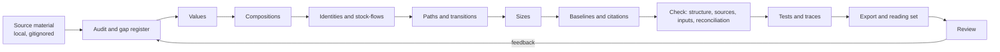

# The construction pipeline

How a company's business construction is built, checked and delivered, from raw material to the export an agent
reads. This page is the abstract pipeline. The method's details are in [README.md](README.md) and the rules (R1–R17)
in [design/specificity.md](../design/specificity.md).

<!-- toc -->
**Contents**

- [Overview](#overview)
- [Objects](#objects)
- [Stages](#stages)
- [Invariants](#invariants)
<!-- /toc -->

## Overview

The order is fixed: structure first, sizes last. A size is never fitted to structure that is not yet laid out.

## Objects

A construction is one YAML file per company (`data/worlds/<world>/construction/<company>.yaml`), loaded into the
world's graph.

| Object | What it is |
|---|---|
| Value (`subentities`) | A quantity of the company, with view, accounting basis, unit and period. Carries a synthetic prior. |
| Composition | A total split into parts by one view, with a residual and eliminations. One view drives a total; the others reconcile against it. |
| Identity | An exact relation (product, ratio, difference, weighted average). Its weights are derived, never fitted. |
| Stock-flow | A stock rolled forward by its flows over a period. |
| Link (`interactions`) | A directed edge between values: causal, accounting, identity or stock-flow. Optionally state-dependent. |
| Transition | A causal link's specification: mechanism, actor, condition, timing, evidence by claim, breaker and unresolved inputs. |
| Path | A named, ordered chain of links from a trigger to an account, with parallel branches. |

Client material stays local: `sources.json` (source id → document, kind, period) and `citations.json` (object id →
location and passage), next to the dated baselines. Tracked files hold neutral ids only.

## Stages

1. **Audit.** Read what the model and the last export already hold. Classify each requirement as already owned,
   missing, modify lightly, or do not touch. Write a gap register, and flag concepts the schema cannot express.
2. **Values.** Define each value's view, basis, unit and period. Statutory, adjusted and segment measures stay separate
   values.
3. **Compositions.** Build every view the company reports for each total. Mark one as driving and the rest as
   reconciling (`drives: false`), each with an explicit residual and eliminations.
4. **Exact structure.** Express products, ratios and differences as identities, balances as stock-flows, and
   thresholds or sign flips as `state:` blocks.
5. **Paths.** Chain each development through the exposed business, the actor's response and the operating outcome to
   the account. Each step is a link with a full transition. Parallel responses are branches. A macro-to-total
   shortcut is allowed only as a labelled reduced form, kept beside its path and never added to it.
6. **Records of stage and scope.** Plans, projects and announcements are records with a stage and their unknowns, not
   values. One-scope statements keep their scope.
7. **Sizes.** Calibrate from evidence for the value's own definition (`scripts/construction/calibrate.py`: a
   disclosed sensitivity, a set of disclosed scenarios solved jointly, or one size per direction). Without evidence, a
   link stays uncalibrated with its sign, never zero.
8. **Baselines and citations.** Build dated actuals as an `axelrod.import/v1` bundle (`scripts/imports/bundles.py
   check`), with estimates kept apart. Cite every material claim to a document, location and passage.
9. **Inputs.** Search the corpus for every input a transition needs (`scripts/construction/inputs.py`). Each input
   ends found and connected, found but not connected, a proxy, not supplied, or not disclosed, never unreviewed.
10. **Check.** Run `scripts/construction/check.py --sources --reconcile [--baselines]`. It checks structural validity,
    resolving sources, uncited claims, input status, and that every view, identity and roll-forward closes at medians
    and at baselines. Any difference left over is reported as an explicit residual.
11. **Tests and traces.** The company scenario test asserts structure, transitions, reconciliation and presence in the
    export and API. A trace of a development nobody wrote a path for must reach an account or say where it stops.
    Forecast coverage lists which links are sized, which are excluded, and which inputs block them.
12. **Export.** Run `scripts/imports/export_context.py`. It writes the domain pack and evidence pack in the client's
    contract, binding local repair data: reported against estimated, reconciliations, input classes, checks and
    business records. It also writes `reading/`, bounded shards an agent's reader can open, checked for exact
    coverage of the pack.
13. **Review.** A reviewer runs small controlled checks first, reading model correctness, runtime access and answer
    quality as separate results. Findings go into the gap register, the standard and the skill
    ([skills/world-model-construction](../../skills/world-model-construction/SKILL.md)), and the pipeline runs again.

## Invariants

- One driving view per total; overlapping views are never added together.
- Identity and stock-flow weights are derived and never refit by learning.
- No size without evidence for that value's definition; unknown is not zero.
- One number per effect: a reduced form and its path's steps never both count.
- Observed means a dated reported observation is attached. A model estimate, an assumption or a derived value is
  never observed.
- Every material claim resolves to a cited passage, and every missing input names what was searched.
- Client figures, quotes and file names never enter tracked files.
