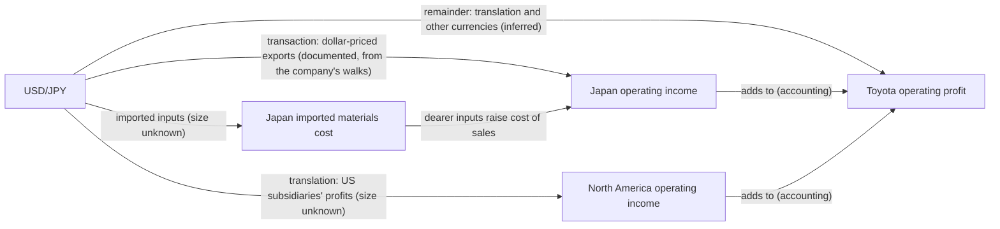

# Toyota: before and after the construction review

A high-level diff of Toyota in Sally's world model:

- **Before:** commit `a7e7890` (Oct 17), the state the client's reviewer audited.
- **After:** the current `toyota-plan`, after both review rounds, the conversion to exact forms, the public
  document pack, and the reviewer's build plan (Oct 18). The same build holds in the focused world (Toyota and Tokio
  Marine only).

Detail is in [toyota.md](toyota.md). Structure only: no client figures.

<!-- toc -->
**Contents**

- [At a glance](#at-a-glance)
- [The yen, before and after](#the-yen-before-and-after)
- [What each finding changed](#what-each-finding-changed)
- [The public document pack](#the-public-document-pack)
- [The build plan](#the-build-plan)
- [What is still missing](#what-is-still-missing)
<!-- /toc -->

## At a glance

| | Before | After |
|---|---|---|
| Values | 2 (operating profit, global vehicle sales), plus the share price from the company kind | 90, each with its view, accounting basis, unit and period |
| Links touching Toyota | 4: yen → profit, US growth → volume, China growth → volume, volume → profit | 163: 49 accounting (13 of them reconciling views, without a size), 21 identity, 1 stock-flow, 11 calibrated causal, 81 uncalibrated causal (sign known, size unknown) |
| Links that say what they mean | 0 | 162 carry a transition: mechanism, actor, condition and its observable, timing, evidence by claim, breaker, next state, inputs still missing |
| Views of the business | none | 12: segments, segment revenue, regional operating income, regional revenue, revenue by customer location, units by customer region and by production region, retail bridge, powertrain, financial services, pretax and net-income bridges |
| Named operating and financial paths | none | 16: yen, tariffs and sourcing, regional growth, pricing competition, Southeast Asia entrants, product mix, supply availability, three financing paths, production disruption, cash and capital, execution and share, robotics, China affiliates, group bridge |
| Reconciliation | not possible | every view adds up at the model's levels and against two dated years of reported actuals; shares outstanding rolls forward between four dated counts |
| Sources | none | every material claim is cited locally to its document, location and passage; 25 source ids, the company's own filings first |
| Missing inputs | not stated | 67 inputs, each with a status after a search of the supplied material and the public pack: 10 found and connected, 23 found but not connected, 34 not disclosed in the reviewed sources |
| A forecast's account of itself | a number | a number plus calculation coverage: what contributed a size, what was excluded and why, and which inputs block it |

## The yen, before and after

**Before:** one link. The yen moved consolidated operating profit by a fixed amount, labelled as a disclosed sensitivity.

**After:** the channels are parallel branches reaching the accounts through identities. Since the public pack, the
transaction branch is sized from the company's own walks, and the direct link keeps only the remainder.

- One number per effect: the transaction branch carries the dollar transactional effect; the direct link carries
  only what the branch does not (translation, the euro, other currencies), so the yen is counted once.
- Before the pack the direct link's size was labelled *model* (the client's inference). The company's own walks now
  size the transaction branch (*documented*); the direct link is re-sized to the remainder (*inferred*).
- Each branch says what would break it: localized production, hedging, and North American losses reversing the
  translation effect.

The other jumps the reviewer flagged are gone in the same way:

- **Volume → profit** (whose learned sign straddled zero) now runs through consolidated units, revenue, price, mix and
  cost to the segment identity.
- **US and China growth** reach regional volumes, not a global total.

## What each finding changed

| Reviewer's finding | Change for Toyota |
|---|---|
| Round 1: packs jump from a macro driver straight to sales or profit | Compositions, named paths and transitions; volume → profit re-routed and uncalibrated; the description now explains the composition |
| Round 1: unknowns presented as estimates | Uncalibrated links carry no number, and forecasts list them as size unknown, never zero |
| Round 2: source labels cannot be resolved | 213 citations under 159 keys; every claim resolves to a document, location and passage, in the local export |
| Round 2: missing inputs named without saying whether documents were checked | Every input has a status after a search, with what was searched |
| Round 2: components and group profit differ | Synthetic levels fixed to add up; reported operating profit equals the segment sum exactly |
| Round 2: simulation outputs hide unquantified mechanisms | A forecast's coverage lists contributed and excluded links and the blocking inputs |
| Round 2: method applied to two companies | The same process now covers all eleven companies |

## The public document pack

| | Before the pack | After the pack |
|---|---|---|
| Inputs found | 21 | 32 (11 moved from "not disclosed" after the search was re-run over the pack) |
| Dated years of reported actuals | 1 (from the client's workbook) | 2 (the second from the company's own summary) plus four dated share counts |
| Stock-flows | 0 | 1: shares outstanding with buybacks, checked in three windows |
| Toyota's own steps sized in Sally's yen theses | 0 of 3 | 1 of 3 (the transaction branch) |
| Routes to Toyota operating profit fully quantified (S-T1) | 3 of 12, all through the direct yen link | 6 of 12, half through Toyota's own steps |
| Tariff route to operating profit | sized to the customs cost only | sized end to end on Toyota's own steps (absorption graded *model*: the regional split is not disclosed) |
| Dated events | none | certification halts with their production loss, the tariff regime and its revision, the buyback authorization (local) |

## The build plan

The reviewer's plan named eight areas and asked for composition, then operating paths, then the accounts, then
calibration. Each area was audited first (owned, missing, modify lightly, do not touch).

| Area | Before the plan | After the plan |
|---|---|---|
| Business composition | 11 views | 12: segment revenue with inter-segment sales and eliminations added, reconciling to net revenue |
| Tariffs | regime → cost → responses → regions | operational: which imports are covered (a customs base that neither regional imports nor Japan exports are), when the duty falls due, who pays, five responses including incentives, dealers and plants responding |
| Pricing and incentives | rivals' incentives → Toyota's response → price and volume | dealers' stock now feeds incentives; management's marketing line kept whole |
| Product mix and demand | customer choice only | supply availability as its own path; units never read as margins |
| Yen | branches with the R13 netting | reconciled to the company's total FX effect in every period |
| Financial services | funding and used-value paths | a borrower-conditions path; the US finance subsidiary mapped to its consolidation scope as another basis |
| Production disruption | dated events recorded locally | a path from a certification restriction to production, deliveries, utilization and recovery costs, in Japan's results |
| Cash and capital | the shares stock-flow | earnings → industrial cash → free cash flow → liquid assets → dividends and buybacks, with authorizations apart from purchases and the finance book's funding kept out |

Three validation cases now run end to end: through a forecast, the export and the trace an agent reads, in both
worlds. In tariff absorption versus price recovery, absorption is calculated and price recovery is direction only.
Financing pressure is direction only, and the forecast says why. A North American plant stoppage, which no path was
written for, reaches the accounts.

## What is still missing

- **Sizes for most of Toyota's operating steps.** Pass-through, elasticities, incentive response, transfer-price
  support, margins by powertrain and JV economics are not in the supplied material or the public pack.
- **Financing rates on the consolidated basis.** Only the US finance subsidiary's are published; they are another
  basis, so the financing identities stay blocked.
- **A region × business matrix.** No cells are disclosed, so paths on the business view cannot carry a size to
  operating profit.
- **Events as a form.** Dated events are recorded, and the disruption path takes them as a level of withheld
  production, but the engine cannot yet replay an event over its dates.
- **Schema limits.** A results-walk line (a change between periods) is not a value, and a threshold that follows a
  moving level (a liquidity buffer) is not a form. A duty that is customs base × rate is kept as a signed step,
  because the base has no level.
