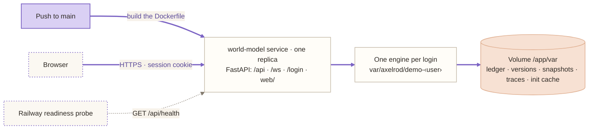

# Deployment

The full demo is hosted on Railway's `dev` environment at **https://world-model-dev.up.railway.app**, behind Basic Auth. This page covers what runs there, how to release, how to verify a release, and how to run the same container locally.

## What runs

| Piece | Where | What it does |
|---|---|---|
| Image | `Dockerfile` | Python 3.12 slim. Installs the frozen dependencies with uv (`uv sync --frozen --no-dev`) and copies `configs/`, `data/`, `web/`, and the start script. |
| Start | `scripts/start-railway.sh` | Runs `axelrod demo --scenario $WORLD_MODEL_SCENARIO --host 0.0.0.0 --port $PORT`: on dev, the production demo for the main login, and Emily's demo for hers ([demos.md](demos.md), [A login per scenario](#a-login-per-scenario)) |
| Infrastructure | `.railway/railway.ts` | The service, its volume, and its settings, as code |
| Release checks | `scripts/persist-railway-fields.sh`, `scripts/verify-railway-drift.py` | Set the two fields Railway's IaC does not store, then reject any drift except known leftovers |
| Auth | `src/axelrod_wm/api/auth.py` | Basic Auth on every request except the health check |



The service's settings, from `.railway/railway.ts`:

- **One replica** in `us-west2`, built from the `Dockerfile`.
- **Health check** at `/api/health`, with a **600-second** initial timeout. The first start replays three years of synthetic history before it is ready.
- **Restarts** on failure, at most two retries. **App Sleep** is off.
- **Storage:** a 5 GB volume mounted at `/app/var`. Runtime state, traces, and the init cache persist there, so later starts take seconds.
- **Port** 8080, served at `world-model-dev.up.railway.app`.

The demo needs no database and no model-provider credentials. Everyone who opens it shares one session and one engine: a review approved there is approved for everyone.

## Ownership in the shared project

The service lives in the shared Axelrod Railway project. This repository owns only `service.world-model` and `volume.world-model-volume`, through the named IaC partial `world-model`. The configuration throws for any environment other than `dev`. Other services and their secrets stay outside the partial. See [Railway multi-repo ownership](https://docs.railway.com/infrastructure-as-code#multi-repo-projects).

Railway requires every IaC repository that targets an environment with named partials to export a partial. Axelrod/core still uses whole-project IaC. Before Core's next `dev` plan or apply, Core must move to its own named partial, with a CLI that supports partials, and claim only its resources. **Do not apply Core's older whole-project plan against `dev`:** it can propose deleting services owned by other repositories. This repository does not edit Core.

## Releasing

**A merge to `main` is a release.** The `world-model` service is linked to this repository's `main` branch (`.railway/railway.ts`, `source: github(...)`), so Railway builds the `Dockerfile` and deploys every push to `main` on its own. There is no upload step. Work on a branch, open a pull request, and merge it when it is ready to go live. The **Tests** workflow (`.github/workflows/tests.yml`) runs the unit tests on every pull request. It does not hold back a deploy; Railway's check suites are off.

**Changing the infrastructure** (`.railway/railway.ts`: the service's settings, variables, volume, domain, or source) needs a Railway Admin on the Axelrod project. Apply it by hand, after review:

```bash
npm ci
npx --yes -p node@22 -p @railway/cli@5.64.2 railway link \
  --project ee19a1df-2ce5-4193-932a-6139f034bbce --environment dev --service world-model
npx --yes -p node@22 -p @railway/cli@5.64.2 railway config plan
# Review the plan: only world-model may change, nothing may be destroyed, and source.repo must stay linked.
npx --yes -p node@22 -p @railway/cli@5.64.2 railway config apply --yes
bash scripts/persist-railway-fields.sh
npx --yes -p node@22 -p @railway/cli@5.64.2 railway config plan --json > /tmp/world-model-drift.json
python3 scripts/verify-railway-drift.py /tmp/world-model-drift.json
```

The toolchain is pinned: the IaC SDK `railway@3.13.1` in `package-lock.json`, the Railway CLI `5.64.2`, and Node 22. Named partials and native TypeScript evaluation need newer tooling than Core's CLI 5.33.0 and Node 20.

**Known leftovers.** Railway does not store `restartPolicyType` or `sleepApplication` in the environment config, so every plan shows them. `persist-railway-fields.sh` sets them directly, and the drift verifier admits only these two. The source is declared, so a plan that would unlink the repository (`source.repo → null`) is drift, and the verifier rejects it.

**Roles.** A Railway **Deployer** cannot deploy from the CLI, change settings, or read logs. A **Member** can deploy, and an **Admin** can also plan and apply infrastructure. Deploys from `main` need no role at all: Railway runs them on its own.

## Verifying a release

An upload or a successful build alone is not a healthy deployment. Check all of these:

1. The deployment's status is `SUCCESS`, and `GET /api/health` reports the commit you merged as `build` (from Railway's `RAILWAY_GIT_COMMIT_SHA`).
2. Its metadata confirms restarts `ON_FAILURE` with a retry limit of 2, App Sleep off, the health check at `/api/health`, and the volume at `/app/var`.
3. Over Railway SSH, `http://127.0.0.1:8080/api/health` answers, and after signing in (see [Sign-in](#sign-in)) so do `/` and `/api/state`.

## Sign-in

Every page, static file, API call, the API docs, and the WebSocket stream require a signed-in login. `GET` and `HEAD` on `/api/health` are the only exception: Railway's readiness probe has no credentials, and the health check exposes no data.

- **The sign-in page** (`/login`, `src/axelrod_wm/api/login.html`) replaced the browser's Basic Auth prompt on Oct 12. A page opened without a session goes there and comes back after signing in; the API and the WebSocket answer 401 instead. Signing in sets an HttpOnly session cookie (the username and an expiry, HMAC-signed, 14 days), which also authenticates the WebSocket. **Sign out** (☰ menu, or `/logout`) clears it.
- The signing key is `WORLD_MODEL_SESSION_SECRET` when set, else derived from the logins' passwords: sessions survive a restart, and changing any password signs everyone out. There is no user database.
- The session cookie is the only credential. A script signs in the way a browser does: `curl -c jar -d username=… -d password=… https://…/login`, then `curl -b jar …`. A Basic `Authorization` header is ignored (Oct 12): a browser that once answered the old Basic prompt keeps sending one by itself, which kept people signed in after Sign out.

- Auth is **required** whenever `RAILWAY_ENVIRONMENT_ID` is set, and IaC also sets `WORLD_MODEL_REQUIRE_BASIC_AUTH=1`. When it is required, the server refuses to start without both `WORLD_MODEL_BASIC_AUTH_USERNAME` and `WORLD_MODEL_BASIC_AUTH_PASSWORD`.
- The credentials were generated securely and live in Railway. IaC preserves them (`preserve()`) rather than setting them. An operator copy is in `var/railway/dev-basic-auth.txt` (gitignored, mode 0600).
- Locally, without these variables, no login is needed, and `/login` goes straight to the demo. Set both to test sign-in locally.

### A login per scenario

`WORLD_MODEL_LOGINS` adds logins that each open their own scenario, as comma-separated `username:password:scenario` entries (no `:` or `,` inside a field). On dev it holds Emily's login, which opens `emily_demo`; the main login opens `WORLD_MODEL_SCENARIO` (`prod_demo` on dev; `oil_shock_demo` when unset). Each login gets an engine of its own, with its own storage (`var/axelrod/demo-<username>`) and trace stream, so reviews under one login never show under another. Everyone who signs in with the same login still shares that login's session. The variable lives in Railway only, like the main credentials.

The browser keeps a Basic Auth login until it is closed: to switch logins, use a private window, or sign in through `https://<username>@world-model-dev.up.railway.app`.

Emily's research bundle (`data/emily_data/`) is never uploaded (`.gitignore`, `.dockerignore`). On the hosted demo, import it with the file picker.

## Running the container locally

```bash
docker build -t world-model .
docker run --rm -p 8080:8080 -e PORT=8080 -v "$PWD/var:/app/var" world-model
# open http://127.0.0.1:8080 once /api/health answers
```

Mounting `var/` keeps the init cache between runs, as the Railway volume does. Add `-e WORLD_MODEL_BASIC_AUTH_USERNAME=… -e WORLD_MODEL_BASIC_AUTH_PASSWORD=…` to put it behind auth.

## Tests

`tests/unit/test_basic_auth.py` covers the auth middleware. `tests/unit/test_railway_drift.py` checks that the drift verifier rejects unrelated and destructive changes. Both run with `uv run pytest`.
