# Deployment

The full demo is hosted on Railway's `dev` environment at **https://world-model-dev.up.railway.app**, behind a sign-in page. This page covers what runs there, how to release, how to verify a release, and how to run the same container locally.

<!-- toc -->
**Contents**

- [What runs](#what-runs)
- [Three services](#three-services)
- [Ownership in the shared project](#ownership-in-the-shared-project)
- [Releasing](#releasing)
- [Verifying a release](#verifying-a-release)
- [Sign-in](#sign-in)
- [The API and its keys](#the-api-and-its-keys)
- [Running the container locally](#running-the-container-locally)
- [Tests](#tests)
<!-- /toc -->

## What runs

| Piece | Where | What it does |
|---|---|---|
| Image | `Dockerfile` | Python 3.12 slim, built from the repository root. Installs the frozen dependencies of the world model member, with ingestion beside it as its workspace dependency (`uv sync --frozen --no-dev --no-editable --package axelrod-world-model --extra semantic`; the extra forwards to `axelrod-ingest[semantic]` and adds the embedding model's runtime), then copies `configs/` (the stage settings), `world_model/{examples,taxonomy,configs,web}`, and the start script. `AXELROD_ROOT=/app` tells the installed package where they are (`world_model/src/axelrod_wm/paths.py`). |
| Start | `.railway/start-railway.sh` | Runs `axelrod demo --scenario $WORLD_MODEL_SCENARIO --host 0.0.0.0 --port $PORT`: on dev, the unified model for the main login, and a compartment of it for each client login ([demos.md](../world_model/docs/guides/demos.md), [A login per scenario](#a-login-per-scenario)) |
| Infrastructure | `.railway/railway.ts` | The service, its volume, and its settings, as code |
| Release checks | `.railway/persist-railway-fields.sh`, `.railway/verify-railway-drift.py` | Set the two fields Railway's IaC does not store, then reject any drift except known leftovers |
| Auth | `world_model/src/axelrod_wm/api/auth.py` | A signed-in session on every request except the health check; service tokens or scoped keys for `/v1` and `/mcp` |



The service's settings, from `.railway/railway.ts`:

- **One replica** in `us-west2`, built from the `Dockerfile`.
- **Health check** at `/api/health`, with a **600-second** initial timeout. The first start replays three years of synthetic history before it is ready.
- **Restarts** on failure, at most two retries. **App Sleep** is off.
- **Storage:** a 5 GB volume mounted at `/app/var`. Runtime state, traces, and the init cache persist there, so later starts take seconds. A model built by imports is kept there too (`/app/var/axelrod/demo-<login>`: ledger, versions, snapshots), and a restart or redeploy resumes it at its last version with its imported items, review policy and pending reviews; nothing wipes it at start, and only an explicit reset forgets it. If a construction file on the client volume changed, the model is rebuilt from the files and its recorded imports replayed, with the earlier storage kept beside it (`demo-<login>.before-<digest>`; delete it by hand once the replay is checked). So do the lakehouse (`/app/var/lake`: uploaded files, their text, indexes, and bundles) and the embedding model (`/app/var/models`, downloaded on the first upload, about 70 MB).
- **Port** 8080, served at `world-model-dev.up.railway.app`.

The demo needs no database server (the lakehouse is SQLite on the volume) and no model-provider credentials (the LLM extraction step is off unless one is set). Everyone who opens it shares one session and one engine: a review approved there is approved for everyone.

## Three services

The deployment is three Railway services. Each kind of data has one home, and no service keeps a copy of another's.

| Service | Code | Image | State | Role |
|---|---|---|---|---|
| `world-model` (dev) | `axelrod_wm` | `Dockerfile` | Volume at `/app/var`: client worlds, scenarios, model caches | The model API and UI. Sends uploads to ingestion; reads the lake and searches it through the data service |
| `world-model-ingestion` (dev) | `axelrod_ingest.service` (`axelrod-ingest`) | `ingestion/Dockerfile` | None | Parses, chunks, embeds, recognizes, extracts, and bundles. The only embedder. Reads and writes the lake through the data service. Serves the [ingestion console](../ingestion/docs/console.md) at `/` |
| `world-model-data` (dev) | `axelrod_ingest.lake.server` (`axelrod-lake`) | `ingestion/Dockerfile.lake` | Volume at `/data`: `lake/lake.sqlite3` and the raw files | The only process that opens the SQLite file. Serves every `LakeStore` method over HTTP, including `nearest`, the cached matrix search |

The dev ingestion service gets a public domain so the console can be opened in a browser. The page is static and open; every JSON call needs `INGEST_TOKEN`, which the console asks for and keeps in the tab's `sessionStorage`. `INGEST_MAX_BYTES` (default 100 MB) caps an uploaded file. The domain is declared in `.railway/railway.ts` (`world-model-ingestion-dev.up.railway.app`); the world model still calls ingestion on the private network.

```text
browser / API client ──▶ world-model ──upload, process, embed (query)──▶ world-model-ingestion
                              │                                                │
                              └──── lake reads, search (nearest) ───▶ world-model-data ◀── lake reads and writes
                                                                       (SQLite + raw files)
```

### Where each kind of data lives

| Data | Home |
|---|---|
| lake (SQLite and raw files) | data service volume |
| client worlds and scenarios | world-model volume |
| embedding weights | ingestion service (baked into its image under `/tmp/models`) |
| vector matrix cache | data service memory |
| OCR page cache | ingestion service, ephemeral (it is a cache, keyed by content) |

The OCR page cache used to sit under the lake directory (`WORLD_MODEL_LAKE_DIR/ocr`). The ingestion service keeps it in temporary storage instead (`$TMPDIR/axelrod-ocr`, unless `AXELROD_OCR_CACHE` says otherwise), so no volume holds it and a restart re-reads scans. File bytes are held in memory while a document is processed and are never written to disk by the ingestion service. In remote mode the world model opens no `SQLiteLake`, creates no `/app/var/lake`, loads no embedding model, and holds no vectors.

### The data flow

- **Upload** (`POST /v1/world-models/{id}/documents`): the world model sends the files and a `WorldView` of its model to `POST /v1/ingest` on the ingestion service. That service stores the file, text, chunks, mentions, embeddings, and bundle in the lake through the data service, and returns the results as JSON, which the world model turns into the same job result as before. Reading a stored document again is `POST /v1/process`. Large scanned files outlast the Railway proxy's 300 s request limit, so uploaders that can wait (the ingestion console, scripts) call `POST /v1/ingest?mode=async`: it answers `202` with `Location: /v1/jobs/{id}` and one background worker runs the jobs in order; `GET /v1/jobs/{id}` reports progress. Jobs are in memory and a restart loses them (the lake holds the real result), see the [console doc](../ingestion/docs/console.md#ingest-jobs). The world model's own `/v1` jobs follow the standard instead: a client that cannot wait sends `Prefer: respond-async` and polls the job's `Location`; without it the call is synchronous.
- **Search**: the world model embeds the query through the ingestion service (`POST /v1/embed`, the one query vector), then asks the data service for the nearest chunks (`nearest`, computed there against its cached matrix) and the keyword hits. Vectors never cross the network except that one query vector.
- **Everything else the lake holds** (documents, bundles, imports, the registry, the audit log, idempotency keys, jobs, the LLM cache): the world model reads and writes it through the data service.

### Variables

| Service | Variable | Meaning |
|---|---|---|
| data | `LAKE_TOKEN` | Required. The bearer token every route but `GET /health` needs |
| data | `LAKE_DIR` | The lake folder (default `/data/lake`) |
| data | `PORT` | Port (default 8000; Railway sets 8080) |
| ingestion | `INGEST_TOKEN` | Required. The bearer token for `/v1/ingest`, `/v1/process`, `/v1/embed` and the console's `/v1` routes |
| ingestion | `INGEST_MAX_BYTES` | Largest file `/v1/ingest` and the console's dry run take (default 104857600) |
| ingestion | `WORLD_MODEL_LAKE_URL`, `WORLD_MODEL_LAKE_TOKEN` | The data service's URL and token |
| ingestion | `WORLD_MODEL_EMBEDDER` | `fastembed`, `hashing`, or `auto`. Set only here: the ingestion service is the only embedder, so there is nothing to match in the world model |
| ingestion | `WORLD_MODEL_LLM_PROVIDER`, `WORLD_MODEL_LLM_MODEL`, `ANTHROPIC_API_KEY` | The optional LLM step |
| ingestion | `AXELROD_OCR_CACHE`, `AXELROD_OCR_LANG` | OCR cache folder (default in temporary storage) and languages (the image sets `eng`, as the existing lake was read; the Chinese and Korean data are installed, so `eng+chi_sim+chi_tra+kor` is one variable away) |
| world-model | `WORLD_MODEL_LAKE_URL`, `WORLD_MODEL_LAKE_TOKEN` | When set, the lake is the data service. Unset: the in-process SQLite lake in `WORLD_MODEL_LAKE_DIR` |
| world-model | `WORLD_MODEL_INGEST_URL`, `WORLD_MODEL_INGEST_TOKEN` | When set, uploads and query embedding go to the ingestion service. Needs the lake variables too, or the process refuses to start (the ingestion service writes to the data service, so the model must read it there). Unset: the in-process pipeline |
| world-model | `WORLD_MODEL_LAKE_SYNC`, `WORLD_MODEL_LAKE_SYNC_SECONDS` | The lake sync: a background task that reads documents added to the lake (through the ingestion console or `/v1/ingest`) against the model and imports them. `1` or `0`; default on exactly when `WORLD_MODEL_LAKE_URL` is set, off otherwise. The interval in seconds (default 30). `GET /v1/world-models/{id}/sync` reports what it did; see [unified-model.md](../world_model/docs/design/unified-model.md) |

Remote mode is opt-in: with none of these set, everything runs in process as it always has. `Dockerfile` keeps the `semantic` extra for that local mode; a remote-mode deployment never loads it. `/api/health` reports `services.lake` and `services.ingestion` as `local`, or `remote` with whether the service answers (never the address or the token). An unreachable service does not fail the health check, so a data outage does not restart the world model.

### Network and environments

All three services run in `dev` (Oct 24). The data service has no public domain: the world model and ingestion reach it on Railway's private network (`WORLD_MODEL_LAKE_URL=http://world-model-data.railway.internal:8080`) with the token, so there is one lake, with organizations as tenants. Anything that holds the token on that network can read and write every tenant, so treat `LAKE_TOKEN` as the lake's root credential: set it in Railway only, rotate it on all three services together, and never put it in the repository. Staging and production have no lake yet. Because Railway volumes and private networks are per environment, serving them later means either giving the data service a public domain they call with the token, or a data service of their own.

### Service settings

Railway has deprecated config-as-code files (`railway.json`), and a root one overrides every service built from this repository, so there are none. Each service keeps its settings on the service itself:

| Service | Dockerfile | Healthcheck | Watch patterns |
|---|---|---|---|
| `world-model` | `Dockerfile` | `/api/health`, 600 s | `Dockerfile`, `pyproject.toml`, `uv.lock`, `README.md`, `ingestion/**`, `world_model/**`, `configs/**`, `.railway/start-railway.sh` |
| `world-model-ingestion` | `ingestion/Dockerfile` | `/health`, 300 s | `ingestion/**`, `uv.lock`, `pyproject.toml`, `world_model/pyproject.toml` |
| `world-model-data` | `ingestion/Dockerfile.lake` | `/health`, 120 s | the same as ingestion |

All three restart on failure (two retries), never sleep, and run one replica in us-west2. The watch patterns are the paths each image copies, so a change under `ingestion/` redeploys all three services and a change under `world_model/` redeploys only the world model. `.railway/railway.ts` declares the same services as code; it is documentation plus IaC and is not applied automatically. Change a setting there and on the service together.

### Moving an existing lake into the data service

1. Stop writes: stop the world model (or its ingestion) that holds the lake.
2. Checkpoint the WAL so the main file holds everything: `sqlite3 lake.sqlite3 'PRAGMA wal_checkpoint(TRUNCATE);'`.
3. Copy `lake.sqlite3` and the raw folders (`<org>/raw/`) into the data volume's `lake/` folder (`/data/lake`), then start the data service and check `GET /health`.
4. Point the services at it (`WORLD_MODEL_LAKE_URL` and the token), and remove the old lake from the world model's volume once a search and a document read answer.

## Ownership in the shared project

The service lives in the shared Axelrod Railway project. This repository owns `world-model`, `world-model-ingestion` and `world-model-data`, with `world-model-volume` and `world-model-data-volume`, all in `dev`, through the named IaC partial `world-model`. The configuration throws for any other environment, and the drift verifier accepts only these three services. Other services and their secrets stay outside the partial. See [Railway multi-repo ownership](https://docs.railway.com/infrastructure-as-code#multi-repo-projects).

Railway requires every IaC repository that targets an environment with named partials to export a partial. Axelrod/core still uses whole-project IaC. Before Core's next `dev` plan or apply, Core must move to its own named partial, with a CLI that supports partials, and claim only its resources. **Do not apply Core's older whole-project plan against `dev`:** it can propose deleting services owned by other repositories. This repository does not edit Core.

## Releasing

**A merge to `main` is a release.** The `world-model` service is linked to this repository's `main` branch (`.railway/railway.ts`, `source: github(...)`), so Railway builds the `Dockerfile` and deploys every push to `main` on its own. There is no upload step. Work on a branch, open a pull request, and merge it when it is ready to go live. The **Tests** workflow (`.github/workflows/tests.yml`) runs the unit tests on every pull request. It does not hold back a deploy; Railway's check suites are off.

**Changing the infrastructure** (`.railway/railway.ts`: the service's settings, variables, volume, domain, or source) needs a Railway Admin on the Axelrod project. Apply it by hand, after review:

```bash
npm --prefix .railway ci
npx --yes -p node@22 -p @railway/cli@5.64.2 railway link \
  --project ee19a1df-2ce5-4193-932a-6139f034bbce --environment dev --service world-model
npx --yes -p node@22 -p @railway/cli@5.64.2 railway config plan
# Review the plan: only world-model may change, nothing may be destroyed, and source.repo must stay linked.
npx --yes -p node@22 -p @railway/cli@5.64.2 railway config apply --yes
bash .railway/persist-railway-fields.sh
npx --yes -p node@22 -p @railway/cli@5.64.2 railway config plan --json > /tmp/world-model-drift.json
python3 .railway/verify-railway-drift.py /tmp/world-model-drift.json
```

The toolchain is pinned: the IaC SDK `railway@3.13.1` in `.railway/package-lock.json`, the Railway CLI `5.64.2`, and Node 22. Named partials and native TypeScript evaluation need newer tooling than Core's CLI 5.33.0 and Node 20.

**Known leftovers.** Railway does not store `restartPolicyType` or `sleepApplication` in the environment config, so every plan shows them. `persist-railway-fields.sh` sets them directly, and the drift verifier admits only these two. The source is declared, so a plan that would unlink the repository (`source.repo → null`) is drift, and the verifier rejects it.

**Roles.** A Railway **Deployer** cannot deploy from the CLI, change settings, or read logs. A **Member** can deploy, and an **Admin** can also plan and apply infrastructure. Deploys from `main` need no role at all: Railway runs them on its own.

## Verifying a release

An upload or a successful build alone is not a healthy deployment. Check all of these:

1. The deployment's status is `SUCCESS`, and `GET /api/health` reports the commit you merged as `build` (from Railway's `RAILWAY_GIT_COMMIT_SHA`).
2. Its metadata confirms restarts `ON_FAILURE` with a retry limit of 2, App Sleep off, the health check at `/api/health`, and the volume at `/app/var`.
3. Over Railway SSH, `http://127.0.0.1:8080/api/health` answers, and after signing in (see [Sign-in](#sign-in)) so do `/` and `/api/state`.

## Sign-in

Every page, static file, API call, the API docs, and the WebSocket stream require a signed-in login. `GET` and `HEAD` on `/api/health` are the only exception: Railway's readiness probe has no credentials, and the health check exposes no data.

- **The sign-in page** (`/login`, `world_model/src/axelrod_wm/api/login.html`) replaced the browser's Basic Auth prompt on Oct 12. A page opened without a session goes there and comes back after signing in; the API and the WebSocket answer 401 instead. Signing in sets an HttpOnly session cookie (the username and an expiry, HMAC-signed, 14 days), which also authenticates the WebSocket. **Sign out** (☰ menu, or `/logout`) clears it.
- The signing key is `WORLD_MODEL_SESSION_SECRET` when set, else derived from the logins' passwords: sessions survive a restart, and changing any password signs everyone out. There is no user database.
- The session cookie is the only credential. A script signs in the way a browser does: `curl -c jar -d username=… -d password=… https://…/login`, then `curl -b jar …`. A Basic `Authorization` header is ignored (Oct 12): a browser that once answered the old Basic prompt keeps sending one by itself, which kept people signed in after Sign out.

- Auth is **required** whenever `RAILWAY_ENVIRONMENT_ID` is set, and IaC also sets `WORLD_MODEL_REQUIRE_BASIC_AUTH=1`. When it is required, the server refuses to start without both `WORLD_MODEL_BASIC_AUTH_USERNAME` and `WORLD_MODEL_BASIC_AUTH_PASSWORD`.
- The credentials were generated securely and live in Railway. IaC preserves them (`preserve()`) rather than setting them. An operator copy is in `var/railway/dev-basic-auth.txt` (gitignored, mode 0600).
- Locally, without these variables, no login is needed, and `/login` goes straight to the demo. Set both to test sign-in locally.

### A login per scenario

`WORLD_MODEL_LOGINS` adds logins that each open their own scenario, as comma-separated `username:password:scenario` entries (no `:` or `,` inside a field). On dev it holds Emily's login, which opens `emily_view`, and Sally's, which opens `sally_view`: both are compartments (focus scenarios) of the unified model, which the main login opens as `WORLD_MODEL_SCENARIO` (`unified` on dev since Oct 25; `oil_shock_demo` when unset), so they are views onto the one engine ([unified-model.md](../world_model/docs/design/unified-model.md)). A login whose scenario is not a compartment gets an engine of its own, with its own storage beside the main engine's (`var/axelrod/demo-<username>`) and trace stream, so reviews under one login never show under another. Everyone who signs in with the same login still shares that login's session. The variable lives in Railway only, like the main credentials.

The top bar's demo menu ([demos.md](../world_model/docs/guides/demos.md#switching-demos)) switches only the signed-in login's engine. Each demo a login opens keeps its own storage next to that login's storage (`var/axelrod/demo-<username>-<demo>`), and it stays in memory until the server restarts. The first time the production or full demo opens on a fresh container, its history is replayed, which takes a few minutes.

A login whose scenario is a focus over the main engine's scenario is a **compartment** (Oct 25): it gets no engine and no storage of its own, but a view onto the main engine, narrowed to its companies ([focus.md](../world_model/docs/construction/focus.md#a-compartment-per-login)). `create_app` decides this when it reads the logins: the scenario is looked up under the client roots, and its `focus.base` is compared with the main engine's scenario (`WORLD_MODEL_SCENARIO`). The login's organization (its name, or `WORLD_MODEL_OWNERS`) owns the compartment, so `/v1/erid` serves it to that organization and to the internal ones. To set it up, the main engine runs the unified scenario, and each client's login names a focus over it.

To switch logins, **Sign out** (☰ menu, or `/logout`) and sign in again, or use a private window.

Emily's and Sally's research (everything under `data/`) is never uploaded (`.gitignore`, `.dockerignore`). On the hosted demo, import it with the file picker; Sally's daily files can be chosen several at a time.

### Client content

Client scenarios, worlds, configs, and construction pages are not in the repository or the image (Oct 21). They live in a client root that mirrors the repository's layout:

```
<client root>/scenarios/<id>/scenario.yaml     (and theses.yaml, watchlist.yaml, superentity_seeds.yaml, ...)
<client root>/worlds/<name>/                   (entities.yaml, interactions.yaml, templates.yaml, taxonomy/, construction/)
<client root>/configs/<name>.yaml              (a scenario's config_overrides)
<client root>/docs/construction/<company>.md   (gap registers and completion reports)
```

The root is `WORLD_MODEL_CLIENT_DIR`. It defaults to `data/clients` (gitignored) in a checkout; on dev, `.railway/railway.ts` sets it to `/app/var/clients`, on the volume. The service finds scenarios in `world_model/examples/scenarios` first, then in the client root's `scenarios/`, so the demo menu lists a client demo only when its folder is there. The variable may name several roots separated by `:`, searched in order.

A path in a client `scenario.yaml` (`construction_dir`, `taxonomy_dir`, `seeds`, `layout`, `config_overrides`, `imports_dir`) is read against the root that holds the scenario, then against the repository, so a client scenario writes `worlds/<name>` for its own world and `world_model/taxonomy` for the shared one (`world_model/src/axelrod_wm/clients.py`).

**The unified model and its compartments** are client content too. In the client root (placeholder names; the shapes are in [focus.md](../world_model/docs/construction/focus.md#one-base-from-several-worlds)):

```
<client root>/worlds/<client_a>/ , <client_b>/ ...        each client's world, as above
<client root>/scenarios/<unified>/scenario.yaml           canvas: seeded, imports: true, initialization.construction_dirs: [worlds/<client_a>, worlds/<client_b>], taxonomy_dir, seeds: [one file per world]
<client root>/scenarios/<unified>/theses.yaml, watchlist.yaml, expected_paths.yaml     (optional) the ready-made questions of the whole model
<client root>/scenarios/<compartment_a>/scenario.yaml     focus: {base: <unified>, companies: [...], overrides: {...}}, context_pack
<client root>/scenarios/<compartment_b>/scenario.yaml     one per client
```

Then set `WORLD_MODEL_SCENARIO` to `<unified>` (the main engine), and `WORLD_MODEL_LOGINS` to `<client_a>:<password>:<compartment_a>,<client_b>:<password>:<compartment_b>`. Two worlds that define the same id differently stop the load with an error naming both files; make the shared definition identical in each, or move it to one world.

A login in `WORLD_MODEL_LOGINS` whose scenario is not under any client root opens the main engine, with a warning in the log, instead of stopping the server. To put a client's content on dev, copy its folders to `/app/var/clients` on the volume (for example `COPYFILE_DISABLE=1 tar cz --exclude='._*' --exclude='.DS_Store' -C data/clients scenarios worlds configs docs | railway ssh -s world-model -e dev -- tar xz -C /app/var/clients`, after `railway ssh keys add`), then redeploy. The two flags keep a Mac's resource forks out of the archive: `._*.yaml` files from a Mac copy took dev down on Oct 22 (a loader fix that ignores hidden files is in PR #41).

To load client content on dev, copy the folder onto the volume (for example `railway ssh`, then `tar` into `/app/var/clients`) and restart; this is done by hand, outside the infrastructure code. The non-secret ids that name client scenarios stay in `configs/world_model.dev.toml` (`[compartments]`, `[auth.owners]`): a compartment whose scenario is absent is simply not served.

## The API and its keys

The outward API (`/v1/*`) and its MCP server (`/mcp`) take core-minted service tokens or scoped static keys rather
than a sign-in. Every variable they read is in [the API reference's Configuration](../world_model/docs/api/README.md#configuration),
and how core authenticates is in [design/core-mcp-auth.md](../world_model/docs/design/core-mcp-auth.md). For operations:

- `WORLD_MODEL_API_KEYS` holds comma-separated `caller:key:org[:scope+scope…]` entries. A key acts as a service of
  that organization and opens only `/v1` and `/mcp`. Keys are at least 24 characters, never carry `changes:approve`,
  and a malformed entry stops the server from starting. A login's organization is its username unless
  the profile's `[auth.owners]` maps it.
- **Where settings live.** Non-secret settings (trusted core issuers, owners, internal organizations, compartments)
  are checked in at `configs/world_model.dev.toml`. Secrets (the logins, the session secret, static keys) live only in
  the gitignored `.creds.dev`, and reach Railway with `.railway/railway-sync-creds.sh dev` (values through stdin, no
  deploy). Core is not a static-key caller: it signs a token per call, which this service checks against core's
  public JWKS, so no core secret is kept here.
- To add a non-core caller: generate a key (`python -c "import secrets; print(secrets.token_urlsafe(32))"`), append
  `name:key:org` to `WORLD_MODEL_API_KEYS` in `.creds.dev`, sync, and redeploy. To rotate, add the new entry first (a
  caller may hold two keys), then remove the old one.
- The image sets `WORLD_MODEL_LAKE_DIR` and `WORLD_MODEL_EMBED_CACHE` to the volume.

## Running the container locally

```bash
docker build -t world-model .
docker run --rm -p 8080:8080 -e PORT=8080 -v "$PWD/var:/app/var" world-model
# open http://127.0.0.1:8080 once /api/health answers
```

Mounting `var/` keeps the init cache between runs, as the Railway volume does. Add `-e WORLD_MODEL_BASIC_AUTH_USERNAME=… -e WORLD_MODEL_BASIC_AUTH_PASSWORD=…` to put it behind auth.

## Tests

The three CI jobs (`ingestion`, `world_model`, `repo`) are in [development.md](development.md#continuous-integration). `world_model/tests/unit/test_basic_auth.py` covers the auth middleware. `tests/test_railway_drift.py` checks that the drift verifier rejects unrelated and destructive changes. The first runs with the world model's tests (`cd world_model && uv run pytest`), the second with the repository's (`uv run pytest`, from the root).
