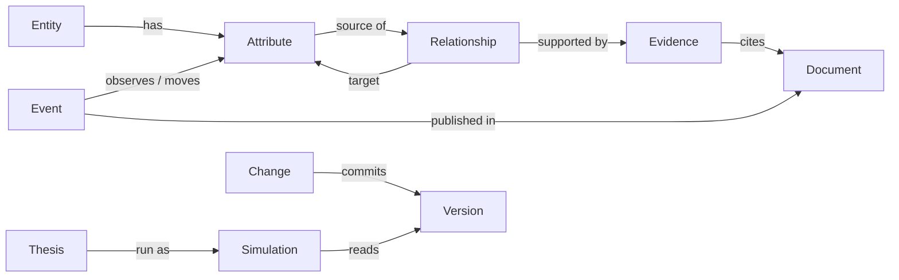

# World model API: data model first, API from the consumer's workflow

**Status:** decided Oct 18 (§9) and built as **v1**. The previous `/api/world-model` routes are retired, because nobody
had integrated them, so there is no compatibility layer. The contract is [../api/openapi.yaml](../api/openapi.yaml),
and the reference is [../api/](../api/README.md). Authentication follows [core-mcp-auth.md](core-mcp-auth.md).

**Ground truth:** Manav's *Data Model and API Design Best Practices*, Oct 18 (local copy). Each decision below names the
principle it follows. Its core principle: *design the data model around domain truths; design the API around how
consumers use those truths; keep both independent of implementation details.*

<!-- toc -->
**Contents**

- [1. The three models](#1-the-three-models)
- [2. The domain model](#2-the-domain-model)
- [3. API conventions](#3-api-conventions)
- [4. Resources and routes](#4-resources-and-routes)
- [5. Workflow reads](#5-workflow-reads)
- [6. From document to committed version](#6-from-document-to-committed-version)
- [7. Terms, grounded](#7-terms-grounded)
- [8. The old routes to v1](#8-the-old-routes-to-v1)
- [9. Decisions](#9-decisions)
<!-- /toc -->

## 1. The three models

*Separate domain, storage and API models.* Each serves one purpose. Today the service mostly serializes the domain
model, and v1 ends that: `src/axelrod_wm/api/v1/schemas.py` holds the API models and `project.py` maps the domain onto them.

| Layer | What it is | Here |
|---|---|---|
| **API model** | Shapes for consumers and their workflows | `EntityResponse`, `SimulationResponse`, `ImpactAnalysisResponse` (OpenAPI components) |
| **Domain model** | Business concepts, invariants and rules | `Entity`, `Subentity`, `Interaction`, `Composition`, `Transition`, `Forecast` (src/axelrod_wm/model) |
| **Persistence model** | Snapshots, the lakehouse catalog, indexes | content-addressed snapshots, SQLite catalog, FTS5 and vector indexes |

The world model is a *substrate* for agents. Agents produce theses, simulations and proposed changes that reference
world-model objects. They never rewrite those objects as established fact: a change becomes fact only when a person
approves it.

## 2. The domain model

*One definition each of Event, Entity, Relationship, Evidence, Thesis and Simulation, each with its own identity
and lifecycle.*

| Object | Identity | Key fields | Lifecycle |
|---|---|---|---|
| **Entity** | stable internal id (`toyota`), never a ticker | `type` (enum below), `name`, `aliases`, `identifiers` (ticker, ISIN, …), `concept_ids`, `group_ids` | created and retired by approved changes |
| **Attribute** | `{entity_id}.{key}` | `unit`, `view`, `basis`, `period`, `family`; its observations and its state over time | as entity |
| **Observation** | content hash | `attribute_id`, `value`, **`valid_at`** (when it applies), **`observed_at`** (when we learned it), `evidence_id` | append-only |
| **Relationship** | stable id (`m29`, `ty-c-tariff-cost`) | `source_attribute_id`, `target_attribute_id`, `type` (causal, accounting, identity, stock_flow), `confidence` (existence, 0–1), `effect` (sd/sd, or `null` when uncalibrated), `calibration`, `sign`, `kernel`, `transition`, **`valid_from` / `valid_to`** | added, re-weighted and retired by approved changes; never deleted |
| **Evidence** | stable id | `relationship_id` or `attribute_id`, `document_id`, `location`, `passage` (local only), **`evidence_type`** (company_filing, guidance, broker_research, expert_call, news, data, client_model), **`epistemic_type`** (documented, guidance, broker, model, assumption, inferred), `published_at` | append-only |
| **Event** | content hash | `type` (data_release, filing, news, research, policy_decision), `published_at`, `ingested_at`, `document_id`, the operations it stands for | append-only |
| **Thesis** | stable id | a what-if question as hypothetical operations | created by people or agents |
| **Simulation** | stable id | `thesis_id`, `version`, `horizon_days`, targets, transmission, coverage, `status` | runs once; immutable after completion |
| **Change** | stable id | `bundle_id`, `item_id`, the operations, `base_version`, `status` (pending, approved, rejected), `decided_by`, `decided_at` | pending → approved (commits a version) or rejected |
| **Version** | number and `state_hash` | `as_of`, `clock`, `change_ids` | immutable |

Data-model principles, as applied:

| Principle | Applied |
|---|---|
| Stable identity | Internal ids; tickers live in `identifiers` |
| Referential integrity | Relationships name existing attributes; evidence names existing relationships and documents; validated on every change |
| Normalize first | Company metadata once on the entity; relationships and evidence as their own objects (an edge has many evidence records) |
| Denormalize for reads | Workflow reads (§5) are projections, recomputed per version |
| Explicit types | `Entity.type` ∈ {company, person, agency, market, macro_factor, external_factor, other} (lower snake case, like every enum in the contract; a security is a market, a sector a group); `Relationship.type`; `evidence_type`; `epistemic_type` |
| Temporal modeling | Bitemporal observations (`valid_at`, `observed_at`); relationships `valid_from` / `valid_to`; documents `published_at`, `ingested_at`; versions (what the model knew, when) |
| Provenance | Every relationship and observation traces to evidence: source document, location, timestamp, and the model version that recorded it |
| Constraints | Confidence in [0, 1]; effect `null` when uncalibrated (never 0); accounting and identity weights fixed; one driving view per total |
| Schema evolution | Expand → migrate → contract; new fields optional first |
| Facts kept apart from inferences | `epistemic_type` on every claim; theses and simulations never write facts; changes need a person |

## 3. API conventions

| Concern | Rule |
|---|---|
| Versioning | Major version in the path, `/v1/…`; a compatibility policy (additive changes within v1; breaking changes only in v2) |
| Resources | Plural nouns, kebab-case, no verbs. Actions that are not CRUD create a resource (`POST /theses/{id}/simulations`) |
| Methods | GET reads, POST creates, PATCH updates, DELETE removes (documents only; model objects are retired by changes) |
| Predictable responses | One shape: `{"data": …, "meta": {"version": {…}, "request_id": "…"}}`. A list's `data` is always an array, with `meta.next_cursor` |
| Pagination | Cursor-based: `?limit=50&cursor=…` on every collection |
| Filtering | Query parameters: `?type=COMPANY&concept=…`, `?source=…&calibration=uncalibrated` |
| Pinning | `?version=N` or `?as_of=T` on every read; `meta.version` names what was served |
| Errors | **RFC 9457 Problem Details** (`application/problem+json`): `type` (a stable URI per error), `title`, `status`, `detail`, `instance`, plus `code` and `errors` (per field). 400, 401, 403, 404, 409, 412, 413, 422 |
| Idempotency | **`Idempotency-Key`** on every POST that creates; a retry returns the first response. Content-hash ids remain as well |
| Async | Long work returns **`202 Accepted`** with a `job` (`GET /v1/world-models/{id}/jobs/{job_id}`): ingesting documents, proposing changes, running simulations |
| Concurrency | **`ETag`** on versioned resources; `If-Match` on decisions (approving a change requires the version it was proposed on: `412` if the model moved) |
| Observability | `X-Request-Id` on every response; W3C `traceparent` accepted and propagated |
| Authentication | Core-minted service tokens (ES256 JWTs, verified with core's JWKS), scoped static keys for other services, and sessions for people ([core-mcp-auth.md](core-mcp-auth.md)). Scopes: `read`; propose: `documents:write`, `changes:write`, `simulations:write`; approve: `changes:review` (human only); `admin` |
| Authorization | The organization comes from the credential, never from the request. A world model of another organization is `404`. A scope check on every route |
| Contracts | OpenAPI 3.1 written first (`docs/api/openapi.yaml`), JSON Schema validation of responses in tests, route parity both ways, and consumer contract tests (core's patch) |

## 4. Resources and routes

All paths below start with `/v1/world-models/{world_model_id}` (decision 1). The organization comes from the
credential. The contract lists every route; the tables here are its outline.

### Entities and attributes

| Route | Returns |
|---|---|
| `GET /entities?type=&concept=&group=&q=&limit=&cursor=` | entities; `q` searches names and aliases |
| `GET /entities/{entity_id}?include=attributes,relationships` | one entity; attributes nested by default |
| `GET /entities/{entity_id}/attributes` | its attributes |
| `GET /entities/{entity_id}/attributes/{key}` | one attribute: level, spread, unit, view, basis, and the latest observation |
| `GET /entities/{entity_id}/attributes/{key}/observations?valid_from=&valid_to=` | its dated observations (bitemporal) |
| `GET /entities/{entity_id}/attributes/{key}/states?from=&to=` | the model's state of it over time: trajectories for charts |
| `GET /entities/{entity_id}/compositions` / `{composition_id}` | its business views: parts, role (driving or reconciling), reconciliation |
| `GET /entities/{entity_id}/paths` / `{path_id}` | its named paths, each step a relationship with its transition |

### Relationships and evidence

| Route | Returns |
|---|---|
| `GET /relationships?source=&target=&entity=&type=&calibration=&valid_at=` | relationships |
| `GET /relationships/{relationship_id}` | one relationship: effect or `null`, sign, kernel, transition, validity |
| `GET /relationships/{relationship_id}/evidence` | its evidence records |
| `GET /evidence/{evidence_id}` | one record: document, location, `evidence_type`, `epistemic_type` |

### Events, documents and research

| Route | Returns or does |
|---|---|
| `GET /events?type=&published_from=&published_to=&entity=` | market events |
| `GET /events/{event_id}` | one event and its operations |
| `POST /documents` (multipart; `Idempotency-Key`) | `202` and a job: store, parse, chunk, index, read into a bundle |
| `GET /documents?published_from=&ingested_from=` / `{document_id}` | documents |
| `GET /documents/{document_id}/chunks` / `{chunk_id}` | passages and the names recognized in each |
| `GET /documents/{document_id}/content?format=text\|raw` | the extracted text, or the original |
| `POST /documents/{document_id}/bundles` | read again against the model as it is now |
| `DELETE /documents/{document_id}` | remove it; its events and changes stay as history |
| `POST /bundles` / `GET /bundles` / `{bundle_id}` / `{bundle_id}/items` | research read by an agent: dated items with signals |
| `GET /search?q=&mode=&scope=` | search over chunks and names |

### Changes and versions

| Route | Does |
|---|---|
| `POST /changes` with `{"bundle_id", "item_ids"?}` (`Idempotency-Key`) | proposes one change per item, in event-time order |
| `GET /changes?status=` / `{change_id}` / `{change_id}/diff` | changes; one; what approving it would do |
| `POST /changes/{change_id}/approvals` (`If-Match: "<version etag>"`) | approve: commits a version (`412` if the model moved) |
| `POST /changes/{change_id}/rejections` with `{"reason"}` | reject |
| `GET /versions` / `{version}` / `latest` | committed versions, each with the diff from the previous |

### Theses and simulations

| Route | Does or returns |
|---|---|
| `POST /theses` / `GET /theses` / `{thesis_id}` | what-if questions |
| `POST /theses/{thesis_id}/simulations` with `{"horizon_days", "version"?}` | `202` and a job: runs it (replaces `POST /forecasts`) |
| `GET /simulations/{simulation_id}` | targets with ranges, scenario table, status, the version it ran on |
| `GET /simulations/{simulation_id}/transmission` | the shock's path by order |
| `GET /simulations/{simulation_id}/coverage` | calculated and excluded relationships, blocking inputs, share quantified |

### The rest

| Route | Returns |
|---|---|
| `GET /concepts` / `{concept_id}` | the taxonomy |
| `GET /groups` / `{group_id}` | recurring configurations of entities (superentity instances) |
| `GET /exports/v4.1.4?version=&simulation=` | the model in the client's v4.1.4 format |
| `GET /jobs/{job_id}` | async work: status, result link, error |

## 5. Workflow reads

*Keep canonical resources reusable, and add workflow-oriented reads where they cut complexity and latency.* Each read
below is a projection, recomputed for a version, that saves a consumer many requests.

| Route | For | Returns |
|---|---|---|
| `GET /events/{event_id}/impact-analysis` | "what did this news do?" (the UI, Kedar's harness) | `impacts`: entity, attribute, direction, size or `null`, confidence, `causal_path_ids`; `model_version` |
| `GET /entities/{entity_id}/traces?from={attribute}&through_totals=` | "how does X reach this company?" (was `/construction/{id}/trace`) | every route to the company's accounts, with uncalibrated steps and stops named |
| `GET /simulations/{simulation_id}/brief` | a reader's summary | summary, timing, exposures, indicators, evidence |
| `GET /graph?entities=&attributes=&depth=` | an agent's context window (was `/query`) | a subgraph: entities with nested attributes, plus the relationships between them |

## 6. From document to committed version

Each step is a pure function of its inputs and the version it reads. Nothing changes the model before step 9.

| # | Step | Input → output | Stored | Seen at |
|---|---|---|---|---|
| 1 | Store | file → document (content hash) | bytes, once per organization | `documents/{id}` |
| 2 | Parse | document → text with pages, sheets and rows | text | `…/content` |
| 3 | Chunk | text → passages (a table row each) | chunks | `…/chunks` |
| 4 | Index | chunks → keyword and vector indexes | indexes | `search` |
| 5 | Recognize | chunks, plus names at version V → mentions | mentions | `…/chunks` |
| 6 | Extract | mentions + rules (+ optional LLM), relative to `published_at` → signals with quotes | — | bundle items |
| 7 | Bundle | signals → dated items | bundle (content hash) | `bundles/{id}/items` |
| 8 | Propose | item + V → a change (operations, evidence) applied to a copy of V | change, `pending` | `changes/{id}/diff` |
| 9 | Decide | a person approves (`If-Match` V) or rejects | decision, who, when | `changes/{id}` |
| 10 | Commit | approval → version V+1, with events, observations and evidence recorded | snapshot | `versions/{V+1}` |

The same file and the same version always give the same document, chunks, signals, bundle and change, and approving
gives the same `state_hash`. Late and historical documents follow `temporal-ingestion.md`: claims land at their
`valid_at` and are recorded at their `observed_at`.

## 7. Terms, grounded

| Term | Definition |
|---|---|
| **Organization** (was *tenant*) | Owns world models, documents and credentials: Axelrod, or a client firm. Never a user. Derived from the credential and enforced on every route. |
| **Caller** | Who acts within an organization: a person or a service. Recorded on every change and decision. A service acting for a person names them. |
| **World model** | One causal model, with its own entities, relationships, history and documents. An organization may hold several. |
| **Change** (was *proposal*) | One item's operations applied to a copy of a version: an uncommitted diff. Approval commits it as a version. |
| **Simulation** (was *forecast*) | A thesis run on a version. A hypothetical change that is never committed. |
| **Coverage** | Part of a simulation: what was calculated, what was excluded and why, and which inputs block it. |
| **Export** (was *context*) | A version (and optionally a simulation) in a client's format. A projection, not separate state. |
| **Composition, path, trace** (was *construction*) | An entity's business views, its named chains of relationships, and the computed routes to its accounts. |
| **Relationship** (model: *interaction*) | A directed causal or accounting relation between two attributes. |
| **Attribute** (model: *subentity*) | One of an entity's values. |

## 8. The old routes to v1

| Retired (`/api/world-model`) | v1 (`{wm}` = `/v1/world-models/{id}`) |
|---|---|
| `GET /state` | `GET /v1/me`, `GET {wm}` (latest version, clock, counts), `GET {wm}/versions` |
| `GET /query` | `GET {wm}/graph` |
| `GET /nodes?q=` | `GET {wm}/entities?q=` |
| `GET /entities/{id}`, `…/attributes/{key}` | `GET {wm}/entities/{id}`, `…/attributes`, `…/attributes/{key}`, plus `…/observations` and `…/states` |
| `GET /taxonomy` | `GET {wm}/concepts`, `GET {wm}/concepts/{id}`; groups at `GET {wm}/groups` |
| `GET /construction/{id}` (json, markdown) | `GET {wm}/entities/{id}/construction`, and the canonical `…/compositions` and `…/paths` |
| `GET /construction/{id}/trace?start=` (`through_totals`, `max_depth`) | `GET {wm}/entities/{id}/traces?from=` (the same two) |
| `GET /context/v4?forecast=` | `GET {wm}/exports/v4.1.4?simulation=` |
| edges inside `/query` | `GET {wm}/relationships`, `…/{id}`, `…/{id}/evidence`, `GET {wm}/evidence/{id}` |
| (none) | `GET {wm}/events`, `…/{id}`, `…/{id}/impact-analysis` |
| `POST /documents` (synchronous) | `POST {wm}/documents` → `202` and a job |
| `GET /documents`, `/documents/{id}` | `GET {wm}/documents`, `…/{id}` |
| `GET /documents/{id}/text`, `/raw` | `GET {wm}/documents/{id}/content?format=text\|raw` |
| `GET /documents/{id}/chunks` | `GET {wm}/documents/{id}/chunks`, `…/chunks/{ordinal}` |
| `POST /documents/{id}/extract` | `POST {wm}/documents/{id}/bundles` → `202` and a job |
| `DELETE /documents/{id}` | `DELETE {wm}/documents/{id}` (`admin`) → `204` |
| `POST /bundles`, `GET /bundles`, `/bundles/{id}` | `POST {wm}/bundles`, `GET {wm}/bundles`, `…/{id}`, `…/{id}/items` |
| `POST /bundles/{id}/import` (`review: queue\|auto`) | `POST {wm}/changes` → `202` and a job; `auto` is gone |
| `GET /proposals`, `POST …/approve`, `…/reject` | `GET {wm}/changes`, `…/{id}`, `…/{id}/diff`, `POST …/approvals` and `…/rejections` (`If-Match`, human only) |
| `GET /search` | `GET {wm}/search` |
| `POST /forecasts` (`question` or `thesis_id`) | `POST {wm}/theses` (`question` or `template_id`), then `POST {wm}/theses/{id}/simulations` → `202` and a job; ready theses at `GET {wm}/thesis-templates` |
| `GET /forecasts`, `/forecasts/{id}`, `/brief` | `GET {wm}/simulations`, `…/{id}`, `…/transmission`, `…/coverage`, `…/brief` |
| (none) | `GET {wm}/jobs/{id}`, `GET {wm}/audit-events` (`admin`) |
| `{"error": {"code", "message", "details"}}` | RFC 9457 problem details |
| `limit` and `offset` | cursors |
| `X-Axelrod-On-Behalf-Of` | removed: the person comes from the token |
| version in a header only | `/v1` in the path; the header stays |

The MCP tools follow the same nouns (`world_model_list_entities`, `world_model_get_relationship`,
`world_model_simulate`, `world_model_list_changes`, …), and the core patch calls the v1 routes.

## 9. Decisions

Decided Oct 18.

1. **The world model is in the path:** `/v1/world-models/{id}/…`. It is explicit, and it allows several models per
   organization.
2. **The old API is retired, and this design becomes v1.** Nobody had integrated it, so it moved in one step, with no
   compatibility layer and no `/v2`.
3. **The API's nouns may differ from the code's.** The API says entity, attribute, relationship, evidence, event,
   thesis, simulation and change; the code keeps entity, subentity, interaction, market event, thesis, forecast and
   proposal. The three-model separation (§1) holds the line between them.
4. **Changes are approved per item.** A reviewer can accept part of a document.
5. **The OpenAPI spec is written in full first** ([../api/openapi.yaml](../api/openapi.yaml)), and the implementation
   is tested against it.

Built since, from [core-mcp-auth.md](core-mcp-auth.md): two security schemes (core-minted tokens and scoped static
keys) plus sessions; the `admin` scope; human-only decisions; `review: "auto"` removed; the `world_models` registry;
and an audit log of every write.

Not built yet:

- **Durable idempotency.** Keys are remembered for a day in memory, so a restart forgets them. Content-hash ids still
  make retried uploads and bundles safe.
- **Jobs that outlive the request.** A job runs to completion before its `202` returns. The contract already makes
  clients poll, so moving the work to a queue changes no client.
- **`POST /v1/world-models` and credentials routes** (`admin`). World models are still configured per login.
- **Attribute states before a restart.** States come from each attribute's own history, which holds the newest 260.
