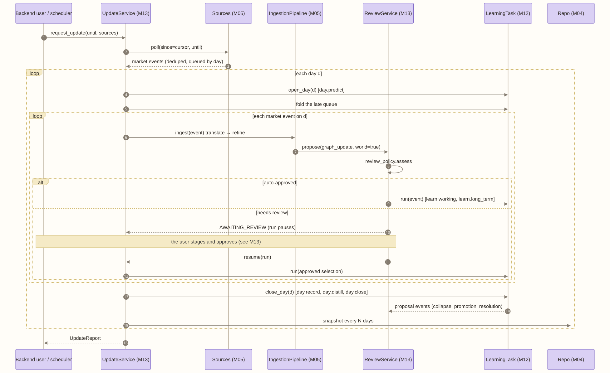

# Architecture

The system drawn as pictures, from the most abstract to the processes. The colors match the app's flowcharts:
- **Purple:** where a flow starts.
- **Butter:** a yes/no check.
- **Peach:** a commit or stored data.
- **Green · blue · pink:** working memory · long-term memory · inference.
- **Dashed:** a step that runs only sometimes.
- **Thick purple arrows:** the happy path.

Each module's spec holds its own detail diagrams.

<!-- toc -->
**Contents**

- [At a glance](#at-a-glance)
- [Dependency graph](#dependency-graph)
- [Components](#components)
- [Learning: five stages](#learning-five-stages)
- [Inference: seven stages](#inference-seven-stages)
- [The day loop](#the-day-loop)
- [The ledger lifecycle](#the-ledger-lifecycle)
- [Infrastructure](#infrastructure)
- [Detail diagrams](#detail-diagrams)
<!-- /toc -->

## At a glance

## Dependency graph

Every arrow points up, to what a module depends on. Each layer is its own band, and no module imports from a layer below it. Edges that others already imply are left out.

- **Algorithms never take the engine.** A slot gets its inputs, a context, and a transaction (or `None` for a read).
- **Algorithms return proposals; services create them.**
- **State never imports algorithms.**
- **Nothing below layer 5 imports views, the API, or the demo.**

The code today has import cycles; [migration.md](migration.md#current-cycles) lists them and the tasks that cut them.

## Components

What each part does with the data, from sources to interfaces. Learning writes; inference only reads committed versions.

## Learning: five stages

| Stage | Takes | Hands on | Detail |
|---|---|---|---|
| 1 · Intake | A market event, or an analyst's edit | A graph update event with concrete or hedged ends | [M05](modules/M05-intake.md) |
| 2 · Learning · working memory | The graph update event | The staged current state: structure, moves, the ripple by order, values and effects | [M08](modules/M08-learning-working.md) |
| 3 · Learning · long-term memory | What working memory learned | Staged lessons: concepts, Entity memories, the frontier, superentity support | [M09](modules/M09-learning-long-term.md) |
| 4 · Human review | Every staged change, ripple included | An approved selection, or a rejection | [M13](modules/M13-services.md) |
| 5 · Commit | The approved selection | A new version: one commit to each memory | [M04](modules/M04-repo.md) |

## Inference: seven stages

The stages are mutually exclusive and collectively exhaustive. Each answers one question with one output, and no step belongs to two stages. They use the naming guide's terms.

| Stage | Question | Takes | Hands on | Slots |
|---|---|---|---|---|
| 1 · Pose a thesis | What is asked? | A what-if question, on a committed version | A hypothetical event with concrete ends, and the values to watch | `refiner` |
| 2 · Isolate | What can the shock reach? | The event, on a branch | Networks: the superentities reached, a residual network, a context network for watched values | `isolator` |
| 3 · Isolated prediction | How does each network respond alone? | The networks | Each network's effect, shocked minus baseline | `network_predictor` |
| 4 · Distributed prediction | How do the networks move together? | The networks and their effects | Weighted scenarios (rival choices × open hypotheses), each with its networks coupled | `rival_detector`, `scenario_weighter`, `coupler` |
| 5 · Unify | One answer from rival stories? | The weighted scenarios | One forecast: every value as a distribution | `unifier` |
| 6 · Read out | What moves, when, by which path, and why? | The forecast | Orders, transmission paths, groups, binding constraints, a brief | `explainer` |
| 7 · Evaluate | Did it come true? | A decision recorded on the forecast, after its horizon | A score, and track records that weigh the next forecast | `scorer` |

Each scenario is weighed once, in stage 4, so that only the heaviest are coupled; stage 5 only mixes. Every stage's own flowchart is in the app (How it works) and in `flows/inference.py`.

## The day loop

The system's step: one update run, which pauses on a day while a proposal waits.

## The ledger lifecycle

Every write takes this path. It is modeled on Semantica's decision lifecycle.

## Infrastructure

The table of components is on the [design front page](README.md#10-infrastructure); operations are in [../guides/deployment.md](../guides/deployment.md).

## Detail diagrams

| Diagram | In |
|---|---|
| The data model | [data-model.md](data-model.md) |
| Intake, step by step; a fuzzy end's lifecycle | [M05 intake](modules/M05-intake.md) |
| The shared read | [M06 shared read](modules/M06-shared-read.md) |
| The two memories and their commits | [M03 memory](modules/M03-memory.md) |
| Learning · working memory, step by step; a hypothesis's lifecycle | [M08](modules/M08-learning-working.md) |
| Learning · long-term memory, per event and per day; a superentity's lifecycle | [M09](modules/M09-learning-long-term.md) |
| Pose a thesis, as a sequence | [M10 inference](modules/M10-inference.md) |
| Review and commit; a staged review as a sequence; a proposal's lifecycle | [M13 services](modules/M13-services.md) |
| An agent through the context layer | [M15 context layer](modules/M15-context-layer.md) |
| The standard retrieval stack vs the model's memory | [cognition.md](cognition.md) |
| Cognee and Semantica around the model | [frameworks.md](frameworks.md) |

The diagrams' sources are in `diagrams/*.mmd`. Edit a source, then run `uv run --with playwright python scripts/docs/diagrams.py` to re-render it. `--check` fails while any SVG is stale.
