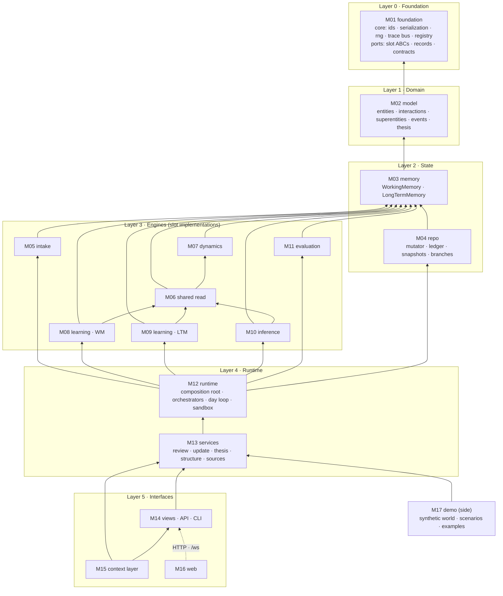
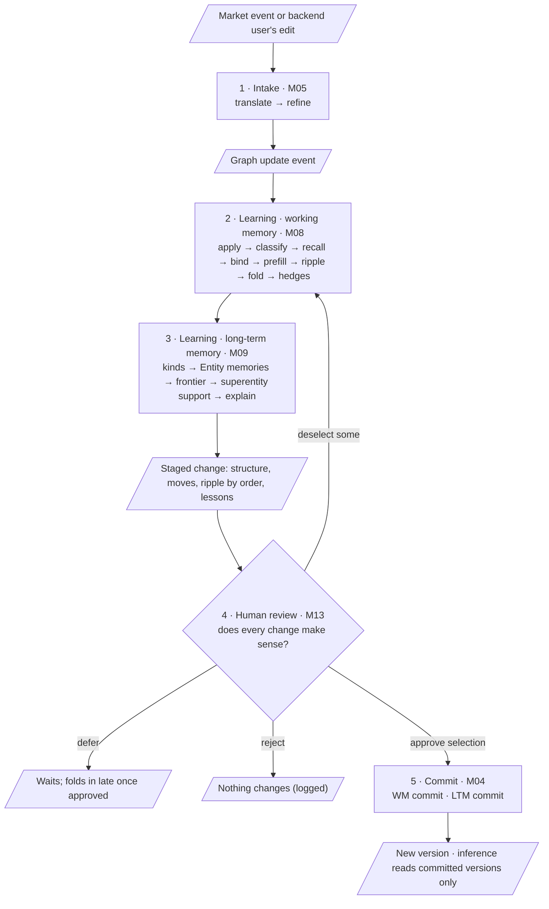
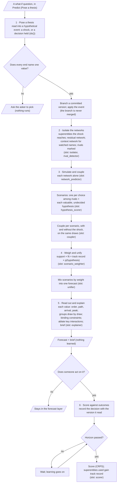
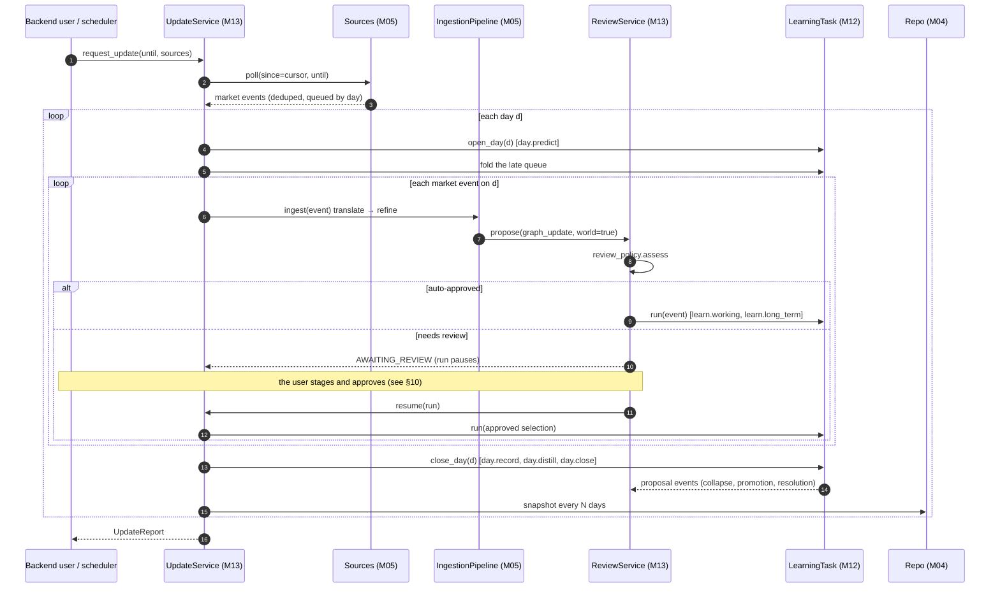
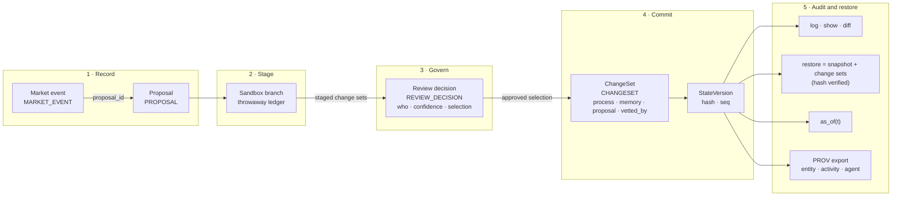
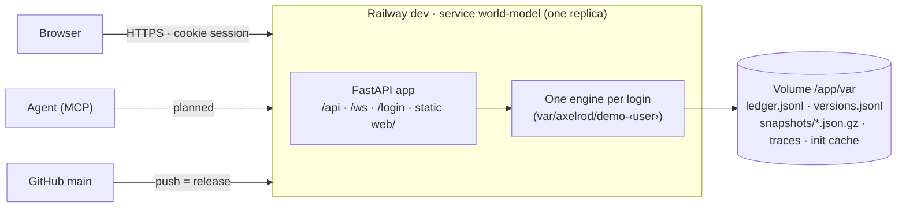

# Architecture: diagrams

The overview diagrams, in Mermaid, so they render on GitHub and a coding agent can read them as text. Each box reads `Stage (package) · module`. Parallelograms are data; rectangles are processing. The detail diagrams, such as each stage's own flowchart, the sequences, and object lifecycles, live in the module spec they describe ([index below](#detail-diagrams)).

## 1. System map

Learning writes; inference only reads committed versions.

## 2. Module layers

Arrows point from a module to what it imports. Nothing points upward, so there are no cycles (the code today has several: [migration.md](migration.md#current-cycles)).

- **Algorithms never take the engine.** A slot gets its inputs, a `ProcessContext`, and a `MutationTxn` (or `None` for a read). It never looks up `engine.components[...]`.
- **Algorithms return proposals; services create them.**
- **State never imports algorithms.**
- **Nothing below layer 5 imports views, the API, or the demo.**

## 3. Learning: five stages

Generated from `flows/` ([../flowchart.svg](../flowchart.svg) is the same picture). Each stage's own flowchart is in its module.

## 4. Inference: six stages

Nothing here writes to either memory.

## 5. The day loop

The system's step: one update run, paused on a day while a proposal waits.

## 6. The ledger lifecycle

Modeled on Semantica's decision lifecycle. Every write takes this path.

Ledger kinds: construction, update, market_event, proposal, review_decision, changeset, thesis, forecast, evaluation, decision, outcome, consolidation. Commit processes: construction, history, intake, day.predict, learn.working, learn.long_term, day.record, day.distill, day.close, structural, review, hypothesis, forecast (no version bump), evaluation, other.

## 7. Data model

Memory, as state:

```mermaid
flowchart LR
  subgraph WM["WorkingMemory (M03) — what the world is like now"]
    G["graph: CausalGraph"]
    DV["deviations (z per value per day)"]
    CH["channels (kernel recursion states)"]
    HY["hypotheses — the hypothesis frontier"]
    PRF["pending refinements (hedges)"]
    RJ["ripple judgments"]
    FL["forecast layer (outside the hash)"]
    AUX["activity log · episode buffer · late queue · source cursors · clock"]
  end
  subgraph LTM["LongTermMemory (M03) — what generalizes"]
    OG["Object generalizations<br/>kinds + superentity patterns"]
    IG["Interaction generalizations"]
    EMM["Entity memories<br/>decisions by context"]
    CF["Correlation frontier<br/>co-movements with no interaction"]
    PS["Prior states<br/>episodes · explanations"]
  end
  WM -- "day.distill" --> LTM
  LTM -- "priors · analogs · patterns" --> WM
```

## 8. Deployment

## Detail diagrams

| Diagram | In |
|---|---|
| Intake, from an article to a graph update event; a fuzzy end's lifecycle | [M05 intake](modules/M05-intake.md) |
| Learning · working memory, step by step; a hypothesis's lifecycle | [M08 learning · WM](modules/M08-learning-working.md) |
| Learning · long-term memory, per event and per day; a superentity's lifecycle | [M09 learning · LTM](modules/M09-learning-long-term.md) |
| Pose a thesis, as a sequence | [M10 inference](modules/M10-inference.md) |
| Human review and commit; staged review as a sequence; a proposal's lifecycle | [M13 services](modules/M13-services.md) |
| An agent through the context layer | [M15 context layer](modules/M15-context-layer.md) |
| The two memories and their commits | [M03 memory](modules/M03-memory.md) |
| The shared read | [M06 shared read](modules/M06-shared-read.md) |
| Cognee and Semantica around the model | [frameworks.md](frameworks.md#recommendation) |
| The standard retrieval stack vs the model's memory | [cognition.md](cognition.md#the-difference-in-one-picture) |
