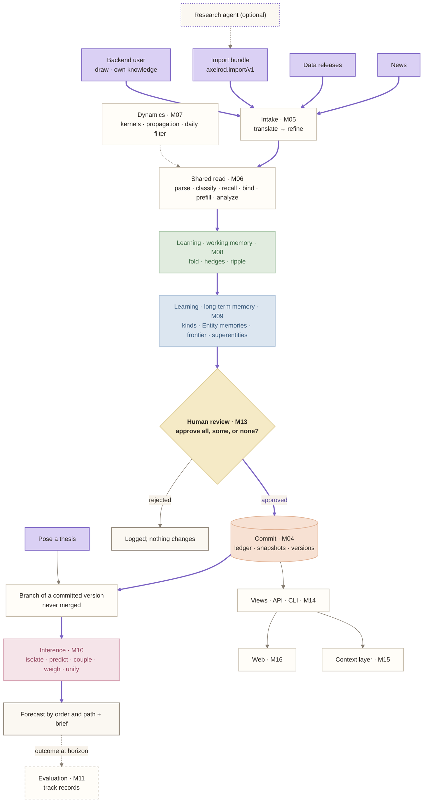
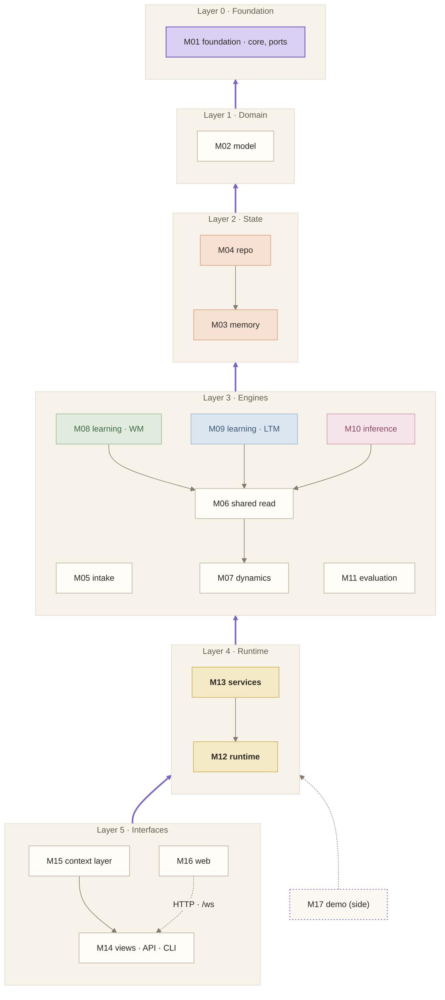
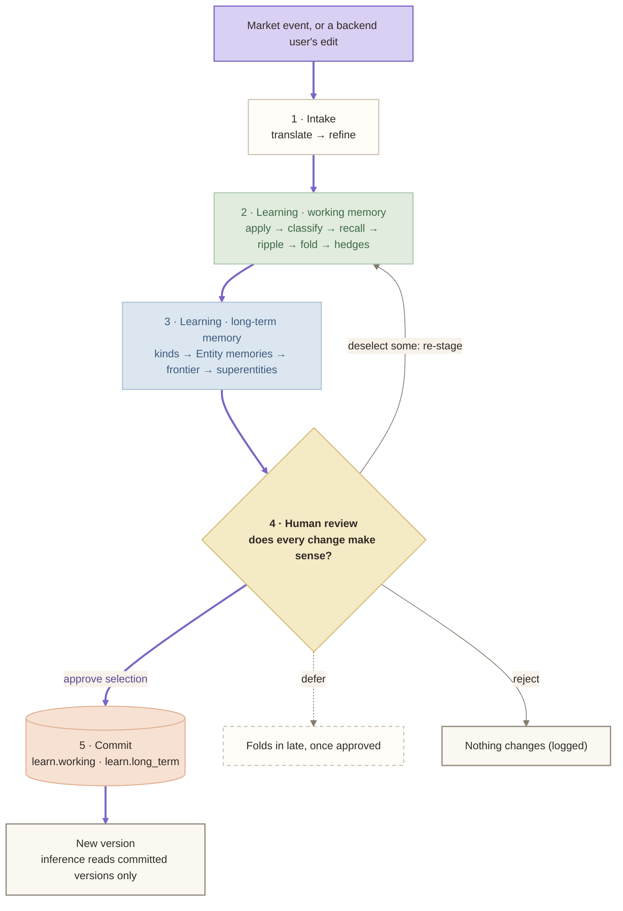
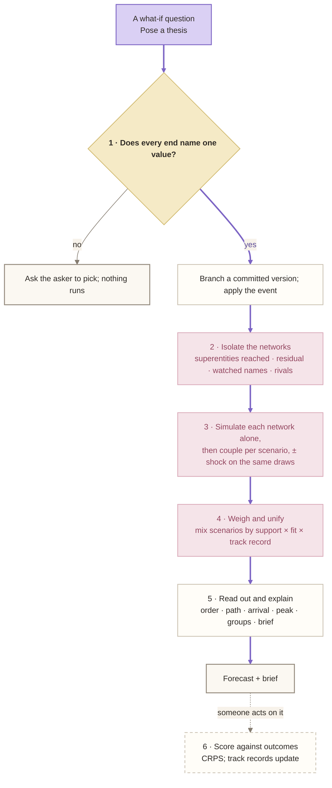
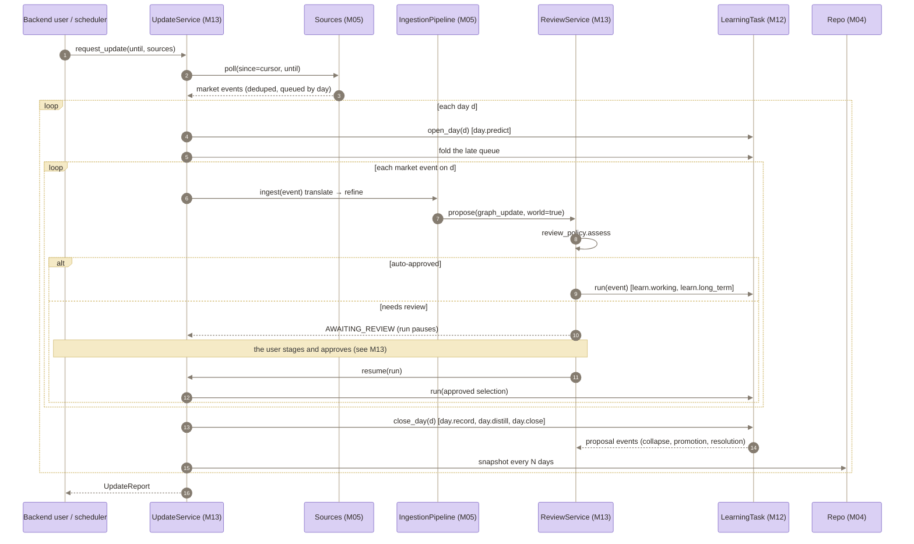
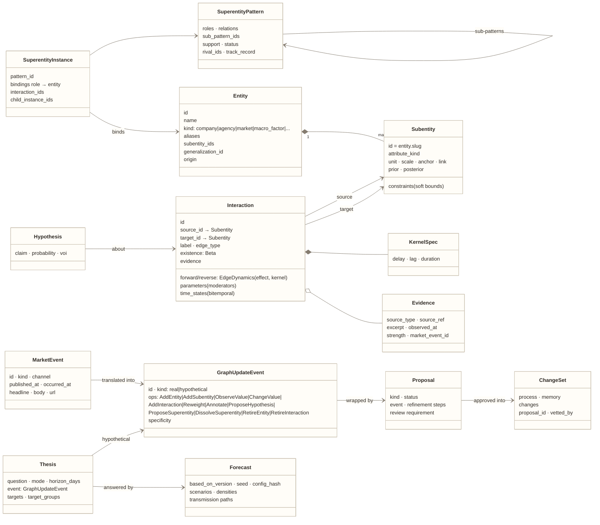

# Architecture: diagrams

Seven overview diagrams. The detail diagrams (each stage's own flowchart, the sequences, and the object lifecycles) live in the module spec they describe; [the index](#detail-diagrams) at the bottom lists them.

**Key:**
- **Thick purple arrows** are the happy path.
- 🟪 **Purple:** where a flow starts.
- 🟨 **Yellow:** a yes/no check.
- 🟧 **Peach:** a commit or stored data.
- 🟩 **Green:** working memory.
- 🟦 **Blue:** long-term memory.
- **Dashed:** runs only sometimes.

The colors match the app's own flowcharts and the README's overview ([../flowchart.svg](../flowchart.svg)). `scripts/docs/style_mermaid.py` applies them.

## 1. System map

Learning writes; inference only reads committed versions.

## 2. Module layers

Arrows point from a module to what it imports. Nothing points upward, so there are no cycles (the code today has several: [migration.md](migration.md#current-cycles)).

Rules:
- **Algorithms never take the engine.** A slot gets its inputs, a context, and a transaction (or `None` for a read).
- **Algorithms return proposals; services create them.**
- **State never imports algorithms.**
- **Nothing below layer 5 imports views, the API, or the demo.**

## 3. Learning: five stages

Each stage's own flowchart is in its module: [M05](modules/M05-intake.md), [M08](modules/M08-learning-working.md), [M09](modules/M09-learning-long-term.md), [M13](modules/M13-services.md).

## 4. Inference: six stages

Nothing here writes to either memory. The sequence is in [M10](modules/M10-inference.md).

## 5. The day loop

The system's step: one update run, which pauses on a day while a proposal waits.

## 6. The ledger lifecycle

Every write takes this path. It is modeled on Semantica's decision lifecycle.

```mermaid
%% style: begin (scripts/docs/style_mermaid.py)
%%{init: {"theme": "base", "themeVariables": {"fontSize": "14px", "primaryColor": "#FFFDF8", "primaryBorderColor": "#C9BFAF", "primaryTextColor": "#2F2A25", "lineColor": "#857C70", "textColor": "#2F2A25", "secondaryColor": "#F7F2EA", "tertiaryColor": "#FBF8F2", "edgeLabelBackground": "#F7F2EA", "clusterBkg": "#F7F2EA", "clusterBorder": "#E4DACB", "titleColor": "#665E54"}}}%%
%% style: end
flowchart LR
  ME["Market event<br/>MARKET_EVENT"]:::start ==> PR["Proposal<br/>PROPOSAL"]:::step
  PR ==> SB["Staged on a branch<br/>throwaway ledger"]:::opt
  SB ==> RV{"Review decision<br/>REVIEW_DECISION"}:::check
  RV ==>|approved selection| CS[("ChangeSet<br/>process · memory · proposal · vetted_by")]:::store
  CS ==> SV[("StateVersion<br/>hash · seq")]:::store
  SV --> AUD["log · show · diff · restore · as_of · PROV export"]:::done
  %% style: classes and happy path
  classDef start fill:#DAD0F4,stroke:#7C64C4,stroke-width:1.5px,color:#2F2A25
  classDef step fill:#FFFDF8,stroke:#C9BFAF,stroke-width:1.3px,color:#2F2A25
  classDef opt fill:#FFFDF8,stroke:#C9BFAF,stroke-width:1.3px,stroke-dasharray:5 4,color:#2F2A25
  classDef check fill:#F5EAC6,stroke:#D2BB72,stroke-width:1.3px,color:#2F2A25,font-weight:600
  classDef store fill:#F7E1D3,stroke:#E0B092,stroke-width:1.3px,color:#2F2A25
  classDef done fill:#FBF8F2,stroke:#93897C,stroke-width:1.6px,color:#2F2A25
  linkStyle 0,1,2,3,4 stroke:#7C64C4,stroke-width:2.6px,color:#5B4A99
  %% style: end
```

- **Ledger kinds:** construction, update, market_event, proposal, review_decision, changeset, thesis, forecast, evaluation, decision, outcome, consolidation.
- **Commit processes:** construction, history, intake, day.predict, learn.working, learn.long_term, day.record, day.distill, day.close, structural, review, hypothesis, forecast (no version bump), evaluation, other.

## 7. Data model

How the two memories feed each other is drawn in [M03](modules/M03-memory.md).

## Detail diagrams

| Diagram | In |
|---|---|
| Intake, step by step; a fuzzy end's lifecycle | [M05 intake](modules/M05-intake.md) |
| The shared read | [M06 shared read](modules/M06-shared-read.md) |
| Learning · working memory, step by step; a hypothesis's lifecycle | [M08 learning · WM](modules/M08-learning-working.md) |
| Learning · long-term memory, per event and per day; a superentity's lifecycle | [M09 learning · LTM](modules/M09-learning-long-term.md) |
| Pose a thesis, as a sequence | [M10 inference](modules/M10-inference.md) |
| Review and commit; a staged review as a sequence; a proposal's lifecycle | [M13 services](modules/M13-services.md) |
| An agent through the context layer | [M15 context layer](modules/M15-context-layer.md) |
| The two memories and their commits | [M03 memory](modules/M03-memory.md) |
| The standard retrieval stack vs the model's memory | [cognition.md](cognition.md#the-difference-in-one-picture) |
| Cognee and Semantica around the model | [frameworks.md](frameworks.md#recommendation) |
| The hosted deployment | [../deployment.md](../deployment.md) |
