# Architecture: diagrams

Every diagram is Mermaid, so it renders on GitHub and coding agents can read it as text. Boxes name the module they belong to, in the form `Stage (package)`, with their main classes or slots under the name. Parallelogram nodes are data; rectangles are processing. Module numbers (M01–M19) link to the specs in [modules/](modules/).

1. [System map](#1-system-map)
2. [Module layers and dependencies](#2-module-layers-and-dependencies)
3. [Learning: the five stages](#3-learning-the-five-stages)
4. [Intake](#4-intake)
5. [Learning · working memory](#5-learning--working-memory)
6. [Learning · long-term memory](#6-learning--long-term-memory)
7. [Human review and commit](#7-human-review-and-commit)
8. [The day loop (an update run)](#8-the-day-loop-an-update-run)
9. [Inference: the six stages](#9-inference-the-six-stages)
10. [Sequences: review, thesis, agent](#10-sequences)
11. [The ledger lifecycle](#11-the-ledger-lifecycle)
12. [Lifecycles of model objects](#12-lifecycles-of-model-objects)
13. [Data model](#13-data-model)
14. [Deployment](#14-deployment)

---

## 1. System map

The whole system, from sources to interfaces. Learning writes; inference only reads committed versions.

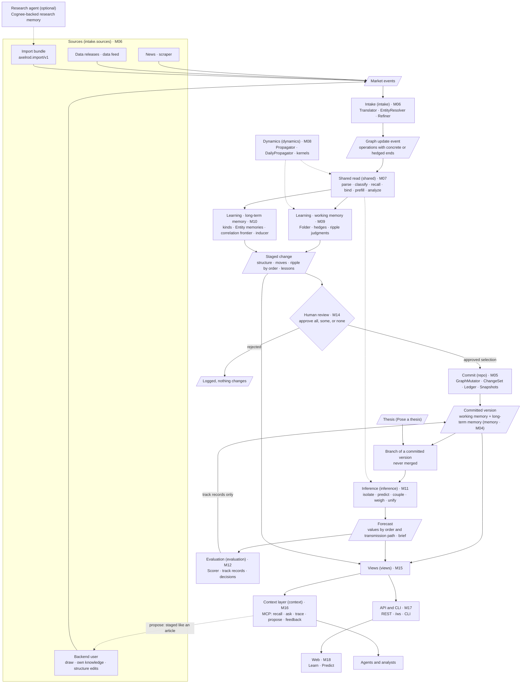

---

## 2. Module layers and dependencies

Arrows point from a module to what it imports. No arrow points upward, so there are no cycles. The code today has several cycles; [migration.md](migration.md#current-cycles) lists them and the cuts that remove them.

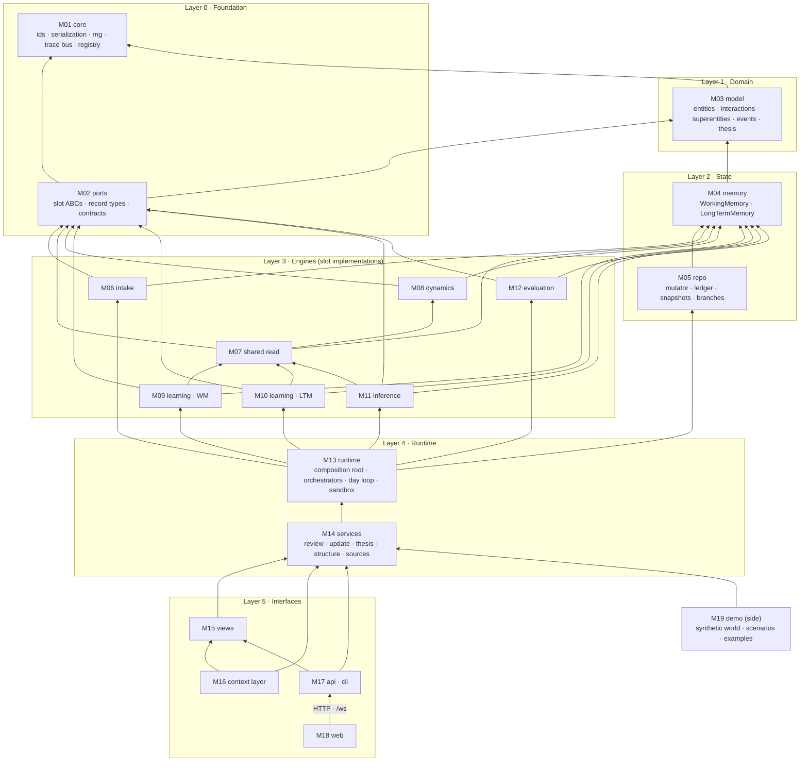

Rules that keep the layers honest:

- **Algorithms never take the engine.** A slot gets its inputs, a `ProcessContext`, and a `MutationTxn` (or `None` for a read). It never looks up `engine.components[...]` at run time.
- **Algorithms return proposals; they don't create them.** Creating a proposal is a service's job (M14).
- **State never imports algorithms.** `memory/` holds pydantic state; kernels' recursion state and the `Forecast` record live in `model/`.
- **Nothing below layer 5 imports `api/`, `views/`, or `demo/`.**

---

## 3. Learning: the five stages

Learning's overview. It is generated from `flows/__init__.py`; [../flowchart.svg](../flowchart.svg) is the same picture.

---

## 4. Intake

From an article to a graph update event. An end binds only when the article names it; otherwise it stays hedged.

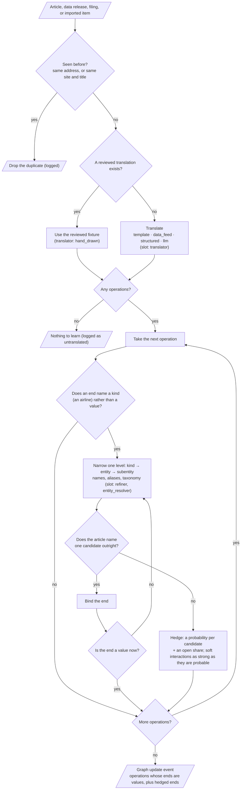

---

## 5. Learning · working memory

What the world is like now. It runs on a staged copy during review, and on the live state once approved.

```mermaid
flowchart TD
  IN[/"Graph update event, on its day"/] --> OPEN["The day opens: yesterday's moves ripple forward<br/>(slot: daily_propagator, once per day)"]
  OPEN --> P["Apply each operation<br/>add or retire structure; a change becomes a shock;<br/>a report becomes an observation (slot: parser)"]
  P --> NEW{"New items?"}
  NEW -- yes --> CL["Sort each down its taxonomy; inherit the kind's priors<br/>(slot: classifier)"]
  NEW -- no --> RC
  CL --> RC["Recall superentities and past days with a matching signature<br/>(slot: recaller, attention)"]
  RC --> FIT{"Does a recalled superentity fit?"}
  FIT -- yes --> BD["Bind it as an instance;<br/>a relation it predicts but the graph lacks → proposal (slot: binder)"]
  FIT -- no --> PF
  BD --> PF["Build the working set: interactions near the event,<br/>adjusted by similar past days (slot: prefiller)"]
  PF --> MV{"Does the event move a value?"}
  MV -- yes --> AN["Simulate with and without the move on the same draws;<br/>each reached value gets an order, a path, a peak (slot: analyzer → propagator)"]
  MV -- no --> RP
  AN --> RP{"Does the event report a value?"}
  RP -- yes --> FO["Surprise = report − prediction;<br/>update the level and each incoming interaction by its share (slot: folder)"]
  RP -- no --> HG
  FO --> HG{"Hedged ends waiting?"}
  HG -- yes --> WH["Weigh each candidate by this event × your confidence<br/>(refiner.weigh_hedges)"]
  WH --> PASS{"One candidate past the bound?"}
  PASS -- yes --> RES["Propose the resolution (waits for review)"]
  PASS -- no --> OUT
  HG -- no --> OUT
  RES --> OUT[/"Staged working memory: structure, moves, ripple by order,<br/>updated values and effects, hedges' new odds"/]
```

---

## 6. Learning · long-term memory

What generalizes across time and entities. Per event and then per day.

```mermaid
flowchart TD
  subgraph PE["Per event"]
    I[/"What working memory learned"/] --> RT{"Retired anything?"}
    RT -- yes --> FG["Retired items leave their kinds; frontier entries decay"]
    RT -- no --> GU
    FG --> GU["New items join their kinds; statistics update along the path<br/>(slot: generalization_updater)"]
    GU --> CR{"Is a kind crowded?"}
    CR -- yes --> SP["Split: a new child kind (slot: taxonomy_grower)"]
    CR -- no --> DC
    SP --> DC{"Did an actor decide?"}
    DC -- yes --> EM["Record it in the actor's Entity memory, by context"]
    DC -- no --> UX
    EM --> UX{"A move the graph did not explain?"}
    UX -- yes --> FR["Pair it with earlier unexplained moves,<br/>after removing known drivers (slot: frontier)"]
    UX -- no --> EX
    FR --> HOLD{"Has a pair held at enough spaced checks?<br/>(slot: promotion_test)"}
    HOLD -- yes --> PP["Propose the pair as an interaction (waits for review)"]
    HOLD -- no --> EX
    PP --> EX["Explain what was learned; keep it in Prior states (slot: explainer)"]
  end
  subgraph PD["Per day (distillation)"]
    EP["Summarize the day as an episode (slot: consolidator)"] --> CT["Count which interactions were active together (slot: inducer)"]
    CT --> KN{"Matches a known superentity?"}
    KN -- yes --> SUP["It gains support"]
    KN -- no --> CAND["Record a candidate"]
    SUP & CAND --> ADM{"Candidate above the admission threshold?"}
    ADM -- yes --> COL["Propose a collapse into a superentity"]
    ADM -- no --> FADE
    COL --> FADE{"Admitted superentity below its floor?"}
    FADE -- yes --> EXP["Propose an expansion back into its members"]
    FADE -- no --> DONE
    EXP --> DONE[/"Staged lessons and the proposals they raise"/]
  end
  EX --> EP
```

---

## 7. Human review and commit

The review happens at the end of learning, on a staged copy of the whole event, ripple included. Deselecting re-stages.

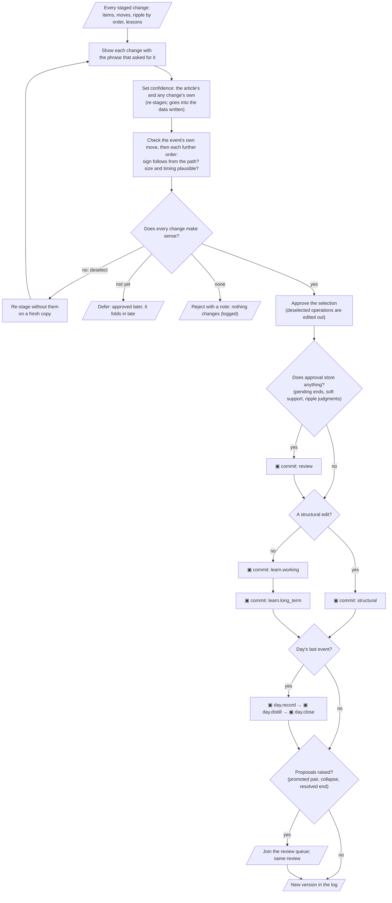

---

## 8. The day loop (an update run)

There is no `Engine.step`. The day loop in the update service is the step. One run is active at a time, and it pauses on a day while a proposal waits.

---

## 9. Inference: the six stages

How the model answers a what-if question. Nothing here writes to either memory.

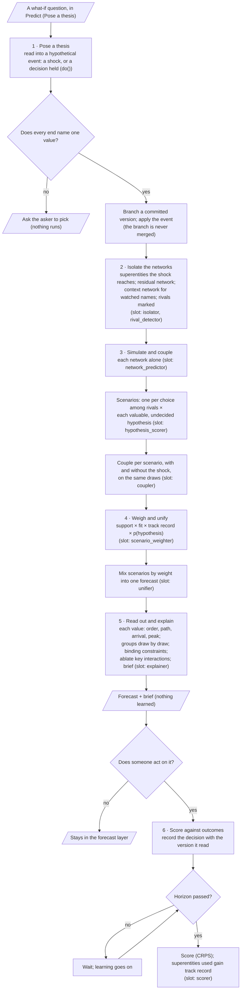

---

## 10. Sequences

### Staged review of one event

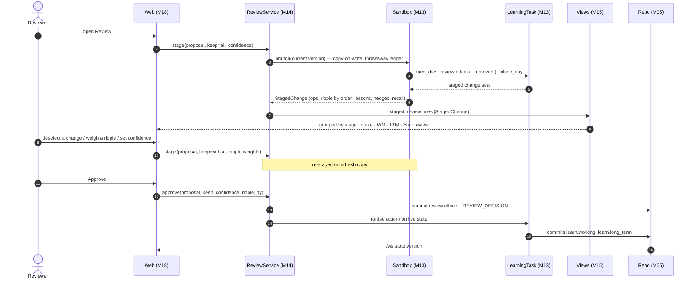

### Pose a thesis

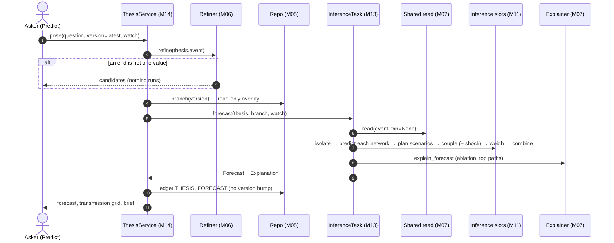

### An agent through the context layer

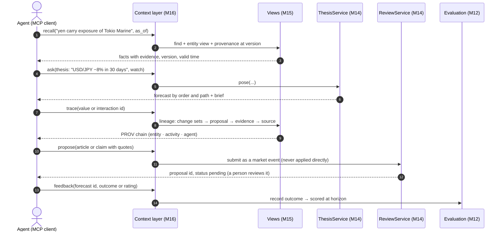

---

## 11. The ledger lifecycle

Modeled on Semantica's decision lifecycle (record → link → query → govern → audit). Every write takes this path.

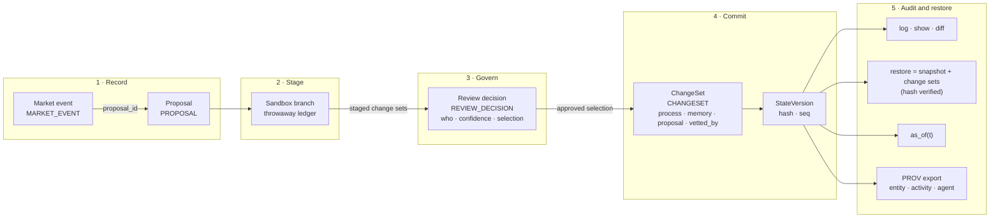

Ledger kinds (`repo/ledger.LedgerKind`): construction, update, market_event, proposal, review_decision, changeset, thesis, forecast, evaluation, decision, outcome, consolidation.

Commit processes (`repo/mutator.PROCESSES`): construction, history, intake, day.predict, learn.working, learn.long_term, day.record, day.distill, day.close, structural, review, hypothesis, forecast (no version bump), evaluation (track records), other.

---

## 12. Lifecycles of model objects

### Proposal

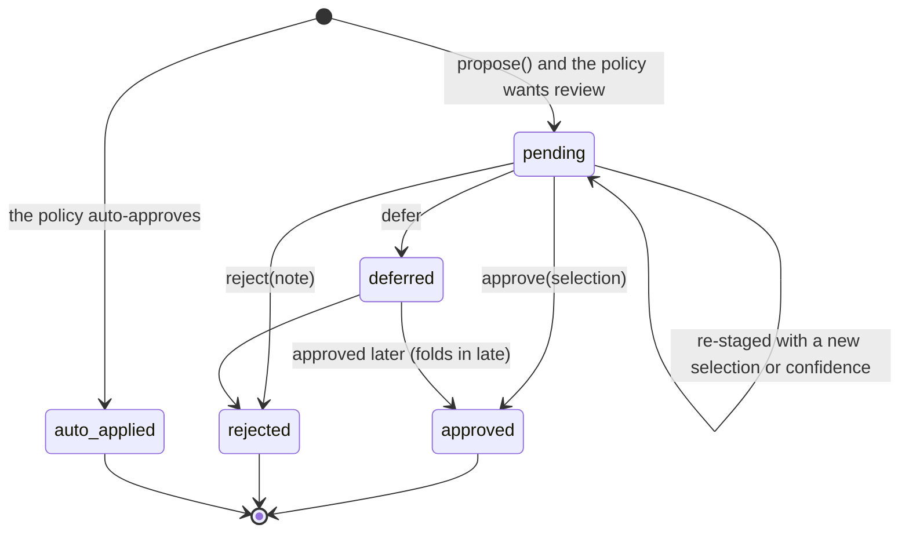

Kinds: graph_update, refinement, frontier_promotion, superentity_admission, superentity_dissolution, missing_relation.

### A fuzzy end (hedge)

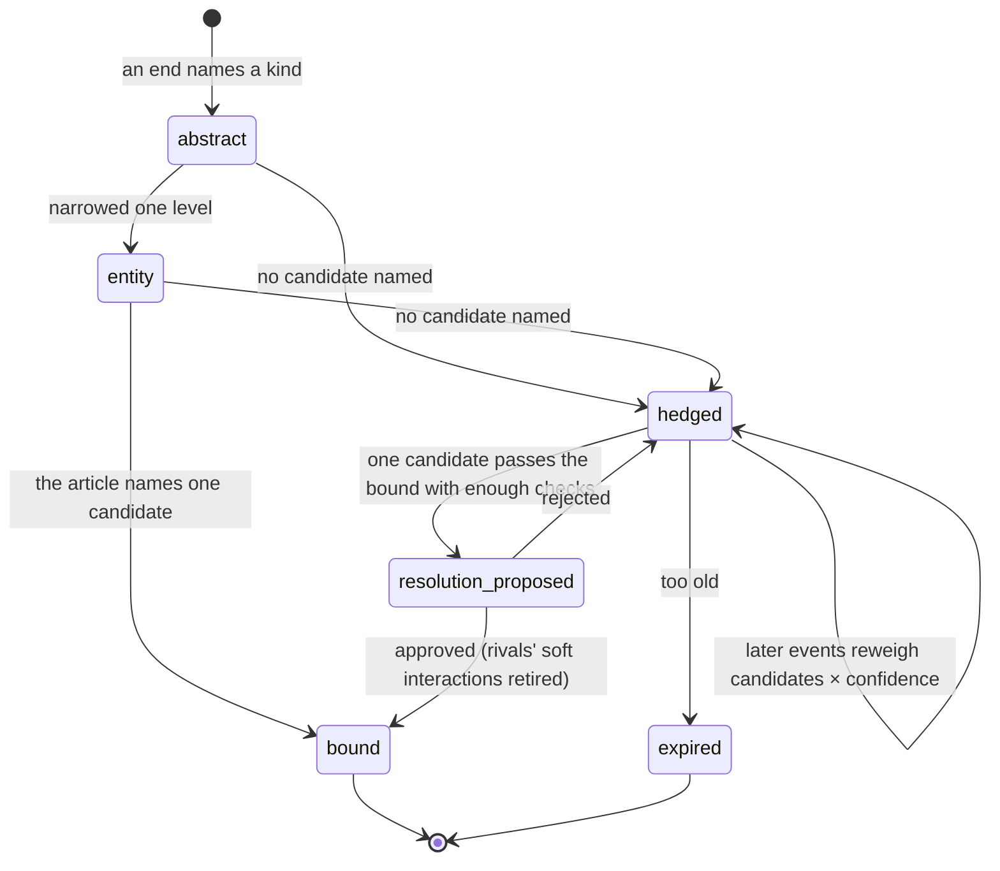

### A superentity pattern

```mermaid
stateDiagram-v2
  [*] --> candidate: a group of interactions fires together
  candidate --> candidate: support grows (+1 per spaced day) or decays
  candidate --> admitted: support > admission threshold and the collapse is approved
  [*] --> admitted: a backend user groups items (approved)
  admitted --> admitted: bound as instances; gains track record from forecasts
  admitted --> dissolved: support < floor and the expansion is approved, or the user dissolves it
  dissolved --> [*]
```

### A hypothesis (the hypothesis frontier)

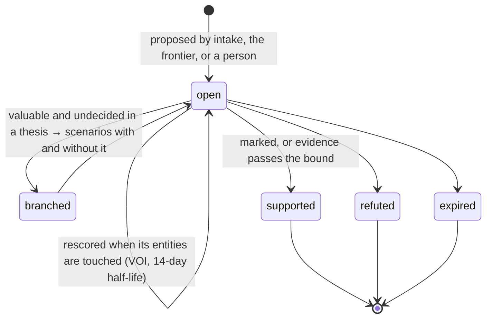

---

## 13. Data model

The main types and how they refer to each other. Field lists are in [M03](modules/M03-model.md) and [M04](modules/M04-memory.md).

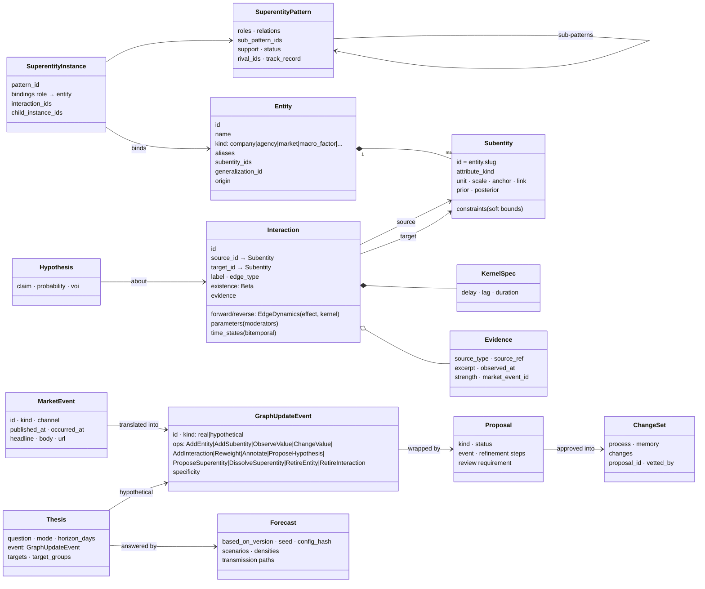

Memory, as state:

```mermaid
flowchart LR
  subgraph WM["WorkingMemory (M04) — what the world is like now"]
    G["graph: CausalGraph"]
    DV["deviations (z per value per day)"]
    CH["channels (kernel recursion states)"]
    HY["hypotheses — the hypothesis frontier"]
    PRF["pending refinements (hedges)"]
    RJ["ripple judgments"]
    FL["forecast layer (outside the hash)"]
    AUX["activity log · episode buffer · late queue · source cursors · clock"]
  end
  subgraph LTM["LongTermMemory (M04) — what generalizes"]
    OG["Object generalizations<br/>kinds + superentity patterns"]
    IG["Interaction generalizations"]
    EMM["Entity memories<br/>decisions by context"]
    CF["Correlation frontier<br/>co-movements with no interaction"]
    PS["Prior states<br/>episodes · explanations"]
  end
  WM -- "day.distill" --> LTM
  LTM -- "priors · analogs · patterns" --> WM
```

---

## 14. Deployment

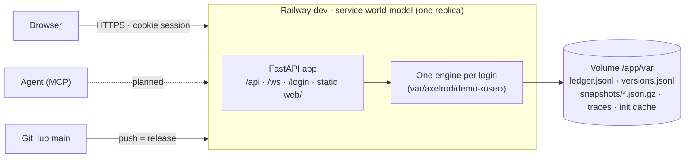
