# Cognitive framings

Why the world model organizes memory the way a cognitive architecture does, instead of the standard stack of chunks, embeddings, a vector index, and top-k retrieval. The framings come from research on concept formation, analogy, and causal learning, including our own work on hierarchical retrieval with Cobweb (Gupta et al., 2025) and on concepts and chunks (Singaravadivelan & Langley, 2026). Every framing lands in a slot, so each claim can be tested by swapping in the standard method and comparing ([how to test it](#how-to-test-the-claim)).

<!-- toc -->
**Contents**

- [In one table](#in-one-table)
- [The difference in one picture](#the-difference-in-one-picture)
- [The framings](#the-framings)
- [Where standard tools still fit](#where-standard-tools-still-fit)
- [How to test the claim](#how-to-test-the-claim)
- [References](#references)
<!-- /toc -->

## In one table

| # | Framing | The standard approach | What we do instead | What it buys a PM | Status |
|---|---|---|---|---|---|
| F1 | Two memories, consolidated daily | One store: a vector database or a long context | Working memory (the world now) and long-term memory (what generalizes), with a daily distillation | Today's state stays exact; lessons accrue slowly and don't overwrite it | Built |
| F2 | Incremental concept formation | A flat index, or batch clustering re-run on a schedule | Cobweb trees built one instance at a time, by category utility | New names are understood at once, with no re-indexing and no forgetting of old kinds | Planned (signature descent today) |
| F3 | Hierarchical retrieval | Top-k cosine over whitened embeddings | Sort down a concept tree; acuity cutoff instead of whitening | Retrieval returns a kind and its members, not a list of near-duplicates | Planned |
| F4 | A tree per structure, composed by concepts | One embedding space for everything | Separate trees for subentities, entities, interactions, events, schemas, episodes; composites point to their parts' concepts | A long part list can't swamp a composite; like is compared with like | Planned |
| F5 | Kinds by how things respond | Text embeddings of descriptions | Structured vectors: profile, factor exposures, responses to standard shocks, graph position | Two firms that react alike to oil are grouped, even if described differently | Planned |
| F6 | Kinds supply priors | Each new entity starts cold | A new member inherits its kind's values, interactions, and effect sizes | A newly added airline already links to jet fuel and to confidence | Built |
| F7 | Schemas as chunks | Fixed sector lists, or community detection | Superentities: recurring configurations, induced from co-activation, nested, admitted by review | Groups like "oil to airlines" emerge from data and can be named and reused | Built (heuristic) |
| F8 | Analogy by structure | Retrieve the most similar text | Two-stage recall: a cheap filter, then alignment of roles and relations | A new shock recalls an old one with the same shape, not the same words | Partial |
| F9 | Explaining away | Count every co-occurrence as evidence | A move already explained by a kind or an interaction is not evidence for a new link | Fewer spurious links from common drivers | Partial (R2) |
| F10 | Structure apart from strength; ask what is worth knowing | Store facts passively | The hypothesis frontier: whether an interaction exists, kept apart from its size, ranked by value of information | The model says which uncertainties matter to the names you watch | Built (heuristic VOI) |
| F11 | An open world | Closed-world entity linking (top-1) | Hedge vague mentions across candidates plus an open share; commit at a bound | "A US carrier" stays uncertain until evidence settles it; no false precision | Built (counts) |
| F12 | Local, incremental revision, judged by a person | Re-extract and overwrite in batch | Each event revises a staged copy; a person judges the consequences, ripple included | Every change is small, inspectable, and reversible | Built |

**Status:** *Built* means in the code. *Partial* means a simpler version is built. *Planned* means designed, with the slot ready ([ml-roadmap](../ml-roadmap.md) R5, R18, R2).

## The difference in one picture

The standard stack answers "which text is like this text". The world model answers "what kind of thing is this, what does that kind usually do, what past case had the same shape, and what don't we know yet". It is the second question set that a forecast needs.

## The framings

### F1 · Two memories, consolidated daily

- **Idea.** In complementary learning systems theory, specific episodes are stored fast, and structured knowledge is consolidated slowly and interleaved, which avoids catastrophic interference (McClelland et al., 1995).
- **Instead of** a single store, where every new fact competes with every old one.
- **In the model.** Working memory folds each vetted event in at once. Long-term memory learns from the day's distillation (`day.distill`): episodes, kinds, schemas, and Entity memories. Learning commits twice per event, once per memory.
- **Where.** [M03](modules/M03-memory.md), [M08](modules/M08-learning-working.md), [M09](modules/M09-learning-long-term.md).

### F2 · Incremental concept formation

- **Idea.** Cobweb builds a hierarchy of probabilistic concepts one instance at a time. It sorts each instance by category utility and predicts missing attributes from where sorting stops (Fisher, 1987). Classit extends it to continuous attributes with an acuity that floors a concept's variance (Gennari et al., 1989). Category utility favors the basic level, the level people name first (Corter & Gluck, 1992; Rosch et al., 1976). Cobweb reproduces human category-learning effects (Lian et al., 2024) and learns incrementally with little catastrophic forgetting (Barari et al., 2024, 2026).
- **Instead of** a flat index, or clustering re-run in batch, which must be rebuilt as the market changes and has no notion of a level.
- **In the model.** Kinds are the nodes of the object and interaction taxonomies. Each new item is sorted in and updates the statistics along its path.
- **Status.** The classifier is signature descent today. Cobweb trees are the planned implementation of the same slots, where Cobweb *proposes* structure and a hierarchical likelihood *decides* it ([decisions D-07](decisions.md)).

### F3 · Hierarchical retrieval with an acuity cutoff

- **Idea.** Retrieval can sort a query down a Cobweb tree over embeddings and return concepts, not only nearest neighbors (Gupta et al., 2025).
- **Our edit.** No whitening. That paper whitened its embeddings; here a tuned acuity cutoff, which floors each concept's variance at the prior variance instead of adding to it, does that job.
- **Instead of** top-k cosine similarity over whitened vectors, which returns near-duplicates and no structure.
- **In the model.** Each tree sets its own acuity cutoff, and recall returns the concept a query falls into, with its members and its statistics.
- **Status.** Planned, behind the `classifier`, `recaller`, and `context_retriever` slots.

### F4 · A tree per data structure, composed by concepts

- **Idea.** LABYRINTH classifies the parts of a structured object first, then describes the whole by the concepts its parts fell into (Thompson & Langley, 1991). TRESTLE adds partial matching to align roles and relations (MacLellan et al., 2016). Trellis gives one account of concepts and chunks (Singaravadivelan & Langley, 2026).
- **Instead of** one embedding space for every kind of object, where a composite with many parts is dominated by its longest part.
- **In the model.** There are six trees: subentities, entities, interactions, events, schemas, and episodes. A composite (an entity, a schema, an episode) refers to its parts by the concepts they were sorted into.
- **Status.** Planned (R5).

### F5 · Kinds by how things respond

- **Idea.** Categories carry the causal relations among their features, not just the features (Rehder, 2003). So an object's description should include how it responds.
- **Instead of** text embeddings of a company's description.
- **In the model.** An instance is built from structured data the model already holds:
  - a profile (kind, sector, region);
  - factor exposures (Ross, 1976; Stock & Watson, 2002);
  - responses to standard shocks (Jordà, 2005; Sims, 1980);
  - graph position (Grover & Leskovec, 2016);
  - text only where the input is text (Reimers & Gurevych, 2019).

  The vectors go into Cobweb unwhitened.
- **Status.** Planned (R5).

### F6 · Kinds supply priors

- **Idea.** People learn causal schemata, categories whose members share mechanisms (Kemp et al., 2010), and generic priors carry over from the kind to the case (Lu et al., 2008).
- **Instead of** each new entity starting with no values and no interactions.
- **In the model.** An entity sorted under Airline inherits a jet fuel cost, passenger traffic, and a market share, linked to oil and to confidence the way other airlines' are. The prior is used once the kind's support passes the recall threshold. Tutorial example 8 shows it.
- **Status.** Built.

### F7 · Schemas as chunks

- **Idea.** People induce a schema by comparing cases (Gick & Holyoak, 1983). A chunk is a concept over a configuration (Singaravadivelan & Langley, 2026).
- **Instead of** fixed sector lists, or a community-detection pass that knows nothing of causal roles.
- **In the model.** Superentities are recurring configurations of entities and interactions, with roles. They are induced from co-activation, nested inside larger ones, admitted only by review, and bound as instances when a new event fits. Tutorial examples 15 and 19–22 show them.
- **Status.** Built with a heuristic score. ml-stack §8.3 notes it can confirm itself; R2 addresses this.

### F8 · Analogy by structure

- **Idea.** Analogy maps relational structure, not surface features (Gentner, 1983). Retrieval runs as a cheap filter followed by structural alignment (Forbus et al., 1995).
- **Instead of** retrieving the past text that reads most like today's.
- **In the model.** Each distilled day is an episode. A new event recalls episodes whose signature matches, and their responses adjust the prefill. Tutorial example 11 shows a later shock recalling an earlier one.
- **Status.** Partial. Recall uses signature overlap today. The two-stage filter-then-align version is planned, along with R18's fix for double counting.

### F9 · Explaining away

- **Idea.** Evidence for one cause lowers belief in a rival cause. Dayan and Kakade (2001) give a Kalman-filter account of it.
- **Instead of** counting every co-movement as evidence for a link.
- **In the model.** A move that an interaction or a kind already predicts is not evidence for a new interaction or a new schema. The correlation frontier pairs only unexplained moves.
- **Status.** Partial. The frontier's slope still absorbs common drivers (ml-stack §8.2). R2 residualizes on the graph and on factors.

### F10 · Structure apart from strength, and what is worth knowing

- **Idea.** Whether a cause exists and how strong it is are separate questions (Griffiths & Tenenbaum, 2005). A question's value is how much its answer would change a decision. Like information gain for a yes-no question, it peaks at p = 0.5 (Nelson, 2005). Choosing what to watch is the observational counterpart of choosing interventions (Steyvers et al., 2003). In active learning, a learner asks for the labels that are worth the cost (Settles, 2012).
- **Instead of** a store that holds facts but does not know which unknowns matter.
- **In the model.** The hypothesis frontier holds claims that an interaction is present or absent, and that an actor will make a decision. The decision claims are scored from the actor's Entity memory, which is an empirical reaction function. Each hypothesis is ranked by its effect on the watched forecasts × 4p(1 − p), with a 14-day half-life. In a thesis, a valuable and undecided hypothesis splits the forecast into scenarios with and without it.
- **Status.** Built with a heuristic value. R8 plans the expected value of information under the forecast's own score.

### F11 · An open world

- **Idea.** Multiple-hypothesis tracking keeps every association alive until later evidence settles it (Reid, 1979). Probabilistic data association weights each candidate instead of choosing one (Bar-Shalom et al., 2009). A share kept for "one not seen yet" is the open-world mass of a Dirichlet process (Ferguson, 1973). Committing once evidence crosses a bound is a sequential test (Wald, 1945).
- **Instead of** linking every mention to its top-1 entity, and assuming the graph already holds everything that matters.
- **In the model.**
  - A vague mention ("a US carrier") is hedged across its candidates, plus an open share, and drawn as soft interactions.
  - Later events reweigh the candidates, and a resolution comes back for review once one passes the bound.
  - Every node carries an **open node**: the share of its movement the graph does not explain, or a kind's reserve for a member not seen yet.
  - Tutorial examples 3, 12, and 13 show hedging and its resolution.
- **Status.** Built. The weights are counts, not posteriors (S-M8); R18 plans proper responsibilities.

### F12 · Local, incremental revision, judged by a person

- **Idea.** People revise causal beliefs online through small local edits, not by re-deriving the whole model (Bramley et al., 2017). Interactive learning works when people are asked to judge what they can judge well (Amershi et al., 2014).
- **Instead of** re-extracting the graph in batch, or letting an LLM overwrite facts.
- **In the model.** Each event revises a staged copy. The reviewer judges *consequences*: what the event adds or retires, the value it moves, and that move's ripple at the second and third order. Every judgment is kept in the ledger.
- **Status.** Built.

## Where standard tools still fit

- **Text in, text out.** Text embeddings and language models are right for text: a vague mention's wording, an article's spans, and search over headlines. A language model translates an article into operations, held to the operation schema. It never computes an effect or a forecast.
- **Find.** The `find` view is a semantic filter for people navigating the canvas. It is a navigation aid, not the model's memory.
- **An upstream research memory.** Cognee, or a plain vector store, can hold the documents a research agent reads ([frameworks.md](frameworks.md#recommendation)). What reaches the world model is a reviewed import, sorted into the trees above.

## How to test the claim

Each framing sits behind a slot, so we can test it by ablation: swap in the standard method, replay the same history on the same seed, and compare.

| Ablation | Swap | Measure |
|---|---|---|
| Kinds vs cold start (F6) | `prefiller: none`; no inherited priors | Forecast CRPS for an entity in its first 30 days; reviewer edits per new entity |
| Concept trees vs a flat index (F2–F4) | `recaller`/`classifier` → top-k cosine over one embedding space | Analog hit rate on held-out shocks; CRPS; omission of tracked names |
| Structure vs surface (F8) | Recall by text similarity of headlines | The same, on shocks with novel wording but a familiar shape |
| Explaining away (F9) | Frontier on raw co-movement | False interactions proposed per month on a synthetic world with known truth (R16) |
| Open world (F11) | Top-1 binding | Wrong bindings later reversed; CRPS on the affected values |
| Value of information (F10) | Uniform scores | Forecast error reduction per reviewed hypothesis |

Scoring must be against raw observations (R0) and in synthetic worlds with known truth (R16). Otherwise the comparison flatters whichever method the filter already favors.

## References

The full list, with DOIs, is in the Literature tab (`web/literature.md`). Cited here:

Amershi et al. (2014); Bar-Shalom et al. (2009); Barari et al. (2024, 2026); Bramley et al. (2017); Corter & Gluck (1992); Dayan & Kakade (2001); Ferguson (1973); Fisher (1987); Forbus et al. (1995); Gennari et al. (1989); Gentner (1983); Gick & Holyoak (1983); Griffiths & Tenenbaum (2005); Grover & Leskovec (2016); Gupta, Singaravadivelan, & Wang (2025); Jordà (2005); Kemp et al. (2010); Lian et al. (2024); Lu et al. (2008); MacLellan et al. (2016); McClelland et al. (1995); Nelson (2005); Rehder (2003); Reid (1979); Reimers & Gurevych (2019); Rosch et al. (1976); Ross (1976); Settles (2012); Sims (1980); Singaravadivelan & Langley (2026); Steyvers et al. (2003); Stock & Watson (2002); Thompson & Langley (1991); Wald (1945).
