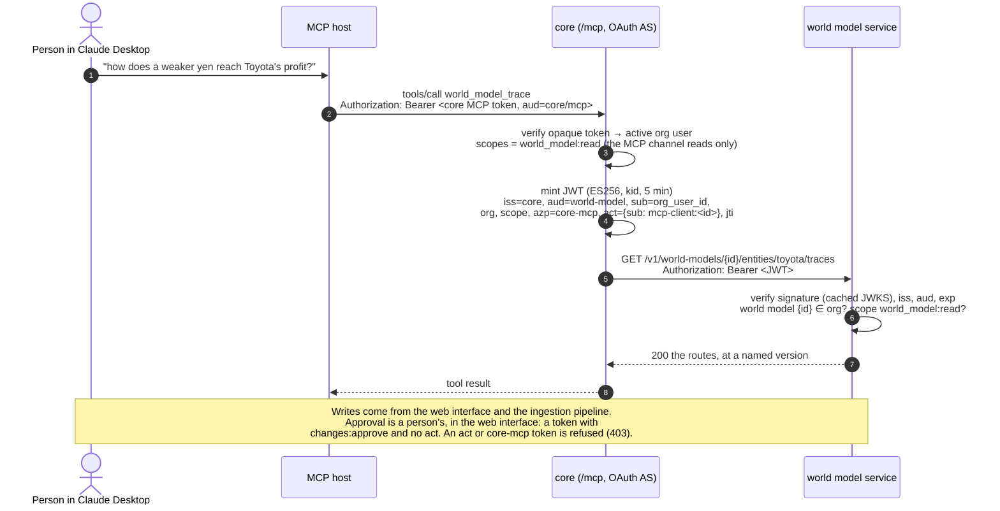

# Authentication between core's MCP server and the world model service

**Status:** our side (§7) is built (Oct 18): service-token verification, scoped keys, the `world_models` registry,
human-only decisions, and the audit log, as [api.md §9](api.md#9-decisions) records. The API review with Manav
(Oct 19, [architecture-plan.md](architecture-plan.md)) then changed four things, all built: scopes are named
`resource:action`; core's backend MCP **reads only** (§5); the audit log is kept forever; and idempotency keys are
permanent. Core's side (§6) is proposed, for review by Zsolt (core's MCP) and Manav (API and data model). Every core
change is a proposal; this repo never writes to core.

**Ground truth:** Manav's *Data Model and API Design Best Practices* (Oct 18): *OAuth2/OIDC or scoped service
credentials*; *tenant and resource-level checks*; *derive and enforce tenant scope from auth, never trust
client-supplied tenant IDs*. The API it applies to is [api.md](api.md), with three decisions
already taken: the world model id is in the path (`/v1/world-models/{id}/…`), changes are approved per item, and
credentials are scoped.

<!-- toc -->
**Contents**

- [Terms and acronyms](#terms-and-acronyms)
- [1. Problem](#1-problem)
- [2. Current state](#2-current-state)
  - [Core (`Axelrod-AI-Engineering/core`, `main` at `01886b5`, Oct 17)](#core-axelrod-ai-engineeringcore-main-at-01886b5-oct-17)
  - [Here (before v1)](#here-before-v1)
- [3. Requirements](#3-requirements)
- [4. Options](#4-options)
- [5. Recommendation](#5-recommendation)
  - [The token](#the-token)
  - [Scopes per route, and how they map to core](#scopes-per-route-and-how-they-map-to-core)
  - [Tenancy](#tenancy)
  - [Approval stays human-only](#approval-stays-human-only)
  - [Rotation and revocation](#rotation-and-revocation)
  - [Audit](#audit)
  - [When one side is down](#when-one-side-is-down)
  - [Local dev and tests](#local-dev-and-tests)
  - [The end user's direct MCP use](#the-end-users-direct-mcp-use)
- [6. Changes in core](#6-changes-in-core)
- [7. Changes here](#7-changes-here)
- [8. Rollout and migration](#8-rollout-and-migration)
- [9. Open questions](#9-open-questions)
<!-- /toc -->

## Terms and acronyms

Every acronym and short claim name used below, from the contract ([../api/openapi.yaml](../api/openapi.yaml),
`info.x-terms`; generated by `scripts/api/reference.py`).

<!-- terms:start -->
| Term | Full name | Meaning | Example |
|---|---|---|---|
| API | Application Programming Interface | The routes other programs call to use the world model. | `GET /v1/world-models` |
| v1 | version 1 of this API | The major version, in every path. Additive changes stay in v1; a breaking change is v2. | `/v1/…` |
| World model |  | One causal model: entities, their attributes, the relationships between attributes, its history and documents. An organization may own several. | `sally_demo` |
| erid | the unified world model (core's name for the world model state) | The whole graph, served beside the per-client world models. Its reads take a compartment; the whole graph is for internal staff. | `GET /v1/erid` |
| Compartment |  | A client's view of the unified world model: its companies, every player upstream of their values, and one link downstream (as a focused world is defined). | `sally_focus` |
| Organization (`org`) |  | Owns world models, documents and credentials: Axelrod or a client firm. It comes from the credential, never from the request. | `default`, `acme` |
| Internal staff |  | People and services of an internal organization (`WORLD_MODEL_INTERNAL_ORGS`). Only they read the whole unified world model. | Axelrod engineers |
| Person |  | A human, signed in to the web interface (a session) or named by a core-minted token without an agent. Only a person approves a change. | an analyst reviewing changes |
| Service |  | A program with a static key: the data-ingestion pipeline, a script. Never approves a change. | `ingest-pipeline` |
| Agent |  | An AI client acting for a person through MCP. Recorded in `act`; reads only. | Claude in core's MCP |
| Principal |  | The verified identity a request acts as: its kind, organization, subject, scopes and, for a token, `azp`, `act` and `jti`. | `{kind: token, org: acme, sub: org_user_9}` |
| `kind` | actor kind | How the principal was verified: `token` (core-minted), `key` (static), `session` (signed in here), `local` (an open local run), `system` (the engine itself). | `token` |
| Scope |  | A permission, named `resource:action` with three actions (read, create, approve), plus `admin`. | `changes:approve` |
| RBAC | Role-Based Access Control | Granting permissions by role. Here scopes are granted per credential; finer roles (approvers, admins) come later. |  |
| JWT | JSON Web Token (RFC 7519) | A signed set of claims. Core mints one per call as a service token. | `eyJhbGciOiJFUzI1NiIs…` |
| JSON | JavaScript Object Notation | The text format of every request and response body. | `{"data": …}` |
| JWKS | JSON Web Key Set (RFC 7517) | The issuer's public signing keys, by key id, at a URL this service fetches and caches. | `https://core…/.well-known/jwks.json` |
| ES256 | ECDSA using P-256 and SHA-256 (RFC 7518) | The only signature algorithm accepted on a service token. | header `alg: ES256` |
| ECDSA | Elliptic Curve Digital Signature Algorithm | The signature family ES256 belongs to. |  |
| `at+jwt` | OAuth 2.0 access token in JWT form (RFC 9068) | The `typ` header a service token must carry. | header `typ: at+jwt` |
| OAuth | Open Authorization (OAuth 2.0, RFC 6749) | The authorization framework whose access tokens a service token follows. |  |
| MCP | Model Context Protocol | The protocol AI clients use to call tools. Core runs an MCP server (its backend MCP); this service runs one at `/mcp`. | `world_model_get_entity` |
| `core-mcp`, `core-web` | core's channels | The part of core that asked, in a token's `azp`: its MCP server (reads only) or its web interface (a person). | `azp: core-web` |
| `iss` | issuer | Who minted the token; must be a trusted issuer. | `https://core.axelrod.ai` |
| `aud` | audience | Who the token is for: this service. | `https://world-model.axelrod.ai` |
| `sub` | subject | Who the token speaks for: the organization user (a person) or the key's caller. | `org_user_9` |
| `azp` | authorized party | The part of core that asked (OpenID Connect). | `core-mcp` |
| `act` | actor (RFC 8693) | The agent acting for the person, `{sub, name}`. A token with `act` reads only and never decides. | `{sub: mcp-client:claude}` |
| `jti` | JWT ID | A token's unique id: the join key between core's log and this audit log. | `5f1c…` |
| `exp`, `iat`, `nbf` | expiration time, issued at, not before | A token's validity window, checked with 60 seconds of leeway. | `exp` = issue + 5 minutes |
| `kid` | key ID | Which key of the JWKS signed the token. | `core-2026-10` |
| TTL | time to live | How long something is kept before it expires. Idempotency keys and the audit log have none: they are kept forever. | the JWKS cache: 10 minutes |
| RFC | Request for Comments | An Internet standard published by the IETF (Internet Engineering Task Force). | RFC 9457 |
| RFC 9457 | Problem Details for HTTP APIs | The error format: `application/problem+json` with `type`, `title`, `status`, `detail`, `instance`, and our `code`. | `404 entity_not_found` |
| HTTP | Hypertext Transfer Protocol | The protocol of every call. Status codes used: 200 OK, 201 Created, 202 Accepted, 204 No Content, 304 Not Modified, 4xx client errors, 5xx server errors. | `202 Accepted` |
| ETag | entity tag (RFC 9110) | An opaque version identifier of a response; here the model's state hash. Under review (Manav). | `"9c1f…"` |
| If-Match, If-None-Match | conditional request headers (RFC 9110) | If-Match: act only if the model is still at this ETag (412 if it moved; 428 without it). If-None-Match: 304 if unchanged. Under review (Manav). | `If-Match: "9c1f…"` |
| Idempotency-Key |  | A client's key that makes a create safe to retry: the same key and request return the first answer. Kept forever. | `Idempotency-Key: upload-42` |
| Cursor |  | An opaque position in a list, returned as `meta.next_cursor`; it keeps the version it started on. | `eyJvIjo1MCwidiI6M30` |
| Job |  | Long work answered `202 Accepted` with a job to poll. | `job_8f2a…` |
| `traceparent` | W3C Trace Context header | Distributed-tracing context, accepted and echoed. W3C is the World Wide Web Consortium. | `00-4bf9…-00f0…-01` |
| OpenAPI | the OpenAPI Specification 3.1 | The machine-readable contract of this API, docs/api/openapi.yaml. |  |
| CRUD | create, read, update, delete | The plain operations; actions that are not CRUD create a resource instead. | `POST …/approvals` |
| Lakehouse catalog |  | The service's store of documents, chunks, bundles, the registry, the audit log, idempotency keys and jobs (SQLite). |  |
| Bitemporal |  | Two times on every fact: when it applies (`valid_at`) and when the model learned it (`observed_at`). |  |
| sd | standard deviation | The unit of an effect size: a move in the target, in its standard deviations, per standard deviation of the source. | `effect: 0.4` |
| LLM | large language model | An optional extraction step in ingestion. |  |
<!-- terms:end -->

## 1. Problem

Core's MCP server knows who the person is: an org user, signed in through core's OAuth. The world model service only
knows that the caller holds a static key, and *reads* the person's identity from a header it cannot check. So today:

- **Anyone holding a key can name anyone.** `X-Axelrod-On-Behalf-Of` is recorded and never verified.
- **A key has every right.** Core's key can approve changes. Only the patch's choice to leave out `world_model_decide_proposal` stops an agent from approving its own change.
- **The organization comes from deployment config, not from the credential's claims.** Core holds an `org_id=key` map, and each key opens one login on our side.
- **Rotation and revocation are manual.** Each one is a coordinated edit to Railway variables on both services.

Before full integration, Manav wants the interface and the data model agreed. This document settles who the caller is
and what the caller may do.

## 2. Current state

This section is the state the design started from (Oct 17). Our side has since been built (§7), and the patch no
longer sends the on-behalf-of header ([integrations/core](../../integrations/core/README.md)).

### Core (`Axelrod-AI-Engineering/core`, `main` at `01886b5`, Oct 17)

| Concern | How it works | Where |
|---|---|---|
| MCP client auth | OAuth 2.1 with core as both the authorization server and the resource server: dynamic client registration, PKCE, and a consent page the signed-in org user must allow. The SDK routes sit at the origin root (`/authorize`, `/token`, `/register`, `/.well-known/*`) | `src/axelrod_app/mcp_oauth.py` (`AxelrodOAuthProvider`), `src/axelrod_app/mcp_server.py` (`build_mcp_server`, `install_mcp_routes`) |
| MCP access token | An **opaque** random token, stored hashed as an `auth_sessions` row (`authn_method="mcp"`, `audience` = the `{public_url}/mcp` resource). It is not a JWT. It has one coarse scope, `mcp`, and **no refresh token**. Its TTL is the UI session's (`auth_session_ttl_hours`, 14 days by default) | `mcp_oauth.py` `exchange_authorization_code`, `load_access_token`; `docs/mcp/CONTEXT.md` |
| Per-call identity | `org_user_from_mcp_token` resolves the token's subject to an `OrgUserRecord` and requires `status == "active"`, so suspending a user kills their MCP token at once. `mcp_principal` builds an `AuthPrincipal(subject_type="org_user_mcp", org_id, user_id, authn_method="mcp")` | `mcp_server.py`; `authn/sessions.py` |
| UI auth | An httpOnly session cookie (`axelrod_session`), backed by the same `auth_sessions` table with `authn_method="session"`. An MCP token presented as a cookie is refused | `authn/request_auth.py`, `authn/sessions.py`, `authn/http.py` |
| Orgs and users | `org_id` is a string on `OrgUserRecord` (`org_user_id`, `org_id`, `user_id`, `status`: invited, active or suspended). There is no organizations table. Users are seeded from `seeds/auth_identities.json` or invited | `contracts/v1/identity.py`, `identity/bootstrap.py`, `routers/auth.py` |
| Roles | **No org-level roles.** Any active org user can invite and suspend. Access is per analysis (`AnalysisGrantRole = owner \| viewer`). The one admin precedent is an environment allowlist, `AXELROD_CITATION_PREVIEW_POLICY_ADMIN_USER_IDS`. `docs/platform-identity/STATUS.md` marks RBAC as *planned* | `authz/analysis_acl.py`, `routers/citation_previews.py`, `config.py` |
| Writeback rules | The expert writeback design keeps the "expert" as a person, not a role. Simulation agents have no write path. Every authoritative change needs explicit human approval of the exact revision, with the reviewer drawn from **trusted auth**. In the MVP an author may approve their own change. Mapping permissions to writeback actions is left **unresolved** | `docs/world-model/EXPERT_WRITEBACK_INTERFACES.md` |
| Calling other services | Static shared bearers held in env vars: `AXELROD_HARNESS_RPC_TOKEN` between web and the dsh harness (open PR #63, a private Railway service). Vendor API keys go out the same way. No JWT is signed anywhere, though `pyjwt[crypto]` is already in `uv.lock` as a dependency of the `mcp` SDK. Secrets live in `.creds.<stage>` locally and in env vars when hosted | PR #63; `config.py`; `docs/conventions.md` |

The patch, [`integrations/core/0001-world-model-service-mcp-tools.patch`](../../integrations/core/0001-world-model-service-mcp-tools.patch),
is **not yet applied in core**. It adds two settings to `config.py`: `world_model_service_url` and
`world_model_service_keys_raw` (`AXELROD_WORLD_MODEL_SERVICE_KEYS`, with `org_id=key` entries and `*=key` as the
fallback). In `mcp_world_model.py`, `connection()` sends `Authorization: Bearer <org key>` and
`X-Axelrod-On-Behalf-Of: <org_id>/<org_user_id>`.

### Here (before v1)

| Concern | How it works | Where |
|---|---|---|
| Service credentials | `WORLD_MODEL_API_KEYS`: `caller:key:login` entries, each key 24+ characters, compared in constant time. A key opens `/api/world-model/…` and `/mcp` as its login, and the login picks the engine and the lakehouse partition (the tenant). The key carries **no scopes** | `src/axelrod_wm/api/keys.py`, `src/axelrod_wm/api/auth.py` (`service`) |
| Who is recorded | `caller_of` returns the key's caller, or the string `"<caller> for <on-behalf-of>"`. The header is checked only against a character pattern | `src/axelrod_wm/api/service.py` |
| Approval | `POST /proposals/{id}/approve` and `/reject` accept any key. `POST /bundles/{id}/import` with `review: "auto"` approves each item *as the caller* | `service.py` (`_decide`, `approve_all`) |
| Humans | Our own logins (`WORLD_MODEL_LOGINS`) and an HMAC session cookie. There is no user database | `api/auth.py` |
| Local | With no keys and no logins the service is open, and the caller is `local` | `api/auth.py` |

## 3. Requirements

| # | Requirement | Source |
|---|---|---|
| R1 | The organization and the person come from a credential we can **verify**, never from a header or path we have to trust | best practices, *Security* |
| R2 | Every route checks a **scope** and checks that the world model in the path belongs to the credential's organization | best practices, *Authorization*; api.md §3 |
| R3 | **Approval stays human-only.** No token minted for an agent or an MCP host can approve or reject a change. The check holds even if a future tool tries | core's expert writeback design; docs/design/api.md §1 |
| R4 | Every change and decision records the **organization, the person, the service and the agent host**, as structured fields rather than a string | docs/design/api.md §7 (*Caller*); audit |
| R5 | Keys rotate with no downtime and no coordinated edit on both sides. A suspended user or a compromised key stops working within minutes | ops |
| R6 | Local dev and CI work offline, with no shared secret checked in | core `docs/conventions.md` |
| R7 | An outage on one side degrades only the features that depend on the other | ops |
| R8 | MCP hosts (Claude Desktop, Cursor, Codex) keep connecting **only to core**, and core's token never leaves core | MCP authorization spec (no token passthrough; audience-bound tokens) |
| R9 | Small to build: no new infrastructure, and libraries both repos already have | best practices, *no premature microservices* |

## 4. Options

| | (a) Static org keys + trusted header (today) | (b) Core-minted short-lived JWT, verified with core's JWKS | (c) OAuth 2.0 token exchange (RFC 8693), core as the AS | (d) mTLS or service mesh + user claims |
|---|---|---|---|---|
| Who the user is | asserted in a header; unverifiable | signed claim (`sub`, `org`) | signed claim, from a `/token` exchange | still needs (a) or (b) for the user; mTLS proves only "this is core" |
| Organization | from the key map in core's config | signed claim | signed claim | from the client certificate, per service |
| Scopes | none (a key is all-powerful) | per token, from the user and the channel | per token, negotiated at the exchange | none on its own |
| Human-only approval | by convention (a tool left out) | enforced: MCP-channel tokens never carry `changes:approve`, and we reject `act` tokens on decisions | same as (b) | not expressible |
| Rotation | manual, on both sides | publish a new `kid` in the JWKS; we pick it up | same as (b) | certificate rotation; Railway has no built-in mesh or mTLS |
| Revocation | edit both env vars | TTL ≤ 5 min; core stops minting for suspended users | same as (b) | revoke the certificate |
| Core work | none (the patch) | a mint function, a JWKS route, signing-key settings | a token-exchange grant on the MCP SDK's `/token`, client auth for the exchange, plus everything in (b) | certificates, a sidecar or proxy, plus (b) for users |
| Our work | scopes on keys at least | verify JWTs (`pyjwt`, already a transitive dependency through `mcp`), check scopes | as (b), plus exchange client config | TLS termination we do not control on Railway |
| Fit with the guide | fails *derive tenant from auth* | *OAuth2/OIDC-style* tokens | *OAuth2* proper | — |

(b) and (c) produce the same token. They differ in who asks for it: in (b) core mints it in-process. In (c) a
client presents a subject token to an exchange endpoint. With core as the only caller, the endpoint adds a hop,
client credentials and a grant type the MCP SDK's provider doesn't implement, and it buys nothing (b) lacks.
(d) answers "is this core?" but not "for whom, and allowed to do what?", and Railway offers private networking, not
mTLS.

## 5. Recommendation

**(b): core mints a short-lived, audience-bound JWT (JSON Web Token) for each call. We verify it with core's JWKS
(JSON Web Key Set).** Shape the token after RFC 9068 (JWT access tokens) and RFC 8693's `act` (actor) claim, so (c)
remains an endpoint we can add later and the token stays the same. Keep Railway private networking as defense in
depth, not as identity. Keep **scoped static keys** for backend services (the data-ingestion pipeline, Kedar's
harness, scripts, our own `/mcp`). They carry no person and never `changes:approve`.

**The access boundary (decided Oct 19, D-21).** Only internal staff and backend services reach the world model
directly; clients use the products built on it. Core's backend MCP (Model Context Protocol) server **reads only**, to
start. Writes come from two places: the web interface (a signed-in person) and the data-ingestion pipeline (a static
key with `documents:create` and `changes:create`). We enforce the read-only rule ourselves too: a token with
`azp: core-mcp`, or with `act`, holds `world_model:read` only, whatever its `scope` claim says.

### The token

| Claim | Value | Why |
|---|---|---|
| `iss` | core's `public_url` (`https://insights.axelrod-ai.com` in prod, one per stage) | pins the stage. A dev token is useless against prod |
| `aud` | the world model service's configured audience (its origin) | an audience-bound token cannot be replayed at another service |
| `sub` | `org_user_id` | stable per membership; suspension is checked at mint |
| `org` | `org_id` | **the** tenant (R1). Path and body never override it |
| `name` | display name (optional) | so our review UI can show who proposed. See Q6 |
| `scope` | space-separated, below | R2 |
| `azp` (authorized party) | `core-mcp` or `core-web` | which part of core asked; `core-mcp` reads only |
| `act` (actor) | `{"sub": "mcp-client:<client_id>", "name": "<client name>"}` when an MCP host drives the call | an agent is acting (R3, R4); reads only |
| `iat` (issued at), `exp` (expiry), `jti` (JWT id) | TTL (time to live) 300 s; `jti` unique | short revocation window; audit join key |
| header `kid` (key id), `alg=ES256`, `typ=at+jwt` | | rotation; RFC 9068 |

### Scopes per route, and how they map to core

Scopes are `resource:action`, with one verb per action used the same way on every resource: **read**, **create**,
**approve**, plus **admin** (decided Oct 19 with Manav; finer admin and approval roles come later). All paths are
under `/v1/world-models/{id}` (and `/v1/erid` for the unified world model).

| Scope | Allows | Routes |
|---|---|---|
| `world_model:read` | reading a world model and everything in it | every `GET`: entities, attributes, relationships, evidence, events, documents, bundles, search, changes, versions, theses, simulations, concepts, groups, exports, jobs; `GET /v1/world-models`; `GET /v1/erid…` |
| `documents:create` | adding documents and bundles | `POST /documents`, `POST /documents/{id}/bundles`, `POST /bundles` |
| `changes:create` | proposing changes | `POST /changes` (one change per item) |
| `simulations:create` | posing theses and running simulations | `POST /theses`, `POST /theses/{id}/simulations` |
| `changes:approve` | approving or rejecting a change (a person only) | `POST /changes/{id}/approvals` (`If-Match`), `POST /changes/{id}/rejections` |
| `admin` | administration | `DELETE /documents/{id}`, `GET /audit-events`; later `POST /v1/world-models`, credentials |

| Old scope (Oct 18) | New scope (Oct 19) |
|---|---|
| `read` | `world_model:read` |
| `documents:write` | `documents:create` |
| `changes:write` | `changes:create` |
| `simulations:write` | `simulations:create` |
| `changes:review` | `changes:approve` |
| `admin` | `admin` |

Core has no roles, so for now the mapping goes by **channel**, with an allowlist for admin. The design follows core's
own rule: no new expert role. What each channel can do:

| Channel | Credential | Scopes | Can |
|---|---|---|---|
| Core's backend MCP (`azp=core-mcp`, `act` set) | core-minted token | `world_model:read` (we cap it, whatever is asked) | read |
| The web interface, a person (`azp=core-web`, no `act`; or our own session) | core-minted token or session | `world_model:read changes:approve`, plus `documents:create changes:create simulations:create` when the person's screen writes | read, write, approve |
| The data-ingestion pipeline | static key | `world_model:read documents:create changes:create` | read, upload, propose (never approve) |
| Any other backend service | static key, no scopes listed | `world_model:read` | read |
| A user on `AXELROD_WORLD_MODEL_ADMIN_USER_IDS` (web only) | core-minted token | adds `admin` (never on an `act` or `core-mcp` token) | administer |

Each tool asks for only the scope it needs. When core gains RBAC (Role-Based Access Control), the channel table
becomes the role table (viewer → read; contributor → +create; reviewer → +approve; admin), and the claim format stays
the same.

### Tenancy

- **An organization owns world models.** We keep a registry, `world_models(id, org_id, name, created_at)`, and the
  `org` claim must equal the model's `org_id`. Any other case answers `404`, not `403`, so other organizations'
  ids are not disclosed. Core does not store the mapping; it lists `GET /v1/world-models`.
- `org_id` is core's string as it stands, because core is the identity source. Axelrod's internal analysts are an
  organization like any other (`axelrod`).
- Every org user sees every model of their organization. Per-model grants wait for a need (Q3).

### Approval stays human-only

Four checks, each sufficient on its own:

1. Core never mints `changes:approve` on an MCP call, and we cap a `core-mcp` or `act` token at `world_model:read`.
2. We refuse a decision from any token with an `act` claim or `azp: core-mcp`, and from any static key
   (`403 human_approval_required`), before any scope check.
3. Core's catalog publishes no write tool at all. The patch's test enforces this.
4. `review: "auto"` is gone from the API. It approved as the caller, which broke R3 for any key.

Per-item approval records `decided_by` as `{org, sub, name, azp, jti}`. A person may approve a change they proposed
through an agent; core's MVP allows it (Q4).

### Rotation and revocation

- **Signing keys.** Core's settings hold the current and the next private key. The JWKS publishes both public keys,
  and core signs with the current one. To rotate: publish the next key, wait one JWKS cache period (10 min), switch
  signing, and drop the old key after one token TTL. We cache the JWKS for 10 minutes and refetch on an unknown
  `kid`, at most once a minute.
- **Users.** A suspended user cannot be minted for, because core checks `status == "active"` at mint, and the
  outstanding token dies within 5 minutes.
- **Emergency.** We hold a deny list of `kid`, `org` or `sub` values (`WORLD_MODEL_DENY`) that applies at once. Removing
  the issuer from our config stops all core traffic.
- **Static credentials.** Each caller may hold two keys at once, so a key rotates by overlap. Keys move to a hashed
  credentials table with `admin` routes (`POST/DELETE /v1/credentials`) when a second client needs them.

### Audit

Three records join on `jti` and `X-Request-Id` / `traceparent`:

1. Core logs each mint (`jti`, `org_user_id`, `client_id`, tool, scopes).
2. We append one audit event per request (time, request id, `jti`, `iss`, `org`, `sub`, `act.sub`, `azp`, scopes,
   world model, method, route, status, change ids).
3. Each change and decision stores its structured actor.

Together these answer "who did what, for which user, through which agent".

**Retention: forever** (decided Oct 19, D-22). The audit log has no expiry and no route that deletes it; only `admin`
reads it (`GET /v1/world-models/{id}/audit-events`).

### When one side is down

- **Core down.** No MCP calls arrive, so there is nothing to serve. Our review UI and our own logins keep working,
  because tokens are verified offline against the cached JWKS. If the JWKS cannot be fetched we keep the last good
  set for up to 24 h. An unknown `kid` with no reachable JWKS gets `503` with `application/problem+json`
  (`issuer_unavailable`).
- **We are down.** Core's tools return `world_model_unavailable`, as the patch does now. Add a 30 s breaker, as for
  dsh in #63, and the rest of the catalog is unaffected.

### Local dev and tests

- **Core.** On the `local` profile, with no signing key set, core generates an ephemeral key at startup and serves
  it at `http://localhost:<port>/.well-known/jwks.json`. Hosted profiles refuse to start without configured keys,
  as `auth_cookie_secure` is enforced in `config.py`.
- **Here.** `WORLD_MODEL_TRUSTED_ISSUERS` points at that issuer and JWKS. With nothing configured, the open local
  mode stays: caller `local` with every scope except `changes:approve` on `/v1`. The review UI still approves.
- **Tests on both sides.** Each test suite generates a key pair, so no key is ever committed. We test with an
  in-memory JWKS behind `httpx.MockTransport`. Core decodes what it mints against its own JWKS.
- **Contract.** A claim schema, `integrations/core/service-token.schema.json` (to be added), runs
  as a consumer contract test in both repos. A test-signed token fixture checks the scope-per-route table.

### The end user's direct MCP use

Claude Desktop, Cursor and Codex connect to **core's** `/mcp` only, through core's OAuth. That token's audience is core's
`/mcp`, and it never leaves core (R8). Each downstream call gets a fresh token addressed to us.

Our own `/mcp` stays an internal endpoint for engineers and harness work, on scoped static credentials, and is never
listed for clients. If clients ever need to reach it directly, our `/mcp` becomes an OAuth resource server that
names core as its authorization server (RFC 9728 metadata). That is option (c) arriving when there is a second
resource server (Q7).

Later, core's OAuth (Open Authorization 2.0) could offer finer host scopes (`world_model:read`, then a create
scope) on the consent page.
A person could then connect a host read-only, and the minted scopes would be the intersection of the person's
entitlement, the host's consent and the channel cap.

## 6. Changes in core

Proposals only, for Zsolt. File paths are against `main` at `01886b5`.

| File | Change |
|---|---|
| `src/axelrod_app/authn/service_tokens.py` (new) | `mint_service_token(org_user, *, audience, scopes, azp, actor=None) -> str` (ES256 via `pyjwt`); `public_jwks() -> dict`; key loading from settings; the local-profile ephemeral key |
| `src/axelrod_app/authz/world_model_scopes.py` (new) | `scopes_for(principal, channel, settings) -> set[str]`: the channel table and the admin allowlist. Only `world_model:read` when `channel == "mcp"` |
| `src/axelrod_app/routers/surface.py` (or a new `routers/well_known.py`) | `GET /.well-known/jwks.json`, public and cacheable (`Cache-Control: max-age=600`). It sits at the origin root next to the SDK's well-known routes, which `install_mcp_routes` already puts there |
| `src/axelrod_app/authn/http.py` | add `/.well-known/jwks.json` to the public paths if needed. `should_bypass_auth` already skips non-`/api/` paths |
| `src/axelrod_app/config.py` | add `service_token_signing_keys_raw` (`AXELROD_SERVICE_TOKEN_SIGNING_KEYS`: secret, `repr=False`, the current and the next private JWK), `service_token_ttl_seconds` (`AXELROD_SERVICE_TOKEN_TTL_SECONDS`, 300), `world_model_service_audience` (`AXELROD_WORLD_MODEL_SERVICE_AUDIENCE`), and `world_model_admin_user_ids` (`AXELROD_WORLD_MODEL_ADMIN_USER_IDS`). Keep `world_model_service_url`. **Drop** `world_model_service_keys_raw` from the patch. Add a validator: hosted profiles need signing keys |
| `src/axelrod_app/mcp_world_model.py` (the patch) | `connection()` mints a token per call, with the tool's scopes and `act={"sub": "mcp-client:<client_id>"}` from the verified access token, instead of the org key. The `X-Axelrod-On-Behalf-Of` header goes. Routes move to `/v1/world-models/{id}/…`, and tools take a `world_model_id` (default: the org's only model). A 30 s breaker |
| `src/axelrod_app/mcp_server.py` | expose the access token's `client_id` (today `load_access_token` sets `client_id=""`). Persist the registering client on the `auth_sessions` row so `act` can name the host |
| `src/axelrod_app/mcp_oauth.py` | store `client_id` and the client name at `exchange_authorization_code`. Later: offer `world_model:read` as a consentable scope |
| `tests/backend/test_mcp_server.py`, `tests/backend/test_service_tokens.py` (new) | the token's claims and signature against the JWKS; only `world_model:read` on any MCP mint; a suspended user gets no token; the local ephemeral key; rotation with two keys |
| `docs/mcp/SETUP.md`, `docs/mcp/CONTEXT.md` | a glossary entry *Service token* (*avoid*: forwarding the MCP access token). The world model paragraph names the scopes |
| Later, for the expert review UI | a `core-web` route that mints `world_model:read changes:approve` from a cookie session on an explicit decision, and calls `POST …/changes/{id}/approvals` with `If-Match` |

## 7. Changes here

| File | Change |
|---|---|
| `src/axelrod_wm/api/tokens.py` (new) | the JWKS cache, verification (`iss`, `aud`, `exp`, `nbf`, 60 s leeway, `typ`, `alg` allowlist ES256), the deny list, and the `Principal(org, sub, name, azp, actor, scopes, jti, kind)` it returns |
| `src/axelrod_wm/api/keys.py` | entries become `caller:key:org[:scopes]` (scopes `+`-joined; none listed means `world_model:read` only; `changes:approve` refused at parse). Two keys per caller for rotation. `login` becomes the organization |
| `src/axelrod_wm/api/auth.py` (`service`) | a bearer that looks like a JWT goes to `tokens.verify`; otherwise it is a static key. Put the `Principal` in the scope instead of `axelrod_login`/`axelrod_caller`. Answer `401`/`403` as RFC 9457 problems with `WWW-Authenticate: Bearer error="insufficient_scope", scope="…"` |
| `src/axelrod_wm/api/service.py` | `caller_of` → `principal_of(request)`. Drop `ON_BEHALF_OF`. A `requires(scope)` dependency on each route, plus a world model resolver that checks `org`. Decisions require `changes:approve` and no `actor`. `review: "auto"` removed. `decided_by` and `proposed_by` become structured |
| world model registry (lakehouse catalog) | `world_models(id, org_id, …)`; the existing per-login scenarios migrate to one model per organization |
| audit | an append-only `audit_events` table and an `X-Request-Id` on every response |
| `docs/design/api.md` (was `api-v2.md`) | done: the §3 *Authentication* row points here; `docs/api/openapi.yaml` has the scopes and both security schemes. Our side differs in places (key format, open mode): see docs/design/api.md |
| `integrations/core/` | regenerate the patch with the core changes above, and add `service-token.schema.json`. `tests/service/test_core_integration.py` also checks that each tool's minted scopes cover its route |
| settings | `WORLD_MODEL_TRUSTED_ISSUERS` (`issuer;jwks_url;audience` entries, one per core stage), `WORLD_MODEL_DENY`. Secrets stay in Railway variables |

## 8. Rollout and migration

The patch has not landed in core and nobody has integrated v1, so we change the patch **before** it lands instead of
migrating a live integration.

1. **Agree on the contract** (this document, plus api.md §3). Zsolt confirms the claims, the scope table and the
   JWKS path; Manav confirms the tenancy and actor fields in the data model. Commit the claim schema.
2. **Build here.** JWT verification beside scoped keys, the registry, scope checks, structured actors, and audit.
   Remove `review: "auto"` and the on-behalf-of header in the same step. Contract tests run against a test-signed
   token.
3. **Build in core.** The mint function, JWKS, settings and the regenerated patch. Dev first: core dev's issuer
   goes into our dev `WORLD_MODEL_TRUSTED_ISSUERS`. End-to-end smoke as today: ingest a source, propose, see
   `decided_by` empty and the change pending, and get `403` on any write or approval attempt with the MCP token.
4. **Staging, then production.** Each stage has its own issuer and its own keys. Keys never cross stages.
5. **Retire the static keys** issued to core. Static keys remain only for non-core callers, scoped.
6. **Later.** The core-web review path, consentable MCP scopes, and per-model grants once core has RBAC. Add a
   token-exchange endpoint (c) only if a second resource server or an outside caller appears.

## 9. Open questions

**For Zsolt**

1. Is `/.well-known/jwks.json` on core's origin acceptable next to the SDK's well-known routes, or would you prefer
   `/api/auth/jwks.json`? Should core's OAuth metadata also advertise `jwks_uri`?
2. Can `load_access_token` carry the MCP `client_id`, and the client name from registration, so `act` names the host?
   Clients live in memory and are forgotten on restart; the `auth_sessions` row may need to keep them.
3. Per-model access: is "every org user sees every model of their organization" enough until core has RBAC, or
   should per-analysis grants extend to world models?
4. Self-approval: core's MVP lets an author approve their own change. When a person proposed through an agent and
   then approves in a UI, is that acceptable, or must the reviewer differ from the `sub` of the proposing token?
5. Where does human review live for client organizations: our review UI (our logins), or core's future expert
   review screen (a `core-web` token)? Two human identity systems split the audit until one wins.
6. May the token carry the user's display name (`name`), or should we resolve names through a core endpoint so no
   personal data travels in tokens?
7. Should clients ever connect a host straight to our `/mcp`? If not, we keep it internal and unlisted.
8. Are core and the world model service in one Railway project, so the call can use private networking
   (`*.railway.internal`)?

**For Manav**

9. Should `organization`, `world_model` and the structured actor (`org`, `sub`, `azp`, `act`, `jti`) enter the
   canonical data model as first-class records, or stay API-layer metadata?
10. ~~Should the five api.md scopes plus `admin` be the contract, or four tiers?~~ **Answered Oct 19:** scopes are
    `resource:action` with three verbs (read, create, approve) plus `admin`, kept fine-grained (§5).
11. Should a shared base world model (Axelrod's) be readable across organizations? **Built Oct 19 as `erid`**, the
    unified world model: the whole graph for internal staff, and compartments assigned to client organizations
    (`WORLD_MODEL_COMPARTMENTS`), rather than a grants table. Whether it replaces the per-client world models is the
    open analysis in [architecture-plan.md §4](architecture-plan.md#4-one-world-model-or-several).
12. ~~Audit retention and access~~ **Answered Oct 19:** kept forever, no deletion route and no expiry (D-22); only
    `admin` reads it.
