# Data model

Everything the world model knows is one of the types below, and everything it writes is a change to one of them. Start with the five nouns; read further only for the type you are working on. Field lists match `src/axelrod_wm/model/`, `events/`, `memory/`, `inference/records.py`, and `repo/`.

<!-- toc -->
**Contents**

- [The model in five nouns](#the-model-in-five-nouns)
- [Units: how a number lives in the model](#units-how-a-number-lives-in-the-model)
- [The graph](#the-graph)
- [Events](#events)
- [Memory](#memory)
- [Forecasts](#forecasts)
- [Version control](#version-control)
- [Invariants](#invariants)
- [Next horizon](#next-horizon)
<!-- /toc -->

## The model in five nouns

| Noun | What it is | Example |
|---|---|---|
| **Entity** | An actor or an idea in the economy | Tokio Marine; the Fed; "oil supply" |
| **Subentity** | One of an entity's values: a number with a prior and a posterior | Tokio Marine's share price; the Fed's policy rate |
| **Interaction** | A directed causal relation from one subentity to another: whether it exists, how big, how slow | Brent → airline fuel cost, +0.6 sd per sd, after 10–30 days |
| **Superentity** | A recurring configuration of entities and interactions, with roles; superentities nest | "Oil to airlines"; "Semiconductor complex" › "AI chip supply chain" |
| **Event** | Something that changes or asks about the graph: a market event (learned from) or a thesis (asked, never learned from) | "Brent jumps 20%"; "What if USD/JPY falls 8% in 30 days?" |

Everything else is either **memory** (what the model holds now, and what it has generalized), **concepts** (the taxonomies new items are sorted into), or **records** (proposals, change sets, forecasts) that make it auditable.

## Units: how a number lives in the model

Every subentity is modeled in standard units so interactions compare across prices, rates, and shares:

z = (link(x) − anchor) / scale

- `x` is the value in native units (¥bn, %, bp, an index).
- `link` is identity, log, or logit, by the value's distribution.
- `anchor` is the reference level the value deviates from.
- `scale` is one standard unit.

An interaction's **effect** is in sd of the target per sd of the source. Reports and forecasts are converted back to native units for people. Today the scale is set once and never re-estimated, so "one sd" is a designer's unit, not a volatility (ml-stack §1); R3 plans realized-volatility scales.

## The graph

### Entity

| Field | Meaning |
|---|---|
| `id`, `name`, `aliases` | Identity and the names articles use |
| `kind` | company · person · agency · market · macro_factor · external_factor · other |
| `category_tags` | Display labels (SD, MF, SC, DI, DF, EN, EX, SH); no causal meaning |
| `features`, `description` | Profile used for classification (sector, region, …) |
| `subentity_ids` | Its values |
| `internal_interaction_ids` | Interactions between its own values |
| `generalization_id` | The concept it was sorted into |
| `origin`, `created_at`, `user_confidence` | Where it came from (seed, article, user, learned) and the reviewer's confidence |

### Subentity

| Field | Meaning |
|---|---|
| `id` = `<entity>.<slug>`, `entity_id`, `name`, `aliases` | Identity; always shown with its entity ("Tokio Marine · share price") |
| `attribute_kind`, `unit`, `features` | Its value concept (price, rate, flow, share, decision variable) |
| `prior`, `posterior` | Distributions (Gaussian, LogNormal, Beta, Gamma) |
| `anchor`, `scale`, `obs_noise` | The unit system above |
| `level_mean`, `level_var`, `level_noise`, `state_cov` | The daily filter's state |
| `observed` | False if no source reports it; it then moves only by propagation |
| `constraint` | A soft economic bound (`min`, `max`, `reason`) that bends, never clips |
| `history` | Time states: weekly, and one per non-routine event |
| `origin`, `prior_source_id`, `slot`, `slot_of`, `user_confidence` | Provenance of the value and its prior |

### Interaction

| Field | Meaning |
|---|---|
| `id`, `source_id`, `target_id` | A directed relation between two subentities |
| `label`, `direction`, `edge_type`, `tags`, `internal` | What it says; one-way or two-way; seeded, learned, or causal-learned |
| `existence` | A Beta: the probability the interaction is real |
| `forward`, `reverse` | `EdgeDynamics(effect, kernel)` per direction |
| `kernel` | `KernelSpec(delay, lag, duration, shape)`: zero before the delay, a ramp over the lag, a fade over the duration |
| `parameters` | Moderators: `ParameterBinding(name, moderator_id, form, coefficient, threshold)`, multiplicative, threshold, or additive |
| `evidence`, `evidence_dropped` | What supports it |
| `time_states` | Its past values |
| `generalization_id`, `prior_source_id` | Its interaction concept, and where its prior came from |
| `origin`, `created_at`, `retired_at` | Lifecycle; retired, never deleted |

### Superentity

| Type | Fields | Meaning |
|---|---|---|
| `SuperentityPattern` (long-term memory) | `roles` (name, kind, value concepts), `relations` (role → role, interaction concept, polarity, `present`), `sub_pattern_ids`, `support`, `status` (candidate · admitted · dissolved), `rival_ids`, `episode_ids`, `track_record` (hits, misses) | A reusable configuration: who plays which role and how they interact |
| `SuperentityInstance` (working memory) | `pattern_id`, `bindings` (role → entity), `interaction_ids`, `absent_interaction_ids`, `child_instance_ids`, `activation` | A pattern bound to real entities |
| `SuperInteraction` | `source_instance_id`, `target_instance_id`, `kind` (causal · shares_members), `underlying_interaction_ids`, `shared_entity_ids`, `significance` | The interactions between two instances, abstracted |

### Concepts

`Taxonomy` → `Generalization` nodes, with `GeneralizationStats` (support, typical levels, effects, kernels) and a `Signature`. There are two taxonomies, objects and interactions. A new item is sorted down one, inherits its concept's priors once the concept's support passes the recall threshold, and updates the statistics along its path. `AttributeVocabulary` lists the attribute kinds (designer-given, not learned).

## Events

### Market event (learned from)

`id`, `kind` (news · data · filing), `channel` (scraper · data_feed · user), `source`, `headline`, `body`, `full_text`, `published_at` (decides its day), `occurred_at`, `data`, `mentions`, `tags`, `url`, `synthetic`. An imported research item becomes a market event; its bundle format is in [interfaces.md](interfaces.md#import-bundle).

### Graph update event

`id`, `kind` (real · hypothetical), `ops`, `evidence`, `market_event_id`, `produced_by`, `confidence`, `ripple` (the reviewer's per-value ripple weights), `occurred_at`, `recorded_at`.

| Operation | Changes | In learning | In a thesis |
|---|---|---|---|
| `AddEntity`, `AddSubentity` | Structure | Adds it, sorted into a concept | On the branch only |
| `AddInteraction` | Structure | Adds it, with existence and dynamics (or as a hedge) | On the branch only |
| `ReweightInteraction`, `AnnotateInteraction` | An interaction | Changes its belief or evidence | — |
| `ObserveValue` | A value | A report: folded against the day's prediction | — |
| `ChangeValue` | A value | A shock, with its ripple | The thesis's shock; `intervention=true` pins a decision (do()) |
| `ProposeHypothesis` | The hypothesis frontier | Adds a hypothesis | — |
| `ProposeSuperentity`, `DissolveSuperentity` | Superentities | Collapse or expand, by review | — |
| `RetireEntity`, `RetireInteraction` | Structure | Retires it (kept in history) | — |

Every end of an operation is a `ConcreteTarget` (a subentity) or an `AbstractTarget` (a concept, an entity, or a mention still to be narrowed). **Specificity** runs generalization (0) → entity (1) → subentity (2); only concrete ends propagate.

### Thesis (asked, never learned from)

`id`, `question`, `mode` (open-ended · scaffolded), `event` (a hypothetical graph update event), `horizon_days` (182 by default), `targets` (values to report), `target_groups` (entities, superentities, sectors, categories), `posed_by`, `posed_at`, `pinned`.

## Memory

| Memory | Holds |
|---|---|
| **Working memory**: the world now | The graph · daily deviations (z per value per day) · channel states (each interaction's kernel recursion) · the **hypothesis frontier** · pending refinements (hedges) · ripple judgments · the forecast layer (outside the state hash) · activity log, episode buffer, late queue, source cursors, clock |
| **Long-term memory**: what generalizes | **Object generalizations** (concepts and superentity patterns) · **Interaction generalizations** · **Entity memories** (each actor's `DecisionObservation`s and `DecisionProfile` by context) · **Correlation frontier** (`CoMovement`: earlier → later, lag, sign, support, consistency, status) · **Prior states** (episodes and explanations) |

A **hypothesis** is a claim that an interaction is present or absent, or that an entity will make a decision. It has `probability`, `informational_value`, `half_life_days` (14), and `status` (open · supported · refuted · expired).

## Forecasts

| Type | Key fields |
|---|---|
| `Network` | `kind` (superentity instance · residual · context), `subentity_ids`, `channels`, `boundary_in`/`out`, `forced_present`/`absent`, `relevance` |
| `ForecastScenario` | `network_ids`, `rival_choices`, `branched_hypothesis_ids`, `forced_existence`, `weight`, `effect_summary` |
| `Forecast` | `thesis_id`, `based_on_version`, `config_hash`, `seed` (reproducible), `horizon_days`, `targets`, `summary`/`effect_summary`/`z_summary` (distributions), `scenarios`, `isolated`, `decomposition`, `groups`, `effect_density`, `movers`, `transmission` (order, path, arrival, peak), `paths` (the transmission grid), `constraints_binding`, `explanation_id`, `dropped_mass` |
| `Explanation` | `key_interactions` (by ablation), `top_paths`, `analogs`, `networks`, `scenarios`, `assumptions`, `text`, `index_keys` |

## Version control

| Type | Key fields |
|---|---|
| `Proposal` | `kind` (graph_update · refinement · frontier_promotion · superentity_admission · superentity_dissolution · missing_relation), `event`, `status` (pending · approved · rejected · deferred · auto_applied), `review_reasons`, `decided_by`, `note`, `edited_from`, `changeset_id`, `version_after` |
| `ChangeSet` | `cause`, `process` (day.predict · learn.working · learn.long_term · day.record · day.distill · day.close · structural · review · …), `memory`, `message`, `proposal_id`, `vetted_by`, `version_before`/`after`, `changes` |
| `Change` | `action` (add · update · remove · …), `collection` (dotted, e.g. `wm.graph.interactions`), `id`, `field`, `before`, `after` |
| `LedgerEntry` | `seq`, `kind` (construction · market_event · proposal · review_decision · changeset · thesis · forecast · evaluation · decision · outcome · …), `recorded_at`, `occurred_at`, `state_version`, `payload` |
| `StateVersion` | `version`, `seq`, `state_hash` (Merkle), `cause`, `process`, `memory` |

`Evidence` (`source_type`, `source_ref`, `excerpt`, `observed_at`, `strength`, `market_event_id`, `user_confidence`) ties a belief to where it came from.

## Invariants

- **Ids are stable.** A subentity's id is `<entity>.<slug>`; nothing is renamed or deleted, only retired.
- **Only concrete ends propagate.** An abstract end is hedged until evidence or a person resolves it.
- **One writer.** Every change is a `Change` inside a `ChangeSet` in the ledger; snapshots plus change sets reproduce the state hash.
- **Category tags never enter inference.**
- **A forecast never changes memory.** It records the version, config hash, and seed it used.

## Next horizon

These are designed but not built. Each is an additive field, so old snapshots still load.

| Addition | On | Why |
|---|---|---|
| `valid_from`, `valid_to`, `recorded_at` (bitemporal) | time states, interactions, evidence | "What did we believe on date X about date Y"; leak-free backtests |
| `superseded_by`, `supersession_reason` | interactions, time states | Supersede, never delete |
| `identity` (ticker, LEI) | entities | One real actor, one id, across imports |
| `evidence_type`, `trust_tier`, `source_credibility` | evidence | Fact vs assumption vs our view, and how corroborated a claim is |
| `vintage`, `reference_period`, `release_ts`, `expectation` | observations | Point-in-time data, and releases read as surprises |
