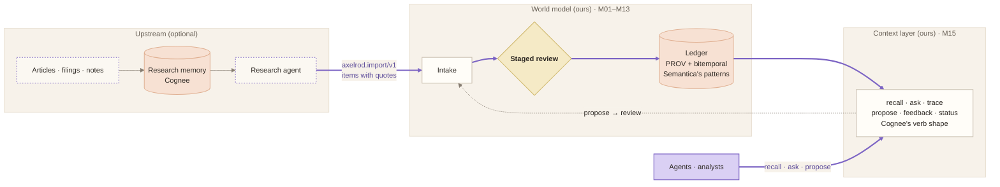

# Cognee and Semantica

We compared two open-source frameworks to decide what to build, what to borrow, and what to run. Both were read at their source on 2026-10-12; neither was run.

## Recommendation

1. **Build the core ourselves.** That covers model, memory, repo, intake, the shared read, dynamics, learning, inference, and evaluation (M01–M13). This is mostly done; [migration.md](migration.md) cleans its boundaries.
2. **Build a thin context layer ourselves** ([M15](modules/M15-context-layer.md)). It uses Cognee's verb shape and Semantica's provenance and time model, on our ledger. It is small (it wraps services and views), and it keeps the review gate that neither framework has for facts.
3. **Optionally run Cognee upstream, as research memory, behind the import bundle.** A research agent keeps articles, filings, and analyst notes in Cognee, which is strong at unstructured documents and sessions, and emits `axelrod.import/v1` items with quotes. The world model reviews them like any import. This is the only place a framework would run as a component, and the bundle keeps it swappable.
4. **Don't depend on Semantica.** Borrow its patterns. It is pre-1.0 and fast-moving, and its value (lineage, time, conflicts) maps onto fields and a ledger we already own.

## Side by side

| | [Semantica](https://github.com/semantica-agi/semantica) | [Cognee](https://github.com/topoteretes/cognee) | Our world model |
|---|---|---|---|
| What it is | A staged knowledge-graph pipeline for regulated domains: ingest → extract → conflicts → dedup → KG, then ontology, reasoning, provenance, decisions | Memory for AI agents: remember, recall, improve, forget (over add → cognify → memify → search) | A causal world model of the economy that learns from vetted events and forecasts |
| License, maturity | MIT · v0.7.0 · ~14k stars · pre-1.0 | Apache-2.0 · v1.6.3 · ~32k stars | Ours |
| Core abstraction | A staged KG pipeline, plus a context graph of decisions | DataPoint nodes through a Task pipeline | A causal graph: entities, subentities, interactions with effects and kernels, superentities |
| Edges | Labeled, qualitative | Labeled, from typed fields | Quantitative: existence, effect size, timing (delay, lag, duration), moderators |
| Dynamics and forecasts | None | None | Monte Carlo propagation, daily state-space filter, scenario mixtures, transmission paths |
| Provenance | First-class W3C PROV-O | Opt-in relational ledger, plus `source_*` fields | Append-only ledger of change sets (process, proposal, who vetted) |
| Time | Bitemporal, `state_at`, Allen intervals | created, updated, version, `valid_to` supersession | Versions, `as_of`, time states; not yet bitemporal |
| Conflicts | Typed, with severity, resolution strategies, credibility, and truth maintenance | LLM `contradicts` edges; supersede, never delete | Only by a person in review |
| Human review of facts | Policy gates on decisions | Proposals for agent skills only | Everything is staged and reviewed, ripple included |
| Extensibility | Importable modules; a step DAG; store registries | Any function → Task; adapters; community plugins | Slots: ABC + contract + registry + config |
| Agent interface | MCP, REST, CLI | MCP (remember, recall, improve, forget), REST, SDKs | REST and WebSocket; no MCP yet |
| Determinism | Deterministic core; LLM only for extraction | Extraction is LLM or GLiNER | Deterministic from seed and version |
| Dependencies | Light core, heavy extras | Heavy core | Light (pydantic, numpy, FastAPI) |

## What neither provides

- **Quantitative interactions.** Effect sizes, timing kernels, moderators, existence probabilities.
- **Propagation across orders.** Second- and third-order effects, with paths and arrival times.
- **Forecasts with uncertainty.** Rival scenarios mixed into a distribution, soft economic constraints, and pricing in.
- **Calibration against outcomes.** Scoring, track records, backtests.
- **Review of numbers.** A person approving a change to an effect size or a ripple.

In both frameworks, "causal" means an edge label, and reasoning is by rules or an LLM. So the core stays ours.

## What we borrow

| From | Pattern | Where it lands |
|---|---|---|
| Semantica | Bitemporal facts: valid time vs recorded time, `state_at(date)` | [M02](modules/M02-model.md#additions-this-design-makes) fields; [M04](modules/M04-repo.md) `as_of(valid, recorded)`; leak-free backtests in [M11](modules/M11-evaluation.md) |
| Semantica | PROV-O lineage: entity, activity, agent | PROV fields on `ChangeSet` and the `provenance_exporter` slot ([M04](modules/M04-repo.md)); `trace` in the context layer ([M15](modules/M15-context-layer.md)) |
| Semantica | A conflict taxonomy (value, type, relationship, temporal, logical) with severity | The `conflict_detector` slot ([M05](modules/M05-intake.md)), which flags into the review |
| Semantica | Trust tiers from corroboration, and source credibility | `Evidence.trust_tier`, `source_credibility` ([M02](modules/M02-model.md)) |
| Semantica | Decision records linked to their causes, with "trace ancestry" and "impact" queries | Decision records citing forecasts at a version ([M11](modules/M11-evaluation.md)); `provenance_view` ([M14](modules/M14-interfaces.md)) |
| Semantica | A README architecture as one arrow chain, a bullet per stage, a module reference, and Mermaid diagrams in a separate page | [README.md](README.md) and [architecture.md](architecture.md) follow it |
| Semantica | A light core with heavy backends behind extras | Keep: optional extras for an LLM translator, a columnar store, and MCP |
| Cognee | `identity_fields` → deterministic uuid5 ids, so one real actor merges across ingestions | `core.identity_key` ([M01](modules/M01-foundation.md)); `Entity.identity` ([M02](modules/M02-model.md)) |
| Cognee | `index_fields`: types declare what gets embedded | Structured embeddings for the `context_retriever` and the Cobweb trees ([cognition.md F2–F5](cognition.md)) |
| Cognee | Task pipelines; opt-in steps that never break ingestion | Our slots already do this. Keep the rule that optional steps (conflict detection, provenance export) only annotate and never fail a run. |
| Cognee | Supersede, never delete (`superseded_by`, a reason) | `superseded_by` on interactions and time states ([M02](modules/M02-model.md)); the ledger is append-only |
| Cognee | Agent verbs over MCP: remember, recall, improve | `propose`, `recall`, `ask`, `trace`, `feedback`, `status` ([M15](modules/M15-context-layer.md)) |
| Cognee | A feedback weight updated from use | `feedback` → outcomes → track records ([M11](modules/M11-evaluation.md)). We score against outcomes, not ratings, wherever an outcome exists. |
| Cognee | Session (short-term) memory distilled into the permanent graph | Already our working memory → long-term memory, through `day.distill` |
| Cognee | The proposals pattern: before and after, rationale, confidence, status | Our staged review is a stronger version, so keep ours |

## What we don't take

- **LLM-first extraction straight into the graph.** Every change is staged and reviewed.
- **A generic graph or vector database as the system of record.** The ledger plus snapshots is the system of record. A store can be a read index later. Recall works over concept trees and analogs instead ([cognition.md](cognition.md)).
- **`forget`.** We retire items by review, and history stays.
- **Newest-wins conflict resolution.** In finance, a newer claim is not automatically a truer one. A person decides, with the conflict flagged.

## Open questions for the review call

- Do we want MCP in the first version of the context layer, or REST only?
- Is a Cognee research memory worth its dependency weight now, or should the research agent stay a script that writes bundles?
- Should PROV export be Turtle (RDF, which Semantica can read) or JSON first?
