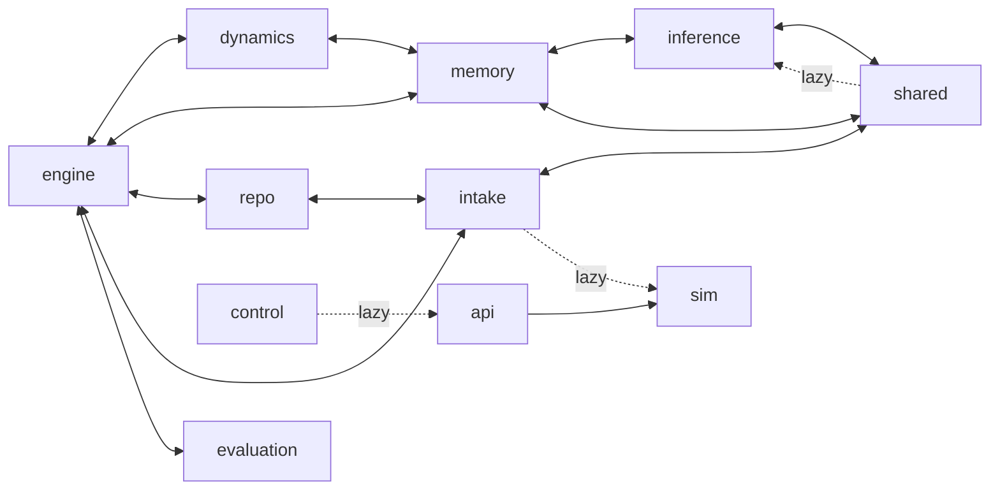

# Migration: from the code today to the modules

The code is close to the design: the slots, contracts, flowcharts, one writer, and staged review already exist. What is missing is clean boundaries. This page lists what is wrong today and gives ordered tasks to fix it. Each task is small enough for one pull request, keeps every test passing, and changes no behavior unless it says so.

## Where the code is today

About 28.7k lines of Python in `src/axelrod_wm` and 13.8k lines of JavaScript in `web/js`.

| Package today | Becomes | Change |
|---|---|---|
| `model/` | M02 model | Gains `events/`, `Forecast`; loses `ids`, `serialization` (→ core) and `PosteriorUpdater` (→ dynamics) |
| `events/` | M02 model | Merged |
| `trace.py`, `engine/registry.py`, `engine/rng.py`, `model/ids.py`, `model/serialization.py` | M01 foundation (`core/`) | Moved |
| `engine/interfaces.py`, `engine/contracts.py`, and scattered ABCs | M01 foundation (`ports/`) | Gathered |
| `memory/` | M03 memory | Loses `SuperInteractionBuilder` (→ M09), the frontier ABCs (→ ports), `open_world.py` (→ views); `ChannelState` stays, its import of `dynamics.kernels` goes |
| `repo/` | M04 repo | Gains `Branch`, PROV fields, and `RecordStore`; loses `Proposal` and `ReviewPolicy` (→ services and ports) |
| `intake/`, `sim/imports.py` | M05 intake | `ImportRunner` comes in; the imports of `sim/` go |
| `shared/`, `inference/transmission.py`, `inference/paths.py`, `abduction.bind` | M06 shared read | Transmission and binding come in |
| `dynamics/` | M07 dynamics | Gains `PosteriorUpdater`; stops importing `memory.working` at module scope |
| `learning/working_memory.py`, `fold.py`, `kernel_learning.py`, `inference/voi.py` | M08 learning · WM | Regrouped |
| `learning/long_term.py`, `generalize.py`, `frontier_test.py`, `consolidate.py`, `abduction.count`, `structural.py` | M09 learning · LTM | Regrouped |
| `inference/` (rest) | M10 inference | Loses voi, decisions, transmission, paths |
| `evaluation/`, `inference/decisions.py` | M11 evaluation | Decisions come in |
| `engine/engine.py`, `config.py`, `context.py`, `defaults.py`, `initialize.py`, `learning/task.py`, `inference/task.py` (run), the day loop | M12 runtime | Composition root and orchestrators |
| `control/` | M13 services | Split into five services |
| `api/views.py`, `brief.py`, `find.py`, `checks.py`, `control/stage.py` (views) | M14 views, API, CLI (`views/`) | Gathered |
| — | M15 context layer | New |
| `api/`, `cli.py` | M14 views, API, CLI | Thinned |
| `web/` | M16 web | Split by feature |
| `sim/` (rest) | M17 demo | Renamed; product paths leave |

## Current cycles

Package-level cycles at module scope:

- engine ↔ dynamics, memory, repo, intake, evaluation;
- dynamics ↔ memory;
- memory ↔ inference;
- repo ↔ intake;
- inference ↔ shared, repo, memory, dynamics;
- shared ↔ memory, dynamics;
- intake ↔ memory, shared.

With lazy imports counted, there are also api ↔ control, engine ↔ learning, inference, and shared; inference ↔ learning; and intake ↔ sim. Python tolerates these only because `engine/__init__.py` imports nothing eagerly.

The back edges that cause them, and the task that cuts each one:

| Back edge | Where | Cut by |
|---|---|---|
| Every plugin imports `engine.registry` | e.g. `dynamics/propagation.py:21`, `repo/review.py:12`, `evaluation/backtest.py:12` | T-01 |
| `engine/interfaces.py` imports `dynamics.propagation` | line 10 | T-02 |
| `engine/defaults.py` imports plugin packages | | T-01 |
| `memory/working.py` imports `dynamics.kernels`, `inference.records` | lines 10, 12 | T-03 |
| `dynamics/daily.py` imports `memory.working` | line 22 | T-03 (types only, under `TYPE_CHECKING`) |
| `repo/review.py` imports `intake.refiner.RefinementStep` | line 14 | T-04 |
| `intake/refiner.py` imports `shared.classify.node_signature` | line 42 | T-05 |
| `shared/analyze.py` lazily imports `inference.transmission` | | T-06 |
| `control/` imports `api.views` | `controller.py:931`, `stage.py:392` | T-09 |
| `api` wraps `sim.ScenarioRunner` and probes it with `hasattr` | `routes.py:1172, 1244` | T-11 |
| `intake/bundle.py` imports `sim.examples.catalog` | line 136 | T-07 |

## Tasks, in order

Each task lists: **Do**, the change; **Keep**, what must not change; **Test**, how we know it is done. Tasks T-01–T-07 are pure moves and can be done mechanically. T-08 onward changes structure.

### Phase A · Foundation (no behavior change)

**T-01 · Create `core/`.**
- **Do:** move `engine/registry.py`, `engine/rng.py`, `trace.py`, `model/ids.py`, and `model/serialization.py` into `axelrod_wm/core/`. Leave re-export shims at the old paths, with a `DeprecationWarning`. Replace `engine/defaults.py` with `runtime/plugins.py` (the list of modules to import).
- **Keep:** every import path still works through the shims.
- **Test:** add `tests/unit/ports/test_layers.py`, an `ast` import graph that asserts `core/` is a leaf.

**T-02 · Create `ports/`.**
- **Do:** move every slot ABC and its record types into `ports/<module>.py`, and move `contracts.py` there. Implementations import from `ports/`.
- **Keep:** the slot names and registered names.
- **Test:** the registry/contract/flowchart test still passes, and the layer test asserts that no ABC is defined outside `ports/`.

**T-03 · State stops importing algorithms.**
- **Do:**
  - move `KernelRecursion`'s state (pydantic) into `memory/`, keeping the recursion math in `dynamics/`;
  - move `Forecast`, `ForecastScenario`, and `Network` into `model/records/`;
  - type-only imports go under `TYPE_CHECKING`.
- **Test:** the layer test asserts that `memory/` imports only `core`, `model`, and `ports`.

**T-04 · Proposal types leave `repo/`.**
- **Do:** move `RefinementStep` into `model/`, `Proposal` into `control/` (services), and the `ReviewPolicy` ABC into `ports/`.

**T-05 · `node_signature` moves into `model/taxonomy.py`.** It is a pure function of an item, so intake and the shared read both import it from below.

**T-06 · Transmission and binding move into `shared/`.**
- **Do:** move `inference/transmission.py` and `inference/paths.py` into `shared/`, and move `abduction.SuperentityInducer.bind` into `shared/recognize.py`. `count` stays in learning.
- **Test:** `shared/` imports nothing from `learning/` or `inference/`.

**T-07 · Intake owns its op builders and the import path.**
- **Do:** move the op helpers from `sim/examples/catalog.py` into `intake/ops.py`, and move `sim/imports.py` into `intake/` and `control/`.
- **Test:** `intake/` imports nothing from `sim/`.

### Phase B · Runtime and services

**T-08 · Constructor injection only.**
- **Do:** for each component that takes `engine: Any`, replace it with the slots and state it uses, passed by name in `build_engine`. Today these include `learning/abduction.py` (14 lookups), `consolidate.py`, `recognize.py`, `refiner.py`, `structural.py`, `working_memory.py`, `long_term.py`, and `inference/task.py`.
- **Test:** add a test that no slot constructor has a parameter named `engine`.

**T-09 · Views leave `control/`.**
- **Do:** create `views/`. Move `api/views.py`, `brief.py`, `find.py`, `checks.py`, `memory/open_world.py`, and `stage.py`'s `_review`, `_lessons`, and staged-graph assembly into it. `control/` returns `StagedChange`; the API calls `views.staged_review_view`.
- **Test:** `control/` imports nothing from `api/` or `views/`. The review API's JSON is unchanged (a golden test).

**T-10 · `repo.Branch`, used for staging and theses.**
- **Do:** implement `Branch.of(version)` as copy-on-write with a `MemoryBackend`. Rewrite `control/stage.sandbox` on it (no attribute swaps), and run `InferenceTask` on a branch instead of a `GraphOverlay` on live WM.
- **Keep:** the staged review's output, bit for bit.
- **Test:** the live hash, ledger length, and trace sequence are unchanged after staging and after theses. *This changes performance; measure staging time on the oil demo before and after.*

**T-11 · Split the controller and add a `Session` protocol.**
- **Do:**
  - split `WorldModelController` into `ReviewService`, `UpdateService`, `ThesisService`, `StructureService`, and `SourceRegistry`, keeping a thin facade;
  - add `api/session.Session` with `capabilities`;
  - `ScenarioRunner` becomes `demo.DemoSession`;
  - routes stop probing with `hasattr`.
- **Test:** all integration tests pass against the facade.

**T-12 · Records persist; inference stops writing LTM.**
- **Do:**
  - persist proposals, theses, forecasts, and decisions through `repo.RecordStore` (rebuilt from the ledger);
  - remove "forecast explanations move into long-term memory" from `consolidate.py`, as D-04 settles.
- **Behavior change:** after a restart, pending reviews and forecasts are still there. LTM no longer holds forecast explanations.
- **Test:** a restart test; the tutorial and oil scenario tests pass (update their golden values where they change).

### Phase C · What the design adds

**T-13 · Bitemporal and PROV fields** ([M02](modules/M02-model.md#additions-this-design-makes), [M04](modules/M04-repo.md)).
- **Do:** add `valid_from`, `valid_to`, `recorded_at`, `superseded_by`, and `evidence_type`, `trust_tier`, `source_credibility`, `identity`. Add the PROV fields on `ChangeSet`, `as_of(valid, recorded)`, and `export_prov`.
- **Test:** old snapshots load; a PROV export validates.

**T-14 · `conflict_detector` slot** ([M05](modules/M05-intake.md)).
- **Do:** implement rules first. The review shows conflicts with their severity.
- **Test:** three rule cases are flagged, and ingestion never fails because of the detector.

**T-15 · Context layer v1** ([M15](modules/M15-context-layer.md)).
- **Do:** implement `recall`, `ask`, `trace`, `propose`, `feedback`, and `status` over the services and views, with REST routes. Add `axelrod mcp` to serve them as MCP tools.
- **Test:** verb contract tests, and an MCP smoke test.

**T-16 · Package renames.**
- **Do:** with everything else in place, rename `learning/` into `learning/working/` and `learning/long_term/`, `engine/` into `runtime/`, and `sim/` into `demo/`, then remove the shims.
- **Test:** the layer test has no exceptions left.

**T-17 · Front end by feature** ([M16](modules/M16-web.md)).
- **Do:** split `renderer.js` and `main.js`, and move each panel into `features/<name>/` with its own api, store, and trace slice.
- **Test:** the Playwright smoke test passes.

**T-18 · Align the older documents.**
- **Do:** apply the fixes listed in [decisions.md](decisions.md#where-older-documents-disagree) to `web/literature.md` and `web/implementation.html`. Mark the planned methods "planned", and match the stage counts to `flows/`.
- **Keep:** the academic terms and the references.
- **Test:** the How it works tab renders, and no claim in it contradicts ml-stack.md.

### Methods (parallel track)

The method upgrades are independent of the moves above, because each lands behind its slot: R0, R18, R3, R13, R14, R15, R16, R10, R2, R11, R1, R17, R4, R6, R9, R5, R7, R8, R12, R19. [../ml-roadmap.md](../ml-roadmap.md) orders them in phases 0–4, and the reviewers' first fixes are in [../ml-stack.md](../ml-stack.md) (end of §13). Start with **R0** (score against raw observations): every later method is judged by the evaluation.

## How to hand a task to a coding agent

Give it:

1. the task above;
2. the spec of each module the task touches (from [modules/](modules/));
3. [architecture.md](architecture.md) §2 (the layer rules).

Ask it to run `uv run pytest` and `uv run ruff check src tests` before it finishes, and to make the layer test stricter by one rule at a time rather than turning it off.
