# M03 · Memory

**Layer** 2 · **Package** `memory/` · **Status** exists. Its logic moves out:
- `SuperInteractionBuilder` → M09;
- the frontier ABCs → M01;
- `open_world.py` → M14.

<!-- toc -->
**Contents**

- [Purpose](#purpose)
- [Owns](#owns)
- [Depends on](#depends-on)
- [Diagram](#diagram)
- [Invariants](#invariants)
- [Planned](#planned)
- [Done when](#done-when)
<!-- /toc -->

## Purpose

The two memories, as state only. **Working memory** is what the world is like now. **Long-term memory** is what generalizes across time and entities. Algorithms write to them only through a `MutationTxn` ([M04](M04-repo.md)). [cognition.md F1](../cognition.md#f1--two-memories-consolidated-daily) explains why there are two.

## Owns

```python
class WorkingMemory(BaseModel):
    clock; graph: CausalGraph
    deviations: DeviationHistory            # z per subentity per day
    channels: dict[str, ChannelState]       # kernel recursion state per interaction direction
    hypotheses: dict[str, Hypothesis]       # the hypothesis frontier
    pending_refinements: dict[str, PendingRefinement]   # hedges
    ripple_judgments: dict[str, RippleJudgment]
    forecast_layer: ForecastLayer           # outside the state hash
    activity_log; episode_buffer; late_queue; source_cursors; ids

class LongTermMemory(BaseModel):            # the UI's five tabs, in this order
    object_generalizations                  # concepts + superentity patterns
    interaction_generalizations
    entity_memories: dict[str, EntityMemory]   # decisions by context
    correlation_frontier                    # co-movements with no interaction
    prior_states                            # episodes, explanations

dump_state(wm, ltm) -> bytes; load_state(blob) -> (wm, ltm)
```

## Depends on

[M01](M01-foundation.md), [M02](M02-model.md).

## Diagram



## Invariants

- **State, not logic.** No imports from layer 3 or above. Today `memory/` imports `dynamics.kernels` and `inference.records`.
- **The forecast layer is not state.** It never bumps the version and is excluded from the hash.
- **Exact past states are snapshots,** not long-term memory.
- **Learning writes memory; inference never does.**

## Planned

- Proposals, theses, forecasts, and decisions live in the controller's memory today. They move to ledger-backed stores ([M04](M04-repo.md)).

## Done when

- `dump_state`/`load_state` round-trips.
- The forecast layer stays out of the hash.
- The layer test passes.
