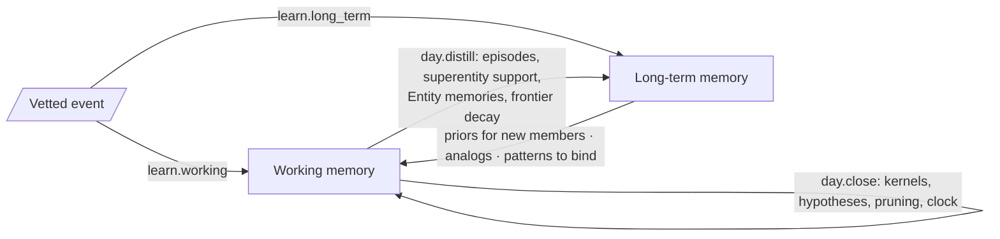

# M04 · Memory

| | |
|---|---|
| Layer | 2 · State |
| Status | **Exists**; strip out the logic that lives in it |
| Code today | `memory/working.py`, `memory/long_term.py`, `memory/entity_memory.py`, `memory/frontier.py`, `memory/open_world.py` |
| Target | `axelrod_wm/memory/` (state only). `SuperInteractionBuilder` moves to [M10](M10-learning-long-term.md), the frontier ABCs to [M02](M02-ports.md), and `open_world.py` to [M15](M15-views.md). |

## Purpose

The two memories, as state. **Working memory** is what the world is like now. **Long-term memory** is what generalizes across time and entities. Algorithms read them and write them only through a `MutationTxn` ([M05](M05-repo.md)).

## Owns

```python
class WorkingMemory(BaseModel):
    clock: Clock
    graph: CausalGraph
    deviations: DeviationHistory          # z per subentity per day
    channels: dict[str, ChannelState]     # kernel recursion state per interaction direction
    hypotheses: dict[str, Hypothesis]     # the hypothesis frontier
    pending_refinements: dict[str, PendingRefinement]   # hedged ends: candidates, Dirichlet weights, open share
    ripple_judgments: dict[str, RippleJudgment]         # reviewers' weight that a value's ripple arrives
    forecast_layer: ForecastLayer         # forecasts by thesis; outside the state hash
    activity_log: list[ActivityRecord]
    fold_accumulators: dict
    episode_buffer: list[EpisodeEntry]
    source_cursors: dict[str, datetime]
    late_queue: list[str]
    ids: IdFactory

class LongTermMemory(BaseModel):
    object_generalizations: ObjectGeneralizations          # object taxonomy + superentity patterns
    interaction_generalizations: InteractionGeneralizations
    entity_memories: dict[str, EntityMemory]               # entries, DecisionObservation, DecisionProfile
    correlation_frontier: CorrelationFrontier              # CoMovement records
    prior_states: PriorStates                              # episodes, explanations
```

The UI's long-term memory drawer has five tabs, in this order: **Object generalizations**, **Interaction generalizations**, **Entity memories**, **Correlation frontier**, **Prior states**.

## Interface

State only, plus read helpers that compute nothing new:

```python
WorkingMemory.value(subentity_id, day=None) -> DeviationPoint
WorkingMemory.today -> int
LongTermMemory.kind(gen_id) -> Generalization
LongTermMemory.pattern(id) -> SuperentityPattern
LongTermMemory.episodes(since=None) -> list[Episode]
dump_state(wm, ltm) -> bytes        # canonical, used by snapshots and hashing
load_state(blob) -> (WorkingMemory, LongTermMemory)
```

## Depends on / used by

- Depends on: [M01](M01-core.md), [M03](M03-model.md).
- Used by: [M05](M05-repo.md) and every engine.

## Flow

How the two memories feed each other. The commit names are the ledger's processes.



## Invariants

- **State, not logic.** `memory/` imports no algorithm package (today it imports `dynamics.kernels` and `inference.records`; [migration.md](../migration.md) removes both).
- **The forecast layer is not state.** Writing it never bumps the version, and it is excluded from the hash.
- **Exact past states are snapshots, not LTM.** Prior states hold episodes and explanations, not copies of the graph.
- **Learning writes memory; inference never does.** Only outcomes feed back, through track records ([M12](M12-evaluation.md)).

## Known issues and planned

- The controller keeps proposals, forecasts, theses, and decisions in in-memory dicts that are only logged ([M14](M14-services.md)). Those are service state, and they move into the ledger-backed stores of M05.
- Hedges hold Dirichlet counts, not posteriors (ml-stack §5, S-M8). R18 plans likelihood-based responsibilities. The field stays; its update changes.

## Done when

- `tests/unit/memory/` checks `dump_state`/`load_state` round trips, that the forecast layer stays out of the hash, and that `memory/` imports nothing above layer 2.
