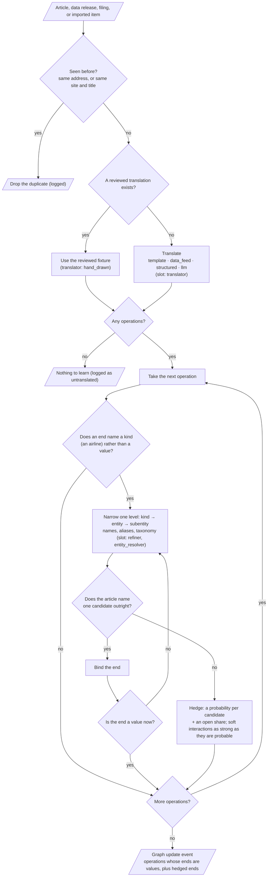
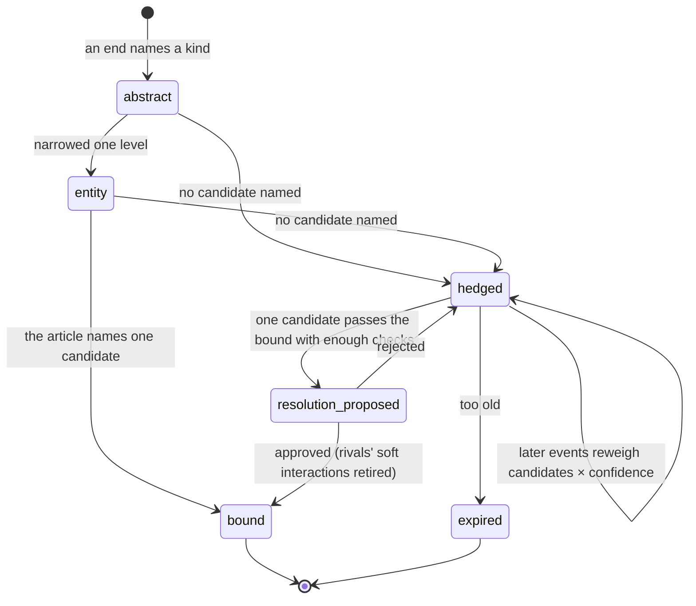

# M05 · Intake

**Layer** 3 · **Package** `intake/` · **Status** exists. Changes:
- `ImportRunner` comes in from `sim/`;
- the imports of `sim/` go;
- conflict detection is added.

**Code today:** `intake/sources.py`, `scrapers.py`, `translators.py`, `bundle.py`, `resolver.py`, `refiner.py`, `pipeline.py`; `sim/imports.py`.

## Purpose

From the outside world to a graph update event, in three steps:
1. a **source** yields market events;
2. a **translator** turns each one into operations;
3. the **refiner** narrows each fuzzy end from kind to entity to subentity.

An end binds only when the article names it; otherwise it is hedged. Intake returns results. It never proposes and never commits.

## Owns

- Sources, scrapers, `dedup_keys`.
- Translators, with `TranslationContext` and `TranslationResult` (events, plus the phrase span behind each operation).
- The import bundle `axelrod.import/v1`. Each item has dated fields, entities, tickers, stance, relevance, confidence, and **signals**. A signal is one of observe, move, link, support, or contradict, and carries a quote. This bundle is the seam to any upstream research agent ([frameworks.md](../frameworks.md#recommendation)).
- `EntityResolver`, `Refiner` (`refine`, `weigh_hedges`), `IngestionPipeline`.
- **New** `ConflictDetector`, which yields `Conflict {op_index, kind: value|sign|timing|existence|type, severity, against}`.

## Interface

```python
IngestionPipeline.ingest(event: MarketEvent, now) -> IngestResult     # translate → refine → detect conflicts
MarketEventSource.poll(since, until) -> list[MarketEvent]
MarketEventTranslator.translate(event, TranslationContext) -> TranslationResult
EntityResolver.resolve(mention, constraints, candidate_ids, graph) -> list[(id, score)]
Refiner.refine(event, wm, ltm, ctx) -> RefinementResult
Refiner.weigh_hedges(parsed, fold, wm, ctx, txn) -> list[ProposalEvent]  # called from M08
ConflictDetector.detect(event, wm, ltm, ctx) -> list[Conflict]           # new
read_bundle(src) -> ImportBundle; market_event_of(item) -> MarketEvent
```

## Slots

| Slot | Default | Alternatives / planned |
|---|---|---|
| `source` | config `update.sources` | jsonl_replay, history_replay, mock_web_scraper; `synthetic_data_feed` registers from [M17](M17-demo.md) |
| `translator` | news → hand_drawn, template; data → data_feed | structured (bundles); llm (a stub, held to the operation schema); example (demo) |
| `entity_resolver` | alias_fuzzy | |
| `refiner` | taxonomy | R18: likelihood-based responsibilities |
| `conflict_detector` (new) | rules: opposite sign on an existing interaction, a value outside a soft bound, a retired item reused | llm_pairwise. It **only flags**; the reviewer decides (Semantica's conflict types). |

Which model each slot should use, from rules up to a logged large-LLM fallback, and how the `translator` chain and `entity_resolver` take finetuned small models: [ml-stack.md, Small models first](../../ml-stack.md#small-models-first) and [§14](../../ml-stack.md#14-fine-tuning-to-own-the-structure) (R20).

## Depends on

[M01](M01-foundation.md)–[M03](M03-memory.md); `node_signature` from [M02](M02-model.md). Not `sim/`.

## Diagrams

From an article to a graph update event:



A fuzzy end's lifecycle ([cognition.md F11](../cognition.md#f11--an-open-world)):



## Invariants

- **Intake never writes memory.**
- **Deduplication.** The same address, or the same site and title, is dropped and logged.
- **Bind only a named mention.** Otherwise hedge it across the candidates, plus an open share.
- **Every operation keeps its phrase span.**
- **A signal whose ends aren't in the graph is reported, never invented.**

## Done when

- Unit tests cover dedup, each translator, binding versus hedging, and bundle parsing.
- Conflict detection flags the three rule cases and never fails ingestion.
- `intake/` doesn't import `sim/`.
