# M06 · Shared read

**Layer** 3 · **Package** `shared/` · **Status** exists. It takes in transmission and the inducer's `bind`, so it stops calling up into learning and inference.

<!-- toc -->
**Contents**

- [Purpose](#purpose)
- [Owns](#owns)
- [Interface](#interface)
- [Slots](#slots)
- [Depends on](#depends-on)
- [Diagram](#diagram)
- [Invariants](#invariants)
- [Done when](#done-when)
<!-- /toc -->

**Code today:** `shared/process.py`, `parse.py`, `classify.py`, `recall.py`, `recognize.py`, `prefill.py`, `analyze.py`, `explain.py`; `inference/transmission.py`, `inference/paths.py`; `learning/abduction.py:bind`.

## Purpose

The read that learning and inference share. Given an event, real or hypothetical, it works out:
- what the event adds;
- which concept each new item falls under;
- what it resembles;
- which patterns it binds;
- how its moves ripple, order by order.

Learning reads with a transaction. Inference reads on a branch with `txn=None`.

## Owns

- `SharedProcess`, with `SharedResult {parsed, classifications, recall, induction, model, analysis}`.
- **Transmission.** For each reached value: its **order** (the fewest interactions from the shock), its most significant **path**, its arrival, and its peak. Also the transmission grid's source.
- **Explanations**, for learning and for forecasts.

## Interface

```python
SharedProcess.run(event, ctx, txn | None, *, incorporate: bool) -> SharedResult
EventParser.parse(event, wm, ltm, ctx, txn) -> ParsedEvent
Classifier.classify(taxonomy, item_id, is_new, ctx, txn, *, incorporate=True) -> Classification
Recaller.recall(parsed, wm, ltm, ctx) -> RecallResult
AttentionPolicy.select(scores, top_k) -> dict[str, float]
PatternBinder.bind(pattern, seed_entity_ids, graph, ltm) -> Binding | None
SuperentityInducer.bind(parsed, recall, wm, ltm, ctx, txn) -> InductionResult
Prefiller.prefill(parsed, recall, induction, wm, ltm, ctx) -> PrefilledModel
Analyzer.analyze(parsed, model, wm, ctx) -> Analysis
Explainer.explain_learning(shared, fold, frontier, ctx) / .explain_forecast(forecast, networks, scenarios, shared, ctx) -> Explanation
transmission_map(analysis, graph, max_order=6) -> TransmissionMap
isolate_grid(source, method, outputs) -> GridView   # relevant (each further order counts 40% less), by_order, largest, toward_outputs, strongest_paths
```

## Slots

| Slot | Default | Planned |
|---|---|---|
| `classifier` | taxonomy_descent (signature descent) | Cobweb trees, one per data structure plus composition trees ([cognition.md F2–F5](../cognition.md)) |
| `recaller`, `attention` | overlap_attention, softmax_top_k | Two-stage recall: filter, then align (F8); R18 fixes double counting |
| `binder` | bfs_role_filling | vf2 subgraph matching |
| `prefiller` | analog_empirical_bayes | |
| `analyzer` | propagation (via [M07](M07-dynamics.md)) | |
| `explainer` | path_attribution (ablation) | R12: path-specific effects |

## Depends on

[M01](M01-foundation.md)–[M03](M03-memory.md), [M07](M07-dynamics.md). Not learning or inference.

## Diagram



## Invariants

- **One read for both.** The same code and the same event shape serve learning and inference.
- **The effect is the shocked run minus the baseline, on common random numbers.**
- **Order is hop distance; size is simulated.**

## Done when

- A golden test: learning and inference give the same `SharedResult` for the same event at the same version.
- No imports from learning or inference.
