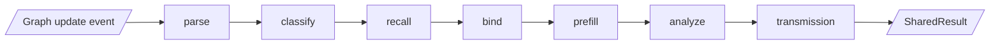

# M07 · Shared read

| | |
|---|---|
| Layer | 3 · Engines |
| Status | **Exists**; take in transmission and the inducer's `bind`, so the read stops calling back into learning and inference |
| Code today | `shared/process.py`, `parse.py`, `classify.py`, `recall.py`, `recognize.py`, `prefill.py`, `analyze.py`, `explain.py`; `inference/transmission.py` and `inference/paths.py` (called lazily from `analyze.py`); `learning/abduction.py:bind` (runs inside the shared read) |
| Target | `axelrod_wm/shared/`: `process.py`, `parse.py`, `classify.py`, `recall.py`, `recognize.py` (binder + inducer's bind), `prefill.py`, `analyze.py`, `transmission.py`, `paths.py`, `explain.py` |

## Purpose

The read that learning and inference share. Given a graph update event, real or hypothetical, it works out what the event means for the graph: what it adds, what kind each new item is, what it resembles, which patterns it binds, and how its moves ripple, order by order. Learning reads with a transaction; inference reads on a branch with `txn=None`.

## Owns

- `SharedProcess` and `SharedResult {parsed, classifications, recall, induction, model, analysis}`.
- `ParsedEvent` (created and retired items, shocks, observations, signature).
- Transmission: each reached value's **order** (the fewest interactions from the shock), its most significant **path**, its arrival and peak, and the **transmission grid** source (input → each order → output).
- Explanations: `explain_learning` and `explain_forecast`.

## Interface

```python
class SharedProcess:
    def run(self, event: GraphUpdateEvent, ctx, txn: MutationTxn | None, *, incorporate: bool) -> SharedResult
        # parse → classify → recall → bind → prefill → analyze (→ transmission)

def transmission_map(analysis: Analysis, graph: CausalGraph, *, max_order=6) -> TransmissionMap
def grid_source(tmap: TransmissionMap) -> GridSource
def isolate_grid(src: GridSource, method: str, outputs: list[str]) -> GridView
    # methods: relevant (default; each further order counts 40% less), by_order, largest, toward_outputs, strongest_paths
```

## Slots

| Slot | Default | Alternatives |
|---|---|---|
| `parser` | default | — |
| `classifier` | taxonomy_descent (signature descent) | Planned: cobweb, one tree per data structure plus composition trees ([M10](M10-learning-long-term.md)) |
| `attention` | softmax_top_k | — |
| `recaller` | overlap_attention | recency |
| `binder` | bfs_role_filling | Planned: vf2 subgraph matching |
| `inducer` (bind half) | co_activation | — |
| `prefiller` | analog_empirical_bayes | none |
| `analyzer` | propagation (uses `propagator`, [M08](M08-dynamics.md)) | — |
| `explainer` | path_attribution (ablation of the top interactions) | Planned: path-specific effects (R12) |

## Depends on / used by

- Depends on: [M01](M01-core.md)–[M04](M04-memory.md), [M08](M08-dynamics.md).
- Used by: [M09](M09-learning-working.md), [M10](M10-learning-long-term.md), [M11](M11-inference.md), and [M15](M15-views.md) (the grid view).

## Flow

The read is steps 1–6 of [architecture.md §5](../architecture.md#5-learning--working-memory).



## Invariants

- **One read for both.** Learning and inference run the same code on the same event shape. Learning gets a `txn`; inference gets `None` and a branch.
- **With and without, on the same draws.** An event's effect is the shocked run minus the baseline, on common random numbers.
- **Order is hop distance, size is simulated.** Order never depends on effect size.
- **No upward calls.** The read imports nothing from `learning/` or `inference/`.

## Known issues and planned

- Recall double-counts and keeps only same-sign siblings (ml-stack §8.4, S-C3). R18 plans analogs only from other channels or held-out periods, one episode per day, and a hierarchical sign model.
- The classifier is signature descent, not Cobweb (ml-stack §8.1). The literature tab describes Cobweb as built; [decisions.md](../decisions.md#d-07--cobweb-proposes-the-hierarchical-likelihood-decides--accepted-as-plan) settles it.
- Transmission: R12 adds Wright path tracing, P(|Δ| ≥ t), and time to 50% of peak. The strongest-paths view is the first step.

## Done when

- `tests/unit/shared/` covers each stage. A golden test checks that learning and inference produce the same `SharedResult` for the same event at the same version.
- `shared/` has no import of `learning/` or `inference/`.
