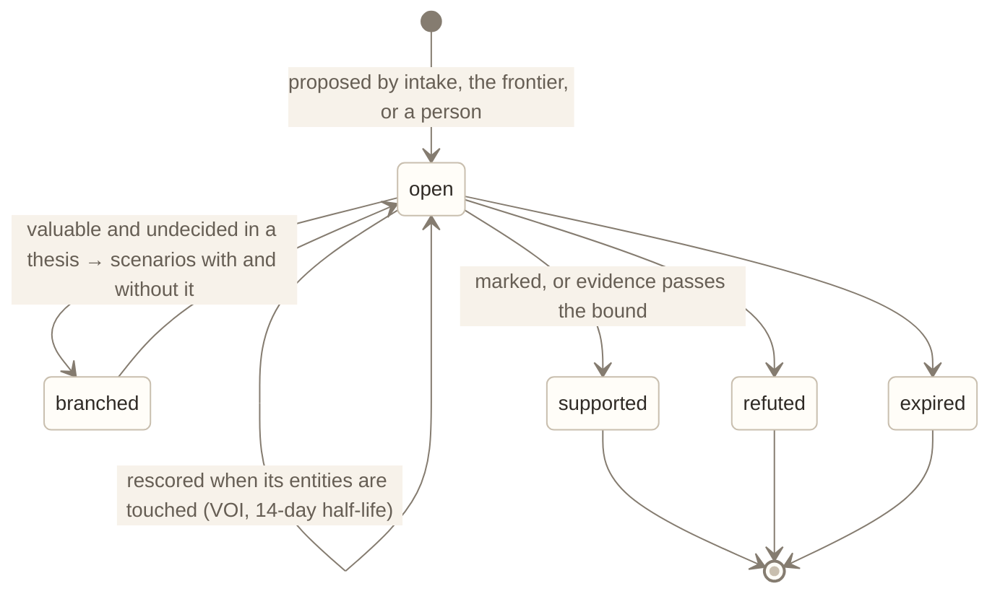

# M08 · Learning · working memory

**Layer** 3 · **Package** `learning/working/` · **Status** exists; regrouped, and it receives VOI from `inference/`.
**Code today:** `learning/working_memory.py`, `fold.py`, `kernel_learning.py`, `inference/voi.py`.

## Purpose

What the world is like now. One vetted event is **folded** into the current state:
- a reported value corrects the model;
- each interaction into that value is updated in proportion to how much of the surprise it explains.

This module also opens, records, and closes each day, and keeps the hypothesis frontier scored.

## Owns

- `WorkingMemoryLearning`.
- `Folder`, returning `FoldResult` (posteriors, unexplained moves, observed decisions).
- Ripple judgments.
- `KernelUpdater`.
- `HypothesisScorer`.

## Interface

```python
WorkingMemoryLearning.learn(event, ctx, txn) -> WMResult        # learn.working: shared read → fold → weigh hedges → ripple judgments
WorkingMemoryLearning.open_day(day, ctx, txn)                   # day.predict
WorkingMemoryLearning.record_day(day, ctx, txn)                 # day.record
WorkingMemoryLearning.close_day(day, ctx, txn) -> list[ProposalEvent]   # day.close: kernels, rescore, expiries, prune, clock
Folder.fold(parsed, analysis, wm, ctx, txn) -> FoldResult
KernelUpdater.update(wm, ltm, ctx, txn) -> list[str]
HypothesisScorer.score(h, wm, ltm, ctx) -> float; .rescore_touched(entity_ids, wm, ltm, ctx, txn) -> list[str]
```

## Slots

| Slot | Default | Planned |
|---|---|---|
| `folder` | kalman_edge (joint over level and β) | R1: filter with the mixture; inclusion log-odds |
| `kernel_updater` | grid_rescale (3-point, weekly) | R4: (delay, lag) grid posterior by marginal likelihood |
| `hypothesis_scorer` | forecast_sensitivity_voi: sensitivity × 4p(1−p) | R8: EVPI under the forecast's score ([cognition.md F10](../cognition.md#f10--structure-apart-from-strength-and-what-is-worth-knowing)) |

## Depends on

[M01](M01-foundation.md)–[M03](M03-memory.md), [M05](M05-intake.md) (`weigh_hedges`), [M06](M06-shared-read.md), [M07](M07-dynamics.md).

## Diagrams

Step by step:

```mermaid
%% style: begin (scripts/docs/style_mermaid.py)
%%{init: {"theme": "base", "themeVariables": {"fontSize": "14px", "primaryColor": "#FFFDF8", "primaryBorderColor": "#C9BFAF", "primaryTextColor": "#2F2A25", "lineColor": "#857C70", "textColor": "#2F2A25", "secondaryColor": "#F7F2EA", "tertiaryColor": "#FBF8F2", "edgeLabelBackground": "#F7F2EA", "clusterBkg": "#F7F2EA", "clusterBorder": "#E4DACB", "titleColor": "#665E54"}}}%%
%% style: end
flowchart TD
  IN["Graph update event, on its day"]:::start ==> OPEN["The day opens: yesterday's moves ripple forward<br/>daily_propagator · once a day"]:::wm
  OPEN ==> P["Apply each operation: add or retire structure;<br/>a change becomes a shock, a report an observation · parser"]:::wm
  P ==> NEW{"New items?"}:::check
  NEW ==>|no| RC["Recall superentities and past days · recaller"]:::step
  RC ==> FIT{"Does a recalled superentity fit?"}:::check
  FIT ==>|no| PF["Build the working set from similar past days · prefiller"]:::step
  PF ==> MV{"Does the event move a value?"}:::check
  MV ==>|no| RP{"Does the event report a value?"}:::check
  RP ==>|no| HG{"Hedged ends waiting?"}:::check
  HG ==>|no| OUT["Staged working memory: structure, moves,<br/>ripple by order, values, effects, hedges"]:::done
  NEW -->|yes| CL["Sort each into its kind;<br/>inherit its priors · classifier"]:::opt
  CL --> RC
  FIT -->|yes| BD["Bind it as an instance · binder"]:::opt
  BD --> PF
  MV -->|yes| AN["Simulate with and without the move;<br/>order, path, peak · analyzer"]:::opt
  AN --> RP
  RP -->|yes| FO["Surprise = report − prediction; update the level<br/>and each incoming interaction · folder"]:::opt
  FO --> HG
  HG -->|yes| WH["Weigh candidates × your confidence;<br/>propose a resolution past the bound"]:::opt
  WH --> OUT
  %% style: classes and happy path
  classDef start fill:#DAD0F4,stroke:#7C64C4,stroke-width:1.5px,color:#2F2A25
  classDef step fill:#FFFDF8,stroke:#C9BFAF,stroke-width:1.3px,color:#2F2A25
  classDef opt fill:#FFFDF8,stroke:#C9BFAF,stroke-width:1.3px,stroke-dasharray:5 4,color:#2F2A25
  classDef check fill:#F5EAC6,stroke:#D2BB72,stroke-width:1.3px,color:#2F2A25,font-weight:600
  classDef done fill:#FBF8F2,stroke:#93897C,stroke-width:1.6px,color:#2F2A25
  classDef wm fill:#E1ECDF,stroke:#A9C6A9,stroke-width:1.3px,color:#3E6A46
  linkStyle 0,1,2,3,4,5,6,7,8,9 stroke:#7C64C4,stroke-width:2.6px,color:#5B4A99
  %% style: end
```



A hypothesis's lifecycle:



## Invariants

- **The day's commits come in this order:** `day.predict`, the events' `learn.working`, `day.record`, `day.distill` ([M09](M09-learning-long-term.md)), `day.close`.
- **Proposals are returned, not created.**
- **Reviewer confidence tempers the writes:** existence, a report's weight, and a move's expected size.

## Planned

- R6: a ripple judgment becomes a two-component mixture. Today the Monte Carlo ignores it.
- R17: learn the observation noise.

## Done when

- A fold on a two-node graph splits the innovation by explained share.
- Hedges resolve.
- Ripple judgments expire.
- The commits come in order.
