# M09 · Learning · long-term memory

**Layer** 3 · **Package** `learning/long_term/` · **Status** exists; this gathers pieces now scattered across `learning/`, `memory/`, and `shared/`.

**Code today:**
- `learning/long_term.py`, `generalize.py`, `frontier_test.py`, `consolidate.py`, `abduction.py:count`, `structural.py`;
- `memory/long_term.py:SuperInteractionBuilder`;
- the incorporate half of `shared/classify.py`.

## Purpose

What an event teaches across time and entities:

- **Kinds** learn from their members and pass priors to newcomers.
- **Entity memories** remember each actor's decisions by context.
- The **correlation frontier** pairs unexplained moves, and proposes an interaction once a pair keeps holding.
- **Superentity induction** proposes a collapse when a group of interactions keeps firing together, and an expansion when one fades.
- **Distillation** turns each day into an episode.

[cognition.md](../cognition.md) gives the reasons for this organization (F2–F9).

## Interface

```python
LongTermLearning.register(wm_result, ctx, txn) -> LTMResult      # learn.long_term: incorporate → kinds → decisions → frontier → explain
LongTermLearning.distill(day, ctx, txn) -> ConsolidationReport   # day.distill: episode → analogs → induction → entity memories → decay → splits
StructuralApplier.apply(event, ctx, txn)                         # structural: approved collapse, expand, retire, drawn edits
GeneralizationUpdater.update(classifications, ltm, ctx, txn)
TaxonomyGrower.maybe_split(taxonomy, gen_id, ctx, txn) -> list[str]
FrontierTester.test(fold, wm, ltm, ctx, txn) -> FrontierResult
PromotionTest.passes(co, recognition, cfg) -> bool
SuperentityInducer.count(day, wm, ltm, ctx, txn) -> InductionResult
Consolidator.run(day, ctx) -> ConsolidationReport
```

## Slots

| Slot | Default | Planned |
|---|---|---|
| `generalization_updater` | path_stats | R5: a measurement-error hierarchy, one entry per item |
| `taxonomy_grower` | shared_feature_split | Cobweb/Classit with an acuity cutoff **proposes**; the hierarchical likelihood decides |
| `frontier`, `promotion_test` | residual_comovement, threshold (support > 3, \|r\| ≥ 0.3, 75% consistency) | R2: residualize on the graph and factors; online FDR; PCMCI+ |
| `inducer` (count) | co_activation | Frequent-subgraph mining; Trellis-style chunks |
| `consolidator` | daily | |

## Depends on

[M01](M01-foundation.md)–[M03](M03-memory.md), [M06](M06-shared-read.md), [M07](M07-dynamics.md).

## Diagrams

Per event and per day:

```mermaid
flowchart TD
  subgraph PE["Per event"]
    I[/"What working memory learned"/] --> RT{"Retired anything?"}
    RT -- yes --> FG["Retired items leave their kinds; frontier entries decay"]
    RT -- no --> GU
    FG --> GU["New items join their kinds; statistics update along the path<br/>(slot: generalization_updater)"]
    GU --> CR{"Is a kind crowded?"}
    CR -- yes --> SP["Split: a new child kind (slot: taxonomy_grower)"]
    CR -- no --> DC
    SP --> DC{"Did an actor decide?"}
    DC -- yes --> EM["Record it in the actor's Entity memory, by context"]
    DC -- no --> UX
    EM --> UX{"A move the graph did not explain?"}
    UX -- yes --> FR["Pair it with earlier unexplained moves,<br/>after removing known drivers (slot: frontier)"]
    UX -- no --> EX
    FR --> HOLD{"Has a pair held at enough spaced checks?<br/>(slot: promotion_test)"}
    HOLD -- yes --> PP["Propose the pair as an interaction (waits for review)"]
    HOLD -- no --> EX
    PP --> EX["Explain what was learned; keep it in Prior states (slot: explainer)"]
  end
  subgraph PD["Per day (distillation)"]
    EP["Summarize the day as an episode (slot: consolidator)"] --> CT["Count which interactions were active together (slot: inducer)"]
    CT --> KN{"Matches a known superentity?"}
    KN -- yes --> SUP["It gains support"]
    KN -- no --> CAND["Record a candidate"]
    SUP & CAND --> ADM{"Candidate above the admission threshold?"}
    ADM -- yes --> COL["Propose a collapse into a superentity"]
    ADM -- no --> FADE
    COL --> FADE{"Admitted superentity below its floor?"}
    FADE -- yes --> EXP["Propose an expansion back into its members"]
    FADE -- no --> DONE
    EXP --> DONE[/"Staged lessons and the proposals they raise"/]
  end
  EX --> EP
```



A superentity's lifecycle:

```mermaid
stateDiagram-v2
  [*] --> candidate: a group of interactions fires together
  candidate --> candidate: support grows (+1 per spaced day) or decays
  candidate --> admitted: support > admission threshold and the collapse is approved
  [*] --> admitted: a backend user groups items (approved)
  admitted --> admitted: bound as instances; gains track record from forecasts
  admitted --> dissolved: support < floor and the expansion is approved, or the user dissolves it
  dissolved --> [*]
```



## Invariants

- **One commit per event** (`learn.long_term`) and one per day (`day.distill`).
- **Structure changes only through review.** Promotion, collapse, and expansion are all proposals. Splitting a kind changes only the taxonomy, and is logged.
- **Thresholds.** Support > 3 to admit or promote; support > 4 to supply priors or analogs.
- **The frontier is never propagated.** It runs on live vetted events only.
- **Forecasts don't enter long-term memory.** Today `consolidate.py` keeps forecast explanations; task T-12 removes that.

## Planned

- S-C4: kinds' priors collapse → R5.
- S-C2: induction confirms itself → R2.
- S-M6: the frontier has no valid inference → R2.
- Analog over-counting → R18.
- A JEPA-style state encoder (planned slot `state_encoder`) may order the frontier's candidates and recall analogs; it never decides a promotion → R20.4 ([ml-stack.md §14](../../ml-stack.md#14-fine-tuning-to-own-the-structure)).

## Done when

- Unit tests pass for kinds, splits, promotion after spaced checks, admission and dissolution, and decision profiles.
- Tutorial examples 8, 10, 11, and 15–22 pass.
