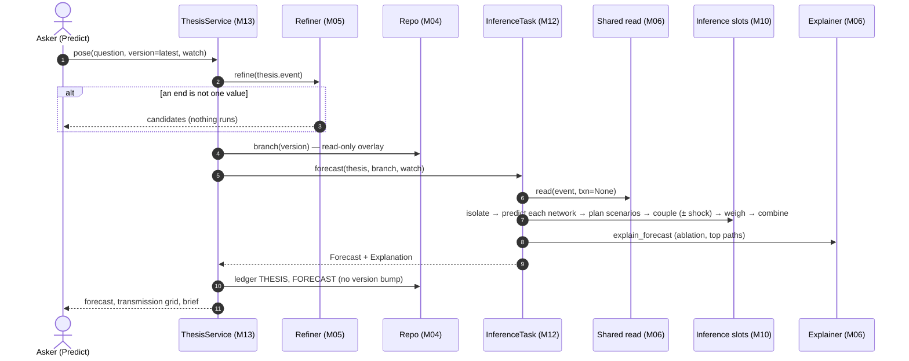

# M10 · Inference

**Layer** 3 · **Package** `inference/` · **Status** exists. It hands off three pieces:
- VOI to M08;
- decisions to M11;
- transmission to M06.

**Code today:** `inference/task.py`, `isolate.py`, `predict.py`, `couple.py`, `unify.py`, `groups.py`.

## Purpose

How the model answers a what-if question. A thesis runs the shared read on a **branch** that is never merged. Inference then:
1. **isolates** the networks the shock reaches;
2. predicts each network alone (**isolated prediction**);
3. couples the networks (**distributed prediction**);
4. **unifies** the rival scenarios into one forecast;
5. reads it out by order and transmission path, at any granularity.

## Owns

- `Network` (a bound superentity instance, a residual, or a context/watch network), `NetworkPrediction`, `ForecastScenario`.
- Group forecasts: an entity, a sector, a superentity, or a category, each averaged draw by draw.

## Interface

```python
forecast(thesis, branch, shared, slots, ctx, *, watch) -> Forecast    # pure; ThesisService (M13) writes the ledger
NetworkIsolator.isolate(shared, wm, ltm, ctx) -> list[Network]
NetworkPredictor.predict(network, inputs, model, ctx) -> NetworkPrediction
RivalDetector.groups(networks, ltm) -> list[list[str]]
NetworkCoupler.couple(networks, forced_existence, shocks, model, ctx, n_samples=None) -> PropagationResult
ScenarioWeighter.weights(scenarios, networks, wm, ltm, ctx) -> list[float]
ForecastUnifier.plan(networks, wm, ltm, ctx) -> list[ForecastScenario]
ForecastUnifier.combine(thesis, scenarios, coupled, baseline, local, networks, ctx) -> Forecast
```

## Slots

| Slot | Default | Alternatives / planned |
|---|---|---|
| `isolator` | bound_superentity (0.5·attention + 0.5·reach) | k_hop |
| `network_predictor` | mc_network | |
| `rival_detector` | pattern_and_sign | |
| `coupler` | union_graph | iterative_block (Gauss–Seidel) |
| `scenario_weighter` | support_fit_track: support × fit × track record × p | uniform; R7: leave-future-out stacking |
| `unifier` | channels_and_rivals (top 8) | weighted_mixture |

## Depends on

[M01](M01-foundation.md)–[M04](M04-repo.md) (`Branch`), [M06](M06-shared-read.md), [M07](M07-dynamics.md).

## Diagram

The six stages are in [architecture.md §4](../architecture.md#4-inference-six-stages). As a sequence:



## Invariants

- **Inference never learns.** Only outcomes feed back, through track records.
- **Rivals are mixed, not averaged.** Where they disagree, the forecast is wide or has two humps.
- **The context network.** Every watched name is reached by a path or reported unreached.
- **Reproducible:** `based_on_version`, `config_hash`, `seed`.
- **A held decision is do().** A changed value is a soft intervention.

## Planned

- Scenario weights are fit in sample (S-M5) → R7.
- Config: `max_networks` is 8 in the yaml and 6 in the code.

## Done when

- Unit tests cover isolation with residual and watch networks, CRN coupling, and weights that sum to one.
- The live hash is unchanged after any number of theses.
