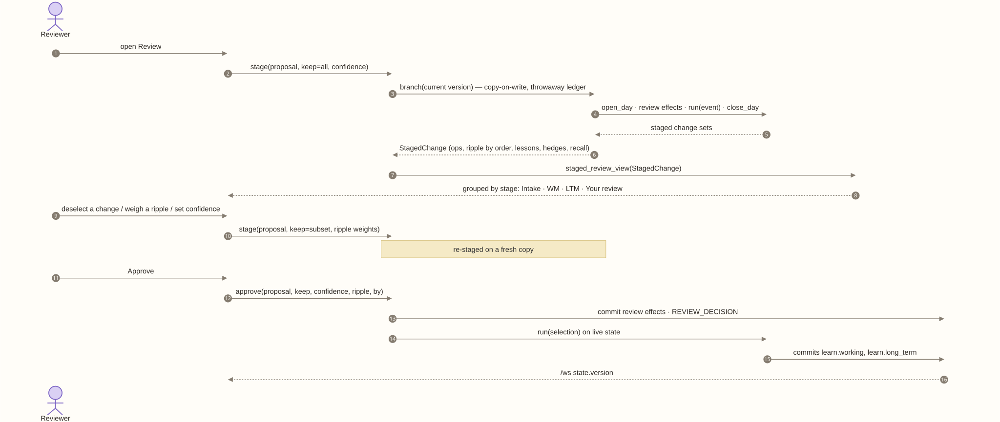

# M13 · Services

**Layer** 4 · **Package** `control/` · **Status** split the god object.

<!-- toc -->
**Contents**

- [Purpose](#purpose)
- [Owns](#owns)
- [Depends on](#depends-on)
- [Diagrams](#diagrams)
- [Invariants](#invariants)
- [Done when](#done-when)
<!-- /toc -->

**Code today:**
- `control/controller.py`: `WorldModelController`, 940 lines with about 47 `self.engine` references;
- `control/updates.py`;
- `control/stage.py`: 972 lines, about 600 of them view assembly;
- `repo/review.py`.

## Purpose

The product's commands. Each service owns one workflow, persists its records through the ledger, and emits trace events. Services alone call `propose()`, and they alone decide when learning runs.

## Owns

| Service | Commands | Records |
|---|---|---|
| `ReviewService` | propose, stage(pid, keep, confidences, ripple) → `StagedChange`, approve(pid, by, note, keep, confidence, op_confidence, ripple), reject, defer, edit, set_review_policy | `Proposal {kind, status, event, refinement, conflicts, requirement, decided_by, note}` |
| `UpdateService` | request_update, continue, cancel, import_items(bundle, ids) | `UpdateRun`, `UpdateReport` |
| `ThesisService` | pose(question or thesis, version, watch), pin, record_decision, resolve_decision, add_hypothesis, mark_hypothesis | `Thesis`, `Forecast`, `DecisionRecord` |
| `StructureService` | propose_group, propose_dissolve, propose_retire, submit_graph_update (drawn edits; world ops refused), add_from_knowledge | proposals |
| `SourceRegistry` | register_source, source, translator_chain | |

A thin `WorldModelController` facade keeps today's callers working.

**Slot:** `review_policy` (default, auto_approve_all, review_all): `ReviewPolicy.assess(proposal, wm) -> ReviewRequirement`.

## Depends on

[M12](M12-runtime.md), [M04](M04-repo.md), [M05](M05-intake.md), [M11](M11-evaluation.md). Not the API, views, or demo.

## Diagrams

Human review and commit:

A staged review, as a sequence:

A proposal's lifecycle. Its kinds are graph_update, refinement, frontier_promotion, superentity_admission, superentity_dissolution, and missing_relation.

## Invariants

- **Vetted learning.** Nothing that needs review is learned before approval, and what is approved is what was staged. Rejecting changes nothing. A deferred event folds in late.
- **Review at the end.** Staging runs the event's whole learning, including the day's distillation.
- **Deselecting re-stages.** A partial approval also drops the operations that depend on what was removed.
- **Every decision is logged** with who made it and at what confidence.
- **Learn is internal; Predict is external.** External users reach only `ThesisService`.
- **Records survive a restart.**

## Done when

- The review, ripple, import, and API integration tests pass against the facade unchanged.
- The proposal lifecycle and restart tests pass.
- `control/` imports neither `api/` nor `sim/`.
