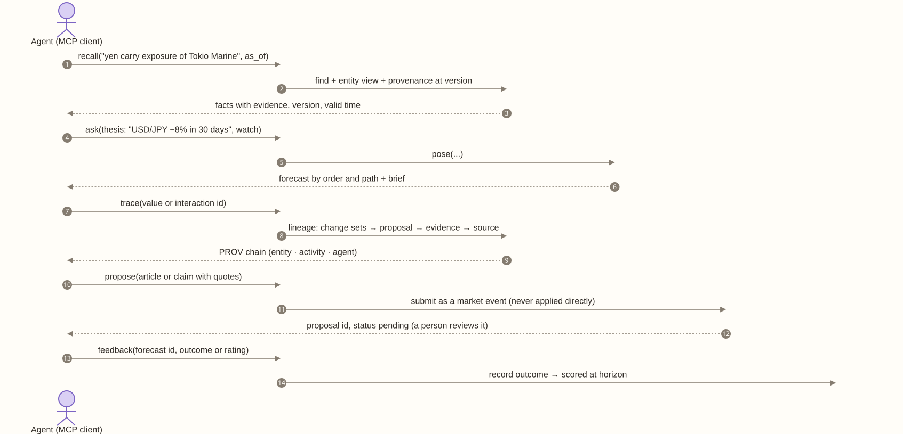

# M15 · Context layer

**Layer** 5 · **Package** `context/` · **Status** new. Pieces exist: `find`, briefs, the ledger, and the import bundle.

<!-- toc -->
**Contents**

- [Purpose](#purpose)
- [Owns](#owns)
- [Interface](#interface)
- [Depends on](#depends-on)
- [Diagram](#diagram)
- [Invariants](#invariants)
- [Done when](#done-when)
<!-- /toc -->

## Purpose

How agents and analysts reach the world model, over MCP and REST. Through it they can:
- recall what the model knows, at a version and with provenance;
- ask a what-if question;
- trace where a number came from;
- propose something for it to learn, which a person reviews;
- give feedback on a forecast.

It is a layer *on* the model and holds no facts of its own. The verbs follow Cognee's; the provenance and time model follow Semantica's. **No verb writes without review** ([frameworks.md](../frameworks.md)). Recall uses the model's concept trees and analogs rather than a flat vector index, for the reasons in [cognition.md](../cognition.md).

## Owns

| Verb | Cognee analogue | Does | Reaches |
|---|---|---|---|
| `recall(query, as_of?, scope?)` | recall | Facts about entities, values, interactions, superentities, Entity memories, and episodes, each with evidence, version, and valid time | views; slot `context_retriever` |
| `ask(question, watch?, version?)` | none | Pose a thesis on a branch; return the forecast by order and path, and the brief | ThesisService |
| `trace(item_id, version?)` | provenance | The PROV chain | `provenance_view` |
| `propose(text or bundle item, quotes, confidence)` | remember | A market event, staged; **waits for a person** | UpdateService, ReviewService |
| `feedback(forecast_id, outcome or rating)` | improve | An outcome, scored at the horizon | Evaluation |
| `status(proposal_id)` | cognify_status | pending, approved, or rejected | ReviewService |

There is no `forget`. Retiring an item is a reviewed proposal, and history stays.

## Interface

```python
ContextLayer.recall(query, *, as_of=None, scope=None, k=20) -> list[Fact]
ContextLayer.ask(question | Thesis, *, watch=(), version=None) -> ForecastAnswer
ContextLayer.trace(item_id, *, version=None) -> Lineage
ContextLayer.propose(item | str, *, by, confidence=1.0) -> ProposalRef
ContextLayer.feedback(forecast_id, *, outcome=None, rating=None, by) -> None
ContextLayer.status(proposal_id) -> ProposalRef
class Fact: item_id, kind, text, value, version, valid_from, valid_to, recorded_at, evidence, trust_tier
```

Each MCP tool is one verb, and its schema is generated from these types.

**Slot:** `context_retriever`.
- **Default:** `find_plus_neighborhood`.
- **Planned:** `concept_tree` (F3), and `cognee_adapter`, which also recalls across an upstream research memory.

## Depends on

[M13](M13-services.md), [M14](M14-interfaces.md), [M11](M11-evaluation.md).

## Diagram



## Invariants

- **Read freely; write only by proposal.**
- **Every fact carries a version, its evidence, and a recorded time.**
- **A login sees only its own engine.**
- **`ask` runs on a branch.**

## Done when

- Each verb has a contract test.
- An MCP smoke test passes: recall, ask, trace, then propose, and the proposal shows in Review as pending.
