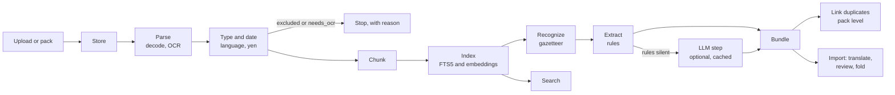

# How the ingestion pipeline is implemented

A stage-by-stage technical reference: what each stage computes, the method it uses (rules, a learned model, or a
workflow step), its parameters, where it lives, and why it gives the same result every time. For what the pipeline is
for and how to run it, see [pipeline.md](pipeline.md). Storage and search are covered in [lake.md](lake.md), the bundle
format in [contract.md](contract.md), and how quality is measured in [bench.md](bench.md). Ingestion module paths are
relative to `ingestion/src/axelrod_ingest/`, and world-model paths to `world_model/src/axelrod_wm/`.

To watch stages 1 to 5 run on a file, with each stage's input, output, decision and timing and nothing written, use the stage debugger of the
[ingestion console](console.md).

<!-- toc -->
**Contents**

- [Overview](#overview)
- [1. Store](#1-store)
- [2. Parse](#2-parse)
- [3. Type, date, language and currency](#3-type-date-language-and-currency)
- [4. Chunk](#4-chunk)
- [5. Index and embed](#5-index-and-embed)
- [6. Recognize](#6-recognize)
- [7. Extract](#7-extract)
- [8. The LLM step (optional)](#8-the-llm-step-optional)
- [9. Bundle](#9-bundle)
- [10. Link duplicates (packs)](#10-link-duplicates-packs)
- [11. Search (downstream retrieval)](#11-search-downstream-retrieval)
- [12. Import into the world model (review, then fold)](#12-import-into-the-world-model-review-then-fold)
- [Determinism and measurement](#determinism-and-measurement)
- [Parameters at a glance](#parameters-at-a-glance)
<!-- /toc -->

## Overview



Most of the pipeline is deterministic rules. Learned models appear in four places only, each pinned so that it repeats
exactly:

| Where | Model | How it is pinned |
|---|---|---|
| OCR | Tesseract's LSTM engine (`--oem 1`) | A fixed configuration and one thread. Page text is cached by content |
| Semantic search | IBM granite-embedding-small-english-r2 sentence embedder (open, Apache-2.0, from a US developer; ONNX, 384 dimensions; no query prefix). It replaced BAAI/bge-small-en-v1.5 on Oct 25 | CPU, single-threaded, vectors L2-normalized and rounded to 6 decimals. Used for search only, never extraction |
| LLM step | A configured Anthropic or OpenAI model | Off by default. Temperature 0, and each answer is cached by digest and replayed |
| Fold into the model | A linear-Gaussian state-space model with a joint Kalman update | Closed-form algebra with no sampling |

Ingestion never changes the model. It produces an `axelrod.import/v1` bundle of proposed signals, and a person
approves each item before it is folded in.

**Entry points.**

| Entry point | Code | Runs |
|---|---|---|
| Upload | `POST /v1/world-models/{id}/documents` (`api/v1/routes_ingest.py`) | `Ingestor.ingest_many` as a background job, with an idempotency key; results come back in event-time order |
| Read again | `POST …/documents/{doc}/bundles` | `Ingestor.process` on the stored bytes, against the model as it is now |
| Pack | `ingestion/scripts/ingest_pack.py` → `pack.run` | Every file of a folder with a manifest, then duplicate linking, then a digest of the lake |

**Where each stage runs.** Locally and in tests, everything runs in one process. Deployed, it is split into three
services, each holding one kind of data ([deployment.md](../../docs/deployment.md)):

| Service | Runs | Holds |
|---|---|---|
| `world-model-data` (`axelrod-lake`, `lake/server.py`) | Every `LakeStore` method over HTTP, including `nearest` (stage 5's matrix search) | The lake: `lake.sqlite3` and the raw files |
| `world-model-ingestion` (`axelrod-ingest`, `service.py`) | Stages 1–9 through `Ingestor`, reading and writing the lake through `RemoteLake`, plus `POST /v1/embed` | Nothing durable. The embedding weights and the OCR page cache are rebuildable caches |
| `world-model` | The routes above, sending uploads and reads to the other two services (`ingest_client.py`) and running search over `RemoteLake` | Client worlds and scenarios |

Each mode is chosen by environment variable: `WORLD_MODEL_LAKE_URL` and `WORLD_MODEL_INGEST_URL`. With neither set, the
services run in process. The remote path gives byte-identical bundles, digests and search results.

The world model hands ingestion a `WorldView` (`contract/world_view.py`, built by `intake/world_view.py`). It holds
the entities, values (with unit, scale and current posterior) and links, sorted by id, and it is the only thing
ingestion knows about the model.

## 1. Store

**What.** Keep the file's bytes once, under its organization.

**How.** The document id is the first 24 hex digits of the bytes' SHA-256 (`lake/store.content_id`), so the same file
uploaded twice is stored once. The raw file goes to `<lake>/<tenant>/raw/<id>.<ext>`, and a `documents` row records
the hash, file name, MIME type, size, source, `source_type`, uploader and two times:

- `ingested_at`, the lake's clock;
- `event_time`, the given publication date, or the ingest time until a date is found.

**Where.** `pipeline.Ingestor.store_file`; `lake/sqlite.SQLiteLake.put_document`.

**Determinism.** The id comes from the content. Each tenant is a partition, and no read crosses tenants. A pack run
fixes the clock (`--clock`).

## 2. Parse

**What.** Turn bytes into normalized text, split into *segments* (pages, sheets, slides) with their spans.

**How.** One parser per format, chosen by extension, then MIME type (`parse.py`):

| Format | Parser |
|---|---|
| PDF | PDFium (`pypdfium2`), page by page |
| DOCX, PPTX | Their XML, read from the zip |
| XLSX | `openpyxl`, values not formulas. Rows become ` \| `-separated cells |
| HTML | The standard library's parser. Tables become ` \| ` rows |
| CSV, Markdown, text | Decoded (below), with rows as cells |
| JSON | An import bundle, passed through whole |

**Normalization.** Every format is normalized the same way:
- Unicode NFC;
- whitespace runs inside a line collapsed, and blank-line runs collapsed to one;
- curly quotes and dashes kept.

For Chinese, Japanese and Korean text, `cjk.width` also folds the full-width block (digits, letters, punctuation,
currency signs) to ASCII, and rejoins a name a PDF drew with a space between every character.

**Decoding text files** (`encoding.decode`). The order is fixed:
1. a byte-order mark;
2. for HTML, the page's own declaration, read browser-style (gb2312 is read as gb18030, euc-kr as cp949, shift_jis as
   cp932). A declaration the bytes don't fit is ignored;
3. UTF-8;
4. Latin-1, which never fails and is recorded as a fallback.

How the file was decoded goes into the document's metadata.

**OCR** (`ocr.py`). A PDF page with drawn content and no text layer is a scan:
- **With an engine** (`ocr_from_env`), the page is rendered in grayscale at 200 dpi, written as a PGM, and read by
  `tesseract --psm 3 --oem 1 -l <lang> --dpi 200` with `OMP_THREAD_LIMIT=1`. The text is cached under a hash of the
  engine, its version, the configuration, the document's SHA-256 and the page number. The engine, version and
  configuration go into the metadata.
- **Without an engine,** the pages are listed as `needs_ocr`.

**Where.** `parse.py`, `encoding.py`, `ocr.py`, `cjk.py`; the parser version is `PARSER_VERSION`.

**Failure.** A file that isn't what it claims to be raises `ParseError`, and the document is marked `failed` with the
error.

## 3. Type, date, language and currency

**What.** Learn what the document is, when it was published, what period it covers, its language, and what a bare ¥
means. All of this is rules over the text, the file name and the manifest.

**Type** (`sources.classify`). One of `filing`, `report`, `transcript`, `presentation`, `news`, `data_aggregate`,
`index_page` or `other`, with a reason. The evidence is checked strongest first:

1. A file named as an index is excluded.
2. The page itself:
   - *Substance* is the characters on lines that read as prose: eight words, or twelve ideographs, per line.
   - A page with almost none, such as a menu, a script shell or a list of links, is excluded. So is a page that says
     it is gated.
   - This screen runs on HTML and PDF from packs, and never on a scan awaiting OCR.
3. Words in the file name, then the URL's host and path, then the manifest's section.

The type maps to the contract's `source_type` when the uploader gave none.

**Dates** (`dates.resolve`). Two times are kept apart:

- **Published.** The first of these that exists:
  1. the upload's date;
  2. for a manifest-listed file, the date in its name;
  3. the first full date in the opening text;
  4. a date in the file name;
  5. the ingest time, recorded as such.
- **Period.** What the document reports on (a month, a quarter, a half, a fiscal year or an end date), read from the
  opening text, then the file name, and kept with its end date. A news story has no period.

Dates are read in English, Chinese (including Chinese numerals) and Korean. Years run from 2000 to 2099, so a page
number is never a year.

**Language** (`units.language_of`). `ja`, `ko`, `zh` or `en`, from the share of kana, Hangul and ideographs.

**The yen sign** (`units.resolve_yen`). The document's own words decide, not the number:
1. the document's currency words (RMB, 元 and 人民币 against JPY, 円 and 日元), when one side appears alone or three
   times as often;
2. whether the issuer is a PRC company;
3. the language;
4. by default, yen.

The answer and its evidence are stored.

**Gates.** An excluded document keeps its text, gets no chunks or bundle, and is marked `excluded` with the reason. A
document with no text and pages awaiting OCR is marked `needs_ocr`.

## 4. Chunk

**What.** Cut the text into passages, the unit of search, recognition and items.

**How** (`chunk.py`).

**Sentences.** A sentence ends at any of these:
- `. ! ?` before a space and a capital, a digit or an opening quote, except after a known abbreviation (U.S., Inc.,
  e.g., No., Q3) or inside a number;
- a line break that starts a bullet or a new paragraph;
- a capitalized line after a short line (`SHORT_LINE` = 50 characters, meaning a heading);
- every table row (a ` | ` line, or a line ending in two or more figures);
- for Chinese and Japanese, `。！？`;
- for Korean, a final ending (다, 요, 죠, 까) at the end of a line.

**Chunks.** Whole sentences are grouped up to `CHUNK_CHARS` = 700 units, within one paragraph of one page or sheet,
so a passage never straddles two pages:
- A Latin character weighs 1. An ideograph, kana or Hangul syllable weighs 2, so 700 units is about 350 Chinese
  characters.
- A sentence longer than a chunk is cut at a line break, else at a space, and never inside a word, number or character.
  Chinese has no spaces, so it is cut after the last clause mark that fits.
- A table row stays one chunk, up to `ROW_CHARS` = 12,000.

Each chunk keeps its exact span in the document's text, and its page.

## 5. Index and embed

**What.** Make passages findable by keyword, prefix and meaning.

**How.**
- **Keyword:** an SQLite FTS5 index with Porter stemming, ranked by BM25.
- **Prefix:** a second, unstemmed FTS5 index, because a stemmed index stores "oper" for "operating", so the prefix
  "opera" would miss it.
- **Embeddings** (`lake/embed.py`, chosen by `WORLD_MODEL_EMBEDDER`):
  - `fastembed`: IBM granite-embedding-small-english-r2 in ONNX on the CPU, 384 dimensions, single-threaded,
    L2-normalized and rounded to 6 decimals,
    so no text leaves the deploy;
  - `hashing`: words and word pairs hashed (BLAKE2b) into 256 signed buckets, then L2-normalized. It needs no model
    and is exact. Tests use it, and it is the fallback when fastembed is missing;
  - the default `auto` picks fastembed when it is installed.
- **Storage.** Embeddings are float32 blobs, one per chunk, tagged with the embedder's name.

**Where.** `lake/sqlite.py` (`chunks`, `chunks_fts`, `chunks_prefix`, `embeddings`), `lake/embed.py`.

**Limit.** Cosine similarity is computed in Python over every chunk, which suits thousands of chunks. An approximate
nearest-neighbour index belongs behind `LakeStore` (see [next_steps.md](next_steps.md)).

## 6. Recognize

**What.** Find the model's own entities and values in each passage. Ingestion never proposes an entity the model
doesn't have.

**How** (`gazetteer.py`).

**Surfaces.** The gazetteer is built from the world view:
- every entity's name and aliases;
- every value's name and aliases;
- each value's own phrase without its entity ("net interest income" for "JPMorgan net interest income").

**Matching** runs over tokens (`text.tokens`, `text.norm`: lower case, with a plural's -s dropped):
- longest match first, left to right, never overlapping;
- a surface written in capitals (BoJ, ECB) matches only in capitals;
- one-letter surfaces never match;
- in Chinese or Korean, each character is a token, and a one- or two-character surface matches only at the start of a
  run or after a particle such as 的.

**Slots.** A phrase shared by several entities ("share price", "NII") is a *slot*. It resolves, in order, to:
1. the nearest owner named in the same sentence;
2. the owner named in the previous sentences, when this sentence names no value;
3. the document's *subject*, when the sentence names no other company. The subject is found by `profile` from the
   title, file name and first `PROFILE_CHARS` = 3,000 characters;
4. for a market or an agency only, the owner in the region the sentence or document names.

Otherwise the slot stays unresolved and yields nothing.

**Head words.** A value phrase's last word alone ("yields", "price") names a value only:
- when exactly one of that entity's values ends in that word;
- right after the entity's name or verb ("Bund yields", "the Fed raised rates"), or as a short key-data label.

**Output.** One `Mention` per match (chunk, entity, value, surface), stored for the graph search mode.

**Determinism.** The gazetteer has a digest over its surfaces. It is recorded in the bundle and keys the LLM cache.

## 7. Extract

**What.** Turn recognized sentences into signals: claims about the model's values, each quoting its sentence exactly.

**How** (`extract.py`). The numbers, direction words and causal words around each recognized value decide the claim:

| Signal | Rule examples | Confidence |
|---|---|---|
| `observe`: a level | "held rates at 3.875%", a key-data line "Price (31 Jul 2026) ¥6,994", a table row read in the right column | 0.75 |
| `move`: a change with a size | "raised its policy rate by 25bp", "NII rose 4%"; a revision "from ¥592bn to ¥654bn" | 0.75–0.8 |
| `move`: a direction only | "estimates were cut" becomes a standardized move of `UNDIRECTED_SD` = 0.5 sd | 0.45 |
| `support` / `contradict` | two linked values joined by a causal word: "higher JGB yields lift Tokio Marine's income" | per rule |
| `link` | the same when the model has no link yet: proposed for review with an effect of `LINK_EFFECT` = 0.3 | per rule |

**Tables** (`tables.py`).
- A header line of periods ("FY2025 | Q1-2026", "03/26 03/27e") is aligned to a row's cells by count.
- The row is read in one column, chosen as an analyst would (`pick`):
  - for a flow, the fiscal year the document's date falls in;
  - for a level, the latest dated column already passed.
- The scale comes from the row's label ("(RMB'000)", "百万元", "(단위: 억원)"). Failing that, it is the one scale that
  makes the figure plausible.

**Numbers and units** (`numbers`, `units.py`). Figures are read with their currency (a code or sign, or CJK words such
as 亿元 and 억원) and scale:
- English k, m, bn, tn;
- Chinese 万 (1e4) and 亿 (1e8);
- Korean 만, 억 and 조 (1e12), including compounds such as 3억 5천만.

兆 is never read as a scale, because it means a trillion in one usage and a million in another.

**Plausibility.** A number must fit the value's unit. A level must also lie within `6·sd + 4·scale` of the value's
posterior mean, with at least ±16% for a lognormal value (`MIN_LOG_BAND` = 0.15). That keeps years, page numbers and
footnotes from becoming levels.

**Precision rules.** An observation is a reported *current* level, and a move a reported change or revision. These
claim nothing:
- a price target;
- a forecast of a market level;
- a sentence only about earlier years;
- a denied or hypothetical claim ("is unlikely to fall", "if yields rise");
- a disclaimer;
- a projection column, a base case, someone else's guidance, or a prediction ("will grow");
- a quarter's change applied to a year's flow;
- a part of a list taken for the whole.

A direction is read only from the value's own words: never across a preposition, and never from a verb acting on
something else.

**Context across sentences** (`Reading`). Each chunk carries forward:
- the entities named in recent sentences;
- the document's subject and region;
- its date, period end and partial-period flag;
- whether it is forward-looking, meaning the file name says guidance, outlook, forecast or budget.

**One claim per effect** (`keep_best`). Across the whole document, the pipeline keeps one level and one move per value,
and one claim per pair of linked values. It keeps the most confident, then the first. A report repeats its point in the
summary, the body and the charts, and the news must count once.

**Where.** `extract.Rules`, `claims_of_chunk`, `keep_best`, `item_of`; extractor version `EXTRACTOR_VERSION`.

## 8. The LLM step (optional)

**What.** Propose signals for passages the rules could not read.

**When it runs.** Only when a provider is configured (`WORLD_MODEL_LLM_PROVIDER` = `anthropic` or `openai`, with the
matching key, and `WORLD_MODEL_LLM_MODEL` if needed), and only for chunks that name the model's entities but gave the
rules nothing.

**How** (`llm.py`).
- **Prompt.** The system prompt (version `PROMPT_VERSION` = `llm-signals-1`) asks for JSON signals in the import
  schema, using only the listed ids, with quotes copied exactly. The user prompt is the passage plus the ids of the
  entities it names and their values and links.
- **Call.** Temperature 0, with a 60 s timeout.
- **Validation** (`validate`). A signal is dropped, never repaired, if it is malformed, names an unknown id, or quotes
  text that isn't in the passage.
- **Cache.** Answers are stored in the lake's `llm_cache`, keyed by provider, model, prompt version, chunk text and
  gazetteer digest. A rerun replays byte-identically, with no second call.
- **Marking.** Each signal it adds is tagged `llm:<model>`. Like every signal, it waits for a person's review.

## 9. Bundle

**What.** Package the claims as an `axelrod.import/v1` bundle.

**How** (`pipeline._extract`, `extract.item_of`).
- **Items.** One item per chunk that has signals: rule signals first, then any from the LLM step. Each item carries:
  - the document's event time as `published_at`;
  - its source and kind;
  - a category and stance derived from the signals;
  - tags: `doc_type:`, `lang:` and `period:`.
- **Period.** When the document reports on a period and isn't forward-looking, `occurred_at` is the period's end, so a
  figure is dated by when it happened, not when it was published.
- **Validation and id.** The bundle is validated against `ImportBundle` (pydantic). Its id is the hash of its content
  without `collected_at`, so the same file against the same model gives the same id.
- **Storage.** It is stored in `bundles` with its source documents and extractor version.
- **Pass-through.** A JSON bundle uploaded as a file is validated and stored as it is.

## 10. Link duplicates (packs)

**What.** Recognize one disclosure carried by several files (an English and a Chinese filing, or a report and its
summary), so its figures are counted once.

**How** (`dedupe.py`), after a pack is ingested.
- **Fingerprint.** The document's period end, plus the multiset of its figures with at least `MIN_DIGITS` = 5
  significant digits, each reduced to its significant digits. "777,102" and "777102.00" therefore match, across
  languages and units.
- **Same disclosure.** Two documents with the same period end are one disclosure when the smaller one's figures are
  found in the larger at a containment of at least 0.8, sharing at least 40 figures. Containment, rather than equality,
  is used because a summary holds only part of a report.
- **Groups.** These pairs form connected groups, each with a `shared_origin` id.
- **Primary.** One copy per group is chosen by an ordered rule list: English IFRS, then English, then IFRS, then the
  most distinct figures (completeness), then length, then earliest, then latest. Ties break on document id.
- **Storage.** Every copy keeps its text and bundle; only the group and its primary are recorded in each copy's
  metadata.

## 11. Search (downstream retrieval)

**What.** The retrieval layer that agents and construction builders use.

**How** (`lake/search.py`, `Searcher`).

| Mode | Method | Score |
|---|---|---|
| `keyword` | FTS5 over the stemmed index: all words first, any word if that finds nothing | BM25 |
| `prefix` | The unstemmed index with the last word as a prefix, plus the model's names that start with it | rank; names 1.0 for entities and 0.9 for values |
| `semantic` | The query embedded with the same embedder, compared with every chunk | cosine, rounded to 6 decimals |
| `graph` | The entities and values the query names (1.0), their neighbours one link away (0.5), then chunks that mention them | as stated |
| `hybrid` (default) | Reciprocal-rank fusion of keyword, semantic and graph: Σ 1/(60 + rank + 1) | fused |

Every list is ordered by score, then by document and position, and each hit says why it matched. The search is served
at `GET /v1/world-models/{id}/search` and as the `world_model_search` MCP tool.

## 12. Import into the world model (review, then fold)

Ingestion ends at the bundle. These steps belong to the world model and are summarized here for completeness. See
[specificity.md](../../world_model/docs/design/specificity.md#the-learning-model) for the mathematics.

1. **Translate** (`intake/structured.py`, `sim/imports.py`). Each item becomes a market event on its own date, and each
   signal becomes graph operations:

   | Signal | Graph operation |
   |---|---|
   | observe | an observation |
   | move | a move (relative, absolute or standardized) |
   | link, where the link exists | a reweight of that link, as supporting evidence |
   | link, where it doesn't | a new link with its sign and timing |
   | support / contradict | a reweight of the existing link |

   A signal whose ends are not in the graph is dropped and reported.

2. **Guards.** Before anything is proposed, two checks keep a reported number from being misread:
   - **Splits** (`model/corporate_actions.py`): a per-share level dated after a stock split is converted to the
     model's basis.
   - **Overlapping views** (`intake/overlap.py`): parts of two additive views of one total, reported in one item or on
     one day, are not both folded. One view is kept, and the other's signals are listed as dropped.
3. **Review.** `POST …/changes` proposes one change per item, and a person approves or rejects each. The Import dialog
   previews the graph update first (`api/ingest_view.py`).
4. **Fold** (`learning/fold.py`). This is the learned part. An approved observation or move is a measurement in a
   linear-Gaussian state-space model over standardized values. A joint Kalman update moves the value's level and its
   incoming links' effects together:

   ```
   k = P h / s,  θ⁺ = θ + k (y − hᵀθ),  P⁺ = P − k (P h)ᵀ
   ```

   Each link's existence probability moves by a likelihood-ratio pseudo-count. Accounting, identity and stock-flow
   links never learn. Structure is only ever proposed, by the correlation frontier and co-activation, and waits for
   review.

## Determinism and measurement

**The same inputs give the same outputs** at every stage:

| Stage | What makes it repeat |
|---|---|
| Store | Content-hash ids; a fixed clock in packs |
| Parse | Versioned parsers. OCR has a fixed configuration, one thread and a content cache |
| Type and date | Rules over text, file name and manifest |
| Chunk | Fixed sentence rules and sizes |
| Embed | Fixed weights; one thread; rounded vectors |
| Recognize and extract | Rules ordered by position; sets sorted before iteration; `keep_best` ties break on order |
| LLM step | Temperature 0, cached by digest, replayed |
| Bundle | Validated; content-hash id without the clock |
| Lake reads | Every query has an explicit `ORDER BY` |

**How it is checked.**
- `pack.lake_digest` hashes everything a tenant holds: documents with metadata, texts, chunks, mentions, embeddings
  and bundles.
- `ingest_pack.py --twice` runs a pack into a second lake and fails if the digests differ.
- `ingestion/tests/ingest/test_determinism.py` checks byte-identity across lakes, file orders, processes and hash seeds.

**Quality** ([bench.md](bench.md), `bench.py`).
- **Timing:** seconds per stage per document (`IngestResult.timings`: store, parse, chunk, index, embed, extract, llm,
  bundle), with p50 and p95 and throughput.
- **Extraction:** scored against a gold set with a development half and a blind half, fixed by file path. Each
  prediction is scored as one of three outcomes:

  | Outcome | Meaning |
  |---|---|
  | Agrees | Same value at a level within tolerance, or same direction, or same ends |
  | Located | Right place, read differently |
  | Neither | No match |

**Known weak points.**
- Causal claims in prose are read poorly: 0 of 7 on the blind half.
- Recognition is limited to the model's own names.
- Chinese and Korean prose is read for figures, not moves.
- Semantic search is exact but linear-time.

[next_steps.md](next_steps.md) orders the work on these.

## Parameters at a glance

| Parameter | Value | Where |
|---|---|---|
| Document id | first 24 hex digits of SHA-256 | `lake/store.content_id` |
| OCR | Tesseract `--psm 3 --oem 1`, 200 dpi, grayscale, one thread | `ocr.py` |
| Chunk size | 700 units (CJK characters weigh 2) | `chunk.CHUNK_CHARS` |
| Table row limit | 12,000 | `chunk.ROW_CHARS` |
| Heading line | ≤ 50 characters | `chunk.SHORT_LINE` |
| Subject profile window | 3,000 characters | `pipeline.PROFILE_CHARS` |
| Direction-only move | 0.5 sd | `extract.UNDIRECTED_SD` |
| Proposed link effect | 0.3 | `extract.LINK_EFFECT` |
| Level plausibility | within 6·sd + 4·scale of the posterior mean; lognormal band ≥ 0.15 | `extract.plausible_level`, `MIN_LOG_BAND` |
| Embedder | granite-embedding-small-english-r2 (384-d) or 256-bucket hashing | `lake/embed.py` |
| Hybrid fusion | reciprocal rank, k = 60 | `lake/search.RRF_K` |
| Duplicate test | ≥ 5 significant digits; containment ≥ 0.8; ≥ 40 shared figures | `dedupe.py` |
| LLM prompt version | `llm-signals-1`, temperature 0, 60 s timeout | `llm.py` |
