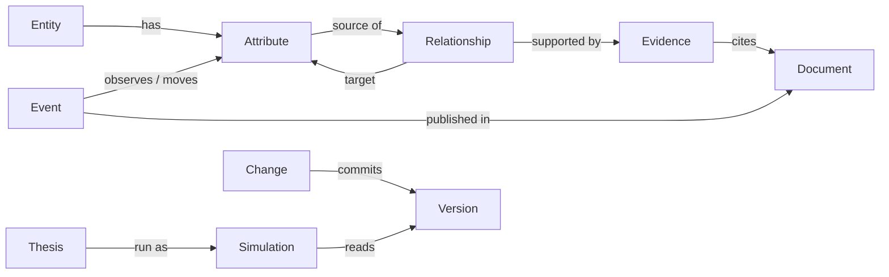

# World model API: data model first, API from the consumer's workflow

**Status:** decided Oct 18 (§9) and built as **v1**; revised after the API review with Manav on Oct 19 (§9): scopes
named `resource:action`, a read-only backend MCP, permanent idempotency keys, an audit log kept forever, every term
defined below, and the unified world model, `erid` (§4). The previous `/api/world-model` routes are retired, because nobody
had integrated them, so there is no compatibility layer. The contract is [../api/openapi.yaml](../api/openapi.yaml),
and the reference is [../api/](../api/README.md). Authentication follows [core-mcp-auth.md](core-mcp-auth.md).

**Ground truth:** Manav's *Data Model and API Design Best Practices*, Oct 18 (local copy). Each decision below names the
principle it follows. Its core principle: *design the data model around domain truths; design the API around how
consumers use those truths; keep both independent of implementation details.*

<!-- toc -->
**Contents**

- [Terms and acronyms](#terms-and-acronyms)
- [1. The three models](#1-the-three-models)
- [2. The domain model](#2-the-domain-model)
- [3. API conventions](#3-api-conventions)
- [4. Resources and routes](#4-resources-and-routes)
- [5. Workflow reads](#5-workflow-reads)
- [6. From document to committed version](#6-from-document-to-committed-version)
- [7. Terms, grounded](#7-terms-grounded)
- [8. The old routes to v1](#8-the-old-routes-to-v1)
- [9. Decisions](#9-decisions)
<!-- /toc -->

## Terms and acronyms

Every acronym, short field name and role used in the API, with its full name, meaning and an example. One source: the
contract's `info.x-terms` ([../api/openapi.yaml](../api/openapi.yaml)), rendered here, in
[../api/README.md](../api/README.md) and in [core-mcp-auth.md](core-mcp-auth.md) by `world_model/scripts/api/reference.py`.

<!-- terms:start -->
| Term | Full name | Meaning | Example |
|---|---|---|---|
| API | Application Programming Interface | The routes other programs call to use the world model. | `GET /v1/world-models` |
| v1 | version 1 of this API | The major version, in every path. Additive changes stay in v1; a breaking change is v2. | `/v1/…` |
| World model |  | One causal model: entities, their attributes, the relationships between attributes, its history and documents. An organization may own several. | `sally_demo` |
| erid | the unified world model (core's name for the world model state) | The whole graph, served beside the per-client world models. Its reads take a compartment; the whole graph is for internal staff. | `GET /v1/erid` |
| Compartment |  | A client's view of the unified world model: its companies, every player upstream of their values, and one link downstream (as a focused world is defined). | `sally_focus` |
| Organization (`org`) |  | Owns world models, documents and credentials: Axelrod or a client firm. It comes from the credential, never from the request. | `default`, `acme` |
| Internal staff |  | People and services of an internal organization (`WORLD_MODEL_INTERNAL_ORGS`). Only they read the whole unified world model. | Axelrod engineers |
| Person |  | A human, signed in to the web interface (a session) or named by a core-minted token without an agent. Only a person approves a change. | an analyst reviewing changes |
| Service |  | A program with a static key: the data-ingestion pipeline, a script. Never approves a change. | `ingest-pipeline` |
| Agent |  | An AI client acting for a person through MCP. Recorded in `act`; reads only. | Claude in core's MCP |
| Principal |  | The verified identity a request acts as: its kind, organization, subject, scopes and, for a token, `azp`, `act` and `jti`. | `{kind: token, org: acme, sub: org_user_9}` |
| `kind` | actor kind | How the principal was verified: `token` (core-minted), `key` (static), `session` (signed in here), `local` (an open local run), `system` (the engine itself). | `token` |
| Scope |  | A permission, named `resource:action` with three actions (read, create, approve), plus `admin`. | `changes:approve` |
| RBAC | Role-Based Access Control | Granting permissions by role. Here scopes are granted per credential; finer roles (approvers, admins) come later. |  |
| JWT | JSON Web Token (RFC 7519) | A signed set of claims. Core mints one per call as a service token. | `eyJhbGciOiJFUzI1NiIs…` |
| JSON | JavaScript Object Notation | The text format of every request and response body. | `{"data": …}` |
| JWKS | JSON Web Key Set (RFC 7517) | The issuer's public signing keys, by key id, at a URL this service fetches and caches. | `https://core…/.well-known/jwks.json` |
| ES256 | ECDSA using P-256 and SHA-256 (RFC 7518) | The only signature algorithm accepted on a service token. | header `alg: ES256` |
| ECDSA | Elliptic Curve Digital Signature Algorithm | The signature family ES256 belongs to. |  |
| `at+jwt` | OAuth 2.0 access token in JWT form (RFC 9068) | The `typ` header a service token must carry. | header `typ: at+jwt` |
| OAuth | Open Authorization (OAuth 2.0, RFC 6749) | The authorization framework whose access tokens a service token follows. |  |
| MCP | Model Context Protocol | The protocol AI clients use to call tools. Core runs an MCP server (its backend MCP); this service runs one at `/mcp`. | `world_model_get_entity` |
| `core-mcp`, `core-web` | core's channels | The part of core that asked, in a token's `azp`: its MCP server (reads only) or its web interface (a person). | `azp: core-web` |
| `iss` | issuer | Who minted the token; must be a trusted issuer. | `https://core.axelrod.ai` |
| `aud` | audience | Who the token is for: this service. | `https://world-model.axelrod.ai` |
| `sub` | subject | Who the token speaks for: the organization user (a person) or the key's caller. | `org_user_9` |
| `azp` | authorized party | The part of core that asked (OpenID Connect). | `core-mcp` |
| `act` | actor (RFC 8693) | The agent acting for the person, `{sub, name}`. A token with `act` reads only and never decides. | `{sub: mcp-client:claude}` |
| `jti` | JWT ID | A token's unique id: the join key between core's log and this audit log. | `5f1c…` |
| `exp`, `iat`, `nbf` | expiration time, issued at, not before | A token's validity window, checked with 60 seconds of leeway. | `exp` = issue + 5 minutes |
| `kid` | key ID | Which key of the JWKS signed the token. | `core-2026-10` |
| TTL | time to live | How long something is kept before it expires. Idempotency keys and the audit log have none: they are kept forever. | the JWKS cache: 10 minutes |
| RFC | Request for Comments | An Internet standard published by the IETF (Internet Engineering Task Force). | RFC 9457 |
| RFC 9457 | Problem Details for HTTP APIs | The error format: `application/problem+json` with `type`, `title`, `status`, `detail`, `instance`, and our `code`. | `404 entity_not_found` |
| HTTP | Hypertext Transfer Protocol | The protocol of every call. Status codes used: 200 OK, 201 Created, 202 Accepted, 204 No Content, 304 Not Modified, 4xx client errors, 5xx server errors. | `202 Accepted` |
| ETag | entity tag (RFC 9110) | An opaque version identifier of a response; here the model's state hash. Under review (Manav). | `"9c1f…"` |
| If-Match, If-None-Match | conditional request headers (RFC 9110) | If-Match: act only if the model is still at this ETag (412 if it moved; 428 without it). If-None-Match: 304 if unchanged. Under review (Manav). | `If-Match: "9c1f…"` |
| Idempotency-Key |  | A client's key that makes a create safe to retry: the same key and request return the first answer. Kept forever. | `Idempotency-Key: upload-42` |
| Cursor |  | An opaque position in a list, returned as `meta.next_cursor`; it keeps the version it started on. | `eyJvIjo1MCwidiI6M30` |
| Job |  | Long work answered `202 Accepted` with a job to poll. | `job_8f2a…` |
| `traceparent` | W3C Trace Context header | Distributed-tracing context, accepted and echoed. W3C is the World Wide Web Consortium. | `00-4bf9…-00f0…-01` |
| OpenAPI | the OpenAPI Specification 3.1 | The machine-readable contract of this API, world_model/docs/api/openapi.yaml. |  |
| CRUD | create, read, update, delete | The plain operations; actions that are not CRUD create a resource instead. | `POST …/approvals` |
| Lakehouse catalog |  | The service's store of documents, chunks, bundles, the registry, the audit log, idempotency keys and jobs (SQLite). |  |
| Bitemporal |  | Two times on every fact: when it applies (`valid_at`) and when the model learned it (`observed_at`). |  |
| sd | standard deviation | The unit of an effect size: a move in the target, in its standard deviations, per standard deviation of the source. | `effect: 0.4` |
| LLM | large language model | An optional extraction step in ingestion. |  |
<!-- terms:end -->

## 1. The three models

*Separate domain, storage and API models.* Each serves one purpose. Today the service mostly serializes the domain
model, and v1 ends that: `world_model/src/axelrod_wm/api/v1/schemas.py` holds the API models and `project.py` maps the domain onto them.

| Layer | What it is | Here |
|---|---|---|
| **API model** | Shapes for consumers and their workflows | `EntityResponse`, `SimulationResponse`, `ImpactAnalysisResponse` (OpenAPI components) |
| **Domain model** | Business concepts, invariants and rules | `Entity`, `Subentity`, `Interaction`, `Composition`, `Transition`, `Forecast` (world_model/src/axelrod_wm/model) |
| **Persistence model** | Snapshots, the lakehouse catalog, indexes | content-addressed snapshots, SQLite catalog, FTS5 and vector indexes |

The world model is a *substrate* for agents. Agents produce theses, simulations and proposed changes that reference
world-model objects. They never rewrite those objects as established fact: a change becomes fact only when a person
approves it.

## 2. The domain model

*One definition each of Event, Entity, Relationship, Evidence, Thesis and Simulation, each with its own identity
and lifecycle.*

| Object | Identity | Key fields | Lifecycle |
|---|---|---|---|
| **Entity** | stable internal id (`toyota`), never a ticker | `type` (enum below), `name`, `aliases`, `identifiers` (ticker, ISIN, …), `concept_ids`, `group_ids` | created and retired by approved changes |
| **Attribute** | `{entity_id}.{key}` | `unit`, `view`, `basis`, `period`, `family`; its observations and its state over time | as entity |
| **Observation** | content hash | `attribute_id`, `value`, **`valid_at`** (when it applies), **`observed_at`** (when we learned it), `evidence_id` | append-only |
| **Relationship** | stable id (`m29`, `ty-c-tariff-cost`) | `source_attribute_id`, `target_attribute_id`, `type` (causal, accounting, identity, stock_flow), `confidence` (existence, 0–1), `effect` (sd/sd, or `null` when uncalibrated), `calibration`, `sign`, `kernel`, `transition`, **`valid_from` / `valid_to`** | added, re-weighted and retired by approved changes; never deleted |
| **Evidence** | stable id | `relationship_id` or `attribute_id`, `document_id`, `location`, `passage` (local only), **`evidence_type`** (company_filing, guidance, broker_research, expert_call, news, data, client_model), **`epistemic_type`** (documented, guidance, broker, model, assumption, inferred), `published_at` | append-only |
| **Event** | content hash | `type` (data_release, filing, news, research, policy_decision), `published_at`, `ingested_at`, `document_id`, the operations it stands for | append-only |
| **Thesis** | stable id | a what-if question as hypothetical operations | created by people or agents |
| **Simulation** | stable id | `thesis_id`, `version`, `horizon_days`, targets, transmission, coverage, `status` | runs once; immutable after completion |
| **Change** | stable id | `bundle_id`, `item_id`, the operations, `base_version`, `status` (pending, approved, rejected), `decided_by`, `decided_at` | pending → approved (commits a version) or rejected |
| **Version** | number and `state_hash` | `as_of`, `clock`, `change_ids` | immutable |

Data-model principles, as applied:

| Principle | Applied |
|---|---|
| Stable identity | Internal ids; tickers live in `identifiers` |
| Referential integrity | Relationships name existing attributes; evidence names existing relationships and documents; validated on every change |
| Normalize first | Company metadata once on the entity; relationships and evidence as their own objects (an edge has many evidence records) |
| Denormalize for reads | Workflow reads (§5) are projections, recomputed per version |
| Explicit types | `Entity.type` ∈ {company, person, agency, market, macro_factor, external_factor, other} (lower snake case, like every enum in the contract; a security is a market, a sector a group); `Relationship.type`; `evidence_type`; `epistemic_type` |
| Temporal modeling | Bitemporal observations (`valid_at`, `observed_at`); relationships `valid_from` / `valid_to`; documents `published_at`, `ingested_at`; versions (what the model knew, when) |
| Provenance | Every relationship and observation traces to evidence: source document, location, timestamp, and the model version that recorded it |
| Constraints | Confidence in [0, 1]; effect `null` when uncalibrated (never 0); accounting and identity weights fixed; one driving view per total |
| Schema evolution | Expand → migrate → contract; new fields optional first |
| Facts kept apart from inferences | `epistemic_type` on every claim; theses and simulations never write facts; changes need a person |

## 3. API conventions

| Concern | Rule |
|---|---|
| Versioning | Major version in the path, `/v1/…`; a compatibility policy (additive changes within v1; breaking changes only in v2) |
| Resources | Plural nouns, kebab-case, no verbs. Actions that are not CRUD create a resource (`POST /theses/{id}/simulations`) |
| Methods | GET reads, POST creates, PATCH updates, DELETE removes (documents only; model objects are retired by changes) |
| Predictable responses | One shape: `{"data": …, "meta": {"version": {…}, "request_id": "…"}}`. A list's `data` is always an array, with `meta.next_cursor` |
| Pagination | Cursor-based: `?limit=50&cursor=…` on every collection |
| Filtering | Query parameters: `?type=COMPANY&concept=…`, `?source=…&calibration=uncalibrated` |
| Pinning | `?version=N` or `?as_of=T` on every read; `meta.version` names what was served |
| Errors | **RFC 9457 Problem Details** (`application/problem+json`): `type` (a stable URI per error), `title`, `status`, `detail`, `instance`, plus `code` and `errors` (per field). 400, 401, 403, 404, 409, 412, 413, 422 |
| Idempotency | **`Idempotency-Key`** on every POST that creates; a retry returns the first response. Keys are **permanent**: kept in the lakehouse catalog per organization, world model and operation, with no expiry, so they survive a restart (D-23). Document uploads and bundles are also keyed on their **content** (`content:<hash>`, header or not), so the same content always gets the same answer, whoever sends it and whenever. A failed request is not kept, so its retry runs again. Deleting a document forgets the answers that named it. Grouping several articles about one event under one key is left for later |
| Async | Long work returns **`202 Accepted`** with a `job` (`GET /v1/world-models/{id}/jobs/{job_id}`): ingesting documents, proposing changes, running simulations |
| Concurrency | **`ETag`** (entity tag) on versioned resources; `If-Match` on decisions (approving a change requires the version it was proposed on: `412` if the model moved). **Under review (Manav):** kept as built until his review |
| Observability | `X-Request-Id` on every response; W3C `traceparent` accepted and propagated |
| Authentication | Core-minted service tokens (ES256 JWTs, verified with core's JWKS), scoped static keys for backend services, and sessions for people ([core-mcp-auth.md](core-mcp-auth.md)) |
| Scopes | `resource:action`, one verb per action on every resource: `world_model:read`; `documents:create`, `changes:create`, `simulations:create`; `changes:approve` (a person only); and `admin`. Kept fine-grained; finer admin and approval roles come later |
| Access boundary | Only internal staff and backend services reach the world model (D-21). Core's backend MCP reads only: a `core-mcp` or `act` token holds `world_model:read`, whatever it asks. A static key with no scopes listed reads only. Writes come from the web interface (a person) and the data-ingestion pipeline (a key with `documents:create changes:create`) |
| Authorization | The organization comes from the credential, never from the request. A world model of another organization is `404`. A scope check on every route; a decision checks that a person decides before any scope |
| Audit | Every write records its actor (`kind`, `org`, `sub`, `name`, `azp`, `act`, `jti`). The log is **kept forever**: no route deletes it and nothing expires (D-22); `admin` reads it |
| Contracts | OpenAPI 3.1 written first (`world_model/docs/api/openapi.yaml`), JSON Schema validation of responses in tests, route parity both ways, and consumer contract tests (core's patch) |

## 4. Resources and routes

All paths below start with `/v1/world-models/{world_model_id}` (decision 1), except the unified world model's,
`/v1/erid` (the last table). The organization comes from the credential. The contract lists every route; the tables
here are its outline.

### Entities and attributes

| Route | Returns |
|---|---|
| `GET /entities?type=&concept=&group=&q=&limit=&cursor=` | entities; `q` searches names and aliases |
| `GET /entities/{entity_id}?include=attributes,relationships` | one entity; attributes nested by default |
| `GET /entities/{entity_id}/attributes` | its attributes |
| `GET /entities/{entity_id}/attributes/{key}` | one attribute: level, spread, unit, view, basis, and the latest observation |
| `GET /entities/{entity_id}/attributes/{key}/observations?valid_from=&valid_to=` | its dated observations (bitemporal) |
| `GET /entities/{entity_id}/attributes/{key}/states?from=&to=` | the model's state of it over time: trajectories for charts |
| `GET /entities/{entity_id}/compositions` / `{composition_id}` | its business views: parts, role (driving or reconciling), reconciliation |
| `GET /entities/{entity_id}/paths` / `{path_id}` | its named paths, each step a relationship with its transition |

### Relationships and evidence

| Route | Returns |
|---|---|
| `GET /relationships?source=&target=&entity=&type=&calibration=&valid_at=` | relationships |
| `GET /relationships/{relationship_id}` | one relationship: effect or `null`, sign, kernel, transition, validity |
| `GET /relationships/{relationship_id}/evidence` | its evidence records |
| `GET /evidence/{evidence_id}` | one record: document, location, `evidence_type`, `epistemic_type` |

### Events, documents and research

| Route | Returns or does |
|---|---|
| `GET /events?type=&published_from=&published_to=&entity=` | market events |
| `GET /events/{event_id}` | one event and its operations |
| `POST /documents` (multipart; `Idempotency-Key`) | `202` and a job: store, parse, chunk, index, read into a bundle |
| `GET /documents?published_from=&ingested_from=` / `{document_id}` | documents |
| `GET /documents/{document_id}/chunks` / `{chunk_id}` | passages and the names recognized in each |
| `GET /documents/{document_id}/content?format=text\|raw` | the extracted text, or the original |
| `POST /documents/{document_id}/bundles` | read again against the model as it is now |
| `DELETE /documents/{document_id}` | remove it; its events and changes stay as history |
| `POST /bundles` / `GET /bundles` / `{bundle_id}` / `{bundle_id}/items` | research read by an agent: dated items with signals |
| `GET /search?q=&mode=&scope=` | search over chunks and names |

### Changes and versions

| Route | Does |
|---|---|
| `POST /changes` with `{"bundle_id", "item_ids"?}` (`Idempotency-Key`) | proposes one change per item, in event-time order |
| `GET /changes?status=` / `{change_id}` / `{change_id}/diff` | changes; one; what approving it would do |
| `POST /changes/{change_id}/approvals` (`If-Match: "<version etag>"`) | approve: commits a version (`412` if the model moved) |
| `POST /changes/{change_id}/rejections` with `{"reason"}` | reject |
| `GET /versions` / `{version}` / `latest` | committed versions, each with the diff from the previous |

### Theses and simulations

| Route | Does or returns |
|---|---|
| `POST /theses` / `GET /theses` / `{thesis_id}` | what-if questions |
| `POST /theses/{thesis_id}/simulations` with `{"horizon_days", "version"?}` | `202` and a job: runs it (replaces `POST /forecasts`) |
| `GET /simulations/{simulation_id}` | targets with ranges, scenario table, status, the version it ran on |
| `GET /simulations/{simulation_id}/transmission` | the shock's path by order |
| `GET /simulations/{simulation_id}/coverage` | calculated and excluded relationships, blocking inputs, share quantified |

### The rest

| Route | Returns |
|---|---|
| `GET /concepts` / `{concept_id}` | the taxonomy |
| `GET /groups` / `{group_id}` | recurring configurations of entities (superentity instances) |
| `GET /exports/v4.1.4?version=&simulation=` | the model in the client's v4.1.4 format |
| `GET /jobs/{job_id}` | async work: status, result link, error |

### The unified world model: erid (built Oct 19)

Manav asked for a separate top-level resource for the unified world model, beside the per-client
`/v1/world-models/{id}`, which stays. The user named it **`erid`**. It is the analysis default of
[architecture-plan.md §4](../archive/architecture-plan.md#4-one-world-model-or-several) (D-20, proposed): one unified model,
served in compartments.

| Route | Returns |
|---|---|
| `GET /v1/erid` | the unified model: its scenario, the world model that backs it, version, clock, counts, compartment ids. Internal staff only (`403 internal_only`) |
| `GET /v1/erid/compartments` / `{compartment_id}` | the compartments this credential may read: each one's companies and size |
| `GET /v1/erid/entities`, `…/entities/{id}` and its attributes, observations, states, compositions, paths, construction and traces; `…/relationships` and evidence; `…/graph`; `…/versions` | the per-world-model reads of the graph, with an optional `compartment` that narrows them |

- **What backs it.** The main engine's world model, so nothing new is loaded: a deployment runs its fullest scenario
  there (`sally_demo` today, the closest to "everything"). `GET /v1/erid` names it as `world_model_id`. A configured
  unified scenario would be the alternative; it is not needed while one deployment has one fullest scenario.
- **Compartments.** Each scenario whose `focus.base` is the unified scenario is a compartment, named by its id
  (`sally_focus`: Toyota and Tokio Marine). A compartment narrows the live graph exactly as `engine/focus.py` narrows a
  focused world: the companies in scope, every player upstream of their values, and one link downstream. The contract
  test checks that the compartment's entities and relationships equal the focused scenario's. Because it narrows the
  live graph, what the unified model learns through review reaches every compartment it belongs to.
- **Access.** The whole graph is for internal staff: an organization in `WORLD_MODEL_INTERNAL_ORGS` (default: the
  organization that owns the backing world model). A compartment is read by internal staff, or by the organization it
  is assigned to in `WORLD_MODEL_COMPARTMENTS` (`compartment=org`). To anyone else it does not exist (`404
  compartment_not_found`).
- **Scopes and audit** are the per-world-model ones: reads need `world_model:read`. Writes are not mirrored: they go
  through the backing world model's own routes (`/v1/world-models/{world_model_id}/…`), with its review and its audit
  log, and so land in the unified graph.
- **Not mirrored yet:** concepts and groups, the export, documents, events, changes, theses and simulations. Each is
  read on the backing world model; a compartment of each comes when a client needs it.

## 5. Workflow reads

*Keep canonical resources reusable, and add workflow-oriented reads where they cut complexity and latency.* Each read
below is a projection, recomputed for a version, that saves a consumer many requests.

| Route | For | Returns |
|---|---|---|
| `GET /events/{event_id}/impact-analysis` | "what did this news do?" (the UI, Kedar's harness) | `impacts`: entity, attribute, direction, size or `null`, confidence, `causal_path_ids`; `model_version` |
| `GET /entities/{entity_id}/traces?from={attribute}&through_totals=` | "how does X reach this company?" (was `/construction/{id}/trace`) | every route to the company's accounts, with uncalibrated steps and stops named |
| `GET /simulations/{simulation_id}/brief` | a reader's summary | summary, timing, exposures, indicators, evidence |
| `GET /graph?entities=&attributes=&depth=` | an agent's context window (was `/query`) | a subgraph: entities with nested attributes, plus the relationships between them |

## 6. From document to committed version

Each step is a pure function of its inputs and the version it reads. Nothing changes the model before step 9.

| # | Step | Input → output | Stored | Seen at |
|---|---|---|---|---|
| 1 | Store | file → document (content hash) | bytes, once per organization | `documents/{id}` |
| 2 | Parse | document → text with pages, sheets and rows | text | `…/content` |
| 3 | Chunk | text → passages (a table row each) | chunks | `…/chunks` |
| 4 | Index | chunks → keyword and vector indexes | indexes | `search` |
| 5 | Recognize | chunks, plus names at version V → mentions | mentions | `…/chunks` |
| 6 | Extract | mentions + rules (+ optional LLM), relative to `published_at` → signals with quotes | — | bundle items |
| 7 | Bundle | signals → dated items | bundle (content hash) | `bundles/{id}/items` |
| 8 | Propose | item + V → a change (operations, evidence) applied to a copy of V | change, `pending` | `changes/{id}/diff` |
| 9 | Decide | a person approves (`If-Match` V) or rejects | decision, who, when | `changes/{id}` |
| 10 | Commit | approval → version V+1, with events, observations and evidence recorded | snapshot | `versions/{V+1}` |

The same file and the same version always give the same document, chunks, signals, bundle and change, and approving
gives the same `state_hash`. Late and historical documents follow `temporal-ingestion.md`: claims land at their
`valid_at` and are recorded at their `observed_at`.

## 7. Terms, grounded

| Term | Definition |
|---|---|
| **Organization** (was *tenant*) | Owns world models, documents and credentials: Axelrod, or a client firm. Never a user. Derived from the credential and enforced on every route. |
| **Caller** | Who acts within an organization: a person or a service. Recorded on every change and decision. A service acting for a person names them. |
| **World model** | One causal model, with its own entities, relationships, history and documents. An organization may hold several. |
| **Change** (was *proposal*) | One item's operations applied to a copy of a version: an uncommitted diff. Approval commits it as a version. |
| **Simulation** (was *forecast*) | A thesis run on a version. A hypothetical change that is never committed. |
| **Coverage** | Part of a simulation: what was calculated, what was excluded and why, and which inputs block it. |
| **Export** (was *context*) | A version (and optionally a simulation) in a client's format. A projection, not separate state. |
| **Composition, path, trace** (was *construction*) | An entity's business views, its named chains of relationships, and the computed routes to its accounts. |
| **Relationship** (model: *interaction*) | A directed causal or accounting relation between two attributes. |
| **Attribute** (model: *subentity*) | One of an entity's values. |

## 8. The old routes to v1

| Retired (`/api/world-model`) | v1 (`{wm}` = `/v1/world-models/{id}`) |
|---|---|
| `GET /state` | `GET /v1/me`, `GET {wm}` (latest version, clock, counts), `GET {wm}/versions` |
| `GET /query` | `GET {wm}/graph` |
| `GET /nodes?q=` | `GET {wm}/entities?q=` |
| `GET /entities/{id}`, `…/attributes/{key}` | `GET {wm}/entities/{id}`, `…/attributes`, `…/attributes/{key}`, plus `…/observations` and `…/states` |
| `GET /taxonomy` | `GET {wm}/concepts`, `GET {wm}/concepts/{id}`; groups at `GET {wm}/groups` |
| `GET /construction/{id}` (json, markdown) | `GET {wm}/entities/{id}/construction`, and the canonical `…/compositions` and `…/paths` |
| `GET /construction/{id}/trace?start=` (`through_totals`, `max_depth`) | `GET {wm}/entities/{id}/traces?from=` (the same two) |
| `GET /context/v4?forecast=` | `GET {wm}/exports/v4.1.4?simulation=` |
| edges inside `/query` | `GET {wm}/relationships`, `…/{id}`, `…/{id}/evidence`, `GET {wm}/evidence/{id}` |
| (none) | `GET {wm}/events`, `…/{id}`, `…/{id}/impact-analysis` |
| `POST /documents` (synchronous) | `POST {wm}/documents` → `202` and a job |
| `GET /documents`, `/documents/{id}` | `GET {wm}/documents`, `…/{id}` |
| `GET /documents/{id}/text`, `/raw` | `GET {wm}/documents/{id}/content?format=text\|raw` |
| `GET /documents/{id}/chunks` | `GET {wm}/documents/{id}/chunks`, `…/chunks/{ordinal}` |
| `POST /documents/{id}/extract` | `POST {wm}/documents/{id}/bundles` → `202` and a job |
| `DELETE /documents/{id}` | `DELETE {wm}/documents/{id}` (`admin`) → `204` |
| `POST /bundles`, `GET /bundles`, `/bundles/{id}` | `POST {wm}/bundles`, `GET {wm}/bundles`, `…/{id}`, `…/{id}/items` |
| `POST /bundles/{id}/import` (`review: queue\|auto`) | `POST {wm}/changes` → `202` and a job; `auto` is gone |
| `GET /proposals`, `POST …/approve`, `…/reject` | `GET {wm}/changes`, `…/{id}`, `…/{id}/diff`, `POST …/approvals` and `…/rejections` (`If-Match`, human only) |
| `GET /search` | `GET {wm}/search` |
| `POST /forecasts` (`question` or `thesis_id`) | `POST {wm}/theses` (`question` or `template_id`), then `POST {wm}/theses/{id}/simulations` → `202` and a job; ready theses at `GET {wm}/thesis-templates` |
| `GET /forecasts`, `/forecasts/{id}`, `/brief` | `GET {wm}/simulations`, `…/{id}`, `…/transmission`, `…/coverage`, `…/brief` |
| (none) | `GET {wm}/jobs/{id}`, `GET {wm}/audit-events` (`admin`) |
| `{"error": {"code", "message", "details"}}` | RFC 9457 problem details |
| `limit` and `offset` | cursors |
| `X-Axelrod-On-Behalf-Of` | removed: the person comes from the token |
| version in a header only | `/v1` in the path; the header stays |
| (none) | `GET /v1/erid`, `/v1/erid/compartments`, and the graph reads under `/v1/erid` with `compartment` (Oct 19) |
| scopes `read`, `documents:write`, `changes:write`, `simulations:write`, `changes:review` | `world_model:read`, `documents:create`, `changes:create`, `simulations:create`, `changes:approve` (Oct 19) |

The MCP tools follow the same nouns (`world_model_list_entities`, `world_model_get_relationship`,
`world_model_simulate`, `world_model_list_changes`, …; `world_model_id="erid"` reads the unified model), and the core
patch calls the v1 routes, reading only.

## 9. Decisions

Decided Oct 18.

1. **The world model is in the path:** `/v1/world-models/{id}/…`. It is explicit, and it allows several models per
   organization.
2. **The old API is retired, and this design becomes v1.** Nobody had integrated it, so it moved in one step, with no
   compatibility layer and no `/v2`.
3. **The API's nouns may differ from the code's.** The API says entity, attribute, relationship, evidence, event,
   thesis, simulation and change; the code keeps entity, subentity, interaction, market event, thesis, forecast and
   proposal. The three-model separation (§1) holds the line between them.
4. **Changes are approved per item.** A reviewer can accept part of a document.
5. **The OpenAPI spec is written in full first** ([../api/openapi.yaml](../api/openapi.yaml)), and the implementation
   is tested against it.

Built since, from [core-mcp-auth.md](core-mcp-auth.md): two security schemes (core-minted tokens and scoped static
keys) plus sessions; the `admin` scope; human-only decisions; `review: "auto"` removed; the `world_models` registry;
and an audit log of every write.

Decided Oct 19, in the API review with Manav ([architecture-plan.md](../archive/architecture-plan.md), D-20 to D-24), and built:

6. **Scopes are `resource:action`** with one verb per action: read, create, approve, plus `admin` (§3).
7. **Only internal staff and backend services reach the world model; core's backend MCP reads only** (D-21). Writes
   come from the web interface and the data-ingestion pipeline. The core patch publishes read tools only.
8. **The audit log is kept forever** (D-22): no deletion route, no expiry.
9. **Idempotency keys are permanent, and creation is also keyed on content** (D-23), in the lakehouse catalog. Jobs
   are kept there too, so a kept answer's job stays readable after a restart.
10. **Every term is defined** (the table at the top), and the roles and scopes use the same words everywhere.
11. **ETag and If-Match stay as built**, under Manav's review.
12. **The unified world model is `/v1/erid`**, with compartments (§4).

Not built yet:

- **Grouping articles about one event.** Several documents about one event could share an idempotency key; keys are
  per content today.
- **Jobs that outlive the request.** A job runs to completion before its `202` returns. The contract already makes
  clients poll, so moving the work to a queue changes no client.
- **`POST /v1/world-models` and credentials routes** (`admin`). World models are still configured per login.
- **Attribute states before a restart.** States come from each attribute's own history, which holds the newest 260.
