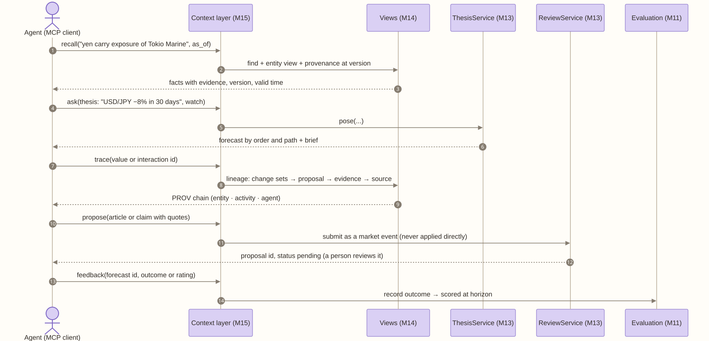

# M15 · Context layer

**Layer** 5 · **Package** `context/` · **Status** new. Pieces exist: `find`, briefs, the ledger, the import bundle, the v4 export (`context/v4.py`), and the outward API's v1 routes and MCP tools (`api/v1/`, `api/mcp.py`; [reference](../../api/README.md)).

<!-- toc -->
**Contents**

- [Purpose](#purpose)
- [Owns](#owns)
- [Interface](#interface)
- [Depends on](#depends-on)
- [Diagram](#diagram)
- [Invariants](#invariants)
- [Done when](#done-when)
<!-- /toc -->

## Purpose

How agents and analysts reach the world model, over MCP and REST. Through it they can:
- recall what the model knows, at a version and with provenance;
- ask a what-if question;
- trace where a number came from;
- propose something for it to learn, which a person reviews;
- give feedback on a forecast.

It is a layer *on* the model and holds no facts of its own. The verbs follow Cognee's; the provenance and time model follow Semantica's. **No verb writes without review** ([frameworks.md](../frameworks.md)). Recall uses the model's concept trees and analogs rather than a flat vector index, for the reasons in [cognition.md](../cognition.md).

## Owns

| Verb | Cognee analogue | Does | Reaches |
|---|---|---|---|
| `recall(query, as_of?, scope?)` | recall | Facts about entities, values, interactions, superentities, Entity memories, and episodes, each with evidence, version, and valid time | views; slot `context_retriever` |
| `ask(question, watch?, version?)` | none | Pose a thesis on a branch; return the forecast by order and path, and the brief | ThesisService |
| `trace(item_id, version?)` | provenance | The PROV chain | `provenance_view` |
| `propose(text or bundle item, quotes, confidence)` | remember | A market event, staged; **waits for a person** | UpdateService, ReviewService |
| `feedback(forecast_id, outcome or rating)` | improve | An outcome, scored at the horizon | Evaluation |
| `status(proposal_id)` | cognify_status | pending, approved, or rejected | ReviewService |

There is no `forget`. Retiring an item is a reviewed proposal, and history stays.

### Export in a client's own format (Oct 15)

Some clients' agents already load a world model of their own before they reason. `context/v4.py` exports ours in the v4.1.4 format one client's agents read: a numbered 03x domain pack loaded after their 000, 010, and 020, a registry entry for their 020, and evidence packs for the current state and each forecast, with a manifest of their load order, so the agents take our model as their context layer without changing. Their core contract files are named, never copied. The export adds what their schema lacks under an `axelrod` key on each edge: effect size, existence probability, timing, and evidence count. It grounds the agent and never concludes: no ratings, no sizing. `GET /api/context/v4[?forecast=<id>]`; the Agent context dialog shows it beside the card it fills ([demos.md](../../guides/demos.md#sallys-demo)).

```python
context_pack(wm, ltm, *, scenario_id, title, book, version, state_hash, forecast=None, explanation=None, pack_cfg=None) -> dict
# {"manifest", "domain_pack", "registry_entry", "evidence", "forecast"?}; pack_cfg from scenario.yaml context_pack
```

### The service, built (Oct 17)

The verbs are served now, over REST (`/v1/world-models/{id}/*`, [api/openapi.yaml](../../api/openapi.yaml)) and MCP (`/mcp`, 27 tools), with a service token or a scoped key per caller ([../../api/](../../api/README.md)). Read: `state`, `query` (pinned by `version` or `as_of`, Erid-compatible nodes and edges), `entities` and their `attributes`, `taxonomy`, `search` (RAG over ingested documents, below). Propose: upload files (`documents`) or bundles, then `import` them for review. Review: `proposals` approve and reject. Ask: `forecasts` and their briefs. Every answer names its state (`version`, `state_hash`). Code: `api/service.py`, `api/mcp.py`, `api/keys.py`. `recall` is `query` plus `search`; `trace` and `feedback` are not yet served.

Retrieval is the lakehouse's search (`lake/search.py`): keyword (BM25), prefix, semantic (bge-small), graph (named nodes, their neighbours, the chunks that mention them), and hybrid (reciprocal-rank fusion). See [pipeline.md](../../../../ingestion/docs/lake.md#search).

## Interface

```python
ContextLayer.recall(query, *, as_of=None, scope=None, k=20) -> list[Fact]
ContextLayer.ask(question | Thesis, *, watch=(), version=None) -> ForecastAnswer
ContextLayer.trace(item_id, *, version=None) -> Lineage
ContextLayer.propose(item | str, *, by, confidence=1.0) -> ProposalRef
ContextLayer.feedback(forecast_id, *, outcome=None, rating=None, by) -> None
ContextLayer.status(proposal_id) -> ProposalRef
class Fact: item_id, kind, text, value, version, valid_from, valid_to, recorded_at, evidence, trust_tier
```

Each MCP tool is one verb, and its schema is generated from these types.

**Slot:** `context_retriever`.
- **Default:** `find_plus_neighborhood`.
- **Planned:** `concept_tree` (F3), and `cognee_adapter`, which also recalls across an upstream research memory.
- **Models behind the verbs:** small embedders, classifiers, and decision models (typed, calibrated answers, Jev-type) first, a large LLM only as a logged fallback; the v4 export stays a deterministic mapping. See [../../ml/stack.md, Small models first](../../ml/stack.md#small-models-first).

## Depends on

[M13](M13-services.md), [M14](M14-interfaces.md), [M11](M11-evaluation.md).

## Diagram



## Invariants

- **Read freely; write only by proposal.**
- **Every fact carries a version, its evidence, and a recorded time.**
- **A login sees only its own engine.**
- **`ask` runs on a branch.**

## Done when

- Each verb has a contract test.
- An MCP smoke test passes: recall, ask, trace, then propose, and the proposal shows in Review as pending.
